# Codebase Mapping & Maintenance Control Reference (Cu Chi Tunnels Smart Audio Guide)

> **Status:** Active Single Source of Truth  
> **Scope:** Active `MVP/` Backend (FastAPI / SQLAlchemy 2.0 / MySQL 8.0) and Frontend (React 18 / Vite / Tailwind / Leaflet) wired into [`main.py`](../MVP/backend/app/main.py#L116) and [`App.jsx`](../MVP/frontend/src/App.jsx#L60)  
> **Conventions:** All links use relative paths from `documents/` (`../MVP/...#L...`) paired with exact symbol names. Unused 1-line stub modules and re-export wrappers are excluded.

---

## Global System Map

### G.1 Master Navigation Hub

| Subsystem / Domain | Component / Layer | Doc Section | Active Source File | Primary Responsibility |
|---|---|---|---|---|
| **Core Config** | Env & Settings | [Core](#core--shared-infrastructure) | [`config.py`](../MVP/backend/app/core/config.py#L38) | `Settings` singleton, bounds, rate limits, providers |
| **Core Config** | DB Engine | [G.6 Repo-to-DB](#g6-service-to-repository--repository-to-database-matrices) | [`database.py`](../MVP/backend/app/core/database.py#L21) | SQLAlchemy engine (`create_database_engine`), `get_db` |
| **Core Config** | DI Container | [Core](#core--shared-infrastructure) | [`dependencies.py`](../MVP/backend/app/core/dependencies.py#L34) | Composition root outside L1/L2/L3 |
| **Core Config** | Error Envelope | [Core](#core--shared-infrastructure) | [`exceptions.py`](../MVP/backend/app/core/exceptions.py#L21) | `ApiError` and unified `{success: false, error}` JSON |
| **Core Config** | Rate Limiter | [Core](#core--shared-infrastructure) | [`limiter.py`](../MVP/backend/app/core/limiter.py#L27) | `DynamicLimiter` and `@rate_limit` decorator |
| **Core Config** | FastAPI Entry | [Core](#core--shared-infrastructure) | [`main.py`](../MVP/backend/app/main.py#L116) | App factory, CORS, 14 routers, lifespan worker, `/health` |
| **Core Config** | React Router | [Core](#core--shared-infrastructure) | [`App.jsx`](../MVP/frontend/src/App.jsx#L60) | Lazy-loaded Visitor & Admin route registry |
| **Core Config** | HTTP Client | [Core](#core--shared-infrastructure) | [`apiClient.js`](../MVP/frontend/src/api/apiClient.js#L162) | Fetch wrapper (`credentials: 'include'`, `ApiError`) |
| **Packaging** | Containers | [Core](#core--shared-infrastructure) | [`docker-compose.yml`](../MVP/docker-compose.yml#L1) | App ([`Dockerfile.app`](../MVP/Dockerfile.app#L1)) & MySQL ([`Dockerfile.mysql`](../MVP/Dockerfile.mysql#L1)) |
| **1.0 Auth** | Views & Guard | [Module 1.0](#module-10-administrative-authentication--session-security-dfd-10--uc-02) | [`AdminLoginView.jsx`](../MVP/frontend/src/views/admin/AdminLoginView.jsx#L34) | Login form, [`AdminRouteGuard.jsx`](../MVP/frontend/src/components/admin/AdminRouteGuard.jsx#L15), [`AdminNavbar.jsx`](../MVP/frontend/src/components/admin/AdminNavbar.jsx#L9) |
| **1.0 Auth** | Context & Idle | [Module 1.0](#module-10-administrative-authentication--session-security-dfd-10--uc-02) | [`AuthContext.jsx`](../MVP/frontend/src/contexts/AuthContext.jsx#L23) | Admin auth state & [`useIdleTimer.js`](../MVP/frontend/src/hooks/useIdleTimer.js#L41) (30m timeout) |
| **1.0 Auth** | Controller & Service | [Module 1.0](#module-10-administrative-authentication--session-security-dfd-10--uc-02) | [`auth_controller.py`](../MVP/backend/app/controllers/auth_controller.py#L28) | `/login`, `/me`, `/logout` -> [`auth_service.py`](../MVP/backend/app/services/auth_service.py#L59) |
| **1.0 Auth** | Security & Data | [Module 1.0](#module-10-administrative-authentication--session-security-dfd-10--uc-02) | [`security.py`](../MVP/backend/app/core/security.py#L28) | Bcrypt + HS256 JWT, [`user_repository.py`](../MVP/backend/app/repositories/user_repository.py#L15), [`audit_repository.py`](../MVP/backend/app/repositories/audit_repository.py#L17) |
| **2.0 Catalog** | Views & Map Picker | [Module 2.0](#module-20-exhibition-catalog--spatial-geofence-management-dfd-20--uc-03) | [`PoiCatalogPage.jsx`](../MVP/frontend/src/views/admin/PoiCatalogPage.jsx#L20) | Catalog table, [`POIFormModal.jsx`](../MVP/frontend/src/components/admin/POIFormModal.jsx#L26), [`GeofenceCalibPage.jsx`](../MVP/frontend/src/views/admin/GeofenceCalibPage.jsx#L24), [`AdminMapPicker.jsx`](../MVP/frontend/src/components/admin/AdminMapPicker.jsx#L82) |
| **2.0 Catalog** | Controllers | [Module 2.0](#module-20-exhibition-catalog--spatial-geofence-management-dfd-20--uc-03) | [`poi_controller.py`](../MVP/backend/app/controllers/poi_controller.py#L26) | Public/Admin POI routes + [`admin_poi_controller.py`](../MVP/backend/app/controllers/admin_poi_controller.py#L26) |
| **2.0 Catalog** | Service & Repo | [Module 2.0](#module-20-exhibition-catalog--spatial-geofence-management-dfd-20--uc-03) | [`poi_service.py`](../MVP/backend/app/services/poi_service.py#L155) | Bounds validation, image checks, [`poi_repository.py`](../MVP/backend/app/repositories/poi_repository.py#L12) |
| **3.0 Translation** | Views & Player | [Module 3.0](#module-30-multilingual-translation--edge-tts-audio-pipeline-dfd-30--uc-04) | [`TranslationAuditView.jsx`](../MVP/frontend/src/views/admin/TranslationAuditView.jsx#L25) | Side-by-side audit ([`TranslationPage.jsx`](../MVP/frontend/src/views/admin/TranslationPage.jsx#L7)), [`AudioAuditPlayer.jsx`](../MVP/frontend/src/components/admin/AudioAuditPlayer.jsx#L11) |
| **3.0 Translation** | Controller & Service | [Module 3.0](#module-30-multilingual-translation--edge-tts-audio-pipeline-dfd-30--uc-04) | [`translation_controller.py`](../MVP/backend/app/controllers/translation_controller.py#L23) | Audit/publish/retry -> [`translation_service.py`](../MVP/backend/app/services/translation_service.py#L15), [`tts_service.py`](../MVP/backend/app/services/tts_service.py#L19) |
| **3.0 Translation** | Queue & Workers | [Module 3.0](#module-30-multilingual-translation--edge-tts-audio-pipeline-dfd-30--uc-04) | [`pipeline_queue.py`](../MVP/backend/app/services/pipeline_queue.py#L48) | Async queue, [`translation_pipeline_service.py`](../MVP/backend/app/services/translation_pipeline_service.py#L21), [`translation_worker.py`](../MVP/backend/app/services/translation_worker.py#L24), [`audio_synthesis_worker.py`](../MVP/backend/app/services/audio_synthesis_worker.py#L21) |
| **3.0 Translation** | AI & TTS Clients | [Module 3.0](#module-30-multilingual-translation--edge-tts-audio-pipeline-dfd-30--uc-04) | [`deep_translator_client.py`](../MVP/backend/app/integrations/deep_translator_client.py#L34) | Render + OpenRouter failover, [`edge_tts_client.py`](../MVP/backend/app/integrations/edge_tts_client.py#L43) |
| **4.0 Payment** | Modals & Context | [Module 4.0](#module-40-digital-admission-payment--24h-visitor-session-dfd-40--uc-06) | [`CheckoutModal.jsx`](../MVP/frontend/src/components/visitor/CheckoutModal.jsx#L72) | VietQR/PayPal checkout, [`RestoreSessionModal.jsx`](../MVP/frontend/src/components/visitor/RestoreSessionModal.jsx#L68), [`VisitorSessionContext.jsx`](../MVP/frontend/src/contexts/VisitorSessionContext.jsx#L88) |
| **4.0 Payment** | Controllers | [Module 4.0](#module-40-digital-admission-payment--24h-visitor-session-dfd-40--uc-06) | [`payment_controller.py`](../MVP/backend/app/controllers/payment_controller.py#L29) | Checkout/webhook/capture, [`session_controller.py`](../MVP/backend/app/controllers/session_controller.py#L13), [`audio_controller.py`](../MVP/backend/app/controllers/audio_controller.py#L15) |
| **4.0 Payment** | Services & Data | [Module 4.0](#module-40-digital-admission-payment--24h-visitor-session-dfd-40--uc-06) | [`payment_service.py`](../MVP/backend/app/services/payment_service.py#L44) | [`session_service.py`](../MVP/backend/app/services/session_service.py#L10), [`audio_service.py`](../MVP/backend/app/services/audio_service.py#L14), [`paypal_client.py`](../MVP/backend/app/integrations/paypal_client.py#L18) |
| **5.0 Map** | Views & Components | [Module 5.0](#module-50-interactive-map-gps-geofencing--osrm-wayfinding-dfd-50--uc-01) | [`VisitorTourPage.jsx`](../MVP/frontend/src/views/visitor/VisitorTourPage.jsx#L70) | Tour UI, [`VisitorMapView.jsx`](../MVP/frontend/src/views/visitor/VisitorMapView.jsx#L12), [`RouteOverlay.jsx`](../MVP/frontend/src/components/visitor/RouteOverlay.jsx#L34), [`QRCodePage.jsx`](../MVP/frontend/src/views/QRCodePage.jsx#L29) |
| **5.0 Map** | Hooks & Audio | [Module 5.0](#module-50-interactive-map-gps-geofencing--osrm-wayfinding-dfd-50--uc-01) | [`useGeofenceTrigger.js`](../MVP/frontend/src/hooks/useGeofenceTrigger.js#L29) | [`useGeolocation.js`](../MVP/frontend/src/hooks/useGeolocation.js#L29), [`cooldownService.js`](../MVP/frontend/src/services/cooldownService.js#L28), [`AudioPlayerContext.jsx`](../MVP/frontend/src/contexts/AudioPlayerContext.jsx#L19) |
| **5.0 Map** | Routing & Media | [Module 5.0](#module-50-interactive-map-gps-geofencing--osrm-wayfinding-dfd-50--uc-01) | [`tour_controller.py`](../MVP/backend/app/controllers/tour_controller.py#L12) | [`wayfinding_service.py`](../MVP/backend/app/services/wayfinding_service.py#L58) (OSRM + Haversine), [`media_controller.py`](../MVP/backend/app/controllers/media_controller.py#L15) |
| **6.0 Telemetry** | Dashboards | [Module 6.0](#module-60-operational-telemetry-density-heatmap--system-health-dfd-60--uc-05) | [`AnalyticsDashboard.jsx`](../MVP/frontend/src/views/admin/AnalyticsDashboard.jsx#L52) | KPIs, [`AnalyticsHeatmap.jsx`](../MVP/frontend/src/components/admin/AnalyticsHeatmap.jsx#L103), [`SystemHealthPage.jsx`](../MVP/frontend/src/views/admin/SystemHealthPage.jsx#L7) |
| **6.0 Telemetry** | Controllers & Services | [Module 6.0](#module-60-operational-telemetry-density-heatmap--system-health-dfd-60--uc-05) | [`analytics_controller.py`](../MVP/backend/app/controllers/analytics_controller.py#L27) | [`telemetry_controller.py`](../MVP/backend/app/controllers/telemetry_controller.py#L13), [`system_controller.py`](../MVP/backend/app/controllers/system_controller.py#L30), [`telemetry_service.py`](../MVP/backend/app/services/telemetry_service.py#L66), [`export_service.py`](../MVP/backend/app/services/export_service.py#L33), [`storage_service.py`](../MVP/backend/app/services/storage_service.py#L29) |

### G.2 Architecture, DFD Level 1 & Module Dependencies

```text
[ FRONTEND: React 18 / Vite / Tailwind / Leaflet ]
  ├── views/ (Routed pages in App.jsx) ──> components/ (admin/, visitor/)
  ├── contexts/ (Auth, VisitorSession, AudioPlayer) & hooks/ (Geolocation, Geofence, Polling, Idle)
  ├── locales/ (adminTranslations.js, visitorTranslations.js) & services/utils/
  └── api/ (apiClient.js + 11 domain API modules)
          │  HTTP REST / JSON / MP3 Stream
          ▼
[ BACKEND: FastAPI / SQLAlchemy 2.0 / MySQL 8.0 ]
  ├── main.py (CORS, /static guard, 14 routers, lifespan pipeline queue, /health)
  ├── controllers/ (Request parsing, Pydantic validation, auth guards, SlowAPI rate limits)
  ├── services/ (Business logic, PipelineQueueManager, translation & TTS workers)
  ├── integrations/ (DeepTranslatorClient, EdgeTTSClient, PayPalClient, StorageClient)
  ├── repositories/ (SQLAlchemy queries) ──> models/ & schemas/
  └── core/ (config, database, dependencies, exceptions, limiter, security, session_restore_rate_limit)
```

```mermaid
graph TD
    subgraph Client_Tier [Client Tier: React 18 + Vite]
        AdminPortal["Admin Portal (/admin/*)"]
        VisitorApp["Visitor PWA (/, /visitor, /qr)"]
    end

    subgraph API_Tier [API Tier: FastAPI Controllers]
        AuthCtrl["auth_controller.py"]
        PoiCtrl["poi_controller.py"]
        AdminPoiCtrl["admin_poi_controller.py"]
        TransCtrl["translation_controller.py"]
        AudioCtrl["audio_controller.py"]
        LangCtrl["language_controller.py"]
        TourCtrl["tour_controller.py"]
        PayCtrl["payment_controller.py"]
        SessCtrl["session_controller.py"]
        AnaCtrl["analytics_controller.py"]
        TelCtrl["telemetry_controller.py"]
        SysCtrl["system_controller.py"]
        MediaCtrl["media_controller.py"]
    end

    subgraph Service_Tier [Service & Worker Tier]
        AuthSvc["auth_service.py"]
        PoiSvc["poi_service.py"]
        TransSvc["translation_service.py"]
        PipeSvc["translation_pipeline_service.py"]
        PipeQ["pipeline_queue.py"]
        TransW["translation_worker.py"]
        AudioW["audio_synthesis_worker.py"]
        TtsSvc["tts_service.py"]
        AudioSvc["audio_service.py"]
        LangSvc["language_service.py"]
        WaySvc["wayfinding_service.py"]
        PaySvc["payment_service.py"]
        SessSvc["session_service.py"]
        TelSvc["telemetry_service.py"]
        ExpSvc["export_service.py"]
        StorSvc["storage_service.py"]
    end

    subgraph Integration_Tier [Integration Adapters]
        DeepTrans["deep_translator_client.py<br/>(Render + OpenRouter)"]
        EdgeTTS["edge_tts_client.py<br/>(Edge Neural TTS)"]
        PayPal["paypal_client.py<br/>(PayPal Orders V2)"]
        StorCli["storage_client.py<br/>(Supabase / Local Disk)"]
    end

    subgraph Repo_DB_Tier [Repositories & MySQL 8.0 Tables]
        UserRepo["UserRepository -> User"]
        AuditRepo["AuditRepository -> Audit"]
        PoiRepo["POIRepository -> POI"]
        TransRepo["TranslationRepository -> POITranslation"]
        AudioRepo["AudioRepository -> POITranslation (Audio cols)"]
        LangRepo["LanguageRepository -> LanguageCode"]
        TxnRepo["TransactionRepository -> Transaction"]
        SessRepo["SessionRepository -> VisitorSession"]
        TelRepo["TelemetryRepository -> POITrigger"]
    end

    AdminPortal --> AuthCtrl & PoiCtrl & AdminPoiCtrl & TransCtrl & AnaCtrl & SysCtrl & LangCtrl
    VisitorApp --> PoiCtrl & LangCtrl & TourCtrl & AudioCtrl & PayCtrl & SessCtrl & TelCtrl & MediaCtrl & SysCtrl

    AuthCtrl --> AuthSvc
    PoiCtrl --> PoiSvc
    AdminPoiCtrl --> PoiSvc
    TransCtrl --> TransSvc & TtsSvc
    AudioCtrl --> AudioSvc
    LangCtrl --> LangSvc
    TourCtrl --> WaySvc
    PayCtrl --> PaySvc
    SessCtrl --> SessSvc
    AnaCtrl --> TelSvc & ExpSvc
    TelCtrl --> TelSvc
    SysCtrl --> StorSvc
    MediaCtrl --> StorCli

    AuthSvc --> UserRepo & AuditRepo
    PoiSvc --> PoiRepo & AuditRepo & LangRepo & SessRepo & StorCli & PipeSvc
    TransSvc --> TransRepo & PoiRepo & AuditRepo & PipeSvc
    PipeSvc --> PipeQ & TransW & AudioW & LangRepo & PoiRepo
    TransW --> DeepTrans & TransRepo & PoiRepo
    AudioW --> EdgeTTS & AudioRepo & TransRepo & PoiRepo & StorCli
    TtsSvc --> EdgeTTS & AudioRepo & StorCli
    AudioSvc --> AudioRepo & SessRepo
    LangSvc --> LangRepo
    WaySvc --> PoiRepo
    PaySvc --> TxnRepo & SessRepo & PayPal
    SessSvc --> SessRepo
    TelSvc --> TelRepo
    ExpSvc --> TelRepo
    StorSvc --> AudioRepo & AuditRepo & PoiRepo
```



### G.3 Unified Navigation Index & Top-Level Folder Guide

| DFD | UC | Module | Domain Name | Owned / Read Tables | Section |
| :---: | :---: | :---: | :--- | :--- | :--- |
| **DFD 1.0** | **UC-02** | **Module 1.0** | Administrative Authentication & Session Security | `User`, `Audit` | [Jump](#module-10-administrative-authentication--session-security-dfd-10--uc-02) |
| **DFD 2.0** | **UC-03** | **Module 2.0** | Exhibition Catalog & Spatial Geofence Management | `POI`, `POITranslation`, `LanguageCode`, `Audit` | [Jump](#module-20-exhibition-catalog--spatial-geofence-management-dfd-20--uc-03) |
| **DFD 3.0** | **UC-04** | **Module 3.0** | Multilingual Translation & Edge-TTS Audio Pipeline | `POITranslation`, `LanguageCode`, `POI`, `Audit` | [Jump](#module-30-multilingual-translation--edge-tts-audio-pipeline-dfd-30--uc-04) |
| **DFD 4.0** | **UC-06** | **Module 4.0** | Digital Admission Payment & 24h Visitor Session | `Transaction`, `VisitorSession`, `POITranslation` | [Jump](#module-40-digital-admission-payment--24h-visitor-session-dfd-40--uc-06) |
| **DFD 5.0** | **UC-01** | **Module 5.0** | Interactive Map, GPS Geofencing & OSRM Wayfinding | `POI`, `POITranslation`, `LanguageCode`, `VisitorSession` | [Jump](#module-50-interactive-map-gps-geofencing--osrm-wayfinding-dfd-50--uc-01) |
| **DFD 6.0** | **UC-05** | **Module 6.0** | Operational Telemetry, Density Heatmap & System Health | `POITrigger`, `VisitorSession`, `POI`, `POITranslation`, `Audit` | [Jump](#module-60-operational-telemetry-density-heatmap--system-health-dfd-60--uc-05) |
| **Core** | **Core** | **Core** | Shared Routing, HTTP Client, DB, Security & Packaging | All 8 tables | [Jump](#core--shared-infrastructure) |

| Layer | Folder | Responsibility |
|---|---|---|
| **BE** | [`controllers/`](../MVP/backend/app/controllers) | HTTP endpoints, admin auth guards, SlowAPI rate limits, response models |
| **BE** | [`services/`](../MVP/backend/app/services) | Business rules, `PipelineQueueManager`, translation and TTS workers |
| **BE** | [`repositories/`](../MVP/backend/app/repositories) | SQLAlchemy queries and transactional writes to MySQL |
| **BE** | [`integrations/`](../MVP/backend/app/integrations) | External adapters: Render/OpenRouter, Edge-TTS, PayPal, Supabase Storage |
| **BE** | [`schemas/`](../MVP/backend/app/schemas) & [`models/`](../MVP/backend/app/models) | Pydantic validation DTOs and SQLAlchemy ORM entities |
| **BE** | [`core/`](../MVP/backend/app/core) | `.env` settings, DB pool, JWT/Bcrypt, `ApiError`, rate limiters, DI |
| **FE** | [`views/`](../MVP/frontend/src/views) | Lazy-loaded page views registered in [`App.jsx`](../MVP/frontend/src/App.jsx#L40) |
| **FE** | [`components/`](../MVP/frontend/src/components) | Reusable UI blocks under `admin/` and `visitor/` |
| **FE** | [`contexts/`](../MVP/frontend/src/contexts) & [`hooks/`](../MVP/frontend/src/hooks) | Global state (`Auth`, `VisitorSession`, `AudioPlayer`) and GPS/Geofence/Polling/Idle hooks |
| **FE** | [`api/`](../MVP/frontend/src/api) & [`locales/`](../MVP/frontend/src/locales) | REST wrappers over `apiClient.js` and UI translation dictionaries |

### G.4 Complete Atomic Feature Traceability Matrix

| ID | Feature Name | Layer 1: Frontend UI & State | Layer 2: Backend Logic & Gateway | Layer 3: Data Access & Schema | Active Test Files |
|---|---|---|---|---|---|
| **1.1** | Admin Login & Bcrypt Check | `AdminLoginView.jsx`, `authApi.js` | `auth_controller.py` (`POST /login`), `auth_service.py`, `security.py` | `user_repository.py`, `User`, `AdminLoginRequest` | [`test_auth_controller.py`](../MVP/backend/tests/unit/controllers/test_auth_controller.py#L1), [`AdminLoginView.test.jsx`](../MVP/frontend/src/views/admin/__tests__/AdminLoginView.test.jsx#L1) |
| **1.2** | HttpOnly JWT Cookie Issuance | `apiClient.js`, `AuthContext.jsx` | `auth_controller.py` (`set_cookie`), `security.py` | `config.py` (`ACCESS_TOKEN_EXPIRE_MINUTES=60`) | [`test_security.py`](../MVP/backend/tests/unit/core/test_security.py#L1), [`AuthContext.test.jsx`](../MVP/frontend/src/contexts/__tests__/AuthContext.test.jsx#L1) |
| **1.3** | Login Rate Limiting (5/min) | `AdminLoginView.jsx` | `limiter.py`, `auth_controller.py` | SlowAPI IP counter | [`test_limiter.py`](../MVP/backend/tests/unit/core/test_limiter.py#L1), [`test_auth_controller.py`](../MVP/backend/tests/unit/controllers/test_auth_controller.py#L1) |
| **1.4** | 5-Attempt Lockout (15 min) | `AccountLockoutModal.jsx` | `auth_service.py` (`MAX_FAILED_ATTEMPTS=5`) | `user_repository.py`, `User.Lockeduntil` | [`test_auth_service.py`](../MVP/backend/tests/unit/services/test_auth_service.py#L1), [`AccountLockoutModal.test.jsx`](../MVP/frontend/src/components/__tests__/AccountLockoutModal.test.jsx#L1) |
| **1.5** | Admin Profile & Navbar Greeting | `AdminNavbar.jsx`, `AdminRouteGuard.jsx` | `auth_controller.py` (`GET /me`), `dependencies.py` | `user_repository.py`, `AdminProfileResponse` | [`AdminNavbar.test.jsx`](../MVP/frontend/src/components/admin/__tests__/AdminNavbar.test.jsx#L1), [`AdminRouteGuard.test.jsx`](../MVP/frontend/src/components/admin/__tests__/AdminRouteGuard.test.jsx#L1) |
| **1.6** | Idle Timeout Auto-Logout (30m) | `AuthContext.jsx`, `useIdleTimer.js` | `config.py` (`IDLE_TIMEOUT_MINUTES=30`) | Browser activity listeners & `sessionStorage` | [`useIdleTimer.test.js`](../MVP/frontend/src/hooks/__tests__/useIdleTimer.test.js#L1) |
| **1.7** | Logout & Token Revocation Audit | `AdminNavbar.jsx`, `authApi.js` | `auth_controller.py` (`POST /logout`), `auth_service.py` | `audit_repository.py`, `Audit` (`ADMIN_LOGOUT`) | [`test_audit_repository.py`](../MVP/backend/tests/unit/repositories/test_audit_repository.py#L1) |
| **2.1** | Admin POI Paginated Catalog | `PoiCatalogPage.jsx`, `poiApi.js` | `poi_controller.py` (`GET /admin/pois`), `poi_service.py` | `poi_repository.py`, `POIListResponse` | [`PoiCatalogPage.test.jsx`](../MVP/frontend/src/views/admin/__tests__/PoiCatalogPage.test.jsx#L1), [`test_poi_controller.py`](../MVP/backend/tests/unit/controllers/test_poi_controller.py#L1) |
| **2.2** | Admin POI Search Filtering | `PoiCatalogPage.jsx` | `poi_controller.py`, `poi_service.py` | `poi_repository.py` (`ilike`) | [`test_poi_repository.py`](../MVP/backend/tests/unit/repositories/test_poi_repository.py#L1) |
| **2.3** | POI Detail Fetch & Edit Modal | `POIFormModal.jsx`, `poiApi.js` | `poi_controller.py` (`GET /admin/pois/{id}`) | `poi_repository.py`, `POIResponse` | [`POIFormModal.test.jsx`](../MVP/frontend/src/components/__tests__/POIFormModal.test.jsx#L1) |
| **2.4** | POI Creation & Foreign Seeding | `PoiCatalogPage.jsx`, `poiApi.js` | `poi_controller.py` (`POST /admin/pois`), `poi_service.py` | `poi_repository.py`, `POICreateRequest`, `POI`, `POITranslation` | [`test_poi_service.py`](../MVP/backend/tests/unit/services/test_poi_service.py#L1), [`test_poi_schema.py`](../MVP/backend/tests/unit/schemas/test_poi_schema.py#L1) |
| **2.5** | Cu Chi Bounds & Geofence Calib | `GeofenceCalibPage.jsx`, `AdminMapPicker.jsx` | `admin_poi_controller.py` (`PUT /{id}`), `poi_service.py` | `config.py` (`CU_CHI_BOUNDS`), `POI.Radius` (`10..50`) | [`GeofenceCalibPage.test.jsx`](../MVP/frontend/src/views/admin/__tests__/GeofenceCalibPage.test.jsx#L1), [`AdminMapPicker.test.jsx`](../MVP/frontend/src/components/admin/__tests__/AdminMapPicker.test.jsx#L1) |
| **2.6** | Cover Image Upload (5MB / Pillow) | `POIFormModal.jsx`, `poiApi.js` | `admin_poi_controller.py` (`POST /upload-image`), `poi_service.py` | `storage_client.py`, `/static/images` or Supabase | [`test_admin_poi_controller.py`](../MVP/backend/tests/unit/controllers/test_admin_poi_controller.py#L1) |
| **2.7** | POI Update & Stale Invalidation | `POIFormModal.jsx`, `adminPoiApi.js` | `admin_poi_controller.py` (`PUT /{id}`), `poi_service.py` | `poi_repository.py` (`POITranslation.Status='PENDING'`) | [`test_poi_service.py`](../MVP/backend/tests/unit/services/test_poi_service.py#L1) |
| **2.8** | Visibility Toggle (Active/Hidden) | `DeactivateConfirmModal.jsx` | `admin_poi_controller.py` (`PATCH /{id}/visibility`) | `poi_repository.py`, `POI.Is_Active` | [`DeactivateConfirmModal.test.jsx`](../MVP/frontend/src/components/admin/__tests__/DeactivateConfirmModal.test.jsx#L1) |
| **2.9** | Retry Failed POI Translations | `PoiCatalogPage.jsx`, `poiApi.js` | `admin_poi_controller.py` (`POST /{id}/retry-translations`) | `poi_repository.py`, `PipelineQueueManager` | [`test_admin_poi_controller.py`](../MVP/backend/tests/unit/controllers/test_admin_poi_controller.py#L1) |
| **2.10** | Visitor Active POIs & Paywall Mask | `VisitorTourPage.jsx`, `poiApi.js` | `poi_controller.py` (`GET /pois`, `GET /pois/{id}`) | `poi_service.py` (`_to_map_item`), `POIMapItem` | [`test_public_map_api.py`](../MVP/backend/tests/unit/test_public_map_api.py#L1) |
| **3.1** | Async Pipeline Queue & Recovery | Background on POI create/edit | `pipeline_queue.py`, `translation_pipeline_service.py` | `POITranslation` (`PENDING` recovery on startup) | [`test_pipeline_queue.py`](../MVP/backend/tests/unit/services/test_pipeline_queue.py#L1), [`test_translation_pipeline_service.py`](../MVP/backend/tests/unit/services/test_translation_pipeline_service.py#L1) |
| **3.2** | Render OPUS-MT Translation | Background worker | `translation_worker.py`, `deep_translator_client.py` | `translation_repository.py`, `POITranslation` | [`test_deep_translator_client.py`](../MVP/backend/tests/unit/integrations/test_deep_translator_client.py#L1) |
| **3.3** | OpenRouter Multi-Key Failover | Transparent fallback | `deep_translator_client.py`, `config.py` | `OPENROUTER_API_KEY` comma-separated pool | [`test_deep_translator_client.py`](../MVP/backend/tests/unit/integrations/test_deep_translator_client.py#L1) |
| **3.4** | Edge-TTS Dubbing & SHA-256 Dedup | Background synthesis | `audio_synthesis_worker.py`, `edge_tts_client.py` | `audio_repository.py`, `POITranslation` audio cols | [`test_edge_tts_client.py`](../MVP/backend/tests/unit/integrations/test_edge_tts_client.py#L1) |
| **3.5** | Translation Audit Grid & Filters | `TranslationAuditView.jsx`, `TranslationPage.jsx` | `translation_controller.py` (`GET /admin/translations`) | `translation_repository.py`, `TranslationListResponse` | [`TranslationAuditView.test.jsx`](../MVP/frontend/src/views/__tests__/TranslationAuditView.test.jsx#L1), [`test_translation_controller.py`](../MVP/backend/tests/unit/controllers/test_translation_controller.py#L1) |
| **3.6** | Manual Edit & Sync Guardrail | `TranslationAuditView.jsx`, `AudioSyncBadge.jsx` | `translation_controller.py` (`PUT /{id}`), `translation_service.py` | Forces `Status='NEEDS_UPDATE'` on text edit | [`test_translation_service.py`](../MVP/backend/tests/unit/services/test_translation_service.py#L1), [`AudioSyncBadge.test.jsx`](../MVP/frontend/src/components/__tests__/AudioSyncBadge.test.jsx#L1) |
| **3.7** | Translation Approval & Publish | `TranslationAuditView.jsx` | `translation_controller.py` (`POST /{id}/publish`) | Requires `audio.status='READY'`, sets `PUBLISHED` | [`test_translation_service.py`](../MVP/backend/tests/unit/services/test_translation_service.py#L1) |
| **3.8** | Manual Audio Regen & Audit Play | `RegenerateAudioButton.jsx`, `AudioAuditPlayer.jsx` | `translation_controller.py` (`POST /{id}/regenerate-audio`), `tts_service.py` | `audio_repository.py`, `StorageClient` | [`test_tts_service.py`](../MVP/backend/tests/unit/services/test_tts_service.py#L1), [`RegenerateAudioButton.test.jsx`](../MVP/frontend/src/components/__tests__/RegenerateAudioButton.test.jsx#L1) |
| **4.1** | Paywall Gate Blur Display | `ContentPaywallGate.jsx`, `VisitorSessionContext.jsx` | `poi_service.py` (`is_locked=None`) | `localStorage` session token | [`ContentPaywallGate.test.jsx`](../MVP/frontend/src/components/__tests__/ContentPaywallGate.test.jsx#L1) |
| **4.2** | Checkout Modal & VietQR/PayPal | `CheckoutModal.jsx`, `paymentApi.js` | `payment_controller.py` (`POST /create-checkout`), `payment_service.py` | `transaction_repository.py`, `Transaction`, `creator_token_hash` | [`CheckoutModal.test.jsx`](../MVP/frontend/src/components/__tests__/CheckoutModal.test.jsx#L1), [`test_payment_controller.py`](../MVP/backend/tests/unit/controllers/test_payment_controller.py#L1) |
| **4.3** | PayOS Webhook HMAC & Order Poll | `usePaymentPolling.js`, `CheckoutSuccessPage.jsx` | `payment_controller.py` (`/status`, `/webhook`, `/paypal-capture`) | `transaction_repository.py` (`mark_as_paid`) | [`usePaymentPolling.test.js`](../MVP/frontend/src/hooks/__tests__/usePaymentPolling.test.js#L1), [`test_payment_service.py`](../MVP/backend/tests/unit/services/test_payment_service.py#L1) |
| **4.4** | Payment Simulation (Dev Only) | `CheckoutModal.jsx` | `payment_controller.py` (`POST /simulate-success`, `/paypal-checkout`) | `config.py` (`is_payment_simulation_allowed`) | [`test_payment_controller.py`](../MVP/backend/tests/unit/controllers/test_payment_controller.py#L1) |
| **4.5** | Creator Token -> 24h Session | `usePaymentPolling.js`, `VisitorSessionContext.jsx` | `payment_controller.py` (`POST /order/{id}/session`) | `VisitorSession` (`CCT-XXXXXX`, `Expire_at=+24h`) | [`VisitorSessionContext.test.jsx`](../MVP/frontend/src/contexts/__tests__/VisitorSessionContext.test.jsx#L1) |
| **4.6** | Cross-Device Session Restore | `RestoreSessionModal.jsx`, `sessionApi.js` | `session_controller.py` (`POST /sessions/restore`), `session_restore_rate_limit.py` | `session_repository.py`, `SessionRestoreRequest` | [`RestoreSessionModal.test.jsx`](../MVP/frontend/src/components/visitor/__tests__/RestoreSessionModal.test.jsx#L1), [`test_session_controller.py`](../MVP/backend/tests/unit/controllers/test_session_controller.py#L1) |
| **4.7** | Gated Audio Streaming | `AudioPlayerContext.jsx`, `MiniAudioPlayer.jsx` | `audio_controller.py` (`GET /audio/{poi_id}`), `audio_service.py` | `audio_repository.py` (with `vi` fallback), `session_repository.py` | [`test_audio_controller.py`](../MVP/backend/tests/unit/controllers/test_audio_controller.py#L1), [`AudioPlayerContext.test.jsx`](../MVP/frontend/src/contexts/__tests__/AudioPlayerContext.test.jsx#L1) |
| **5.1** | Leaflet OSM Map & Markers | `VisitorMapView.jsx`, `VisitorPoiMarkers.jsx`, `VisitorLocationMarker.jsx` | `poi_controller.py` (`GET /pois`), `language_controller.py` | `museumBounds.js` (`MAIN_ENTRANCE`), `LanguageCode` | [`VisitorMapView.test.jsx`](../MVP/frontend/src/views/__tests__/VisitorMapView.test.jsx#L1), [`VisitorPoiMarkers.test.jsx`](../MVP/frontend/src/components/visitor/__tests__/VisitorPoiMarkers.test.jsx#L1) |
| **5.2** | GPS Watch & 10m Cooldown Engine | `useGeolocation.js`, `useGeofenceTrigger.js`, `cooldownService.js`, `haversine.js` | Client-side Haversine (`10m–50m`, default `30m`, `600s` lock) | `localStorage` (`poi_cooldown_*`) | [`useGeofenceTrigger.test.js`](../MVP/frontend/src/hooks/__tests__/useGeofenceTrigger.test.js#L1), [`cooldownService.test.js`](../MVP/frontend/src/services/__tests__/cooldownService.test.js#L1) |
| **5.3** | OSRM Walking Route & Overlay | `RouteOverlay.jsx`, `tourApi.js`, `PoiPreviewCard.jsx` | `tour_controller.py` (`GET /tour/route`), `wayfinding_service.py` | OSRM Foot HTTP (`0.8s` timeout) + Haversine fallback | [`test_wayfinding_service.py`](../MVP/backend/tests/unit/services/test_wayfinding_service.py#L1), [`RouteOverlay.test.jsx`](../MVP/frontend/src/components/visitor/__tests__/RouteOverlay.test.jsx#L1) |
| **5.4** | Cover Image Proxy & Guard | `PoiPreviewCard.jsx` | `media_controller.py` (`GET /media/poi-images/{filename}`), `main.py` | `StorageClient` (local or Supabase) | [`test_media_controller.py`](../MVP/backend/tests/unit/controllers/test_media_controller.py#L1) |
| **5.5** | Entrance QR Kiosk (`/qr`) | `QRCodePage.jsx`, `systemApi.js` | `system_controller.py` (`GET /system/public-config`), `config.py` | `resolve_base_url()` (`BASE_URL` / `CLOUDFLARE_TUNNEL_URL`) | [`QRCodePage.test.jsx`](../MVP/frontend/src/views/__tests__/QRCodePage.test.jsx#L1), [`test_system_controller.py`](../MVP/backend/tests/unit/controllers/test_system_controller.py#L1) |
| **6.1** | Telemetry Ping Ingestion | `VisitorTourPage.jsx`, `telemetryApi.js` | `telemetry_controller.py` (`POST /telemetry/trigger`), `telemetry_service.py` | `telemetry_repository.py`, `POITrigger` | [`test_telemetry_controller.py`](../MVP/backend/tests/unit/controllers/test_telemetry_controller.py#L1), [`test_telemetry_service.py`](../MVP/backend/tests/unit/services/test_telemetry_service.py#L1) |
| **6.2** | Admin KPIs & Density Heatmap | `AnalyticsDashboard.jsx`, `AnalyticsHeatmap.jsx`, `analyticsApi.js` | `analytics_controller.py` (`/summary`, `/heatmap`), `telemetry_service.py` | `telemetry_repository.py`, `HeatmapDataDTO` | [`AnalyticsDashboard.test.jsx`](../MVP/frontend/src/views/__tests__/AnalyticsDashboard.test.jsx#L1), [`test_analytics_controller.py`](../MVP/backend/tests/unit/controllers/test_analytics_controller.py#L1) |
| **6.3** | UTF-8 BOM CSV / JSON Export | `AnalyticsExport.jsx`, `analyticsApi.js` | `analytics_controller.py` (`GET /export`), `export_service.py` | `telemetry_repository.py` (`query_export_telemetry`) | [`test_export_controller.py`](../MVP/backend/tests/unit/controllers/test_export_controller.py#L1), [`test_export_service.py`](../MVP/backend/tests/unit/services/test_export_service.py#L1) |
| **6.4** | Storage Quota & Orphan Cleanup | `SystemHealthPage.jsx`, `StorageHealthBanner.jsx`, `CleanOrphansModal.jsx` | `system_controller.py` (`/health`, `/clean-orphans`), `storage_service.py` | `85% / 95%` of `1 GB`, `Audit` (`ADMIN_STORAGE_CLEANED`) | [`SystemHealthPage.test.jsx`](../MVP/frontend/src/views/admin/__tests__/SystemHealthPage.test.jsx#L1), [`test_storage_service.py`](../MVP/backend/tests/unit/services/test_storage_service.py#L1) |
| **6.5** | Server Liveness Probe | Docker / Render probe | `main.py` (`GET /health`) | Returns `{"status": "ok", "service": ...}` | [`test_main.py`](../MVP/backend/tests/unit/test_main.py#L1) |

### G.5 API-to-Service Mapping Matrix (Verified from `main.py` Routers)

| Domain | Verb | Endpoint Path | Auth Gate | Rate Limit | Controller -> Service Method | Response Schema |
|---|---|---|---|---|---|---|
| **1.0 Auth** | `POST` | `/api/v1/auth/login` | Public | `5/minute` | `auth_controller.py` -> `AuthService.authenticate_admin` | `AdminSessionResponse` |
| **1.0 Auth** | `GET` | `/api/v1/auth/me` | Admin Cookie | Default | `auth_controller.py` -> `get_current_admin_profile` | `AdminSessionResponse` |
| **1.0 Auth** | `POST` | `/api/v1/auth/logout` | Admin Cookie | Default | `auth_controller.py` -> `AuthService.logout_admin` | `AdminLogoutResponse` |
| **2.0 Catalog** | `GET` | `/api/v1/pois` | Public | `60/minute` | `poi_controller.py` -> `POIService.list_map_pois` | `APIResponse[list[POIMapItem]]` |
| **2.0 Catalog** | `GET` | `/api/v1/pois/{poi_id}` | Public | Default | `poi_controller.py` -> `POIService.get_visitor_poi_detail` | `APIResponse[POIMapItem]` |
| **2.0 Catalog** | `POST` | `/api/v1/admin/pois` | Admin Cookie | Default | `poi_controller.py` -> `POIService.create_new_poi` | `POIResponse` |
| **2.0 Catalog** | `GET` | `/api/v1/admin/pois` | Admin Cookie | Default | `poi_controller.py` -> `POIService.list_pois` | `POIListResponse` |
| **2.0 Catalog** | `GET` | `/api/v1/admin/pois/{poi_id}` | Admin Cookie | Default | `poi_controller.py` -> `POIService.get_poi_details` | `POIResponse` |
| **2.0 Catalog** | `PUT` | `/api/v1/admin/pois/{poi_id}` | Admin Cookie | Default | `admin_poi_controller.py` -> `POIService.update_poi` | `POIUpdateResponse` |
| **2.0 Catalog** | `POST` | `/api/v1/admin/pois/upload-image` | Admin Cookie | `10/minute` | `admin_poi_controller.py` -> `POIService.save_cover_image` | `{"image_url": str}` |
| **2.0 Catalog** | `PATCH` | `/api/v1/admin/pois/{poi_id}/visibility` | Admin Cookie | Default | `admin_poi_controller.py` -> `POIService.set_poi_visibility` | `POIResponse` |
| **2.0 Catalog** | `POST` | `/api/v1/admin/pois/{poi_id}/retry-translations` | Admin Cookie | Default | `admin_poi_controller.py` -> `POIService.retry_poi_translations` | `POIRetryTranslationResponse` |
| **3.0 Trans** | `GET` | `/api/v1/languages` | Public | Default | `language_controller.py` -> `LanguageService.list_published` / `list_all` | `APIResponse[list[PublishedLanguage]]` |
| **3.0 Trans** | `GET` | `/api/v1/admin/translations` | Admin Cookie | Default | `translation_controller.py` -> `TranslationService.list_translations` | `TranslationListResponse` |
| **3.0 Trans** | `GET` | `/api/v1/admin/translations/{id}` | Admin Cookie | Default | `translation_controller.py` -> `TranslationService.get_translation_by_id` | `TranslationResponse` |
| **3.0 Trans** | `PUT` | `/api/v1/admin/translations/{id}` | Admin Cookie | Default | `translation_controller.py` -> `TranslationService.update_translation` | `TranslationResponse` |
| **3.0 Trans** | `POST` | `/api/v1/admin/translations/{id}/regenerate-audio` | Admin Cookie | `3/minute` | `translation_controller.py` -> `TTSService.regenerate_audio` | `AudioRegenerationResponse` |
| **3.0 Trans** | `POST` | `/api/v1/admin/translations/{id}/publish` | Admin Cookie | Default | `translation_controller.py` -> `TranslationService.publish_translation` | `TranslationResponse` |
| **3.0 Trans** | `POST` | `/api/v1/admin/translations/{id}/retry` | Admin Cookie | Default | `translation_controller.py` -> `TranslationService.retry_translation` | `TranslationResponse` |
| **4.0 Payment** | `POST` | `/api/v1/payments/create-checkout` | Public | `5/minute` | `payment_controller.py` -> `PaymentService.create_checkout_order` | `CheckoutCreateResponse` |
| **4.0 Payment** | `GET` | `/api/v1/payments/order/{order_id}/status` | Public | `30/minute` | `payment_controller.py` -> `PaymentService.get_order_status` | `OrderStatusResponse` |
| **4.0 Payment** | `POST` | `/api/v1/payments/order/{order_id}/simulate-success` | Dev/Sim Flag | Default | `payment_controller.py` -> `PaymentService.simulate_payment_success` | `OrderSessionResponse` |
| **4.0 Payment** | `POST` | `/api/v1/payments/webhook` | PayOS HMAC | Unlimited | `payment_controller.py` -> `PaymentService.process_payment_webhook` | `WebhookResponse` |
| **4.0 Payment** | `GET` | `/api/v1/payments/paypal-checkout` | Dev/Sim Flag | Default | `payment_controller.py` -> HTML mock PayPal page | `HTMLResponse` |
| **4.0 Payment** | `GET` | `/api/v1/payments/paypal/confirm-mock` | Dev/Sim Flag | Default | `payment_controller.py` -> `PaymentService.simulate_payment_success` | `RedirectResponse` |
| **4.0 Payment** | `POST` | `/api/v1/payments/order/{order_id}/session` | Creator Token | `10/minute` | `payment_controller.py` -> `PaymentService.exchange_order_session` | `OrderSessionResponse` |
| **4.0 Payment** | `POST` | `/api/v1/payments/order/{order_id}/paypal-capture` | Creator Token | Default | `payment_controller.py` -> `PaymentService.capture_paypal_order` | `OrderSessionResponse` |
| **4.0 Payment** | `POST` | `/api/v1/sessions/restore` | Public | IP+Code Limiter | `session_controller.py` -> `SessionService.restore_session` | `SessionRestoreResponse` |
| **4.0 Payment** | `GET` | `/api/v1/audio/{poi_id}` (alias `/stream/{poi_id}`) | 24h Session | `20/minute` | `audio_controller.py` -> `AudioService.get_audio_source_for_poi` | `FileResponse` / `307` |
| **5.0 Map** | `GET` | `/api/v1/tour/route` | Public | `10/minute` | `tour_controller.py` -> `WayfindingService.calculate_walking_route` | `RouteResponse` |
| **5.0 Map** | `GET` | `/api/v1/media/poi-images/{filename}` | Public | Default | `media_controller.py` -> `StorageClient.download_file` / disk | `Response` / `FileResponse` |
| **5.0 Map** | `GET` | `/api/v1/system/public-config` | Public | Default | `system_controller.py` -> `resolve_base_url` | `PublicConfigResponse` |
| **6.0 Telem** | `POST` | `/api/v1/telemetry/trigger` | Public | `20/minute` | `telemetry_controller.py` -> `TelemetryService.ingest_trigger` | `TelemetryTriggerResponse` |
| **6.0 Telem** | `GET` | `/api/v1/admin/analytics/summary` | Admin Cookie | Default | `analytics_controller.py` -> `TelemetryService.get_analytics_summary` | `AnalyticsSummaryResponse` |
| **6.0 Telem** | `GET` | `/api/v1/admin/analytics/heatmap` | Admin Cookie | Default | `analytics_controller.py` -> `TelemetryService.get_heatmap_data` | `HeatmapResponse` |
| **6.0 Telem** | `GET` | `/api/v1/admin/analytics/export` | Admin Cookie | Default | `analytics_controller.py` -> `ExportService.stream_csv` / `stream_json` | `StreamingResponse` |
| **6.0 System** | `GET` | `/api/v1/admin/system/health` | Admin Cookie | Default | `system_controller.py` -> `StorageService.get_system_health` | `SystemHealthResponse` |
| **6.0 System** | `POST` | `/api/v1/admin/storage/clean-orphans` | Admin Cookie | `1/5minute` | `system_controller.py` -> `StorageService.prune_orphaned_audio_files` | `CleanOrphansResponse` |
| **6.0 System** | `GET` | `/health` | Public | Default | `main.py` (`health_check`) | `{"status": "ok"}` |

### G.6 Service-to-Repository & Repository-to-Database Matrices

| Service Class | Primary Repositories | External Clients | Mutations Performed |
|---|---|---|---|
| [`AuthService`](../MVP/backend/app/services/auth_service.py#L59) | `UserRepository`, `AuditRepository` | None | Updates `FalsedAttempts`/`Lockeduntil`, logs login/logout audits |
| [`POIService`](../MVP/backend/app/services/poi_service.py#L155) | `POIRepository`, `AuditRepository`, `LanguageRepository`, `SessionRepository` | `StorageClient` | Inserts/updates `POI`, seeds/invalidates `POITranslation`, logs audit |
| [`TranslationService`](../MVP/backend/app/services/translation_service.py#L15) | `TranslationRepository`, `AuditRepository`, `POIRepository` | None | Updates draft text (`NEEDS_UPDATE`), sets `PUBLISHED`, queues retry |
| [`TranslationPipelineService`](../MVP/backend/app/services/translation_pipeline_service.py#L21) | `TranslationRepository`, `LanguageRepository`, `POIRepository`, `AudioRepository` | `DeepTranslatorClient`, `EdgeTTSClient` | Orchestrates VI TTS + Render wake-up + per-language jobs |
| [`TranslationWorker`](../MVP/backend/app/services/translation_worker.py#L24) | `TranslationRepository`, `POIRepository` | `DeepTranslatorClient` | Translates `PENDING` rows to `DRAFT` or marks `FAILED` |
| [`AudioSynthesisWorker`](../MVP/backend/app/services/audio_synthesis_worker.py#L21) | `AudioRepository`, `TranslationRepository`, `POIRepository` | `EdgeTTSClient`, `StorageClient` | Generates MP3, uploads media, updates audio metadata on `POITranslation` |
| [`TTSService`](../MVP/backend/app/services/tts_service.py#L19) | `AudioRepository` | `EdgeTTSClient`, `StorageClient` | Regenerates MP3 on demand and restores `DRAFT` if `NEEDS_UPDATE` |
| [`AudioService`](../MVP/backend/app/services/audio_service.py#L14) | `AudioRepository`, `SessionRepository` | None | Validates 24h session and resolves audio path/CDN URL |
| [`LanguageService`](../MVP/backend/app/services/language_service.py#L20) | `LanguageRepository` | None | Read-only catalog and published language filtering |
| [`WayfindingService`](../MVP/backend/app/services/wayfinding_service.py#L58) | `POIRepository` | OSRM Foot HTTP API | Read-only coordinate routing and GeoJSON line construction |
| [`PaymentService`](../MVP/backend/app/services/payment_service.py#L44) | `TransactionRepository`, `SessionRepository` | `PayPalClient`, PayOS HTTP | Creates `Transaction`, verifies webhook/capture, creates `VisitorSession` |
| [`SessionService`](../MVP/backend/app/services/session_service.py#L10) | `SessionRepository` | None | Normalizes `CCT-` codes, checks 24h expiry, validates tokens |
| [`TelemetryService`](../MVP/backend/app/services/telemetry_service.py#L66) | `TelemetryRepository` | None | Inserts `POITrigger` (auto-creating guest session if omitted), aggregates KPIs |
| [`ExportService`](../MVP/backend/app/services/export_service.py#L33) | `TelemetryRepository` | None | Streams UTF-8 BOM CSV and JSON records |
| [`StorageService`](../MVP/backend/app/services/storage_service.py#L29) | `AudioRepository`, `AuditRepository`, `POIRepository` | None | Measures disk usage against 1 GB quota, deletes unreferenced MP3s |

| Repository Class | ORM Model | MySQL 8.0 Table | Foreign Key References & Delete Rules ([`mysql_schema.sql`](../MVP/backend/scripts/mysql_schema.sql#L23)) |
|---|---|---|---|
| [`UserRepository`](../MVP/backend/app/repositories/user_repository.py#L15) | [`User`](../MVP/backend/app/models/user.py#L17) | `User` | Primary admin entity (parent of `Audit`, `POI`, `POITranslation`) |
| [`AuditRepository`](../MVP/backend/app/repositories/audit_repository.py#L17) | [`Audit`](../MVP/backend/app/models/audit.py#L28) | `Audit` | `UserName` -> `User(UserName)` (`ON DELETE RESTRICT`) |
| [`LanguageRepository`](../MVP/backend/app/repositories/language_repository.py#L13) | [`LanguageCode`](../MVP/backend/app/models/language.py#L9) | `LanguageCode` | Catalog (`vi`, `en`, `ja`, `ko`, `zh`, `fr`) |
| [`POIRepository`](../MVP/backend/app/repositories/poi_repository.py#L12) | [`POI`](../MVP/backend/app/models/poi.py#L22) | `POI` | `Create_by` -> `User(UserName)` (`ON DELETE SET NULL`) |
| [`TranslationRepository`](../MVP/backend/app/repositories/translation_repository.py#L9) | [`POITranslation`](../MVP/backend/app/models/translation.py#L70) | `POITranslation` | `PoiID` -> `POI`, `LanguageID` -> `LanguageCode`, `Review_by` -> `User` (`ON DELETE RESTRICT`) |
| [`AudioRepository`](../MVP/backend/app/repositories/audio_repository.py#L13) | [`POITranslation`](../MVP/backend/app/models/translation.py#L70) / [`POIAudio`](../MVP/backend/app/models/audio.py#L13) | `POITranslation` | `POIAudio` is a Python dataclass; audio columns (`Audio_url`, `Duration`, `File_size`) live in `POITranslation` |
| [`TransactionRepository`](../MVP/backend/app/repositories/transaction_repository.py#L14) | [`Transaction`](../MVP/backend/app/models/transaction.py#L19) | `Transaction` | Parent of `VisitorSession` (`TransactionID`) |
| [`SessionRepository`](../MVP/backend/app/repositories/session_repository.py#L12) | [`VisitorSession`](../MVP/backend/app/models/session.py#L23) | `VisitorSession` | `PreferredLanguage` -> `LanguageCode`, `TransactionID` -> `Transaction` (`ON DELETE RESTRICT`) |
| [`TelemetryRepository`](../MVP/backend/app/repositories/telemetry_repository.py#L15) | [`POITrigger`](../MVP/backend/app/models/trigger.py#L11) | `POITrigger` | `SessionID` -> `VisitorSession`, `PoiID` -> `POI` (`ON DELETE RESTRICT`) |

---

## Module 1.0: Administrative Authentication & Session Security (DFD 1.0 / UC-02)

### 1.1 Module Overview
- **Purpose:** Authenticates museum administrators with Bcrypt passwords, issues HttpOnly HS256 JWT cookies, blocks brute-force attacks after 5 consecutive failures for 15 minutes, logs every login/logout event to `Audit`, revokes tokens on logout via `Audit` timestamp comparison, and enforces a 30-minute frontend idle timeout.
- **Entry Points:**
  - Frontend: [`AdminLoginView.jsx`](../MVP/frontend/src/views/admin/AdminLoginView.jsx#L34) (`/admin/login`), [`AdminRouteGuard.jsx`](../MVP/frontend/src/components/admin/AdminRouteGuard.jsx#L15), [`AdminNavbar.jsx`](../MVP/frontend/src/components/admin/AdminNavbar.jsx#L9)
  - Backend: [`auth_controller.py`](../MVP/backend/app/controllers/auth_controller.py#L24) (`prefix="/api/v1/auth"`)
- **Dependencies:** `bcrypt`, `PyJWT` (`jwt`), `SlowAPI`, [`AuthContext.jsx`](../MVP/frontend/src/contexts/AuthContext.jsx#L23), [`useIdleTimer.js`](../MVP/frontend/src/hooks/useIdleTimer.js#L41).
- **Owned Data:** `User` ([`user.py`](../MVP/backend/app/models/user.py#L17)), `Audit` ([`audit.py`](../MVP/backend/app/models/audit.py#L28)).

### 1.2 DFD 1.0 Level 2 Subprocess Flow

| DFD ID | Subprocess | Responsibility | Key Files |
| :---: | :--- | :--- | :--- |
| **1.1** | Credential Verification | Accept username/email + password, fetch `User`, verify Bcrypt hash (or `DUMMY_BCRYPT_HASH`). | [`AdminLoginView.jsx`](../MVP/frontend/src/views/admin/AdminLoginView.jsx#L34), [`authApi.js`](../MVP/frontend/src/api/authApi.js#L18), [`auth_controller.py`](../MVP/backend/app/controllers/auth_controller.py#L43), [`auth_service.py`](../MVP/backend/app/services/auth_service.py#L70) |
| **1.2** | Brute-Force Lockout | Increment `FalsedAttempts`, lock account for 15 minutes on 5th failure, log `Audit`. | [`AccountLockoutModal.jsx`](../MVP/frontend/src/components/admin/AccountLockoutModal.jsx#L36), [`auth_service.py`](../MVP/backend/app/services/auth_service.py#L193), [`user_repository.py`](../MVP/backend/app/repositories/user_repository.py#L38) |
| **1.3** | Cookie Session Issuance | Reset failed counter, issue 60-minute JWT inside `admin_session` HttpOnly cookie, serve `/me`. | [`auth_controller.py`](../MVP/backend/app/controllers/auth_controller.py#L55), [`security.py`](../MVP/backend/app/core/security.py#L43), [`dependencies.py`](../MVP/backend/app/core/dependencies.py#L73) |
| **1.4** | Revocation & Idle Logout | Write `ADMIN_LOGOUT` audit row, clear cookie, reject older JWTs, auto-logout after 30m idle. | [`auth_controller.py`](../MVP/backend/app/controllers/auth_controller.py#L81), [`auth_service.py`](../MVP/backend/app/services/auth_service.py#L147), [`useIdleTimer.js`](../MVP/frontend/src/hooks/useIdleTimer.js#L41) |

### 1.3 Granular Feature-by-Feature 3-Layer Manifests

- **Feature 1.1: Admin Login & Bcrypt Verification**
  - Layer 1 (FE): [`AdminLoginView.jsx`](../MVP/frontend/src/views/admin/AdminLoginView.jsx#L94) (`handleSubmit`), [`AuthContext.jsx`](../MVP/frontend/src/contexts/AuthContext.jsx#L47), [`authApi.js`](../MVP/frontend/src/api/authApi.js#L18) (`loginAdmin`).
  - Layer 2 (BE): [`auth_controller.py`](../MVP/backend/app/controllers/auth_controller.py#L43) (`POST /api/v1/auth/login`), [`auth_service.py`](../MVP/backend/app/services/auth_service.py#L70) (`authenticate_admin`), [`security.py`](../MVP/backend/app/core/security.py#L35) (`verify_password`).
  - Layer 3 (Data): [`user_repository.py`](../MVP/backend/app/repositories/user_repository.py#L21) (`find_by_username`, `find_by_email`), [`auth_schema.py`](../MVP/backend/app/schemas/auth_schema.py#L27) (`AdminLoginRequest`), [`user.py`](../MVP/backend/app/models/user.py#L17).
  - Tests: [`test_auth_controller.py`](../MVP/backend/tests/unit/controllers/test_auth_controller.py#L1), [`test_auth_service.py`](../MVP/backend/tests/unit/services/test_auth_service.py#L1), [`AdminLoginView.test.jsx`](../MVP/frontend/src/views/admin/__tests__/AdminLoginView.test.jsx#L1).
- **Feature 1.2: HttpOnly Cookie JWT & Rate Limiting**
  - Layer 1 (FE): [`apiClient.js`](../MVP/frontend/src/api/apiClient.js#L81) (`credentials: 'include'`), [`AuthContext.jsx`](../MVP/frontend/src/contexts/AuthContext.jsx#L30) (`fetchCurrentAdmin`).
  - Layer 2 (BE): [`auth_controller.py`](../MVP/backend/app/controllers/auth_controller.py#L55) (`response.set_cookie`), [`limiter.py`](../MVP/backend/app/core/limiter.py#L44) (`RATE_LIMIT_LOGIN = "5/minute"`), [`security.py`](../MVP/backend/app/core/security.py#L43) (`create_admin_access_token`).
  - Layer 3 (Data): [`config.py`](../MVP/backend/app/core/config.py#L55) (`JWT_SECRET_KEY`, `ACCESS_TOKEN_EXPIRE_MINUTES = 60`, `ADMIN_SESSION_COOKIE_NAME = "admin_session"`).
  - Tests: [`test_security.py`](../MVP/backend/tests/unit/core/test_security.py#L1), [`test_limiter.py`](../MVP/backend/tests/unit/core/test_limiter.py#L1).
- **Feature 1.3: 5-Attempt Brute-Force Lockout & Countdown Modal**
  - Layer 1 (FE): [`AccountLockoutModal.jsx`](../MVP/frontend/src/components/admin/AccountLockoutModal.jsx#L36) (`LOCKOUT_STORAGE_KEY`, `formatCountdown`).
  - Layer 2 (BE): [`auth_service.py`](../MVP/backend/app/services/auth_service.py#L54) (`MAX_FAILED_ATTEMPTS = 5`, `LOCKOUT_DURATION_MINUTES = 15`).
  - Layer 3 (Data): [`user_repository.py`](../MVP/backend/app/repositories/user_repository.py#L38) (`update_failed_attempts`, `reset_failed_attempts`), `User.FalsedAttempts`, `User.Lockeduntil`.
  - Tests: [`test_auth_service.py`](../MVP/backend/tests/unit/services/test_auth_service.py#L1), [`AccountLockoutModal.test.jsx`](../MVP/frontend/src/components/__tests__/AccountLockoutModal.test.jsx#L1).
- **Feature 1.4: Admin Shell, Greeting, Idle Timer & Revocation**
  - Layer 1 (FE): [`AdminRouteGuard.jsx`](../MVP/frontend/src/components/admin/AdminRouteGuard.jsx#L15), [`AdminLayout.jsx`](../MVP/frontend/src/components/admin/AdminLayout.jsx#L4), [`AdminNavbar.jsx`](../MVP/frontend/src/components/admin/AdminNavbar.jsx#L9), [`useIdleTimer.js`](../MVP/frontend/src/hooks/useIdleTimer.js#L41).
  - Layer 2 (BE): [`auth_controller.py`](../MVP/backend/app/controllers/auth_controller.py#L68) (`GET /me`, `POST /logout`), [`dependencies.py`](../MVP/backend/app/core/dependencies.py#L73) (`get_current_admin_profile`), [`auth_service.py`](../MVP/backend/app/services/auth_service.py#L147) (`logout_admin`, `_is_token_revoked`).
  - Layer 3 (Data): [`audit_repository.py`](../MVP/backend/app/repositories/audit_repository.py#L68) (`find_last_logout_at`), `Audit`.
  - Tests: [`AdminNavbar.test.jsx`](../MVP/frontend/src/components/admin/__tests__/AdminNavbar.test.jsx#L1), [`AdminRouteGuard.test.jsx`](../MVP/frontend/src/components/admin/__tests__/AdminRouteGuard.test.jsx#L1), [`useIdleTimer.test.js`](../MVP/frontend/src/hooks/__tests__/useIdleTimer.test.js#L1).

### 1.4 UI Control Points

- **Admin Login Portal (`/admin/login`):** [`AdminLoginView.jsx`](../MVP/frontend/src/views/admin/AdminLoginView.jsx#L34)
  - Displayed: Portal title (`ADMIN_TRANSLATIONS.loginTitle`), error alert banner, [`AccountLockoutModal.jsx`](../MVP/frontend/src/components/admin/AccountLockoutModal.jsx#L36) with `MM:SS` countdown.
  - Editable: `username` (text input), `password` (password input).
  - Actions: Submit login (`handleSubmit`).
- **Admin Shell & Top Navbar (`/admin/*`):** [`AdminRouteGuard.jsx`](../MVP/frontend/src/components/admin/AdminRouteGuard.jsx#L15), [`AdminNavbar.jsx`](../MVP/frontend/src/components/admin/AdminNavbar.jsx#L9)
  - Displayed: Nav links (`Analytics`, `POIs`, `Geofence`, `Translations`, `System Health`), [`StorageHealthBanner.jsx`](../MVP/frontend/src/components/admin/StorageHealthBanner.jsx#L16), greeting (`admin.full_name || admin.user_name`).
  - Actions: Logout button (calls `logoutAdmin()`).

### 1.5 Business Rule & Validation Control Points

| ID | Rule / Validation | Source Location | API / Screen | DB Object |
|---|---|---|---|---|
| **BR-AUTH-01** | Bcrypt password verification (`BCRYPT_ROUNDS = 12` default; `DUMMY_BCRYPT_HASH` on missing user to prevent timing leaks). | [`security.py`](../MVP/backend/app/core/security.py#L28), [`auth_service.py`](../MVP/backend/app/services/auth_service.py#L56) | `POST /api/v1/auth/login` | `User.Password_hash` |
| **BR-AUTH-02** | Lock account for `15` minutes (`LOCKOUT_DURATION_MINUTES`) after `5` consecutive failures (`MAX_FAILED_ATTEMPTS`), returning HTTP 423 with `retry_after_seconds`. | [`auth_service.py`](../MVP/backend/app/services/auth_service.py#L54) | `POST /api/v1/auth/login` | `User.FalsedAttempts`, `User.Lockeduntil` |
| **BR-AUTH-03** | JWT issued with HS256 (`ACCESS_TOKEN_EXPIRE_MINUTES = 60`), stored in `admin_session` cookie (`httponly=True`, `samesite="strict"`). | [`auth_controller.py`](../MVP/backend/app/controllers/auth_controller.py#L55), [`config.py`](../MVP/backend/app/core/config.py#L64) | `/login`, `/me`, `/logout` | Cookie `admin_session` |
| **BR-AUTH-04** | Every login attempt (success, failure, inactive, locked) and logout writes an `Audit` row; tokens issued at or before last `ADMIN_LOGOUT` are rejected. | [`auth_service.py`](../MVP/backend/app/services/auth_service.py#L242), [`audit_repository.py`](../MVP/backend/app/repositories/audit_repository.py#L68) | All `/admin/*` endpoints | `Audit` |
| **BR-AUTH-05** | Frontend auto-logout triggers after `IDLE_TIMEOUT_MINUTES = 30` of no user interaction. | [`config.py`](../MVP/backend/app/core/config.py#L65), [`useIdleTimer.js`](../MVP/frontend/src/hooks/useIdleTimer.js#L41) | `AuthContext.jsx` | `sessionStorage` |
| **VAL-AUTH-01** | `username` trimmed string (`1..255` chars; DB column `UserName` max 20); `password` byte-exact string (`1..128` chars). | [`auth_schema.py`](../MVP/backend/app/schemas/auth_schema.py#L12), [`mysql_schema.sql`](../MVP/backend/scripts/mysql_schema.sql#L24) | `POST /api/v1/auth/login` | `User` |
| **VAL-AUTH-02** | `JWT_SECRET_KEY` must be a 64-character hex string; `RATE_LIMIT_LOGIN = "5/minute"`. | [`config.py`](../MVP/backend/app/core/config.py#L55), [`auth_controller.py`](../MVP/backend/app/controllers/auth_controller.py#L42) | Startup / `/login` | `.env` |

### 1.6 Integration Control Points
- Internal cryptographic stack only (`bcrypt` and `PyJWT` in [`security.py`](../MVP/backend/app/core/security.py#L28)). No third-party auth provider.

### 1.7 Quick-Fix Spots
- **Change lockout threshold (`5`) or duration (`15` min):** [`auth_service.py#L54`](../MVP/backend/app/services/auth_service.py#L54) (`MAX_FAILED_ATTEMPTS`, `LOCKOUT_DURATION_MINUTES`) & [`AccountLockoutModal.jsx#L11`](../MVP/frontend/src/components/admin/AccountLockoutModal.jsx#L11).
- **Change JWT expiry (`60` min), idle timeout (`30` min), or cookie security flag:** [`config.py#L64`](../MVP/backend/app/core/config.py#L64) (`ACCESS_TOKEN_EXPIRE_MINUTES`, `IDLE_TIMEOUT_MINUTES`, `IS_COOKIE_SECURE`) & [`useIdleTimer.js#L41`](../MVP/frontend/src/hooks/useIdleTimer.js#L41).
- **Change login rate limit (`5/minute`):** [`config.py#L76`](../MVP/backend/app/core/config.py#L76) (`RATE_LIMIT_LOGIN`).

### 1.8 Change Impact Matrix

| Change Area | Directly Affected Files |
|---|---|
| **UI** (login form, lockout countdown, navbar) | [`AdminLoginView.jsx`](../MVP/frontend/src/views/admin/AdminLoginView.jsx#L34), [`AccountLockoutModal.jsx`](../MVP/frontend/src/components/admin/AccountLockoutModal.jsx#L36), [`AdminNavbar.jsx`](../MVP/frontend/src/components/admin/AdminNavbar.jsx#L9), [`adminTranslations.js`](../MVP/frontend/src/locales/adminTranslations.js#L6) |
| **Validation** (username/password bounds) | [`auth_schema.py`](../MVP/backend/app/schemas/auth_schema.py#L12), [`AdminLoginView.jsx`](../MVP/frontend/src/views/admin/AdminLoginView.jsx#L83), [`test_auth_schema.py`](../MVP/backend/tests/unit/schemas/test_auth_schema.py#L1) |
| **Business Rule** (attempts, lockout, JWT lifetime) | [`auth_service.py`](../MVP/backend/app/services/auth_service.py#L54), [`config.py`](../MVP/backend/app/core/config.py#L64), [`security.py`](../MVP/backend/app/core/security.py#L43), [`test_auth_service.py`](../MVP/backend/tests/unit/services/test_auth_service.py#L1) |
| **DB Schema** (`User` or `Audit` columns) | [`mysql_schema.sql`](../MVP/backend/scripts/mysql_schema.sql#L23), [`user.py`](../MVP/backend/app/models/user.py#L17), [`audit.py`](../MVP/backend/app/models/audit.py#L28), [`user_repository.py`](../MVP/backend/app/repositories/user_repository.py#L15), [`audit_repository.py`](../MVP/backend/app/repositories/audit_repository.py#L17) |

---

## Module 2.0: Exhibition Catalog & Spatial Geofence Management (DFD 2.0 / UC-03)

### 2.1 Module Overview
- **Purpose:** Manages historical POI CRUD, Cu Chi coordinate boundary guardrails (`CU_CHI_BOUNDS`), interactive Leaflet geofence radius calibration (`10m–50m`), validated cover artwork upload (JPG/PNG/WebP up to 5 MB via Pillow), automatic `PENDING` seeding and invalidation of foreign translations when Vietnamese text changes, visibility toggling, and public/paywalled visitor POI delivery.
- **Entry Points:**
  - Frontend: [`PoiCatalogPage.jsx`](../MVP/frontend/src/views/admin/PoiCatalogPage.jsx#L20) (`/admin/pois`), [`GeofenceCalibPage.jsx`](../MVP/frontend/src/views/admin/GeofenceCalibPage.jsx#L24) (`/admin/geofence`, `/admin/pois/:id/geofence`)
  - Backend: [`poi_controller.py`](../MVP/backend/app/controllers/poi_controller.py#L26) (`/api/v1/pois*`, `/api/v1/admin/pois*`), [`admin_poi_controller.py`](../MVP/backend/app/controllers/admin_poi_controller.py#L26) (`/api/v1/admin/pois/*`)
- **Dependencies:** `Pillow` (`Image`), [`StorageClient`](../MVP/backend/app/integrations/storage_client.py#L14), [`translation_pipeline_service.py`](../MVP/backend/app/services/translation_pipeline_service.py#L184).
- **Owned Data:** `POI` ([`poi.py`](../MVP/backend/app/models/poi.py#L22)), `POITranslation` ([`translation.py`](../MVP/backend/app/models/translation.py#L70)), `LanguageCode`, `Audit`.

### 2.2 DFD 2.0 Level 2 Subprocess Flow

| DFD ID | Subprocess | Responsibility | Key Files |
| :---: | :--- | :--- | :--- |
| **2.1** | Receive Catalog Command | Accept create, list, detail, update, upload, visibility, or retry requests. | [`PoiCatalogPage.jsx`](../MVP/frontend/src/views/admin/PoiCatalogPage.jsx#L20), [`poiApi.js`](../MVP/frontend/src/api/poiApi.js#L50), [`poi_controller.py`](../MVP/backend/app/controllers/poi_controller.py#L98), [`admin_poi_controller.py`](../MVP/backend/app/controllers/admin_poi_controller.py#L35) |
| **2.2** | Validate Exhibit & Bounds | Validate `POICreateRequest`/`POIUpdateRequest`, radius `10..50`, and `CU_CHI_BOUNDS`. | [`poi_schema.py`](../MVP/backend/app/schemas/poi_schema.py#L78), [`poi_service.py`](../MVP/backend/app/services/poi_service.py#L58), [`AdminMapPicker.jsx`](../MVP/frontend/src/components/admin/AdminMapPicker.jsx#L82) |
| **2.3** | Retrieve & Search Catalog | List paginated POIs with title substring filter and translation status pills. | [`poi_controller.py`](../MVP/backend/app/controllers/poi_controller.py#L144), [`poi_service.py`](../MVP/backend/app/services/poi_service.py#L310), [`poi_repository.py`](../MVP/backend/app/repositories/poi_repository.py#L23) |
| **2.4** | Persist Exhibit Changes | Write `POI` rows (`CHK_POI_Radius_Range`) and detect Vietnamese narrative deltas. | [`poi_service.py`](../MVP/backend/app/services/poi_service.py#L426), [`poi_repository.py`](../MVP/backend/app/repositories/poi_repository.py#L111), [`poi.py`](../MVP/backend/app/models/poi.py#L22) |
| **2.5** | Manage Cover Artwork | Verify extension, MIME, and Pillow raster signature (`<= 5 MB`), store locally or in Supabase. | [`admin_poi_controller.py`](../MVP/backend/app/controllers/admin_poi_controller.py#L57), [`poi_service.py`](../MVP/backend/app/services/poi_service.py#L88), [`storage_client.py`](../MVP/backend/app/integrations/storage_client.py#L174) |
| **2.6** | Control Visibility | Toggle `POI.Is_Active` without deleting translations or telemetry history. | [`DeactivateConfirmModal.jsx`](../MVP/frontend/src/components/admin/DeactivateConfirmModal.jsx#L9), [`admin_poi_controller.py`](../MVP/backend/app/controllers/admin_poi_controller.py#L70), [`poi_service.py`](../MVP/backend/app/services/poi_service.py#L549) |
| **2.7** | Trigger Translation Pipeline | Seed `vi` (`PUBLISHED`) + foreign (`PENDING`) rows and enqueue DFD 3.0 background task. | [`poi_service.py`](../MVP/backend/app/services/poi_service.py#L246), [`translation_pipeline_service.py`](../MVP/backend/app/services/translation_pipeline_service.py#L184) |

### 2.3 Granular Feature-by-Feature 3-Layer Manifests

- **Feature 2.1: Admin POI Listing, Search & Detail Fetch**
  - Layer 1 (FE): [`PoiCatalogPage.jsx`](../MVP/frontend/src/views/admin/PoiCatalogPage.jsx#L20), [`poiApi.js`](../MVP/frontend/src/api/poiApi.js#L50) (`getPois`, `getPoiById`).
  - Layer 2 (BE): [`poi_controller.py`](../MVP/backend/app/controllers/poi_controller.py#L144) (`GET /api/v1/admin/pois`, `GET /api/v1/admin/pois/{poi_id}`), [`poi_service.py`](../MVP/backend/app/services/poi_service.py#L310).
  - Layer 3 (Data): [`poi_repository.py`](../MVP/backend/app/repositories/poi_repository.py#L23) (`get_all`, `get_by_id`), [`poi_schema.py`](../MVP/backend/app/schemas/poi_schema.py#L208) (`POIResponse`, `POIListResponse`).
  - Tests: [`PoiCatalogPage.test.jsx`](../MVP/frontend/src/views/admin/__tests__/PoiCatalogPage.test.jsx#L1), [`test_poi_controller.py`](../MVP/backend/tests/unit/controllers/test_poi_controller.py#L1).
- **Feature 2.2: POI Creation & Translation Auto-Seeding**
  - Layer 1 (FE): [`PoiCatalogPage.jsx`](../MVP/frontend/src/views/admin/PoiCatalogPage.jsx#L150) (`handleCreateSubmit`), [`poiApi.js`](../MVP/frontend/src/api/poiApi.js#L73) (`createPoi` JSON or `FormData`).
  - Layer 2 (BE): [`poi_controller.py`](../MVP/backend/app/controllers/poi_controller.py#L98) (`POST /api/v1/admin/pois`), [`poi_service.py`](../MVP/backend/app/services/poi_service.py#L218) (`create_new_poi`).
  - Layer 3 (Data): [`poi_repository.py`](../MVP/backend/app/repositories/poi_repository.py#L16) (`create`, `create_translation`), [`poi_schema.py`](../MVP/backend/app/schemas/poi_schema.py#L162) (`POICreateRequest`).
  - Tests: [`test_poi_service.py`](../MVP/backend/tests/unit/services/test_poi_service.py#L1), [`test_poi_schema.py`](../MVP/backend/tests/unit/schemas/test_poi_schema.py#L1).
- **Feature 2.3: Cover Image Upload & Security Validation**
  - Layer 1 (FE): [`POIFormModal.jsx`](../MVP/frontend/src/components/admin/POIFormModal.jsx#L170), [`poiApi.js`](../MVP/frontend/src/api/poiApi.js#L129) (`uploadPoiImage`).
  - Layer 2 (BE): [`admin_poi_controller.py`](../MVP/backend/app/controllers/admin_poi_controller.py#L57) (`POST /upload-image`), [`poi_service.py`](../MVP/backend/app/services/poi_service.py#L88) (`validate_image_file`, `save_cover_image`), [`storage_client.py`](../MVP/backend/app/integrations/storage_client.py#L174).
  - Layer 3 (Data): [`config.py`](../MVP/backend/app/core/config.py#L91) (`MAX_IMAGE_SIZE_BYTES = 5242880`), local `static/images` or Supabase bucket `museum-media`.
  - Tests: [`test_admin_poi_controller.py`](../MVP/backend/tests/unit/controllers/test_admin_poi_controller.py#L1), [`test_storage_client.py`](../MVP/backend/tests/unit/integrations/test_storage_client.py#L1).
- **Feature 2.4: Exhibit Edit, Narrative Delta Invalidation & Retry**
  - Layer 1 (FE): [`POIFormModal.jsx`](../MVP/frontend/src/components/admin/POIFormModal.jsx#L140), [`adminPoiApi.js`](../MVP/frontend/src/api/adminPoiApi.js#L18), [`poiApi.js`](../MVP/frontend/src/api/poiApi.js#L144).
  - Layer 2 (BE): [`admin_poi_controller.py`](../MVP/backend/app/controllers/admin_poi_controller.py#L35) (`PUT /{poi_id}`, `POST /{poi_id}/retry-translations`), [`poi_service.py`](../MVP/backend/app/services/poi_service.py#L438) (`update_poi`, `retry_poi_translations`).
  - Layer 3 (Data): [`poi_repository.py`](../MVP/backend/app/repositories/poi_repository.py#L146) (`update_translation_narrative_and_invalidate_foreign`, resets foreign rows to `PENDING`).
  - Tests: [`POIFormModal.test.jsx`](../MVP/frontend/src/components/__tests__/POIFormModal.test.jsx#L1), [`test_poi_repository.py`](../MVP/backend/tests/unit/repositories/test_poi_repository.py#L1).
- **Feature 2.5: Geofence Perimeter Calibration & Visibility Toggle**
  - Layer 1 (FE): [`GeofenceCalibPage.jsx`](../MVP/frontend/src/views/admin/GeofenceCalibPage.jsx#L24), [`AdminMapPicker.jsx`](../MVP/frontend/src/components/admin/AdminMapPicker.jsx#L82), [`DeactivateConfirmModal.jsx`](../MVP/frontend/src/components/admin/DeactivateConfirmModal.jsx#L9).
  - Layer 2 (BE): [`admin_poi_controller.py`](../MVP/backend/app/controllers/admin_poi_controller.py#L69) (`PUT /{poi_id}`, `PATCH /{poi_id}/visibility`), [`poi_service.py`](../MVP/backend/app/services/poi_service.py#L529).
  - Layer 3 (Data): [`poi_schema.py`](../MVP/backend/app/schemas/poi_schema.py#L78) (`POIUpdateRequest`, `POIVisibilityUpdateRequest`), [`poi.py`](../MVP/backend/app/models/poi.py#L22).
  - Tests: [`GeofenceCalibPage.test.jsx`](../MVP/frontend/src/views/admin/__tests__/GeofenceCalibPage.test.jsx#L1), [`AdminMapPicker.test.jsx`](../MVP/frontend/src/components/admin/__tests__/AdminMapPicker.test.jsx#L1), [`DeactivateConfirmModal.test.jsx`](../MVP/frontend/src/components/admin/__tests__/DeactivateConfirmModal.test.jsx#L1).
- **Feature 2.6: Public Visitor Active POIs & Paywall Masking**
  - Layer 1 (FE): [`VisitorTourPage.jsx`](../MVP/frontend/src/views/visitor/VisitorTourPage.jsx#L70), [`poiApi.js`](../MVP/frontend/src/api/poiApi.js#L14) (`getMapPois`, `getVisitorPoiDetail`).
  - Layer 2 (BE): [`poi_controller.py`](../MVP/backend/app/controllers/poi_controller.py#L53) (`GET /api/v1/pois`, `GET /api/v1/pois/{poi_id}`), [`poi_service.py`](../MVP/backend/app/services/poi_service.py#L359).
  - Layer 3 (Data): [`poi_repository.py`](../MVP/backend/app/repositories/poi_repository.py#L64) (`list_active_pois`), [`poi_schema.py`](../MVP/backend/app/schemas/poi_schema.py#L32) (`POIMapItem`).
  - Tests: [`test_public_map_api.py`](../MVP/backend/tests/unit/test_public_map_api.py#L1).

### 2.4 UI Control Points

- **POI Catalog Page (`/admin/pois`):** [`PoiCatalogPage.jsx`](../MVP/frontend/src/views/admin/PoiCatalogPage.jsx#L20)
  - Displayed: Thumbnail, Title, Short Description, Latitude/Longitude, Radius, Language status pills (`vi`, `en`, `ja`, `ko`, `zh`, `fr`), Active badge.
  - Editable (Create Modal): `title`, `short_description`, `description`, `latitude`, `longitude`, `radius`, `image`.
  - Filter: Debounced `search` input.
  - Actions: Create POI, Edit ([`POIFormModal.jsx`](../MVP/frontend/src/components/admin/POIFormModal.jsx#L26)), Calibrate Geofence, Toggle Visibility ([`DeactivateConfirmModal.jsx`](../MVP/frontend/src/components/admin/DeactivateConfirmModal.jsx#L9)), Retry Failed Translations.
- **Geofence Calibration Page (`/admin/geofence` or `/admin/pois/:id/geofence`):** [`GeofenceCalibPage.jsx`](../MVP/frontend/src/views/admin/GeofenceCalibPage.jsx#L24), [`AdminMapPicker.jsx`](../MVP/frontend/src/components/admin/AdminMapPicker.jsx#L82)
  - Displayed: POI selector, Leaflet map with draggable pin and radius circle overlay.
  - Editable: `latitude`, `longitude` (map click/drag or inputs), `radius` slider (`10m–50m`).
  - Actions: Save Coordinates & Radius (`PUT /api/v1/admin/pois/{poi_id}`).

### 2.5 Business Rule & Validation Control Points

| ID | Rule / Validation | Source Location | API / Screen | DB Object |
|---|---|---|---|---|
| **BR-POI-01** | Coordinates must fall inside `CU_CHI_BOUNDS` (`lat: 11.136361..11.149306`, `lng: 106.455139..106.467639`) unless `ALLOW_GLOBAL_COORDINATES=True`. | [`poi_service.py`](../MVP/backend/app/services/poi_service.py#L58), [`config.py`](../MVP/backend/app/core/config.py#L148) | `POST /admin/pois`, `PUT /admin/pois/{id}` | `POI.Latitude`, `POI.Longitude` |
| **BR-POI-02** | Creating a POI seeds `vi` as `PUBLISHED` and foreign targets (`en`, `ja`, `ko`, `zh`, `fr` or DB languages) as `PENDING`, then starts the background pipeline. | [`poi_service.py`](../MVP/backend/app/services/poi_service.py#L245) | `POST /api/v1/admin/pois` | `POI`, `POITranslation` |
| **BR-POI-03** | Editing `title`, `short_description`, or `description` on an existing POI updates the `vi` translation, resets foreign translations to `PENDING`, and enqueues re-translation. | [`poi_service.py`](../MVP/backend/app/services/poi_service.py#L426), [`poi_repository.py`](../MVP/backend/app/repositories/poi_repository.py#L146) | `PUT /api/v1/admin/pois/{poi_id}` | `POITranslation.Status` |
| **BR-POI-04** | Uploaded cover images must pass extension, MIME (`image/jpeg`, `image/png`, `image/webp`), `<= 5 MB`, and Pillow `verify()`/`load()` decompression-bomb checks; served with `X-Content-Type-Options: nosniff`. | [`poi_service.py`](../MVP/backend/app/services/poi_service.py#L88), [`main.py`](../MVP/backend/app/main.py#L140) | `POST /upload-image` | `POI.Image_Url` |
| **BR-POI-05** | Unpaid/expired visitor requests receive `short_description` teaser only (`description=None`, `audio_url=None`, `is_locked=None`) and strip `[LANG]` placeholder prefixes via `_strip_language_prefix`. | [`poi_service.py`](../MVP/backend/app/services/poi_service.py#L602) | `GET /api/v1/pois`, `GET /api/v1/pois/{id}` | `POI`, `POITranslation` |
| **VAL-POI-01** | `title` (`1..255`), `short_description` (`<= 255`), `latitude` (`-90..90`), `longitude` (`-180..180`), `radius` (`10..50`, default `30`); `POIUpdateRequest` requires at least one non-null field. | [`poi_schema.py`](../MVP/backend/app/schemas/poi_schema.py#L13), [`mysql_schema.sql`](../MVP/backend/scripts/mysql_schema.sql#L85) | `PoiCatalogPage.jsx`, `POIFormModal.jsx` | `CHK_POI_Radius_Range` |

### 2.6 Integration Control Points
- **Supabase Cloud Storage / Local Disk Fallback:** [`StorageClient.upload_image_file`](../MVP/backend/app/integrations/storage_client.py#L174) uploads cover artwork to bucket `museum-media` when `SUPABASE_URL` and `SUPABASE_KEY` are configured, or writes to `IMAGE_UPLOAD_DIR` (`/static/images`) otherwise.

### 2.7 Quick-Fix Spots
- **Change `title` / `short_description` max length (`255`):** [`poi_schema.py#L91`](../MVP/backend/app/schemas/poi_schema.py#L91), [`poi_schema.py#L163`](../MVP/backend/app/schemas/poi_schema.py#L163), [`POIFormModal.jsx#L150`](../MVP/frontend/src/components/admin/POIFormModal.jsx#L150), [`PoiCatalogPage.jsx#L159`](../MVP/frontend/src/views/admin/PoiCatalogPage.jsx#L159).
- **Change `radius` range (`10m–50m`) & default (`30`):** [`poi_schema.py#L13`](../MVP/backend/app/schemas/poi_schema.py#L13), [`mysql_schema.sql#L85`](../MVP/backend/scripts/mysql_schema.sql#L85) (`CHK_POI_Radius_Range`), [`AdminMapPicker.jsx#L59`](../MVP/frontend/src/components/admin/AdminMapPicker.jsx#L59).
- **Change Cu Chi perimeter bounds (`CU_CHI_BOUNDS`) or enable global coordinates:** [`config.py#L148`](../MVP/backend/app/core/config.py#L148), [`museumBounds.js#L6`](../MVP/frontend/src/utils/museumBounds.js#L6), [`poi_service.py#L58`](../MVP/backend/app/services/poi_service.py#L58).
- **Change cover image limits (`5 MB`, allowed types):** [`config.py#L91`](../MVP/backend/app/core/config.py#L91), [`poi_service.py#L50`](../MVP/backend/app/services/poi_service.py#L50).

### 2.8 Change Impact Matrix

| Change Area | Directly Affected Files |
|---|---|
| **UI** (catalog table, edit modal, map picker) | [`PoiCatalogPage.jsx`](../MVP/frontend/src/views/admin/PoiCatalogPage.jsx#L20), [`POIFormModal.jsx`](../MVP/frontend/src/components/admin/POIFormModal.jsx#L26), [`GeofenceCalibPage.jsx`](../MVP/frontend/src/views/admin/GeofenceCalibPage.jsx#L24), [`AdminMapPicker.jsx`](../MVP/frontend/src/components/admin/AdminMapPicker.jsx#L82) |
| **Validation / Bounds** (lengths, radius, coordinates) | [`poi_schema.py`](../MVP/backend/app/schemas/poi_schema.py#L13), [`config.py`](../MVP/backend/app/core/config.py#L148), [`museumBounds.js`](../MVP/frontend/src/utils/museumBounds.js#L8), [`mysql_schema.sql`](../MVP/backend/scripts/mysql_schema.sql#L69) |
| **Business Rule** (narrative invalidation, paywall masking) | [`poi_service.py`](../MVP/backend/app/services/poi_service.py#L426), [`poi_repository.py`](../MVP/backend/app/repositories/poi_repository.py#L146), [`test_poi_service.py`](../MVP/backend/tests/unit/services/test_poi_service.py#L1) |
| **DB Schema** (`POI` columns) | [`mysql_schema.sql`](../MVP/backend/scripts/mysql_schema.sql#L69), [`poi.py`](../MVP/backend/app/models/poi.py#L22), [`poi_repository.py`](../MVP/backend/app/repositories/poi_repository.py#L12), [`poi_schema.py`](../MVP/backend/app/schemas/poi_schema.py#L32), [`poiApi.js`](../MVP/frontend/src/api/poiApi.js#L14) |

---

## Module 3.0: Multilingual Translation & Edge-TTS Audio Pipeline (DFD 3.0 / UC-04)

### 3.1 Module Overview
- **Purpose:** Runs asynchronous AI translation from Vietnamese into target languages (`en`, `ja`, `ko`, `zh`, `fr`, plus dynamic `LanguageCode` rows) using a two-tier cascade (Render OPUS-MT INT8 -> OpenRouter multi-key rotation), synthesizes MP3 narration via Microsoft Edge-TTS with SHA-256 deduplication, and provides side-by-side human audit, audio regeneration, and publish gating.
- **Entry Points:**
  - Frontend: [`TranslationPage.jsx`](../MVP/frontend/src/views/admin/TranslationPage.jsx#L7) (`/admin/translations`) -> [`TranslationAuditView.jsx`](../MVP/frontend/src/views/admin/TranslationAuditView.jsx#L25)
  - Backend: [`translation_controller.py`](../MVP/backend/app/controllers/translation_controller.py#L23) (`/api/v1/admin/translations`), [`language_controller.py`](../MVP/backend/app/controllers/language_controller.py#L11) (`/api/v1/languages`), [`main.py`](../MVP/backend/app/main.py#L78) (`lifespan` worker)
- **Dependencies:** `httpx`, `edge-tts`, [`PipelineQueueManager`](../MVP/backend/app/services/pipeline_queue.py#L48), [`DeepTranslatorClient`](../MVP/backend/app/integrations/deep_translator_client.py#L34), [`EdgeTTSClient`](../MVP/backend/app/integrations/edge_tts_client.py#L43), [`StorageClient`](../MVP/backend/app/integrations/storage_client.py#L14).
- **Owned Data:** `POITranslation` ([`translation.py`](../MVP/backend/app/models/translation.py#L70)), `LanguageCode` ([`language.py`](../MVP/backend/app/models/language.py#L9)), `Audit`, MP3 cache (`static/audio/` or Supabase).

### 3.2 DFD 3.0 Level 2 Subprocess Flow

| DFD ID | Subprocess | Responsibility | Key Files |
| :---: | :--- | :--- | :--- |
| **3.1** | Receive Audit / Pipeline Command | Handle admin list/edit/publish/regen/retry or background trigger from DFD 2.7. | [`TranslationAuditView.jsx`](../MVP/frontend/src/views/admin/TranslationAuditView.jsx#L25), [`translationApi.js`](../MVP/frontend/src/api/translationApi.js#L20), [`translation_controller.py`](../MVP/backend/app/controllers/translation_controller.py#L27) |
| **3.2** | Retrieve Translation & Audio Data | Load paginated rows with Vietnamese source fields and `_AudioProxy` metadata. | [`translation_service.py`](../MVP/backend/app/services/translation_service.py#L26), [`translation_repository.py`](../MVP/backend/app/repositories/translation_repository.py#L15), [`audio_repository.py`](../MVP/backend/app/repositories/audio_repository.py#L19) |
| **3.3** | Translate Exhibit Narrative | Wake Render API, translate via Render (`<= 500` char chunks) or OpenRouter fallback, save `DRAFT`. | [`translation_pipeline_service.py`](../MVP/backend/app/services/translation_pipeline_service.py#L113), [`translation_worker.py`](../MVP/backend/app/services/translation_worker.py#L35), [`deep_translator_client.py`](../MVP/backend/app/integrations/deep_translator_client.py#L34) |
| **3.4** | Human Review & Text Edit | Compare side-by-side Vietnamese source vs target text; editing forces `NEEDS_UPDATE`. | [`TranslationAuditView.jsx`](../MVP/frontend/src/views/admin/TranslationAuditView.jsx#L590), [`translation_service.py`](../MVP/backend/app/services/translation_service.py#L100) |
| **3.5** | Synthesize or Regenerate Audio | Generate MP3 with Edge-TTS (`synthesize_or_reuse`), upload media, clear `NEEDS_UPDATE` -> `DRAFT`. | [`audio_synthesis_worker.py`](../MVP/backend/app/services/audio_synthesis_worker.py#L36), [`tts_service.py`](../MVP/backend/app/services/tts_service.py#L34), [`edge_tts_client.py`](../MVP/backend/app/integrations/edge_tts_client.py#L238) |
| **3.6** | Approve & Publish | Block publish if `NEEDS_UPDATE` or audio not `READY`; set `PUBLISHED` + `Review_at`. | [`translation_service.py`](../MVP/backend/app/services/translation_service.py#L157), [`AudioSyncBadge.jsx`](../MVP/frontend/src/components/admin/AudioSyncBadge.jsx#L8) |
| **3.7** | Persist Text & Audio Metadata | Store text, status, `Audio_url`, `Duration`, `File_size` in `POITranslation`. | [`translation_repository.py`](../MVP/backend/app/repositories/translation_repository.py#L82), [`audio_repository.py`](../MVP/backend/app/repositories/audio_repository.py#L49), [`translation.py`](../MVP/backend/app/models/translation.py#L70) |

### 3.3 Granular Feature-by-Feature 3-Layer Manifests

- **Feature 3.1: Background Queue, Startup Recovery & Render Keep-Alive**
  - Layer 1 (FE): Transparent background execution triggered on POI create/update/retry.
  - Layer 2 (BE): [`main.py`](../MVP/backend/app/main.py#L46) (`_render_keep_alive_loop`, `lifespan`), [`pipeline_queue.py`](../MVP/backend/app/services/pipeline_queue.py#L48) (`PipelineQueueManager.recover_pending_translations`), [`translation_pipeline_service.py`](../MVP/backend/app/services/translation_pipeline_service.py#L21).
  - Layer 3 (Data): [`translation_repository.py`](../MVP/backend/app/repositories/translation_repository.py#L141) (`get_pending_poi_translations`), `POITranslation`.
  - Tests: [`test_pipeline_queue.py`](../MVP/backend/tests/unit/services/test_pipeline_queue.py#L1), [`test_translation_pipeline_service.py`](../MVP/backend/tests/unit/services/test_translation_pipeline_service.py#L1).
- **Feature 3.2: Two-Tier AI Translation (Render OPUS-MT -> OpenRouter Rotation)**
  - Layer 1 (FE): Transparent worker step.
  - Layer 2 (BE): [`translation_worker.py`](../MVP/backend/app/services/translation_worker.py#L35), [`deep_translator_client.py`](../MVP/backend/app/integrations/deep_translator_client.py#L849) (`translate_text`, `translate_exhibit_narrative`).
  - Layer 3 (Data): [`translation_repository.py`](../MVP/backend/app/repositories/translation_repository.py#L82), `POITranslation` (`DRAFT` or `FAILED`), `config.py` (`OPENROUTER_API_KEY`, `TRANSLATION_PROVIDERS_ORDER`).
  - Tests: [`test_deep_translator_client.py`](../MVP/backend/tests/unit/integrations/test_deep_translator_client.py#L1).
- **Feature 3.3: Edge-TTS Neural Voice Synthesis & Deduplication**
  - Layer 1 (FE): Transparent worker step or triggered via [`RegenerateAudioButton.jsx`](../MVP/frontend/src/components/admin/RegenerateAudioButton.jsx#L5).
  - Layer 2 (BE): [`audio_synthesis_worker.py`](../MVP/backend/app/services/audio_synthesis_worker.py#L36), [`tts_service.py`](../MVP/backend/app/services/tts_service.py#L34), [`edge_tts_client.py`](../MVP/backend/app/integrations/edge_tts_client.py#L238).
  - Layer 3 (Data): [`audio_repository.py`](../MVP/backend/app/repositories/audio_repository.py#L49) (`save_generated_audio`, `upsert_audio`), `POITranslation` (`Audio_url`, `Duration`, `File_size`), `static/audio/` or Supabase.
  - Tests: [`test_edge_tts_client.py`](../MVP/backend/tests/unit/integrations/test_edge_tts_client.py#L1), [`test_tts_service.py`](../MVP/backend/tests/unit/services/test_tts_service.py#L1).
- **Feature 3.4: Side-by-Side Audit Grid, Edit, Audio Preview & Publish**
  - Layer 1 (FE): [`TranslationPage.jsx`](../MVP/frontend/src/views/admin/TranslationPage.jsx#L7), [`TranslationAuditView.jsx`](../MVP/frontend/src/views/admin/TranslationAuditView.jsx#L25), [`AudioAuditPlayer.jsx`](../MVP/frontend/src/components/admin/AudioAuditPlayer.jsx#L11), [`AudioSyncBadge.jsx`](../MVP/frontend/src/components/admin/AudioSyncBadge.jsx#L8), [`translationApi.js`](../MVP/frontend/src/api/translationApi.js#L20).
  - Layer 2 (BE): [`translation_controller.py`](../MVP/backend/app/controllers/translation_controller.py#L27) (`GET ""`, `GET /{id}`, `PUT /{id}`, `POST /{id}/regenerate-audio`, `POST /{id}/publish`, `POST /{id}/retry`), [`translation_service.py`](../MVP/backend/app/services/translation_service.py#L15).
  - Layer 3 (Data): [`translation_schema.py`](../MVP/backend/app/schemas/translation_schema.py#L8), [`audio_schema.py`](../MVP/backend/app/schemas/audio_schema.py#L6), [`translation_repository.py`](../MVP/backend/app/repositories/translation_repository.py#L115), `POITranslation`, `Audit`.
  - Tests: [`TranslationAuditView.test.jsx`](../MVP/frontend/src/views/__tests__/TranslationAuditView.test.jsx#L1), [`AudioAuditPlayer.test.jsx`](../MVP/frontend/src/components/__tests__/AudioAuditPlayer.test.jsx#L1), [`AudioSyncBadge.test.jsx`](../MVP/frontend/src/components/__tests__/AudioSyncBadge.test.jsx#L1), [`RegenerateAudioButton.test.jsx`](../MVP/frontend/src/components/__tests__/RegenerateAudioButton.test.jsx#L1), [`test_translation_controller.py`](../MVP/backend/tests/unit/controllers/test_translation_controller.py#L1), [`test_translation_service.py`](../MVP/backend/tests/unit/services/test_translation_service.py#L1).

### 3.4 UI Control Points

- **Translation Audit View (`/admin/translations`):** [`TranslationAuditView.jsx`](../MVP/frontend/src/views/admin/TranslationAuditView.jsx#L25)
  - Displayed: Status summary counts, Vietnamese reference (`source_title`, `source_short_description`, `source_description`), target language badge, [`AudioSyncBadge.jsx`](../MVP/frontend/src/components/admin/AudioSyncBadge.jsx#L8), [`AudioAuditPlayer.jsx`](../MVP/frontend/src/components/admin/AudioAuditPlayer.jsx#L11).
  - Editable: `title` (max 255), `short_description` (max 1000), `description` (textarea).
  - Filters: POI dropdown, Language filter, Status filter (`PENDING`, `DRAFT`, `NEEDS_UPDATE`, `PUBLISHED`, `FAILED`).
  - Actions: Save Draft (`PUT /{id}`), Regenerate Audio (`POST /{id}/regenerate-audio`), Publish (`POST /{id}/publish`), Retry (`POST /{id}/retry`).

### 3.5 Business Rule & Validation Control Points

| ID | Rule / Validation | Source Location | API / Screen | DB Object |
|---|---|---|---|---|
| **BR-TRANS-01** | Two-tier cascade (`TRANSLATION_PROVIDERS_ORDER = "render_api,openrouter"`): Render OPUS-MT splits text at `RENDER_MAX_CHUNK_CHARS = 500` (`wakeup_timeout=110s`, `timeout=70s`); falls back to OpenRouter (`openrouter/free`), rotating keys on HTTP `401/402/403/429`. | [`deep_translator_client.py`](../MVP/backend/app/integrations/deep_translator_client.py#L18), [`config.py`](../MVP/backend/app/core/config.py#L121) | Background Worker | `POITranslation.Status` |
| **BR-TRANS-02** | Editing any translation text field immediately sets `Status = "NEEDS_UPDATE"` and blocks `publish_translation` until audio is regenerated (`Audio_url` present -> `READY`). | [`translation_service.py`](../MVP/backend/app/services/translation_service.py#L116), [`translation_service.py`](../MVP/backend/app/services/translation_service.py#L172) | `PUT /{id}`, `POST /{id}/publish` | `POITranslation` |
| **BR-TRANS-03** | Edge-TTS maps `vi` -> `vi-VN-HoaiMyNeural`, `en` -> `en-US-AriaNeural`, `ja` -> `ja-JP-NanamiNeural`, `ko` -> `ko-KR-SunHiNeural`, `zh` -> `zh-CN-XiaoxiaoNeural`, `fr` -> `fr-FR-DeniseNeural`, with secondary fallback voices and dynamic `list_voices()` discovery. | [`edge_tts_client.py`](../MVP/backend/app/integrations/edge_tts_client.py#L59) | `POST /{id}/regenerate-audio`, Worker | `POITranslation.Audio_url` |
| **BR-TRANS-04** | Manual audio regeneration is throttled to `3/minute` (`RATE_LIMIT_AI_TTS`). | [`translation_controller.py`](../MVP/backend/app/controllers/translation_controller.py#L84), [`config.py`](../MVP/backend/app/core/config.py#L84) | `POST /{id}/regenerate-audio` | SlowAPI limiter |
| **BR-TRANS-05** | `PipelineQueueManager` uses JIT DB sessions, deduplicates pending POI jobs, limits concurrency (`PIPELINE_MAX_CONCURRENCY = 1`), and recovers `PENDING` rows on startup (`PIPELINE_AUTO_RECOVERY = True`). | [`pipeline_queue.py`](../MVP/backend/app/services/pipeline_queue.py#L48), [`main.py`](../MVP/backend/app/main.py#L90) | Startup lifespan | `POITranslation` |
| **VAL-TRANS-01** | `title` (`1..255` chars), `short_description` (`<= 1000` chars), `status` (`<= 50` chars, DB check constraint `PENDING`, `DRAFT`, `NEEDS_UPDATE`, `PUBLISHED`, `FAILED`). | [`translation_schema.py`](../MVP/backend/app/schemas/translation_schema.py#L8), [`mysql_schema.sql`](../MVP/backend/scripts/mysql_schema.sql#L116) | `PUT /api/v1/admin/translations/{id}` | `CHK_POITranslation_Status` |

### 3.6 Integration Control Points
- **Render Translation API (`Auto_Translate` OPUS-MT INT8):** `RENDER_TRANSLATION_API_URL` (`https://translation-temporary.onrender.com`) via [`DeepTranslatorClient`](../MVP/backend/app/integrations/deep_translator_client.py#L204) (`/health` wake-up + `/translate`).
- **OpenRouter LLM Fallback:** `OPENROUTER_BASE_URL` (`https://openrouter.ai/api/v1`), model `openrouter/free`, multi-key rotation via [`Settings.openrouter_api_keys`](../MVP/backend/app/core/config.py#L179).
- **Microsoft Edge-TTS:** `edge_tts.Communicate` and `edge_tts.list_voices` inside [`EdgeTTSClient`](../MVP/backend/app/integrations/edge_tts_client.py#L139).
- **Supabase Storage:** [`StorageClient.upload_audio_file`](../MVP/backend/app/integrations/storage_client.py#L160) with local `static/audio/` fallback.

### 3.7 Quick-Fix Spots
- **Change Render chunk size (`500`) or OpenRouter rotation codes (`401, 402, 403, 429`):** [`deep_translator_client.py#L18`](../MVP/backend/app/integrations/deep_translator_client.py#L18) (`RENDER_MAX_CHUNK_CHARS`, `OPENROUTER_ROTATE_STATUSES`).
- **Change translation timeouts, model, or keep-alive interval (`600s`):** [`config.py#L121`](../MVP/backend/app/core/config.py#L121).
- **Change primary or fallback TTS voices:** [`edge_tts_client.py#L59`](../MVP/backend/app/integrations/edge_tts_client.py#L59) (`VOICE_BY_LANGUAGE`, `FALLBACK_VOICE_BY_LANGUAGE`).
- **Change publish audio-sync rules or edit status transition:** [`translation_service.py#L116`](../MVP/backend/app/services/translation_service.py#L116) & [`translation_service.py#L172`](../MVP/backend/app/services/translation_service.py#L172).
- **Change audit character limits or filter dropdown options:** [`translation_schema.py#L11`](../MVP/backend/app/schemas/translation_schema.py#L11) & [`TranslationAuditView.jsx#L609`](../MVP/frontend/src/views/admin/TranslationAuditView.jsx#L609).

### 3.8 Change Impact Matrix

| Change Area | Directly Affected Files |
|---|---|
| **UI** (audit layout, audio player, badges) | [`TranslationAuditView.jsx`](../MVP/frontend/src/views/admin/TranslationAuditView.jsx#L25), [`AudioAuditPlayer.jsx`](../MVP/frontend/src/components/admin/AudioAuditPlayer.jsx#L11), [`AudioSyncBadge.jsx`](../MVP/frontend/src/components/admin/AudioSyncBadge.jsx#L8), [`RegenerateAudioButton.jsx`](../MVP/frontend/src/components/admin/RegenerateAudioButton.jsx#L5) |
| **Validation** (draft field lengths) | [`translation_schema.py`](../MVP/backend/app/schemas/translation_schema.py#L8), [`TranslationAuditView.jsx`](../MVP/frontend/src/views/admin/TranslationAuditView.jsx#L605) |
| **Business Rule** (providers, voices, publish lock) | [`deep_translator_client.py`](../MVP/backend/app/integrations/deep_translator_client.py#L34), [`edge_tts_client.py`](../MVP/backend/app/integrations/edge_tts_client.py#L43), [`translation_service.py`](../MVP/backend/app/services/translation_service.py#L157), [`config.py`](../MVP/backend/app/core/config.py#L121) |
| **DB Schema** (`POITranslation` or `LanguageCode`) | [`mysql_schema.sql`](../MVP/backend/scripts/mysql_schema.sql#L60), [`translation.py`](../MVP/backend/app/models/translation.py#L70), [`language.py`](../MVP/backend/app/models/language.py#L9), [`translation_repository.py`](../MVP/backend/app/repositories/translation_repository.py#L9), [`audio_repository.py`](../MVP/backend/app/repositories/audio_repository.py#L13) |

---

## Module 4.0: Digital Admission Payment & 24h Visitor Session (DFD 4.0 / UC-06)

### 4.1 Module Overview
- **Purpose:** Enforces the visitor content paywall, initializes domestic VietQR (PayOS or Napas247 QR fallback) and international PayPal Orders V2 checkouts, protects session exchange using a SHA-256 hashed `creator_token`, verifies PayOS HMAC-SHA256 webhooks, issues 24-hour `VisitorSession` records (`CCT-XXXXXX` recovery PIN + bearer token), enforces rate-limited cross-device restore, and streams gated MP3 audio.
- **Entry Points:**
  - Frontend: [`ContentPaywallGate.jsx`](../MVP/frontend/src/components/visitor/ContentPaywallGate.jsx#L8), [`CheckoutModal.jsx`](../MVP/frontend/src/components/visitor/CheckoutModal.jsx#L72), [`CheckoutSuccessPage.jsx`](../MVP/frontend/src/views/visitor/CheckoutSuccessPage.jsx#L1), [`RestoreSessionModal.jsx`](../MVP/frontend/src/components/visitor/RestoreSessionModal.jsx#L68)
  - Backend: [`payment_controller.py`](../MVP/backend/app/controllers/payment_controller.py#L29) (`/api/v1/payments`), [`session_controller.py`](../MVP/backend/app/controllers/session_controller.py#L13) (`/api/v1/sessions`), [`audio_controller.py`](../MVP/backend/app/controllers/audio_controller.py#L15) (`/api/v1/audio`)
- **Dependencies:** `httpx`, `hmac`, `hashlib`, [`PayPalClient`](../MVP/backend/app/integrations/paypal_client.py#L18), [`SessionRestoreRateLimiter`](../MVP/backend/app/core/session_restore_rate_limit.py#L15).
- **Owned Data:** `Transaction` ([`transaction.py`](../MVP/backend/app/models/transaction.py#L19)), `VisitorSession` ([`session.py`](../MVP/backend/app/models/session.py#L23)), `POITranslation` (audio fields).

### 4.2 DFD 4.0 Level 2 Subprocess Flow

| DFD ID | Subprocess | Responsibility | Key Files |
| :---: | :--- | :--- | :--- |
| **4.1** | Checkout Initialization | Validate `VIETQR`/`CARD`/`PAYPAL`, create `PENDING` `Transaction` with `creator_token_hash`, generate QR/PayPal URL. | [`CheckoutModal.jsx`](../MVP/frontend/src/components/visitor/CheckoutModal.jsx#L72), [`paymentApi.js`](../MVP/frontend/src/api/paymentApi.js#L25), [`payment_controller.py`](../MVP/backend/app/controllers/payment_controller.py#L39), [`payment_service.py`](../MVP/backend/app/services/payment_service.py#L150) |
| **4.2** | Payment Verification & Session Creation | Poll status, verify PayOS webhook HMAC or capture PayPal order, run `mark_as_paid` to create 24h `VisitorSession`, exchange `creator_token`. | [`usePaymentPolling.js`](../MVP/frontend/src/hooks/usePaymentPolling.js#L26), [`payment_controller.py`](../MVP/backend/app/controllers/payment_controller.py#L54), [`payment_service.py`](../MVP/backend/app/services/payment_service.py#L554), [`transaction_repository.py`](../MVP/backend/app/repositories/transaction_repository.py#L95) |
| **4.3** | Cross-Device Session Restore | Normalize `CCT-` PIN, enforce per-IP & per-code limits, verify `ACTIVE` & `Expire_at > now`, return token. | [`RestoreSessionModal.jsx`](../MVP/frontend/src/components/visitor/RestoreSessionModal.jsx#L68), [`sessionApi.js`](../MVP/frontend/src/api/sessionApi.js#L20), [`session_controller.py`](../MVP/backend/app/controllers/session_controller.py#L22), [`session_service.py`](../MVP/backend/app/services/session_service.py#L16) |
| **4.4** | Paywall & Audio Streaming Auth | Mask unpaid POI descriptions (`is_locked=None`) and verify token before serving MP3 (`FileResponse` / `307`). | [`ContentPaywallGate.jsx`](../MVP/frontend/src/components/visitor/ContentPaywallGate.jsx#L8), [`audio_controller.py`](../MVP/backend/app/controllers/audio_controller.py#L63), [`audio_service.py`](../MVP/backend/app/services/audio_service.py#L34) |

### 4.3 Granular Feature-by-Feature 3-Layer Manifests

- **Feature 4.1: Paywall Gate & 24h Countdown Context**
  - Layer 1 (FE): [`ContentPaywallGate.jsx`](../MVP/frontend/src/components/visitor/ContentPaywallGate.jsx#L8), [`VisitorSessionContext.jsx`](../MVP/frontend/src/contexts/VisitorSessionContext.jsx#L88) (`VISITOR_STORAGE_KEYS`, `formatSessionCountdown`), [`VisitorHeader.jsx`](../MVP/frontend/src/components/visitor/VisitorHeader.jsx#L25).
  - Layer 2 (BE): [`poi_service.py`](../MVP/backend/app/services/poi_service.py#L624) (`_to_map_item` session unlock check).
  - Layer 3 (Data): Browser `localStorage`, [`session_repository.py`](../MVP/backend/app/repositories/session_repository.py#L101) (`is_session_active`).
  - Tests: [`ContentPaywallGate.test.jsx`](../MVP/frontend/src/components/__tests__/ContentPaywallGate.test.jsx#L1), [`VisitorSessionContext.test.jsx`](../MVP/frontend/src/contexts/__tests__/VisitorSessionContext.test.jsx#L1).
- **Feature 4.2: Checkout Order Creation (VietQR / PayPal / Mock)**
  - Layer 1 (FE): [`CheckoutModal.jsx`](../MVP/frontend/src/components/visitor/CheckoutModal.jsx#L36) (`getDefaultPaymentMethod`), [`paymentApi.js`](../MVP/frontend/src/api/paymentApi.js#L25) (`createCheckoutOrder`, `storeOrderCreatorToken`).
  - Layer 2 (BE): [`payment_controller.py`](../MVP/backend/app/controllers/payment_controller.py#L39) (`POST /create-checkout`, `GET /paypal-checkout`, `GET /paypal/confirm-mock`), [`payment_service.py`](../MVP/backend/app/services/payment_service.py#L150), [`paypal_client.py`](../MVP/backend/app/integrations/paypal_client.py#L84).
  - Layer 3 (Data): [`payment_schema.py`](../MVP/backend/app/schemas/payment_schema.py#L9), [`transaction_repository.py`](../MVP/backend/app/repositories/transaction_repository.py#L18), `Transaction`.
  - Tests: [`CheckoutModal.test.jsx`](../MVP/frontend/src/components/__tests__/CheckoutModal.test.jsx#L1), [`test_payment_controller.py`](../MVP/backend/tests/unit/controllers/test_payment_controller.py#L1), [`test_payment_service.py`](../MVP/backend/tests/unit/services/test_payment_service.py#L1).
- **Feature 4.3: Status Polling, PayOS Webhook, PayPal Capture & Simulation**
  - Layer 1 (FE): [`usePaymentPolling.js`](../MVP/frontend/src/hooks/usePaymentPolling.js#L26), [`CheckoutSuccessPage.jsx`](../MVP/frontend/src/views/visitor/CheckoutSuccessPage.jsx#L1), [`paymentApi.js`](../MVP/frontend/src/api/paymentApi.js#L70).
  - Layer 2 (BE): [`payment_controller.py`](../MVP/backend/app/controllers/payment_controller.py#L54) (`GET /order/{id}/status`, `POST /webhook`, `POST /order/{id}/session`, `POST /order/{id}/paypal-capture`, `POST /order/{id}/simulate-success`), [`payment_service.py`](../MVP/backend/app/services/payment_service.py#L301).
  - Layer 3 (Data): [`transaction_repository.py`](../MVP/backend/app/repositories/transaction_repository.py#L95) (`mark_as_paid`), [`session.py`](../MVP/backend/app/models/session.py#L14) (`get_default_expire_at`, `generate_session_code`).
  - Tests: [`usePaymentPolling.test.js`](../MVP/frontend/src/hooks/__tests__/usePaymentPolling.test.js#L1), [`paymentApi.test.js`](../MVP/frontend/src/api/__tests__/paymentApi.test.js#L1).
- **Feature 4.4: Cross-Device PIN Restore & Rate Limiter**
  - Layer 1 (FE): [`RestoreSessionModal.jsx`](../MVP/frontend/src/components/visitor/RestoreSessionModal.jsx#L68), [`sessionApi.js`](../MVP/frontend/src/api/sessionApi.js#L20), [`dateUtils.js`](../MVP/frontend/src/utils/dateUtils.js#L12).
  - Layer 2 (BE): [`session_controller.py`](../MVP/backend/app/controllers/session_controller.py#L22) (`POST /api/v1/sessions/restore`), [`session_restore_rate_limit.py`](../MVP/backend/app/core/session_restore_rate_limit.py#L15), [`session_service.py`](../MVP/backend/app/services/session_service.py#L16).
  - Layer 3 (Data): [`session_schema.py`](../MVP/backend/app/schemas/session_schema.py#L28), [`session_repository.py`](../MVP/backend/app/repositories/session_repository.py#L68), `VisitorSession`.
  - Tests: [`RestoreSessionModal.test.jsx`](../MVP/frontend/src/components/visitor/__tests__/RestoreSessionModal.test.jsx#L1), [`test_session_controller.py`](../MVP/backend/tests/unit/controllers/test_session_controller.py#L1), [`test_session_service.py`](../MVP/backend/tests/unit/services/test_session_service.py#L1), [`test_session_restore_rate_limit.py`](../MVP/backend/tests/unit/core/test_session_restore_rate_limit.py#L1).
- **Feature 4.5: Authenticated Audio Streaming (`/api/v1/audio/{poi_id}`)**
  - Layer 1 (FE): [`AudioPlayerContext.jsx`](../MVP/frontend/src/contexts/AudioPlayerContext.jsx#L19), [`MiniAudioPlayer.jsx`](../MVP/frontend/src/components/visitor/MiniAudioPlayer.jsx#L30).
  - Layer 2 (BE): [`audio_controller.py`](../MVP/backend/app/controllers/audio_controller.py#L35) (`GET /api/v1/audio/{poi_id}`), [`audio_service.py`](../MVP/backend/app/services/audio_service.py#L34).
  - Layer 3 (Data): [`audio_repository.py`](../MVP/backend/app/repositories/audio_repository.py#L145) (`get_audio_by_poi_and_language` with `vi` fallback), [`session_repository.py`](../MVP/backend/app/repositories/session_repository.py#L101).
  - Tests: [`test_audio_controller.py`](../MVP/backend/tests/unit/controllers/test_audio_controller.py#L1), [`test_audio_service.py`](../MVP/backend/tests/unit/services/test_audio_service.py#L1), [`test_audio_repository.py`](../MVP/backend/tests/unit/repositories/test_audio_repository.py#L1).

### 4.4 UI Control Points

- **Checkout Modal:** [`CheckoutModal.jsx`](../MVP/frontend/src/components/visitor/CheckoutModal.jsx#L72)
  - Displayed: Service fee (50,000 VND or USD equivalent), VietQR image + bank details + memo (`CCT <6 chars>`), PayPal checkout button, polling status indicator.
  - Editable: Payment method tab (`VIETQR` default for `vi`, `CARD`/`PAYPAL` default for non-`vi`).
  - Actions: Open PayPal / Poll status, Simulate Payment (only when `is_payment_simulation_allowed` is enabled), Close.
- **Restore Session Modal:** [`RestoreSessionModal.jsx`](../MVP/frontend/src/components/visitor/RestoreSessionModal.jsx#L68)
  - Displayed: Restore instructions, error banner (rate-limit / expired / invalid code).
  - Editable: `session_code` (`CCT-XXXXXX` PIN input).
  - Actions: Restore Session, Cancel.

### 4.5 Business Rule & Validation Control Points

| ID | Rule / Validation | Source Location | API / Screen | DB Object |
|---|---|---|---|---|
| **BR-PAY-01** | Default ticket fee is `AUDIO_GUIDE_SERVICE_FEE = 50000` VND (`PAYPAL_EXCHANGE_RATE = 25000.0`); `vi` defaults to `VIETQR`, foreign languages default to `CARD`/`PAYPAL`. | [`config.py`](../MVP/backend/app/core/config.py#L112), [`CheckoutModal.jsx`](../MVP/frontend/src/components/visitor/CheckoutModal.jsx#L36) | `POST /create-checkout` | `Transaction.PayAmount`, `PaymentMethod` |
| **BR-PAY-02** | `exchange_order_session` verifies `SHA256(creator_token)` against `Transaction.GatewayPayload["creator_token_hash"]` before handing out session credentials. | [`payment_service.py`](../MVP/backend/app/services/payment_service.py#L187), [`payment_service.py`](../MVP/backend/app/services/payment_service.py#L301) | `POST /order/{id}/session` | `Transaction.GatewayPayload` |
| **BR-PAY-03** | Inbound PayOS webhooks require `code == "00"`, valid HMAC-SHA256 signature against `PAYOS_CHECKSUM_KEY` (HTTP 401 on mismatch), and exact `PayAmount`/`Currency` match. | [`payment_service.py`](../MVP/backend/app/services/payment_service.py#L580) | `POST /api/v1/payments/webhook` | `Transaction.Status` |
| **BR-PAY-04** | Paid orders create one `VisitorSession` valid for 24 hours (`now + timedelta(hours=24)`) with unique `CCT-` 6-char hex code. | [`transaction_repository.py`](../MVP/backend/app/repositories/transaction_repository.py#L107), [`session.py`](../MVP/backend/app/models/session.py#L14) | `mark_as_paid` | `VisitorSession.Expire_at`, `SessionCode` |
| **BR-PAY-05** | Simulation endpoints (`/simulate-success`, `/paypal-checkout`, `/paypal/confirm-mock`) return HTTP 404 unless `ENVIRONMENT == "development"` or `ENABLE_PAYMENT_SIMULATION=True`. | [`payment_controller.py`](../MVP/backend/app/controllers/payment_controller.py#L75), [`config.py`](../MVP/backend/app/core/config.py#L141) | Checkout dev mode | `.env` |
| **BR-PAY-06** | `/sessions/restore` enforces `SessionRestoreRateLimiter` (`WINDOW_SECONDS=60`, `MAX_ATTEMPTS_PER_IP=5`, `MAX_ATTEMPTS_PER_CODE=5`); audio stream accepts token via query `token`, `X-Session-Token`, or `Bearer` header (HTTP 403 `CONTENT_LOCKED` if invalid) and falls back to `vi` audio if target language is missing. | [`session_restore_rate_limit.py`](../MVP/backend/app/core/session_restore_rate_limit.py#L9), [`audio_service.py`](../MVP/backend/app/services/audio_service.py#L34), [`audio_repository.py`](../MVP/backend/app/repositories/audio_repository.py#L145) | `/sessions/restore`, `/audio/{poi_id}` | `VisitorSession`, `POITranslation` |
| **VAL-PAY-01** | `payment_method` must be `"VIETQR" | "CARD" | "PAYPAL"`; `order_id` pattern on PayPal mock is `^TXN_[0-9A-F]{12}$`; `session_code` is `3..36` chars normalized to `CCT-...`. | [`payment_schema.py`](../MVP/backend/app/schemas/payment_schema.py#L12), [`payment_controller.py`](../MVP/backend/app/controllers/payment_controller.py#L30), [`session_schema.py`](../MVP/backend/app/schemas/session_schema.py#L15) | Checkout & Restore APIs | `Transaction`, `VisitorSession` |

### 4.6 Integration Control Points
- **PayOS VietQR:** [`PaymentService._call_payos_sandbox`](../MVP/backend/app/services/payment_service.py#L89) posts to `https://api-merchant.payos.vn/v2/payment-requests` when PayOS keys exist, or falls back to `img.vietqr.io` via [`_build_vietqr_url`](../MVP/backend/app/services/payment_service.py#L139).
- **PayPal Orders V2:** [`PayPalClient`](../MVP/backend/app/integrations/paypal_client.py#L18) (`get_access_token`, `create_order`, `capture_order`) against Sandbox (`api-m.sandbox.paypal.com`) or Live (`api-m.paypal.com`).

### 4.7 Quick-Fix Spots
- **Change ticket price (`50000` VND) or PayPal FX rate (`25000.0`):** [`config.py#L112`](../MVP/backend/app/core/config.py#L112) & [`payment_service.py#L155`](../MVP/backend/app/services/payment_service.py#L155).
- **Toggle payment simulation in local/demo environments:** [`config.py#L118`](../MVP/backend/app/core/config.py#L118) (`ENABLE_PAYMENT_SIMULATION`).
- **Change VietQR fallback bank account or transfer memo:** [`payment_service.py#L35`](../MVP/backend/app/services/payment_service.py#L35) & [`payment_service.py#L194`](../MVP/backend/app/services/payment_service.py#L194).
- **Change 24h session lifetime or `CCT-` code format:** [`session.py#L14`](../MVP/backend/app/models/session.py#L14) (`get_default_expire_at`, `generate_session_code`) & [`transaction_repository.py#L107`](../MVP/backend/app/repositories/transaction_repository.py#L107).
- **Change restore PIN rate limit (`5` per 60s):** [`session_restore_rate_limit.py#L9`](../MVP/backend/app/core/session_restore_rate_limit.py#L9).

### 4.8 Change Impact Matrix

| Change Area | Directly Affected Files |
|---|---|
| **UI** (checkout modal, paywall gate, restore modal) | [`CheckoutModal.jsx`](../MVP/frontend/src/components/visitor/CheckoutModal.jsx#L72), [`ContentPaywallGate.jsx`](../MVP/frontend/src/components/visitor/ContentPaywallGate.jsx#L8), [`RestoreSessionModal.jsx`](../MVP/frontend/src/components/visitor/RestoreSessionModal.jsx#L68), [`visitorTranslations.js`](../MVP/frontend/src/locales/visitorTranslations.js#L7) |
| **Validation** (checkout method, PIN regex/length) | [`payment_schema.py`](../MVP/backend/app/schemas/payment_schema.py#L9), [`session_schema.py`](../MVP/backend/app/schemas/session_schema.py#L15), [`RestoreSessionModal.jsx`](../MVP/frontend/src/components/visitor/RestoreSessionModal.jsx#L21) |
| **Business Rule** (fee, 24h TTL, rate limit, webhook) | [`config.py`](../MVP/backend/app/core/config.py#L112), [`payment_service.py`](../MVP/backend/app/services/payment_service.py#L44), [`session_service.py`](../MVP/backend/app/services/session_service.py#L10), [`session_restore_rate_limit.py`](../MVP/backend/app/core/session_restore_rate_limit.py#L15) |
| **DB Schema** (`Transaction` or `VisitorSession`) | [`mysql_schema.sql`](../MVP/backend/scripts/mysql_schema.sql#L133), [`transaction.py`](../MVP/backend/app/models/transaction.py#L19), [`session.py`](../MVP/backend/app/models/session.py#L23), [`transaction_repository.py`](../MVP/backend/app/repositories/transaction_repository.py#L14), [`session_repository.py`](../MVP/backend/app/repositories/session_repository.py#L12) |

---

## Module 5.0: Interactive Map, GPS Geofencing & OSRM Wayfinding (DFD 5.0 / UC-01)

### 5.1 Module Overview
- **Purpose:** Delivers the mobile-first visitor map on OpenStreetMap/Leaflet, tracks live GPS via browser Geolocation, evaluates per-POI Haversine geofences (`10m–50m`, default `30m`) with a 10-minute (`600s`) localStorage cooldown lock, auto-dispatches narration in `AudioPlayerContext`, computes pedestrian routes via OSRM Foot Routing with micro-distance bypass (`<= 35m`) and off-road connector stitching (`> 20m`), serves POI cover images, and hosts the `/qr` entrance kiosk view.
- **Entry Points:**
  - Frontend: [`VisitorTourPage.jsx`](../MVP/frontend/src/views/visitor/VisitorTourPage.jsx#L70) (`/`, `/visitor`, `/tour`), [`QRCodePage.jsx`](../MVP/frontend/src/views/QRCodePage.jsx#L29) (`/qr`)
  - Backend: [`tour_controller.py`](../MVP/backend/app/controllers/tour_controller.py#L12) (`/api/v1/tour/route`), [`media_controller.py`](../MVP/backend/app/controllers/media_controller.py#L15) (`/api/v1/media/poi-images/{filename}`), [`system_controller.py`](../MVP/backend/app/controllers/system_controller.py#L71) (`/api/v1/system/public-config`)
- **Dependencies:** `leaflet`, `qrcode.react`, `httpx`, OpenStreetMap tiles, OSRM Foot Routing API.
- **Owned Data:** Reads `POI`, `POITranslation`, `LanguageCode`, `VisitorSession`; stores client cooldowns in `localStorage`.

### 5.2 DFD 5.0 Level 2 Subprocess Flow

| DFD ID | Subprocess | Responsibility | Key Files |
| :---: | :--- | :--- | :--- |
| **5.1–5.5** | Load Localized & Gated POIs | Request active POIs for selected language and unlock full text/audio when 24h session is active. | [`VisitorTourPage.jsx`](../MVP/frontend/src/views/visitor/VisitorTourPage.jsx#L70), [`poiApi.js`](../MVP/frontend/src/api/poiApi.js#L14), [`poi_controller.py`](../MVP/backend/app/controllers/poi_controller.py#L53), [`poi_service.py`](../MVP/backend/app/services/poi_service.py#L359) |
| **5.6** | Render Map & Live GPS | Mount Leaflet OSM map, render POI markers/radii, track live coordinates via `watchPosition`. | [`VisitorMapView.jsx`](../MVP/frontend/src/views/visitor/VisitorMapView.jsx#L12), [`VisitorPoiMarkers.jsx`](../MVP/frontend/src/components/visitor/VisitorPoiMarkers.jsx#L34), [`VisitorLocationMarker.jsx`](../MVP/frontend/src/components/visitor/VisitorLocationMarker.jsx#L22), [`useGeolocation.js`](../MVP/frontend/src/hooks/useGeolocation.js#L29) |
| **5.7** | Evaluate Geofence & Cooldown | Calculate Haversine distance against POI radius (`10m–50m`), check 10-minute cooldown, auto-play & log telemetry. | [`useGeofenceTrigger.js`](../MVP/frontend/src/hooks/useGeofenceTrigger.js#L29), [`cooldownService.js`](../MVP/frontend/src/services/cooldownService.js#L28), [`haversine.js`](../MVP/frontend/src/utils/haversine.js#L25) |
| **5.8** | Stream Audio Narration | Play/pause/seek, switch `0.8x/1.0x/1.2x` speed, reload audio when language switches. | [`AudioPlayerContext.jsx`](../MVP/frontend/src/contexts/AudioPlayerContext.jsx#L19), [`MiniAudioPlayer.jsx`](../MVP/frontend/src/components/visitor/MiniAudioPlayer.jsx#L30), [`audio_controller.py`](../MVP/backend/app/controllers/audio_controller.py#L63) |
| **5.9** | Calculate Walking Route | Query OSRM foot API (`0.8s` timeout) with Haversine fallback and render dashed route polyline. | [`tour_controller.py`](../MVP/backend/app/controllers/tour_controller.py#L22), [`wayfinding_service.py`](../MVP/backend/app/services/wayfinding_service.py#L192), [`tourApi.js`](../MVP/frontend/src/api/tourApi.js#L9), [`RouteOverlay.jsx`](../MVP/frontend/src/components/visitor/RouteOverlay.jsx#L34) |

### 5.3 Granular Feature-by-Feature 3-Layer Manifests

- **Feature 5.1: Visitor Map, Markers, Language Picker & Preview Card**
  - Layer 1 (FE): [`VisitorTourPage.jsx`](../MVP/frontend/src/views/visitor/VisitorTourPage.jsx#L70), [`VisitorMapView.jsx`](../MVP/frontend/src/views/visitor/VisitorMapView.jsx#L12), [`VisitorHeader.jsx`](../MVP/frontend/src/components/visitor/VisitorHeader.jsx#L25), [`VisitorPoiMarkers.jsx`](../MVP/frontend/src/components/visitor/VisitorPoiMarkers.jsx#L34), [`VisitorLocationMarker.jsx`](../MVP/frontend/src/components/visitor/VisitorLocationMarker.jsx#L22), [`PoiPreviewCard.jsx`](../MVP/frontend/src/components/visitor/PoiPreviewCard.jsx#L23), [`visitorTranslations.js`](../MVP/frontend/src/locales/visitorTranslations.js#L7).
  - Layer 2 (BE): [`poi_controller.py`](../MVP/backend/app/controllers/poi_controller.py#L53), [`language_controller.py`](../MVP/backend/app/controllers/language_controller.py#L15), [`media_controller.py`](../MVP/backend/app/controllers/media_controller.py#L26).
  - Layer 3 (Data): [`poi_repository.py`](../MVP/backend/app/repositories/poi_repository.py#L64), [`language_repository.py`](../MVP/backend/app/repositories/language_repository.py#L61), [`museumBounds.js`](../MVP/frontend/src/utils/museumBounds.js#L6).
  - Tests: [`VisitorTourPage.test.jsx`](../MVP/frontend/src/views/visitor/__tests__/VisitorTourPage.test.jsx#L1), [`VisitorMapView.test.jsx`](../MVP/frontend/src/views/__tests__/VisitorMapView.test.jsx#L1), [`PoiPreviewCard.test.jsx`](../MVP/frontend/src/components/visitor/__tests__/PoiPreviewCard.test.jsx#L1), [`test_language_controller.py`](../MVP/backend/tests/unit/controllers/test_language_controller.py#L1), [`test_media_controller.py`](../MVP/backend/tests/unit/controllers/test_media_controller.py#L1).
- **Feature 5.2: GPS Tracking, Geofence Trigger & 10-Minute Cooldown**
  - Layer 1 (FE): [`useGeolocation.js`](../MVP/frontend/src/hooks/useGeolocation.js#L29), [`useGeofenceTrigger.js`](../MVP/frontend/src/hooks/useGeofenceTrigger.js#L29), [`cooldownService.js`](../MVP/frontend/src/services/cooldownService.js#L28), [`haversine.js`](../MVP/frontend/src/utils/haversine.js#L25).
  - Layer 2 (BE): Client-side proximity math (`DEFAULT_TRIGGER_RADIUS_METERS = 30`, `DEFAULT_COOLDOWN_DURATION_MS = 600000`).
  - Layer 3 (Data): `localStorage` keys `poi_cooldown_<poiId>`.
  - Tests: [`useGeolocation.test.js`](../MVP/frontend/src/hooks/__tests__/useGeolocation.test.js#L1), [`useGeofenceTrigger.test.js`](../MVP/frontend/src/hooks/__tests__/useGeofenceTrigger.test.js#L1), [`cooldownService.test.js`](../MVP/frontend/src/services/__tests__/cooldownService.test.js#L1), [`haversine.test.js`](../MVP/frontend/src/utils/__tests__/haversine.test.js#L1).
- **Feature 5.3: Audio Player Controls & Language Switching**
  - Layer 1 (FE): [`AudioPlayerContext.jsx`](../MVP/frontend/src/contexts/AudioPlayerContext.jsx#L19), [`MiniAudioPlayer.jsx`](../MVP/frontend/src/components/visitor/MiniAudioPlayer.jsx#L30).
  - Layer 2 (BE): [`audio_controller.py`](../MVP/backend/app/controllers/audio_controller.py#L63).
  - Layer 3 (Data): `AudioPlayerContext` HTML5 `<audio>` state (`STREAM_TIMEOUT_MS = 3500`, `SUPPORTED_PLAYBACK_RATES = [0.8, 1.0, 1.2]`).
  - Tests: [`AudioPlayerContext.test.jsx`](../MVP/frontend/src/contexts/__tests__/AudioPlayerContext.test.jsx#L1), [`MiniAudioPlayer.test.jsx`](../MVP/frontend/src/components/__tests__/MiniAudioPlayer.test.jsx#L1).
- **Feature 5.4: OSRM Foot Wayfinding & Route Polyline Overlay**
  - Layer 1 (FE): [`RouteOverlay.jsx`](../MVP/frontend/src/components/visitor/RouteOverlay.jsx#L34), [`tourApi.js`](../MVP/frontend/src/api/tourApi.js#L9).
  - Layer 2 (BE): [`tour_controller.py`](../MVP/backend/app/controllers/tour_controller.py#L22) (`GET /api/v1/tour/route`, `RATE_LIMIT_WALKING_ROUTE = "10/minute"`), [`wayfinding_service.py`](../MVP/backend/app/services/wayfinding_service.py#L192).
  - Layer 3 (Data): [`tour_schema.py`](../MVP/backend/app/schemas/tour_schema.py#L12) (`GeoJsonRouteFeature`, `RouteResponse`), `POI`.
  - Tests: [`RouteOverlay.test.jsx`](../MVP/frontend/src/components/visitor/__tests__/RouteOverlay.test.jsx#L1), [`test_tour_controller.py`](../MVP/backend/tests/unit/controllers/test_tour_controller.py#L1), [`test_wayfinding_service.py`](../MVP/backend/tests/unit/services/test_wayfinding_service.py#L1).
- **Feature 5.5: Scannable Entrance QR Kiosk (`/qr`)**
  - Layer 1 (FE): [`QRCodePage.jsx`](../MVP/frontend/src/views/QRCodePage.jsx#L29), [`systemApi.js`](../MVP/frontend/src/api/systemApi.js#L42).
  - Layer 2 (BE): [`system_controller.py`](../MVP/backend/app/controllers/system_controller.py#L80) (`GET /api/v1/system/public-config`), [`config.py`](../MVP/backend/app/core/config.py#L207) (`resolve_base_url`).
  - Layer 3 (Data): [`system_schema.py`](../MVP/backend/app/schemas/system_schema.py#L71) (`PublicConfigResponse`).
  - Tests: [`QRCodePage.test.jsx`](../MVP/frontend/src/views/__tests__/QRCodePage.test.jsx#L1), [`systemApi.test.js`](../MVP/frontend/src/api/__tests__/systemApi.test.js#L1), [`test_system_controller.py`](../MVP/backend/tests/unit/controllers/test_system_controller.py#L1).

### 5.4 UI Control Points

- **Visitor Tour Page (`/`, `/visitor`):** [`VisitorTourPage.jsx`](../MVP/frontend/src/views/visitor/VisitorTourPage.jsx#L70)
  - Displayed: [`VisitorHeader.jsx`](../MVP/frontend/src/components/visitor/VisitorHeader.jsx#L25) (24h pass countdown / restore trigger), [`VisitorMapView.jsx`](../MVP/frontend/src/views/visitor/VisitorMapView.jsx#L12) (OSM map, visitor dot, POI pins + geofence rings, [`RouteOverlay.jsx`](../MVP/frontend/src/components/visitor/RouteOverlay.jsx#L34)), [`PoiPreviewCard.jsx`](../MVP/frontend/src/components/visitor/PoiPreviewCard.jsx#L23), [`MiniAudioPlayer.jsx`](../MVP/frontend/src/components/visitor/MiniAudioPlayer.jsx#L30).
  - Editable: Language dropdown (`vi`, `en`, `ja`, `ko`, `zh`, `fr`).
  - Actions: Recenter GPS, Directions (`getWalkingRoute`), Play/Pause/Seek/Speed (`0.8x / 1.0x / 1.2x`), Unlock Pass, Restore Pass.
- **QR Entrance Kiosk Page (`/qr`):** [`QRCodePage.jsx`](../MVP/frontend/src/views/QRCodePage.jsx#L29)
  - Displayed: Scannable SVG QR code, resolved visitor URL (`base_url/visitor`), localhost warning notice.
  - Actions: Copy link, Download 1024x1024 PNG, Open `/visitor`.

### 5.5 Business Rule & Validation Control Points

| ID | Rule / Validation | Source Location | API / Screen | DB / Storage |
|---|---|---|---|---|
| **BR-MAP-01** | Geofence evaluates Haversine distance (`EARTH_RADIUS_METERS = 6371000`) against each POI's clamped radius (`10m–50m`, default `30m`). | [`useGeofenceTrigger.js`](../MVP/frontend/src/hooks/useGeofenceTrigger.js#L13), [`haversine.js`](../MVP/frontend/src/utils/haversine.js#L8) | `VisitorTourPage.jsx` | Client state |
| **BR-MAP-02** | Triggered POIs enter a 10-minute cooldown (`DEFAULT_COOLDOWN_DURATION_MS = 600 * 1000`) persisted in `localStorage` (`poi_cooldown_*`). | [`cooldownService.js`](../MVP/frontend/src/services/cooldownService.js#L8) | `useGeofenceTrigger.js` | `localStorage` |
| **BR-MAP-03** | Wayfinding bypasses OSRM and returns a direct 2-point line when distance `<= 35.0m`; otherwise queries OSRM foot routing (`OSRM_TIMEOUT_SECONDS = 0.8s`), computing ETA at `72.0` m/min (`~1.2 m/s`) and falling back to direct Haversine on error. | [`wayfinding_service.py`](../MVP/backend/app/services/wayfinding_service.py#L34), [`wayfinding_service.py`](../MVP/backend/app/services/wayfinding_service.py#L106) | `GET /api/v1/tour/route` | `POI` coordinates |
| **BR-MAP-04** | `resolve_base_url()` checks `.env` on disk (`BASE_URL`, then `CLOUDFLARE_TUNNEL_URL`) before falling back to runtime settings or `/visitor`. | [`config.py`](../MVP/backend/app/core/config.py#L207), [`system_controller.py`](../MVP/backend/app/controllers/system_controller.py#L80) | `GET /api/v1/system/public-config` | `.env` |
| **VAL-MAP-01** | `origin_lat`, `origin_lng`, and `destination_poi_id` are required query params (`RATE_LIMIT_WALKING_ROUTE = "10/minute"`); output is RFC 7946 `GeoJsonRouteFeature` (`LineString`). | [`tour_controller.py`](../MVP/backend/app/controllers/tour_controller.py#L21), [`tour_schema.py`](../MVP/backend/app/schemas/tour_schema.py#L47) | `GET /api/v1/tour/route` | `POI` |

### 5.6 Integration Control Points
- **OSRM Foot Routing:** `https://routing.openstreetmap.de/routed-foot/route/v1/driving/...` in [`wayfinding_service.py`](../MVP/backend/app/services/wayfinding_service.py#L38).
- **OpenStreetMap Tiles & Browser Geolocation:** Client-side Leaflet `TileLayer` and `navigator.geolocation.watchPosition`.

### 5.7 Quick-Fix Spots
- **Change geofence cooldown (`10 min`):** [`cooldownService.js#L9`](../MVP/frontend/src/services/cooldownService.js#L9) (`DEFAULT_COOLDOWN_DURATION_MS`) & [`useGeofenceTrigger.js#L35`](../MVP/frontend/src/hooks/useGeofenceTrigger.js#L35).
- **Change audio playback speeds (`0.8 / 1.0 / 1.2`) or stream timeout (`3500ms`):** [`AudioPlayerContext.jsx#L12`](../MVP/frontend/src/contexts/AudioPlayerContext.jsx#L12) & [`MiniAudioPlayer.jsx#L11`](../MVP/frontend/src/components/visitor/MiniAudioPlayer.jsx#L11).
- **Change OSRM endpoint, timeout (`0.8s`), or walking speed (`72.0` m/min):** [`wayfinding_service.py#L34`](../MVP/backend/app/services/wayfinding_service.py#L34).
- **Change map default center (`11.1432, 106.4631`) or 6-language visitor copy:** [`museumBounds.js#L6`](../MVP/frontend/src/utils/museumBounds.js#L6) & [`visitorTranslations.js#L7`](../MVP/frontend/src/locales/visitorTranslations.js#L7).
- **Debug broken cover images:** [`media_controller.py#L26`](../MVP/backend/app/controllers/media_controller.py#L26) & [`main.py#L140`](../MVP/backend/app/main.py#L140).

### 5.8 Change Impact Matrix

| Change Area | Directly Affected Files |
|---|---|
| **UI** (map markers, preview card, player, QR page) | [`VisitorTourPage.jsx`](../MVP/frontend/src/views/visitor/VisitorTourPage.jsx#L70), [`VisitorMapView.jsx`](../MVP/frontend/src/views/visitor/VisitorMapView.jsx#L12), [`PoiPreviewCard.jsx`](../MVP/frontend/src/components/visitor/PoiPreviewCard.jsx#L23), [`MiniAudioPlayer.jsx`](../MVP/frontend/src/components/visitor/MiniAudioPlayer.jsx#L30), [`RouteOverlay.jsx`](../MVP/frontend/src/components/visitor/RouteOverlay.jsx#L34), [`QRCodePage.jsx`](../MVP/frontend/src/views/QRCodePage.jsx#L29) |
| **Geofence / Cooldown** (radius bounds, 10m lock) | [`useGeofenceTrigger.js`](../MVP/frontend/src/hooks/useGeofenceTrigger.js#L13), [`cooldownService.js`](../MVP/frontend/src/services/cooldownService.js#L9), [`poi_schema.py`](../MVP/backend/app/schemas/poi_schema.py#L13) |
| **Wayfinding** (OSRM URL, timeout, speed) | [`wayfinding_service.py`](../MVP/backend/app/services/wayfinding_service.py#L34), [`tour_controller.py`](../MVP/backend/app/controllers/tour_controller.py#L12), [`tour_schema.py`](../MVP/backend/app/schemas/tour_schema.py#L12) |

---

## Module 6.0: Operational Telemetry, Density Heatmap & System Health (DFD 6.0 / UC-05)

### 6.1 Module Overview
- **Purpose:** Records anonymous POI proximity triggers (`POITrigger`), computes KPI metrics (unique visitors, total triggers, Top 10 exhibits, average tour duration, language demographics), normalizes heatmap intensities (`0.0–1.0`) for `leaflet.heat`, streams UTF-8 BOM CSV and JSON exports, monitors media storage against a `1 GB` baseline with `85% / 95%` alerts, and prunes unreferenced MP3 files while logging `ADMIN_STORAGE_CLEANED` audits.
- **Entry Points:**
  - Frontend: [`AnalyticsDashboard.jsx`](../MVP/frontend/src/views/admin/AnalyticsDashboard.jsx#L52) (`/admin`, `/admin/analytics`), [`SystemHealthPage.jsx`](../MVP/frontend/src/views/admin/SystemHealthPage.jsx#L7) (`/admin/health`), [`StorageHealthBanner.jsx`](../MVP/frontend/src/components/admin/StorageHealthBanner.jsx#L16)
  - Backend: [`telemetry_controller.py`](../MVP/backend/app/controllers/telemetry_controller.py#L13) (`/api/v1/telemetry`), [`analytics_controller.py`](../MVP/backend/app/controllers/analytics_controller.py#L27) (`/api/v1/admin/analytics`), [`system_controller.py`](../MVP/backend/app/controllers/system_controller.py#L30) (`/api/v1/admin`), [`main.py`](../MVP/backend/app/main.py#L181) (`/health`)
- **Dependencies:** `leaflet.heat`, [`TelemetryService`](../MVP/backend/app/services/telemetry_service.py#L66), [`ExportService`](../MVP/backend/app/services/export_service.py#L33), [`StorageService`](../MVP/backend/app/services/storage_service.py#L29).
- **Owned Data:** `POITrigger` ([`trigger.py`](../MVP/backend/app/models/trigger.py#L11)), `Audit`, local media folders (`static/audio`, `static/images`).

### 6.2 DFD 6.0 Level 2 Subprocess Flow

| DFD ID | Subprocess | Responsibility | Key Files |
| :---: | :--- | :--- | :--- |
| **6.1** | Ingest & Aggregate Telemetry | Log `POITrigger` pings (creating guest session if omitted) and compute KPIs + language breakdown. | [`telemetry_controller.py`](../MVP/backend/app/controllers/telemetry_controller.py#L24), [`analytics_controller.py`](../MVP/backend/app/controllers/analytics_controller.py#L36), [`telemetry_service.py`](../MVP/backend/app/services/telemetry_service.py#L70), [`telemetry_repository.py`](../MVP/backend/app/repositories/telemetry_repository.py#L45) |
| **6.2** | Render Density Heatmap | Normalize per-POI trigger counts (`count / max_trigger_count`) and draw `leaflet.heat` map. | [`analytics_controller.py`](../MVP/backend/app/controllers/analytics_controller.py#L62), [`telemetry_service.py`](../MVP/backend/app/services/telemetry_service.py#L164), [`AnalyticsHeatmap.jsx`](../MVP/frontend/src/components/admin/AnalyticsHeatmap.jsx#L103) |
| **6.3** | Monitor Health & Prune Orphans | Measure audio + image bytes vs `1 GB`, flag `NORMAL`/`WARNING`/`CRITICAL`, unlink orphan MP3s, log `Audit`. | [`SystemHealthPage.jsx`](../MVP/frontend/src/views/admin/SystemHealthPage.jsx#L7), [`StorageHealthBanner.jsx`](../MVP/frontend/src/components/admin/StorageHealthBanner.jsx#L16), [`CleanOrphansModal.jsx`](../MVP/frontend/src/components/admin/CleanOrphansModal.jsx#L7), [`system_controller.py`](../MVP/backend/app/controllers/system_controller.py#L44), [`storage_service.py`](../MVP/backend/app/services/storage_service.py#L56) |
| **6.4** | Filter & Stream Exports | Resolve `TODAY`/`LAST_7_DAYS`/`LAST_30_DAYS` or custom dates and stream UTF-8 BOM CSV or JSON. | [`AnalyticsExport.jsx`](../MVP/frontend/src/components/admin/AnalyticsExport.jsx#L17), [`analytics_controller.py`](../MVP/backend/app/controllers/analytics_controller.py#L86), [`export_service.py`](../MVP/backend/app/services/export_service.py#L74) |

### 6.3 Granular Feature-by-Feature 3-Layer Manifests

- **Feature 6.1: Proximity Trigger Ingestion & KPI Dashboard**
  - Layer 1 (FE): [`telemetryApi.js`](../MVP/frontend/src/api/telemetryApi.js#L21), [`AnalyticsDashboard.jsx`](../MVP/frontend/src/views/admin/AnalyticsDashboard.jsx#L52), [`analyticsApi.js`](../MVP/frontend/src/api/analyticsApi.js#L27).
  - Layer 2 (BE): [`telemetry_controller.py`](../MVP/backend/app/controllers/telemetry_controller.py#L24) (`POST /trigger`, `20/minute`), [`analytics_controller.py`](../MVP/backend/app/controllers/analytics_controller.py#L36) (`GET /summary`), [`telemetry_service.py`](../MVP/backend/app/services/telemetry_service.py#L70).
  - Layer 3 (Data): [`telemetry_repository.py`](../MVP/backend/app/repositories/telemetry_repository.py#L15), [`telemetry_schema.py`](../MVP/backend/app/schemas/telemetry_schema.py#L8), [`analytics_schema.py`](../MVP/backend/app/schemas/analytics_schema.py#L9), [`trigger.py`](../MVP/backend/app/models/trigger.py#L11).
  - Tests: [`test_telemetry_controller.py`](../MVP/backend/tests/unit/controllers/test_telemetry_controller.py#L1), [`test_telemetry_service.py`](../MVP/backend/tests/unit/services/test_telemetry_service.py#L1), [`AnalyticsDashboard.test.jsx`](../MVP/frontend/src/views/__tests__/AnalyticsDashboard.test.jsx#L1).
- **Feature 6.2: Density Heatmap & CSV/JSON Export**
  - Layer 1 (FE): [`AnalyticsHeatmap.jsx`](../MVP/frontend/src/components/admin/AnalyticsHeatmap.jsx#L103), [`AnalyticsExport.jsx`](../MVP/frontend/src/components/admin/AnalyticsExport.jsx#L17), [`analyticsApi.js`](../MVP/frontend/src/api/analyticsApi.js#L40).
  - Layer 2 (BE): [`analytics_controller.py`](../MVP/backend/app/controllers/analytics_controller.py#L62) (`GET /heatmap`, `GET /export`), [`telemetry_service.py`](../MVP/backend/app/services/telemetry_service.py#L164), [`export_service.py`](../MVP/backend/app/services/export_service.py#L92).
  - Layer 3 (Data): [`analytics_schema.py`](../MVP/backend/app/schemas/analytics_schema.py#L59), `POITrigger`, `POI`, `VisitorSession`.
  - Tests: [`AnalyticsHeatmap.test.jsx`](../MVP/frontend/src/components/admin/__tests__/AnalyticsHeatmap.test.jsx#L1), [`AnalyticsExport.test.jsx`](../MVP/frontend/src/components/admin/__tests__/AnalyticsExport.test.jsx#L1), [`test_analytics_controller.py`](../MVP/backend/tests/unit/controllers/test_analytics_controller.py#L1), [`test_export_controller.py`](../MVP/backend/tests/unit/controllers/test_export_controller.py#L1), [`test_export_service.py`](../MVP/backend/tests/unit/services/test_export_service.py#L1).
- **Feature 6.3: System Health, Storage Alerts & Orphan MP3 Pruning**
  - Layer 1 (FE): [`SystemHealthPage.jsx`](../MVP/frontend/src/views/admin/SystemHealthPage.jsx#L7), [`StorageHealthBanner.jsx`](../MVP/frontend/src/components/admin/StorageHealthBanner.jsx#L16), [`CleanOrphansModal.jsx`](../MVP/frontend/src/components/admin/CleanOrphansModal.jsx#L7), [`systemApi.js`](../MVP/frontend/src/api/systemApi.js#L18).
  - Layer 2 (BE): [`system_controller.py`](../MVP/backend/app/controllers/system_controller.py#L44) (`GET /system/health`, `POST /storage/clean-orphans` at `1/5minute`), [`storage_service.py`](../MVP/backend/app/services/storage_service.py#L29), [`main.py`](../MVP/backend/app/main.py#L181) (`GET /health`).
  - Layer 3 (Data): [`system_schema.py`](../MVP/backend/app/schemas/system_schema.py#L6), [`audio_repository.py`](../MVP/backend/app/repositories/audio_repository.py#L136), [`audit_repository.py`](../MVP/backend/app/repositories/audit_repository.py#L87).
  - Tests: [`SystemHealthPage.test.jsx`](../MVP/frontend/src/views/admin/__tests__/SystemHealthPage.test.jsx#L1), [`StorageHealthBanner.test.jsx`](../MVP/frontend/src/components/__tests__/StorageHealthBanner.test.jsx#L1), [`CleanOrphansModal.test.jsx`](../MVP/frontend/src/components/admin/__tests__/CleanOrphansModal.test.jsx#L1), [`test_system_controller.py`](../MVP/backend/tests/unit/controllers/test_system_controller.py#L1), [`test_storage_service.py`](../MVP/backend/tests/unit/services/test_storage_service.py#L1), [`test_main.py`](../MVP/backend/tests/unit/test_main.py#L1).

### 6.4 UI Control Points

- **Analytics Dashboard (`/admin`, `/admin/analytics`):** [`AnalyticsDashboard.jsx`](../MVP/frontend/src/views/admin/AnalyticsDashboard.jsx#L52), [`AnalyticsHeatmap.jsx`](../MVP/frontend/src/components/admin/AnalyticsHeatmap.jsx#L103), [`AnalyticsExport.jsx`](../MVP/frontend/src/components/admin/AnalyticsExport.jsx#L17)
  - Displayed: KPI cards (`total_visitors`, `total_audio_plays`, `top_exhibit_title`, `average_tour_duration_minutes`), Top 10 POI bar list, Language breakdown, `leaflet.heat` map (radius `28`, blur `18`, 4 legend tiers). Note: `heatmap-congestion-alert`, live badge, and slider controls are removed from the UI.
  - Filters: Time range (`TODAY`, `LAST_7_DAYS`, `LAST_30_DAYS`) + custom export dates (`start_date`, `end_date`) & format (`csv` / `json`).
  - Actions: Export CSV / JSON download.
- **System Health Page (`/admin/health`):** [`SystemHealthPage.jsx`](../MVP/frontend/src/views/admin/SystemHealthPage.jsx#L7)
  - Displayed: DB connectivity & latency, 1 GB storage quota bar, `audio_cache_bytes` & `image_bytes` breakdown, threshold status (`NORMAL`, `WARNING`, `CRITICAL`).
  - Actions: Clean Orphan Audio ([`CleanOrphansModal.jsx`](../MVP/frontend/src/components/admin/CleanOrphansModal.jsx#L7)), Refresh.

### 6.5 Business Rule & Validation Control Points

| ID | Rule / Validation | Source Location | API / Screen | DB / Storage |
|---|---|---|---|---|
| **BR-TEL-01** | Proximity pings (`POST /telemetry/trigger`, `20/minute`) auto-create a guest `VisitorSession` if `session_id` is omitted, enabling anonymous telemetry without PII. | [`telemetry_service.py`](../MVP/backend/app/services/telemetry_service.py#L70), [`telemetry_repository.py`](../MVP/backend/app/repositories/telemetry_repository.py#L26) | `POST /api/v1/telemetry/trigger` | `POITrigger`, `VisitorSession` |
| **BR-TEL-02** | Heatmap normalizes intensity via `round(count / max_trigger_count, 3)`; `AnalyticsHeatmap.jsx` maps `0` -> Gray, `< 0.4` -> Green, `0.4–0.7` -> Yellow, `>= 0.7` -> Red. | [`telemetry_service.py`](../MVP/backend/app/services/telemetry_service.py#L173), [`AnalyticsHeatmap.jsx`](../MVP/frontend/src/components/admin/AnalyticsHeatmap.jsx#L38) | `GET /admin/analytics/heatmap` | `POITrigger`, `POI` |
| **BR-TEL-03** | CSV exports prepend UTF-8 BOM (`\xef\xbb\xbf`) and expose `Content-Disposition` via CORS so Excel renders Vietnamese characters properly. | [`export_service.py`](../MVP/backend/app/services/export_service.py#L92), [`analytics_controller.py`](../MVP/backend/app/controllers/analytics_controller.py#L125) | `GET /admin/analytics/export` | `POITrigger` |
| **BR-SYS-01** | Storage thresholds compare `audio + image` bytes against `STORAGE_QUOTA_BYTES = 1 GB`: `>= 85%` triggers `WARNING`, `>= 95%` triggers `CRITICAL`. | [`storage_service.py`](../MVP/backend/app/services/storage_service.py#L24), [`config.py`](../MVP/backend/app/core/config.py#L93), [`StorageHealthBanner.jsx`](../MVP/frontend/src/components/admin/StorageHealthBanner.jsx#L4) | `GET /admin/system/health` | Local `static/` |
| **BR-SYS-02** | Orphan cleanup (`1/5minute`) unlinks local audio files not referenced by `AudioRepository.get_all_audio_urls()` and logs `ADMIN_STORAGE_CLEANED` to `Audit`. | [`storage_service.py`](../MVP/backend/app/services/storage_service.py#L178), [`system_controller.py`](../MVP/backend/app/controllers/system_controller.py#L54) | `POST /admin/storage/clean-orphans` | `POITranslation`, `Audit` |
| **VAL-TEL-01** | `dwell_time >= 0`, `preferred_language` `2..20` chars; `range` in `TODAY | LAST_7_DAYS | LAST_30_DAYS`; `format` matches `^(csv|json)$`. | [`telemetry_schema.py`](../MVP/backend/app/schemas/telemetry_schema.py#L19), [`analytics_schema.py`](../MVP/backend/app/schemas/analytics_schema.py#L9), [`analytics_controller.py`](../MVP/backend/app/controllers/analytics_controller.py#L88) | Telemetry & Analytics APIs | `POITrigger` |

### 6.6 Integration Control Points
- Local disk inspection via `os.scandir` / `Path` in [`StorageService`](../MVP/backend/app/services/storage_service.py#L126) and client-side `leaflet.heat` in [`AnalyticsHeatmap.jsx`](../MVP/frontend/src/components/admin/AnalyticsHeatmap.jsx#L16).

### 6.7 Quick-Fix Spots
- **Change storage quota (`1 GB`) or `85% / 95%` thresholds:** [`config.py#L93`](../MVP/backend/app/core/config.py#L93), [`storage_service.py#L24`](../MVP/backend/app/services/storage_service.py#L24), [`StorageHealthBanner.jsx#L4`](../MVP/frontend/src/components/admin/StorageHealthBanner.jsx#L4).
- **Change heatmap radius (`28`), blur (`18`), or gradient tiers:** [`AnalyticsHeatmap.jsx#L38`](../MVP/frontend/src/components/admin/AnalyticsHeatmap.jsx#L38) & [`telemetry_service.py#L173`](../MVP/backend/app/services/telemetry_service.py#L173).
- **Change exported CSV columns:** [`export_service.py#L92`](../MVP/backend/app/services/export_service.py#L92) (`stream_csv`).

### 6.8 Change Impact Matrix

| Change Area | Directly Affected Files |
|---|---|
| **UI** (KPIs, heatmap, export, health gauge) | [`AnalyticsDashboard.jsx`](../MVP/frontend/src/views/admin/AnalyticsDashboard.jsx#L52), [`AnalyticsHeatmap.jsx`](../MVP/frontend/src/components/admin/AnalyticsHeatmap.jsx#L103), [`AnalyticsExport.jsx`](../MVP/frontend/src/components/admin/AnalyticsExport.jsx#L17), [`SystemHealthPage.jsx`](../MVP/frontend/src/views/admin/SystemHealthPage.jsx#L7), [`StorageHealthBanner.jsx`](../MVP/frontend/src/components/admin/StorageHealthBanner.jsx#L16) |
| **Validation / Thresholds** (ranges, quota, orphan limit) | [`analytics_schema.py`](../MVP/backend/app/schemas/analytics_schema.py#L9), [`telemetry_schema.py`](../MVP/backend/app/schemas/telemetry_schema.py#L8), [`config.py`](../MVP/backend/app/core/config.py#L86), [`storage_service.py`](../MVP/backend/app/services/storage_service.py#L24) |
| **DB Schema** (`POITrigger` columns) | [`mysql_schema.sql`](../MVP/backend/scripts/mysql_schema.sql#L186), [`trigger.py`](../MVP/backend/app/models/trigger.py#L11), [`telemetry_repository.py`](../MVP/backend/app/repositories/telemetry_repository.py#L15), [`export_service.py`](../MVP/backend/app/services/export_service.py#L92) |

---

## Core & Shared Infrastructure

### Active Shared Files
- **Frontend Entry & Routing:** [`main.jsx`](../MVP/frontend/src/main.jsx#L1), [`App.jsx`](../MVP/frontend/src/App.jsx#L19) (`VISITOR_ROUTES`, `ADMIN_ROUTES`), [`NotFoundPage.jsx`](../MVP/frontend/src/views/NotFoundPage.jsx#L3).
- **Frontend HTTP Transport:** [`apiClient.js`](../MVP/frontend/src/api/apiClient.js#L12) (`ApiError`, `buildRequestUrl`, `requestJson`, `requestBlob`, `requestFormData`).
- **Backend Entry & Lifespan:** [`main.py`](../MVP/backend/app/main.py#L78) (`lifespan`, `create_app`, `DEFAULT_CORS_ORIGINS`, `protect_static_images`, `/health`, SPA bundle fallback).
- **Backend Core:** [`config.py`](../MVP/backend/app/core/config.py#L38), [`database.py`](../MVP/backend/app/core/database.py#L21), [`dependencies.py`](../MVP/backend/app/core/dependencies.py#L34), [`exceptions.py`](../MVP/backend/app/core/exceptions.py#L21), [`limiter.py`](../MVP/backend/app/core/limiter.py#L27).
- **Database & Containers:** [`mysql_schema.sql`](../MVP/backend/scripts/mysql_schema.sql#L1), [`docker-compose.yml`](../MVP/docker-compose.yml#L1), [`Dockerfile.app`](../MVP/Dockerfile.app#L1), [`Dockerfile.mysql`](../MVP/Dockerfile.mysql#L1), [`.env.example`](../MVP/backend/.env.example#L1).

### Core Quick-Fix Spots
- **Add a frontend page route:** [`App.jsx#L19`](../MVP/frontend/src/App.jsx#L19) (`VISITOR_ROUTES` / `ADMIN_ROUTES` & `<Routes>`) and [`AdminNavbar.jsx#L9`](../MVP/frontend/src/components/admin/AdminNavbar.jsx#L9) (for Admin links).
- **Register a FastAPI router or change CORS origins:** [`main.py#L41`](../MVP/backend/app/main.py#L41) & [`main.py#L166`](../MVP/backend/app/main.py#L166).
- **Change standardized error envelope:** [`exceptions.py#L37`](../MVP/backend/app/core/exceptions.py#L37) (`build_error_envelope`) & [`apiClient.js#L47`](../MVP/frontend/src/api/apiClient.js#L47) (`buildErrorFromResponse`).
- **Tune rate limits (`RATE_LIMIT_*`):** [`config.py#L74`](../MVP/backend/app/core/config.py#L74) & [`limiter.py#L44`](../MVP/backend/app/core/limiter.py#L44).

---

## Maintenance & Verification Checklist

1. **Adding or Modifying a Data Field**
   - [ ] Update DDL in [`mysql_schema.sql`](../MVP/backend/scripts/mysql_schema.sql#L1) and add migration `ALTER TABLE` if needed.
   - [ ] Update the SQLAlchemy model in [`models/`](../MVP/backend/app/models) and query projections in [`repositories/`](../MVP/backend/app/repositories).
   - [ ] Update Pydantic request/response DTOs in [`schemas/`](../MVP/backend/app/schemas).
   - [ ] Update response builders/mappers in [`services/`](../MVP/backend/app/services) (such as `_to_map_item`, `_build_poi_response`, `_build_response`).
   - [ ] Update frontend API wrappers in [`api/`](../MVP/frontend/src/api) and UI form/display components plus `maxLength` guards.
   - [ ] Update matching unit tests in `MVP/backend/tests/unit/` and Vitest suites in `MVP/frontend/src/**/__tests__/`.

2. **Enforcing 3-Tier Layering (SISE)**
   - [ ] Keep HTTP parsing and status codes in `controllers/` and `services/`; keep `controllers/` free of direct `repositories/` or `models/` imports.
   - [ ] Keep `repositories/` focused strictly on SQLAlchemy persistence.
   - [ ] Raise [`ApiError`](../MVP/backend/app/core/exceptions.py#L21) (or structured `HTTPException` where expected by tests) so failing responses obey `{"success": false, "error": {"code", "message", "details"}}`.

3. **Pre-Commit Verification Commands**
   - [ ] Backend lint & format: `cd MVP/backend && ruff check . && black --check --workers 1 .`
   - [ ] Backend tests: `cd MVP/backend && pytest`
   - [ ] Frontend tests: `cd MVP/frontend && npm test`
