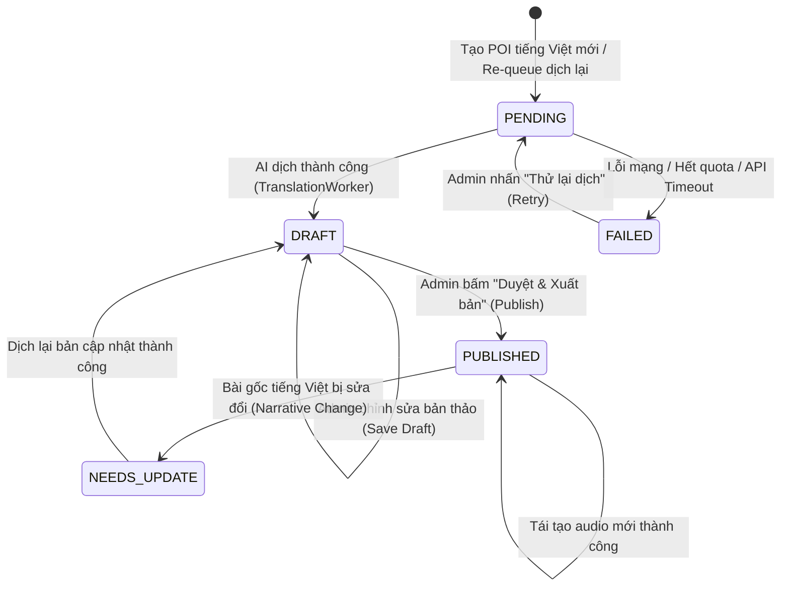
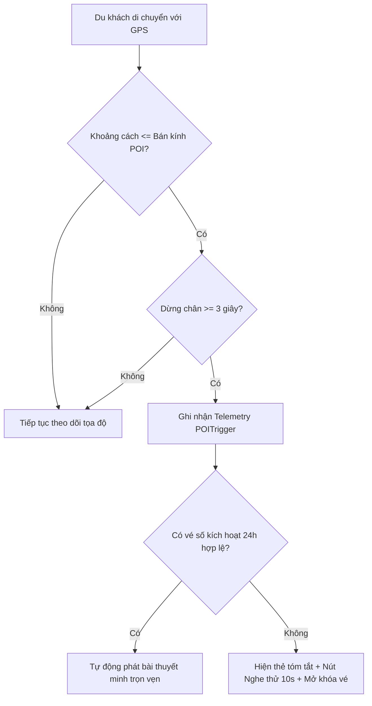
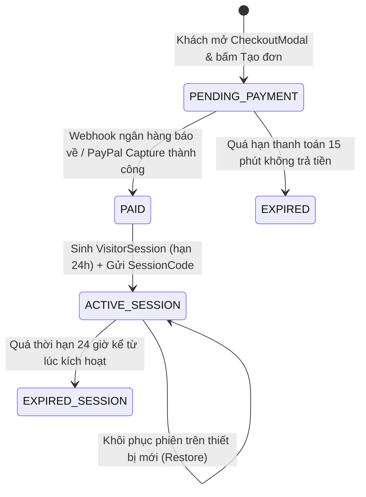

# SYSTEM CONTROL MAP: SMART MULTILINGUAL AUDIO GUIDE & EXHIBIT MANAGEMENT SYSTEM

> **Tài liệu kiểm soát bảo trì và thay đổi hệ thống (Maintenance-Oriented Control Map)**  
> **Mục tiêu:** Cung cấp bản đồ điều khiển chính xác, chi tiết tới từng file, hàm, model, schema và luồng dữ liệu để nhà phát triển hoặc AI Agent có thể xác định ngay lập tức vị trí cần sửa đổi, phạm vi ảnh hưởng (blast radius), và các điểm kiểm soát nghiệp vụ khi phát triển hoặc bảo trì.

---

## MỤC LỤC
1. [GLOBAL SYSTEM MAP (BẢN ĐỒ HỆ THỐNG TOÀN CỤC)](#1-global-system-map)
   - 1.1. Module Dependency Diagram
   - 1.2. Feature to Module Mapping
   - 1.3. API to Service Mapping
   - 1.4. Service to Repository Mapping
   - 1.5. Repository to Database Mapping
2. [MODULE 1: AUTHENTICATION & ACCESS CONTROL (QUẢN TRỊ VIÊN & XÁC THỰC)](#2-module-1-authentication--access-control)
3. [MODULE 2: POI CATALOG & GEOFENCE CALIBRATION (QUẢN LÝ ĐIỂM THAM QUAN & TỌA ĐỘ)](#3-module-2-poi-catalog--geofence-calibration)
4. [MODULE 3: MULTILINGUAL TRANSLATION & TTS AUDIO PIPELINE (DỊCH MÁY AI & THUYẾT MINH)](#4-module-3-multilingual-translation--tts-audio-pipeline)
5. [MODULE 4: VISITOR MAP, WAYFINDING & GEOFENCE TRIGGER (BẢN ĐỒ & ĐIỀU HƯỚNG DU KHÁCH)](#5-module-4-visitor-map-wayfinding--geofence-trigger)
6. [MODULE 5: DIGITAL ADMISSION CHECKOUT & VISITOR SESSION (THANH TOÁN & PHIÊN THAM QUAN)](#6-module-5-digital-admission-checkout--visitor-session)
7. [MODULE 6: TELEMETRY & SPATIAL DENSITY ANALYTICS (DỮ LIỆU ĐO ĐẠC & NHIỆT ĐỘ KHÁCH)](#7-module-6-telemetry--spatial-density-analytics)
8. [MODULE 7: SYSTEM HEALTH, STORAGE QUOTA & INFRASTRUCTURE (HẠ TẦNG & LƯU TRỮ ĐÁM MÂY)](#8-module-7-system-health-storage-quota--infrastructure)

---

## 1. GLOBAL SYSTEM MAP

### 1.1. Module Dependency Diagram

```mermaid
graph TD
    subgraph Client_Tier [Client Presentation Tier (React 18 + Vite)]
        AdminPortal["Admin Web Portal (Desktop)<br/>/admin/*"]
        VisitorApp["Visitor Progressive Web App (Mobile)<br/>/visitor, /tour"]
    end

    subgraph API_Tier [API & Presentation Routing (FastAPI)]
        AuthController["auth_controller.py"]
        AdminPoiController["admin_poi_controller.py"]
        PoiController["poi_controller.py"]
        TranslationController["translation_controller.py"]
        AudioController["audio_controller.py"]
        TourController["tour_controller.py"]
        PaymentController["payment_controller.py"]
        SessionController["session_controller.py"]
        AnalyticsController["analytics_controller.py"]
        TelemetryController["telemetry_controller.py"]
        SystemController["system_controller.py"]
        MediaController["media_controller.py"]
    end

    subgraph Service_Tier [Business Logic & Orchestration Tier]
        AuthService["auth_service.py"]
        POIService["poi_service.py"]
        TranslationService["translation_service.py"]
        TransPipelineService["translation_pipeline_service.py"]
        TransWorker["translation_worker.py"]
        PipelineQueue["pipeline_queue.py"]
        TTSService["tts_service.py"]
        AudioSynthesisWorker["audio_synthesis_worker.py"]
        AudioService["audio_service.py"]
        WayfindingService["wayfinding_service.py"]
        PaymentService["payment_service.py"]
        SessionService["session_service.py"]
        TelemetryService["telemetry_service.py"]
        ExportService["export_service.py"]
        StorageService["storage_service.py"]
    end

    subgraph Integration_Tier [Third-Party Integration Adapters]
        DeepTranslator["deep_translator_client.py<br/>(Render / Crouton / DeepTranslator)"]
        EdgeTTS["edge_tts_client.py<br/>(Microsoft Edge Speech)"]
        PaypalClient["paypal_client.py<br/>(PayPal Orders V2 REST API)"]
        StorageClient["storage_client.py<br/>(Supabase Storage API)"]
    end

    subgraph Repo_Tier [Data Access Repositories (SQLAlchemy 2.0)]
        UserRepo["user_repository.py"]
        AuditRepo["audit_repository.py"]
        POIRepo["poi_repository.py"]
        TransRepo["translation_repository.py"]
        AudioRepo["audio_repository.py"]
        LangRepo["language_repository.py"]
        TxnRepo["transaction_repository.py"]
        SessionRepo["session_repository.py"]
        TelemetryRepo["telemetry_repository.py"]
    end

    subgraph DB_Tier [Database Engine (MySQL 8.0+ InnoDB)]
        T_User[("User")]
        T_Audit[("Audit")]
        T_POI[("POI")]
        T_POITranslation[("POITranslation")]
        T_LanguageCode[("LanguageCode")]
        T_Transaction[("Transaction")]
        T_VisitorSession[("VisitorSession")]
        T_POITrigger[("POITrigger")]
    end

    AdminPortal --> AuthController & AdminPoiController & TranslationController & AnalyticsController & SystemController
    VisitorApp --> PoiController & TourController & AudioController & PaymentController & SessionController & TelemetryController

    AuthController --> AuthService
    AdminPoiController --> POIService
    PoiController --> POIService
    TranslationController --> TranslationService & TransPipelineService & TTSService
    AudioController --> AudioService
    TourController --> WayfindingService
    PaymentController --> PaymentService
    SessionController --> SessionService
    AnalyticsController --> TelemetryService & ExportService
    TelemetryController --> TelemetryService
    SystemController --> StorageService

    AuthService --> UserRepo & AuditRepo
    POIService --> POIRepo & AuditRepo & LangRepo & TransPipelineService & StorageClient
    TranslationService --> TransRepo & POIRepo & AuditRepo
    TransPipelineService --> PipelineQueue & TransWorker & AudioSynthesisWorker
    TransWorker --> DeepTranslator & TransRepo & POIRepo
    AudioSynthesisWorker --> TTSService & AudioRepo & TransRepo & POIRepo
    TTSService --> EdgeTTS & StorageClient
    AudioService --> AudioRepo & SessionRepo & TransRepo
    WayfindingService --> POIRepo
    PaymentService --> TxnRepo & SessionRepo & PaypalClient
    SessionService --> SessionRepo
    TelemetryService --> TelemetryRepo & POIRepo
    ExportService --> TelemetryRepo
    StorageService --> StorageClient & POIRepo & TransRepo

    UserRepo --> T_User
    AuditRepo --> T_Audit
    POIRepo --> T_POI
    TransRepo --> T_POITranslation
    LangRepo --> T_LanguageCode
    TxnRepo --> T_Transaction
    SessionRepo --> T_VisitorSession
    TelemetryRepo --> T_POITrigger
```

---

### 1.2. Feature to Module Mapping

| Feature Code | Tên tính năng (Feature Name) | Module sở hữu | Controller / Endpoint chính |
| :--- | :--- | :--- | :--- |
| **US 01.1** | Bản đồ tương tác di tích (Interactive Visitor Map) | Module 4 | `GET /api/v1/pois` |
| **US 01.4** | Điều hướng lộ trình tham quan (Dijkstra Wayfinding) | Module 4 | `GET /api/v1/tour/route` |
| **US 02.1** | Đăng nhập Quản trị viên (Admin Login & JWT) | Module 1 | `POST /api/v1/admin/auth/login` |
| **US 02.2** | Phòng chống dò mật khẩu (Brute Force Lockout) | Module 1 | `POST /api/v1/admin/auth/login` |
| **US 03.1** | Hồ sơ số hóa điểm tham quan (POI Profile CRUD) | Module 2 | `POST /api/v1/admin/pois`, `GET /api/v1/admin/pois` |
| **US 03.2** | Hiệu chỉnh vùng kích hoạt Geofence | Module 2 | `PUT /api/v1/admin/pois/{id}` |
| **US 03.3** | Bật/tắt trạng thái hiển thị POI (Active/Hide) | Module 2 | `PATCH /api/v1/admin/pois/{id}/visibility` |
| **US 03.4** | Đồng bộ cập nhật nội dung sang bản dịch | Module 2 & 3 | `PUT /api/v1/admin/pois/{id}` -> `pipeline_queue.py` |
| **US 04.1** | Kiểm duyệt bản dịch đa ngữ (Translation Audit) | Module 3 | `GET/PUT /api/v1/admin/translations/{id}` |
| **US 04.2** | Tái tạo audio giọng đọc AI (Audio Regeneration) | Module 3 | `POST /api/v1/admin/translations/{id}/regenerate-audio` |
| **US 04.3** | Phê duyệt & Xuất bản bản dịch (Admin Approval) | Module 3 | `POST /api/v1/admin/translations/{id}/publish` |
| **US 04.4** | Tự động dịch máy AI & Tổng hợp âm thanh | Module 3 | `translation_worker.py`, `audio_synthesis_worker.py` |
| **US 05.1** | Bản đồ nhiệt mật độ khách (Visitor Density Heatmap) | Module 6 | `GET /api/v1/admin/analytics/density` |
| **US 05.2** | Thống kê chỉ số KPI & Xu hướng tham quan | Module 6 | `GET /api/v1/admin/analytics/summary` |
| **US 05.3** | Giám sát dung lượng lưu trữ & Dọn dẹp tệp rác | Module 7 | `GET /api/v1/admin/system/health`, `POST /storage/clean-orphans` |
| **US 05.4** | Xuất dữ liệu đo đạc (Telemetry CSV Export) | Module 6 | `GET /api/v1/admin/analytics/export` |
| **US 06.1** | Thanh toán vé số trực tuyến (VietQR / PayPal) | Module 5 | `POST /api/v1/payments/create-order` |
| **US 06.2** | Webhook kích hoạt phiên tham quan 24h | Module 5 | `POST /api/v1/payments/webhook` |
| **US 06.3** | Khôi phục phiên qua mã PIN / Session Token | Module 5 | `POST /api/v1/sessions/restore` |
| **US 06.4** | Tường lửa khóa nội dung thuyết minh (Paywall Gate) | Module 4 & 5 | `GET /api/v1/audio/{poi_id}` |

---

### 1.3. API to Service Mapping

| HTTP Method & Endpoint Route | Controller File | Service Method được gọi | Ghi chú bảo vệ (Auth / Rate Limit) |
| :--- | :--- | :--- | :--- |
| `POST /api/v1/admin/auth/login` | `auth_controller.py` | `AuthService.login_admin(...)` | Rate Limit 5 req/min, ghi nhật ký Audit |
| `GET /api/v1/admin/auth/me` | `auth_controller.py` | `AuthService.get_current_admin(...)` | Bearer JWT (AdminRouteGuard) |
| `POST /api/v1/admin/auth/logout` | `auth_controller.py` | `AuthService.logout_admin(...)` | Bearer JWT |
| `GET /api/v1/pois` | `poi_controller.py` | `POIService.list_map_pois(...)` | Public, Rate Limit `RATE_LIMIT_POI_CATALOG` |
| `GET /api/v1/pois/{poi_id}` | `poi_controller.py` | `POIService.get_visitor_poi_detail(...)` | Public (Paywall Gate kiểm tra session token) |
| `POST /api/v1/admin/pois` | `poi_controller.py` | `POIService.create_new_poi(...)` | Admin Auth, kích hoạt background pipeline |
| `GET /api/v1/admin/pois` | `poi_controller.py` | `POIService.list_pois(...)` | Admin Auth |
| `GET /api/v1/admin/pois/{poi_id}` | `poi_controller.py` | `POIService.get_poi_details(...)` | Admin Auth |
| `PUT /api/v1/admin/pois/{poi_id}` | `admin_poi_controller.py` | `POIService.update_poi(...)` | Admin Auth, kích hoạt đồng bộ dịch lại nếu đổi text |
| `POST /api/v1/admin/pois/upload-image` | `admin_poi_controller.py`| `POIService.save_cover_image(...)` | Admin Auth, Rate Limit upload, max 5MB |
| `PATCH /api/v1/admin/pois/{id}/visibility`| `admin_poi_controller.py`| `POIService.set_poi_visibility(...)`| Admin Auth |
| `POST /api/v1/admin/pois/{id}/retry-translations`| `admin_poi_controller.py`| `POIService.retry_poi_translations(...)`| Admin Auth, đưa vào hàng đợi dịch lại |
| `GET /api/v1/admin/translations` | `translation_controller.py` | `TranslationService.get_translations(...)` | Admin Auth, lọc theo language và status |
| `GET /api/v1/admin/translations/{id}` | `translation_controller.py`| `TranslationService.get_translation_by_id(...)`| Admin Auth |
| `PUT /api/v1/admin/translations/{id}` | `translation_controller.py`| `TranslationService.update_translation(...)` | Admin Auth, cập nhật bản thảo (Draft) |
| `POST /api/v1/admin/translations/{id}/publish`| `translation_controller.py`| `TranslationService.publish_translation(...)` | Admin Auth, chuyển sang PUBLISHED |
| `POST /api/v1/admin/translations/{id}/regenerate-audio`| `translation_controller.py`| `TTSService.synthesize_and_save(...)` | Admin Auth |
| `POST /api/v1/admin/translations/{id}/retry`| `translation_controller.py`| `TransPipelineService.requeue_translation(...)` | Admin Auth |
| `GET /api/v1/audio/{poi_id}` | `audio_controller.py` | `AudioService.get_audio_stream(...)` | Gated: Yêu cầu Session Token hợp lệ |
| `GET /api/v1/audio/{poi_id}/preview` | `audio_controller.py` | `AudioService.get_preview_stream(...)` | Free: 10 giây nghe thử miễn phí |
| `GET /api/v1/languages` | `language_controller.py` | `LanguageService.get_published_languages(...)`| Public |
| `GET /api/v1/tour/route` | `tour_controller.py` | `WayfindingService.compute_walking_route(...)`| Public |
| `POST /api/v1/payments/create-order` | `payment_controller.py` | `PaymentService.create_order(...)` | Public |
| `GET /api/v1/payments/order-status/{id}` | `payment_controller.py` | `PaymentService.get_order_status(...)` | Public, kiểm tra trạng thái thanh toán |
| `POST /api/v1/payments/webhook` | `payment_controller.py` | `PaymentService.process_webhook(...)` | Webhook Gateway Callback |
| `POST /api/v1/payments/simulate-success`| `payment_controller.py` | `PaymentService.simulate_success(...)` | Dev/Demo Mode Only |
| `GET /api/v1/payments/paypal-checkout` | `payment_controller.py` | `PaymentService.render_paypal_html(...)` | Trang thanh toán PayPal SDK |
| `POST /api/v1/payments/order/{id}/session`| `payment_controller.py` | `PaymentService.exchange_order_for_session(...)`| Đổi Order đã trả tiền lấy Session Token |
| `POST /api/v1/payments/order/{id}/paypal-capture`| `payment_controller.py`| `PaymentService.capture_paypal_order(...)` | Capture thanh toán PayPal sandbox |
| `POST /api/v1/sessions/restore` | `session_controller.py` | `SessionService.restore_session(...)` | Rate Limit chống brute-force mã PIN |
| `POST /api/v1/telemetry/event` | `telemetry_controller.py` | `TelemetryService.record_trigger_event(...)`| Public, ghi nhận phát thuyết minh |
| `GET /api/v1/admin/analytics/summary`| `analytics_controller.py`| `TelemetryService.get_analytics_summary(...)`| Admin Auth |
| `GET /api/v1/admin/analytics/density`| `analytics_controller.py`| `TelemetryService.get_density_heatmap(...)` | Admin Auth |
| `GET /api/v1/admin/analytics/export` | `analytics_controller.py`| `ExportService.export_telemetry_csv(...)` | Admin Auth, xuất file CSV |
| `GET /api/v1/admin/system/health` | `system_controller.py` | `StorageService.get_system_health(...)` | Admin Auth, đo RAM, CPU, quota Supabase |
| `POST /api/v1/admin/system/storage/clean-orphans`| `system_controller.py`| `StorageService.clean_orphan_media(...)` | Admin Auth, dọn ảnh và audio mồ côi |
| `GET /api/v1/system/client-config` | `system_controller.py` | Cung cấp cờ môi trường demo payment | Public |

---

### 1.4. Service to Repository Mapping

| Service Class (`MVP/backend/app/services/`) | Repository phụ thuộc (`MVP/backend/app/repositories/`) | Mục đích tương tác dữ liệu |
| :--- | :--- | :--- |
| `AuthService` | `UserRepository`, `AuditRepository` | Xác thực đăng nhập, đếm số lần sai, khóa tài khoản, ghi nhật ký |
| `POIService` | `POIRepository`, `AuditRepository`, `LanguageRepository`, `SessionRepository` | CRUD POI, tọa độ, kiểm tra phiên mở khóa, seeding bản dịch |
| `TranslationService` | `TranslationRepository`, `POIRepository`, `AuditRepository` | Truy vấn danh sách kiểm duyệt, cập nhật bản thảo, xuất bản |
| `TranslationPipelineService` | `TranslationRepository`, `POIRepository`, `AudioRepository`, `LanguageRepository` | Đẩy hàng đợi dịch máy, tái tạo audio |
| `TranslationWorker` | `TranslationRepository`, `POIRepository` | Gọi DeepTranslatorClient và cập nhật trạng thái DRAFT / FAILED |
| `AudioSynthesisWorker` | `AudioRepository`, `TranslationRepository`, `POIRepository` | Gọi EdgeTTSClient, cập nhật `audio_url`, `duration`, `file_size` |
| `AudioService` | `AudioRepository`, `SessionRepository`, `TranslationRepository` | Truy vấn tệp âm thanh, kiểm tra hạn phiên tham quan 24h |
| `WayfindingService` | `POIRepository` | Đọc tọa độ các điểm di tích để xây dựng đồ thị đường đi Dijkstra |
| `PaymentService` | `TransactionRepository`, `SessionRepository` | Tạo giao dịch, cập nhật PAID, sinh `VisitorSession` và `SessionCode` |
| `SessionService` | `SessionRepository` | Khôi phục phiên bằng mã PIN hoặc session token, kiểm tra hạn 24h |
| `TelemetryService` | `TelemetryRepository`, `POIRepository` | Ghi nhận kích hoạt geofence, tổng hợp KPI thống kê và mật độ nhiệt |
| `ExportService` | `TelemetryRepository` | Đọc bảng POITrigger và xuất luồng bản ghi CSV |
| `StorageService` | `POIRepository`, `TranslationRepository` | Quét so sánh tệp tin lưu trữ và cơ sở dữ liệu để tìm file mồ côi |

---

### 1.5. Repository to Database Mapping

| Repository Class | File mã nguồn Repository | Bảng MySQL sở hữu | Các bảng MySQL liên kết / đọc |
| :--- | :--- | :--- | :--- |
| `UserRepository` | `user_repository.py` | `User` | - |
| `AuditRepository` | `audit_repository.py` | `Audit` | `User` (FK: `UserName`) |
| `POIRepository` | `poi_repository.py` | `POI` | `POITranslation`, `User` |
| `TranslationRepository`| `translation_repository.py` | `POITranslation` | `POI` (FK: `PoiID`), `LanguageCode`, `User` |
| `LanguageRepository` | `language_repository.py` | `LanguageCode` | `POITranslation` |
| `AudioRepository` | `audio_repository.py` | `POITranslation` (trường audio)| `POI`, `LanguageCode` |
| `TransactionRepository`| `transaction_repository.py` | `Transaction` | - |
| `SessionRepository` | `session_repository.py` | `VisitorSession` | `Transaction` (FK: `TransactionID`), `LanguageCode` |
| `TelemetryRepository` | `telemetry_repository.py` | `POITrigger` | `VisitorSession` (FK: `SessionID`), `POI` (FK: `PoiID`) |

---

## 2. MODULE 1: AUTHENTICATION & ACCESS CONTROL

### 2.1. Module Overview
- **Mục đích:** Quản lý truy cập an toàn cho Quản trị viên Di tích (Admin Portal), cấp phát JWT tokens, bảo vệ tài khoản bằng cơ chế khóa tự động chống tấn công dò mật khẩu (Brute Force Protection), và ghi vết toàn bộ hành động bảo mật vào bảng Audit.
- **Entry Points:**
  - Frontend: `MVP/frontend/src/views/admin/AdminLoginView.jsx` (Route: `/admin/login`)
  - Backend API: `MVP/backend/app/controllers/auth_controller.py` (`POST /api/v1/admin/auth/login`, `GET /api/v1/admin/auth/me`, `POST /api/v1/admin/auth/logout`)
- **Dependencies:**
  - `MVP/backend/app/core/security.py` (Bcrypt hashing, JWT encoding/decoding)
  - `MVP/backend/app/core/dependencies.py` (`get_current_admin`, `get_current_admin_profile`)
  - `MVP/backend/app/repositories/user_repository.py`
  - `MVP/backend/app/repositories/audit_repository.py`
- **Owned Data:** Bảng `User`, Bảng `Audit`.

### 2.2. UI Control Points

#### Màn hình: Admin Login (`AdminLoginView.jsx`)
- **Route:** `/admin/login`
- **Component File:** [AdminLoginView.jsx](./MVP/frontend/src/views/admin/AdminLoginView.jsx)
- **Displayed Fields:**
  - Tiêu đề Cổng Quản trị Di tích Củ Chi (`ADMIN_TRANSLATIONS.loginTitle`)
  - Input Tên người dùng / Email (`usernameOrEmail`)
  - Input Mật khẩu (`password`)
  - Thông báo lỗi xác thực (`errorMessage`)
  - Modal thông báo khóa tài khoản (`AccountLockoutModal.jsx`)
- **Editable Fields:**
  - `usernameOrEmail` (string, required)
  - `password` (string, required, type="password")
- **Hidden Fields:** Không có.
- **Filter Fields:** Không có.
- **Action Buttons:**
  - Nút Đăng nhập (`submit` button, testid: `login-submit-button`)
  - Nút Đóng Modal Khóa (`AccountLockoutModal` confirm)

#### Màn hình: Route Guard & Shell (`AdminRouteGuard.jsx` + `AdminLayout.jsx`)
- **Route:** Bảo vệ toàn bộ route con `/admin/*`
- **Component File:** [AdminRouteGuard.jsx](./MVP/frontend/src/components/admin/AdminRouteGuard.jsx), [AdminNavbar.jsx](./MVP/frontend/src/components/admin/AdminNavbar.jsx)
- **Displayed Fields:** Tên tài khoản quản trị hiện tại (`admin.fullName || admin.userName`), Thanh menu điều hướng.
- **Action Buttons:** Nút Đăng xuất (Logout Button -> gọi `authApi.logoutAdmin()`, xóa `localStorage.token`).

### 2.3. Business Rule Control Points

| Rule Name | Mô tả chi tiết quy tắc | File cài đặt (Source Files) | API liên quan | Database Objects |
| :--- | :--- | :--- | :--- | :--- |
| **BR-AUTH-01: Password Hashing** | Mật khẩu phải được hash an toàn bằng Bcrypt trước khi lưu. Không bao giờ lưu plaintext. | [security.py:L15-L35](./MVP/backend/app/core/security.py#L15), [auth_service.py](./MVP/backend/app/services/auth_service.py) | `POST /login` | `User.Password_hash` |
| **BR-AUTH-02: Brute Force Threshold** | Đăng nhập sai 5 lần liên tiếp sẽ tự động khóa tài khoản trong 15 phút (`LOCKOUT_DURATION_MINUTES = 15`). | [auth_service.py:L58-L115](./MVP/backend/app/services/auth_service.py#L58) | `POST /login` | `User.FalsedAttempts`, `User.Lockeduntil` |
| **BR-AUTH-03: Audit Trail Logging** | Mọi lần đăng nhập (thành công, thất bại, hoặc bị khóa) đều phải tạo 1 dòng ghi nhận vào bảng `Audit` kèm IP Client. | [auth_service.py:L80-L130](./MVP/backend/app/services/auth_service.py#L80), [audit_repository.py](./MVP/backend/app/repositories/audit_repository.py) | `POST /login` | `Audit.AuditID`, `Audit.Status`, `Audit.Ip_address`, `Audit.Details` |
| **BR-AUTH-04: JWT Session Validity** | JWT token được ký bằng `HS256`, hạn dùng chuẩn 24 giờ (`ACCESS_TOKEN_EXPIRE_MINUTES = 1440`). Không chấp nhận secret mặc định. | [security.py:L40-L75](./MVP/backend/app/core/security.py#L40), [config.py:L55](./MVP/backend/app/core/config.py#L55) | `GET /me`, Tất cả `/admin/*` | Bộ nhớ JWT / Header Authorization |

### 2.4. Validation Control Points

| Validation Name | Trường đầu vào (Fields) | Nguồn kiểm tra (Source) | Màn hình liên quan | API liên quan |
| :--- | :--- | :--- | :--- | :--- |
| **VAL-AUTH-LOGIN-PAYLOAD** | `username` (min 1, max 20), `password` (min 6, max 100) | [auth_schema.py:L10-L25](./MVP/backend/app/schemas/auth_schema.py#L10) | `AdminLoginView.jsx` | `POST /api/v1/admin/auth/login` |
| **VAL-AUTH-RATE-LIMIT** | IP Address (Giới hạn 5 requests/phút trên endpoint login) | [auth_controller.py:L40](./MVP/backend/app/controllers/auth_controller.py#L40), [limiter.py](./MVP/backend/app/core/limiter.py) | `AdminLoginView.jsx` | `POST /api/v1/admin/auth/login` |

### 2.5. Workflow Control Points

#### Workflow: Admin Account Security State Machine
- **Các trạng thái:**
  - `ACTIVE_NORMAL`: Tài khoản hoạt động, `FalsedAttempts = 0`, `Lockeduntil = NULL`
  - `FAILED_ATTEMPT_RECORDED`: Đăng nhập thất bại `1 <= FalsedAttempts < 5`
  - `TEMPORARILY_LOCKED`: `FalsedAttempts >= 5`, `Lockeduntil = NOW() + 15m`
  - `DEACTIVATED`: `Is_Active = FALSE` (Khóa vĩnh viễn bởi Super Admin)
- **Transitions:**
  - `ACTIVE_NORMAL` -> `FAILED_ATTEMPT_RECORDED`: Khi nhập sai mật khẩu ([auth_service.py](./MVP/backend/app/services/auth_service.py)).
  - `FAILED_ATTEMPT_RECORDED` -> `TEMPORARILY_LOCKED`: Lần sai thứ 5 ([auth_service.py](./MVP/backend/app/services/auth_service.py)).
  - `TEMPORARILY_LOCKED` -> `ACTIVE_NORMAL`: Khi thời gian hiện tại > `Lockeduntil` và đăng nhập đúng.
  - `FAILED_ATTEMPT_RECORDED` -> `ACTIVE_NORMAL`: Đăng nhập đúng trước khi chạm ngưỡng 5 lần.
- **Trigger Files:** [auth_service.py](./MVP/backend/app/services/auth_service.py), [user_repository.py](./MVP/backend/app/repositories/user_repository.py).

### 2.6. Integration Control Points
- *Module hoàn toàn nội bộ, sử dụng thư viện mật mã tiêu chuẩn `bcrypt` và `PyJWT`.*

### 2.7. Change Impact Matrix (Authentication)

| Khi thay đổi tại | Các file và thành phần bị ảnh hưởng trực tiếp (Affected Files) |
| :--- | :--- |
| **UI thay đổi** (form login, lockout modal) | `MVP/frontend/src/views/admin/AdminLoginView.jsx`<br/>`MVP/frontend/src/components/admin/AccountLockoutModal.jsx`<br/>`MVP/frontend/src/api/authApi.js` |
| **Validation thay đổi** (độ dài password, quy tắc ký tự) | `MVP/backend/app/schemas/auth_schema.py`<br/>`MVP/frontend/src/views/admin/AdminLoginView.jsx` |
| **Business rule thay đổi** (đổi số lần thử từ 5 lên 10, thời gian khóa) | `MVP/backend/app/services/auth_service.py`<br/>`MVP/backend/app/core/config.py`<br/>`MVP/frontend/src/components/admin/AccountLockoutModal.jsx` |
| **Workflow thay đổi** (thêm MFA / OTP, reset mật khẩu qua email) | `MVP/backend/app/controllers/auth_controller.py`<br/>`MVP/backend/app/services/auth_service.py`<br/>`MVP/backend/app/models/user.py`<br/>`MVP/frontend/src/views/admin/AdminLoginView.jsx` |
| **Database schema thay đổi** (bảng `User` hoặc `Audit`) | `MVP/backend/scripts/mysql_schema.sql`<br/>`MVP/backend/app/models/user.py`<br/>`MVP/backend/app/models/audit.py`<br/>`MVP/backend/app/repositories/user_repository.py`<br/>`MVP/backend/app/repositories/audit_repository.py` |

---

## 3. MODULE 2: POI CATALOG & GEOFENCE CALIBRATION

### 3.1. Module Overview
- **Mục đích:** Quản lý danh mục điểm di tích lịch sử (POI), tọa độ địa lý WGS84, bán kính kích hoạt thuyết minh tự động (Geofence Radius), trạng thái hoạt động (Active/Hide), tải ảnh bìa, và kiểm soát đồng bộ cập nhật nội dung sang bản dịch.
- **Entry Points:**
  - Frontend:
    - Danh mục POI: [PoiCatalogPage.jsx](./MVP/frontend/src/views/admin/PoiCatalogPage.jsx) (Route: `/admin/pois`)
    - Hiệu chỉnh Geofence: [GeofenceCalibPage.jsx](./MVP/frontend/src/views/admin/GeofenceCalibPage.jsx) (Route: `/admin/pois/:id/geofence` hoặc `/admin/geofence`)
  - Backend API:
    - `MVP/backend/app/controllers/poi_controller.py` (`POST /api/v1/admin/pois`, `GET /api/v1/admin/pois`, `GET /api/v1/admin/pois/{id}`)
    - `MVP/backend/app/controllers/admin_poi_controller.py` (`PUT /api/v1/admin/pois/{id}`, `POST /upload-image`, `PATCH /{id}/visibility`, `POST /{id}/retry-translations`)
- **Dependencies:**
  - `MVP/backend/app/services/poi_service.py`
  - `MVP/backend/app/repositories/poi_repository.py`
  - `MVP/backend/app/repositories/language_repository.py`
  - `MVP/backend/app/repositories/audit_repository.py`
  - `MVP/backend/app/integrations/storage_client.py`
  - `MVP/backend/app/services/translation_pipeline_service.py`
- **Owned Data:** Bảng `POI`.

### 3.2. UI Control Points

#### Màn hình 1: POI Catalog Page (`PoiCatalogPage.jsx`)
- **Route:** `/admin/pois`
- **Component File:** [PoiCatalogPage.jsx](./MVP/frontend/src/views/admin/PoiCatalogPage.jsx)
- **Displayed Fields:**
  - Bảng danh sách POI: Ảnh thu nhỏ (`image_url`), Tiêu đề gốc (`title`), Tóm tắt (`short_description`), Tọa độ (`latitude`, `longitude`), Bán kính (`radius`), Huy hiệu ngôn ngữ (`vi: gốc`, `en`, `ja`, `ko`, `zh`), Trạng thái hoạt động (`Active` / `Hidden`).
- **Editable Fields (trong Modal Tạo POI - dòng 440-520):**
  - `title` (text, required, max 255 chars)
  - `short_description` (textarea, optional, max 255 chars)
  - `description` (textarea, optional, nội dung thuyết minh chi tiết)
  - `latitude`, `longitude` (number, required, tọa độ chọn từ bản đồ hoặc nhập tay)
  - `radius` (number, required, mặc định 30m)
  - `image` (file upload: JPG, PNG, WebP <= 5MB)
- **Filter Fields:**
  - Ô tìm kiếm theo tên POI: `search` (Search input with debouncing)
- **Action Buttons:**
  - Nút "Thêm điểm tham quan" (Mở modal tạo mới)
  - Nút "Sửa" trên từng dòng (Mở `POIFormModal.jsx`)
  - Nút "Hiệu chỉnh Geofence" (Chuyển sang `GeofenceCalibPage.jsx`)
  - Nút "Ẩn / Hiện" (Mở `DeactivateConfirmModal.jsx` gọi API `PATCH /visibility`)
  - Nút "Thử lại dịch lỗi" (Gọi API `POST /{id}/retry-translations`)

#### Màn hình 2: POI Edit Modal (`POIFormModal.jsx`)
- **Component File:** [POIFormModal.jsx](./MVP/frontend/src/components/admin/POIFormModal.jsx)
- **Displayed Fields:** Tiêu đề, tóm tắt, nội dung, preview ảnh bìa, bản đồ chọn tọa độ (`AdminMapPicker.jsx`).
- **Editable Fields:**
  - `title` (max 255 ký tự, có counter)
  - `short_description` (max 255 ký tự, có counter)
  - `description` (textarea không giới hạn)
  - `latitude`, `longitude`, `radius`
  - Nút đổi ảnh / Nút "Không dùng ảnh này" (`btn-remove-cover-photo`)
- **Action Buttons:** Nút "Lưu thay đổi", Nút "Hủy bỏ".

#### Màn hình 3: Geofence Calibration Page (`GeofenceCalibPage.jsx`)
- **Route:** `/admin/pois/:id/geofence` hoặc `/admin/geofence`
- **Component File:** [GeofenceCalibPage.jsx](./MVP/frontend/src/views/admin/GeofenceCalibPage.jsx)
- **Displayed Fields:** Bản đồ vệ tinh/OSM với vòng tròn bán kính kích hoạt (Circle overlay), Danh sách POI bên cạnh.
- **Editable Fields:**
  - Thanh trượt / Input điều chỉnh bán kính `radius` (10m đến 100m)
  - Kéo thả Marker trên bản đồ để đổi `latitude`, `longitude`.
- **Action Buttons:** Nút "Lưu tọa độ & bán kính" (gọi `PUT /api/v1/admin/pois/{id}`).

### 3.3. Business Rule Control Points

| Rule Name | Mô tả chi tiết quy tắc | File cài đặt (Source Files) | API liên quan | Database Objects |
| :--- | :--- | :--- | :--- | :--- |
| **BR-POI-01: Spatial Boundary Guardrail** | Tọa độ POI bắt buộc phải nằm trong ranh giới Khu di tích Củ Chi (`CU_CHI_BOUNDS` trong config) trừ khi bật `ALLOW_GLOBAL_COORDINATES`. | [poi_service.py:L58-L76](./MVP/backend/app/services/poi_service.py#L58), [config.py](./MVP/backend/app/core/config.py) | `POST /admin/pois`, `PUT /admin/pois/{id}` | `POI.Latitude`, `POI.Longitude` |
| **BR-POI-02: Auto-Seed Foreign Placeholders** | Khi tạo một POI tiếng Việt mới, hệ thống tự động khởi tạo các bản ghi bản dịch ngoại ngữ (`en`, `ja`, `ko`, `zh`, `fr`) ở trạng thái `PENDING` với tiêu đề gốc tiếng Việt (không kèm prefix `[LANG]`). | [poi_service.py:L258-L280](./MVP/backend/app/services/poi_service.py#L258) | `POST /admin/pois` | `POITranslation` |
| **BR-POI-03: Narrative Change Detection** | Khi Admin cập nhật POI, nếu nội dung tiếng Việt (`title`, `short_description`, `description`) thay đổi, hệ thống tự động chuyển trạng thái các bản dịch ngoại ngữ hiện có thành `NEEDS_UPDATE` và đẩy vào hàng đợi dịch lại. | [poi_service.py:L425-L510](./MVP/backend/app/services/poi_service.py#L425) | `PUT /admin/pois/{id}` | `POITranslation.Status` |
| **BR-POI-04: Image Validation & Security** | Ảnh tải lên phải là định dạng JPG, PNG hoặc WebP hợp lệ (kiểm tra MIME và magic bytes qua Pillow), kích thước tối đa 5MB, đặt header `nosniff`. | [poi_service.py:L80-L144](./MVP/backend/app/services/poi_service.py#L80), [main.py:L140](./MVP/backend/app/main.py#L140) | `POST /upload-image` | `POI.Image_Url` |
| **BR-POI-05: Deactivation Safe Guard** | Khi ẩn một POI (`is_active = False`), toàn bộ bản dịch và dữ liệu audio vẫn được giữ nguyên vẹn trong DB, chỉ loại bỏ POI khỏi bản đồ du khách. | [poi_service.py:L560-L595](./MVP/backend/app/services/poi_service.py#L560) | `PATCH /{id}/visibility` | `POI.Is_Active` |

### 3.4. Validation Control Points

| Validation Name | Trường đầu vào (Fields) | Nguồn kiểm tra (Source) | Màn hình liên quan | API liên quan |
| :--- | :--- | :--- | :--- | :--- |
| **VAL-POI-CREATE** | `title` (1..255), `short_description` (<=255), `latitude` (-90..90), `longitude` (-180..180), `radius` (>0) | [poi_schema.py:L162-L185](./MVP/backend/app/schemas/poi_schema.py#L162) | `PoiCatalogPage.jsx`, `POIFormModal.jsx` | `POST /api/v1/admin/pois` |
| **VAL-POI-UPDATE** | `title` (max 255), `short_description` (max 255), `radius` (10..100) | [poi_schema.py:L90-L135](./MVP/backend/app/schemas/poi_schema.py#L90) | `POIFormModal.jsx`, `GeofenceCalibPage.jsx` | `PUT /api/v1/admin/pois/{id}` |
| **VAL-POI-CLIENT-MAXLEN** | Client-side `maxLength={255}` cho Title và Short Description | `PoiCatalogPage.jsx`, `POIFormModal.jsx` | `PoiCatalogPage.jsx`, `POIFormModal.jsx` | Chặn trước khi gọi API |

### 3.5. Workflow Control Points

#### Workflow: POI Lifecycle & Narrative Propagation
- **Các trạng thái:**
  - `ACTIVE`: Điểm di tích đang mở cửa, hiển thị trên bản đồ du khách.
  - `INACTIVE / HIDDEN`: Điểm di tích tạm đóng hoặc đang sửa chữa, ẩn khỏi du khách.
- **Trigger Files:** [poi_service.py](./MVP/backend/app/services/poi_service.py), [admin_poi_controller.py](./MVP/backend/app/controllers/admin_poi_controller.py).

### 3.6. Integration Control Points
- **Dịch vụ tích hợp:** `StorageClient` ([storage_client.py](./MVP/backend/app/integrations/storage_client.py)). Lưu ảnh bìa cục bộ tại `STATIC_DIR` hoặc đồng bộ lên đám mây Supabase Storage bucket `museum-media`.

### 3.7. Change Impact Matrix (POI Management)

| Khi thay đổi tại | Các file và thành phần bị ảnh hưởng trực tiếp (Affected Files) |
| :--- | :--- |
| **UI thay đổi** (form thêm POI, giao diện hiệu chỉnh geofence) | `MVP/frontend/src/views/admin/PoiCatalogPage.jsx`<br/>`MVP/frontend/src/components/admin/POIFormModal.jsx`<br/>`MVP/frontend/src/views/admin/GeofenceCalibPage.jsx`<br/>`MVP/frontend/src/components/admin/AdminMapPicker.jsx` |
| **Validation thay đổi** (tăng độ dài tiêu đề, thay đổi giới hạn bán kính) | `MVP/backend/app/schemas/poi_schema.py`<br/>`MVP/frontend/src/views/admin/PoiCatalogPage.jsx`<br/>`MVP/frontend/src/components/admin/POIFormModal.jsx` |
| **Business rule thay đổi** (nới lỏng ranh giới tọa độ Củ Chi, đổi bán kính mặc định) | `MVP/backend/app/core/config.py`<br/>`MVP/backend/app/services/poi_service.py` |
| **Workflow thay đổi** (thêm quy trình phê duyệt POI 2 cấp) | `MVP/backend/app/models/poi.py`<br/>`MVP/backend/app/services/poi_service.py`<br/>`MVP/backend/app/controllers/admin_poi_controller.py` |
| **Database schema thay đổi** (thêm trường thông tin vào bảng `POI`) | `MVP/backend/scripts/mysql_schema.sql`<br/>`MVP/backend/app/models/poi.py`<br/>`MVP/backend/app/repositories/poi_repository.py`<br/>`MVP/backend/app/schemas/poi_schema.py`<br/>`MVP/frontend/src/api/poiApi.js` |

---

## 4. MODULE 3: MULTILINGUAL TRANSLATION & TTS AUDIO PIPELINE

### 4.1. Module Overview
- **Mục đích:** Xử lý toàn bộ quy trình dịch tự động bài thuyết minh từ tiếng Việt sang các thứ tiếng mục tiêu (`en`, `ja`, `ko`, `zh`, `fr`) bằng dịch máy AI, quản lý hàng đợi phi đồng bộ (Asynchronous Queue), hỗ trợ người kiểm duyệt tra soát (Human Audit Review), và tự động tổng hợp tệp âm thanh MP3 bằng công nghệ Text-to-Speech (Microsoft Edge TTS).
- **Entry Points:**
  - Frontend:
    - Bảng kiểm duyệt: [TranslationAuditView.jsx](./MVP/frontend/src/views/admin/TranslationAuditView.jsx) (Route: `/admin/translations`)
  - Backend API:
    - `MVP/backend/app/controllers/translation_controller.py`
    - `MVP/backend/app/controllers/audio_controller.py`
  - Background Lifespan Worker:
    - `MVP/backend/app/main.py:L88` (`pipeline_queue.py`)
- **Dependencies:**
  - `MVP/backend/app/services/translation_service.py`
  - `MVP/backend/app/services/translation_pipeline_service.py`
  - `MVP/backend/app/services/translation_worker.py`
  - `MVP/backend/app/services/pipeline_queue.py`
  - `MVP/backend/app/services/tts_service.py`
  - `MVP/backend/app/services/audio_synthesis_worker.py`
  - `MVP/backend/app/integrations/deep_translator_client.py`
  - `MVP/backend/app/integrations/edge_tts_client.py`
  - `MVP/backend/app/repositories/translation_repository.py`
  - `MVP/backend/app/repositories/audio_repository.py`
- **Owned Data:** Bảng `POITranslation`, Bảng `LanguageCode`.

### 4.2. UI Control Points

#### Màn hình: Translation Audit View (`TranslationAuditView.jsx`)
- **Route:** `/admin/translations`
- **Component File:** [TranslationAuditView.jsx](./MVP/frontend/src/views/admin/TranslationAuditView.jsx)
- **Displayed Fields:**
  - Thống kê tổng số bản dịch, số lượng cần duyệt, số lượng lỗi.
  - Cột Tiếng Việt đối chiếu: `source_title`, `source_short_description`, `source_description`.
  - Cột Ngôn ngữ đích: `language_id` (EN, JA, KO, ZH, FR), trạng thái (`PENDING`, `DRAFT`, `NEEDS_UPDATE`, `PUBLISHED`, `FAILED`).
  - Trình phát âm thanh kiểm duyệt: [AudioAuditPlayer.jsx](./MVP/frontend/src/components/admin/AudioAuditPlayer.jsx) (`Audio_url`, `Duration`, `File_size`).
- **Editable Fields:**
  - `title`: Input chỉnh sửa tiêu đề dịch (max 255 ký tự, có counter `length/255`).
  - `short_description`: Textarea chỉnh sửa tóm tắt dịch (max 1000 ký tự, có counter `length/1000`).
  - `description`: Textarea chỉnh sửa nội dung thuyết minh dịch chi tiết.
- **Filter Fields:**
  - Lọc theo POI: Dropdown chọn POI cụ thể.
  - Lọc theo ngôn ngữ: Tất cả / EN / JA / KO / ZH / FR.
  - Lọc theo trạng thái: Tất cả / Cần duyệt (DRAFT, NEEDS_UPDATE) / Đã xuất bản (PUBLISHED) / Đang xử lý (PENDING) / Thất bại (FAILED).
- **Action Buttons:**
  - Nút "Lưu bản thảo" (Save Draft -> `PUT /admin/translations/{id}`)
  - Nút "Duyệt & Xuất bản" (Publish -> `POST /admin/translations/{id}/publish`)
  - Nút "Tạo lại âm thanh" ([RegenerateAudioButton.jsx](./MVP/frontend/src/components/admin/RegenerateAudioButton.jsx) -> `POST /{id}/regenerate-audio`)
  - Nút "Thử lại dịch" (Retry -> `POST /{id}/retry`)

### 4.3. Business Rule Control Points

| Rule Name | Mô tả chi tiết quy tắc | File cài đặt (Source Files) | API liên quan | Database Objects |
| :--- | :--- | :--- | :--- | :--- |
| **BR-TRANS-01: Multi-Provider Translation Cascade** | Cơ chế dịch 2 tầng liên hoàn (Two-tier Cascade): Tầng 1 ưu tiên gọi Auto_Translate Live API trên Render (mô hình OPUS-MT INT8, không cần API key). Nếu Render timeout (cold start), lỗi 502/504 hoặc gặp ngôn ngữ ngoài danh mục Render hỗ trợ (Out-of-Scope: ngoài en, ja, ko, zh, fr, de, es, ru), hệ thống tự động fallback sang Tầng 2 là OpenRouter AI (LLM đa ngôn ngữ openrouter/free). Nếu cả 2 đều không dịch được, bản ghi lưu trạng thái `FAILED` và giữ nguyên nội dung gốc tiếng Việt an toàn. | [deep_translator_client.py](./MVP/backend/app/integrations/deep_translator_client.py), [translation_worker.py](./MVP/backend/app/services/translation_worker.py) | Background Worker | `POITranslation.Status`, `POITranslation.Description` |
| **BR-TRANS-02: Non-blocking Queue Worker** | Tác vụ dịch và tổng hợp audio chạy hoàn toàn dưới nền qua hàng đợi bộ nhớ `PipelineQueue`, giải phóng kết nối database trong lúc gọi API bên thứ ba. | [pipeline_queue.py](./MVP/backend/app/services/pipeline_queue.py), [translation_worker.py](./MVP/backend/app/services/translation_worker.py) | Background Lifespan | - |
| **BR-TRANS-03: Edge-TTS Voice Mapping** | Giọng đọc AI được map tự động theo mã ngôn ngữ: `vi` (vi-VN-HoaiMyNeural / NamMinh), `en` (en-US-JennyNeural), `ja` (ja-JP-NanamiNeural), `ko` (ko-KR-SunHiNeural), `zh` (zh-CN-XiaoxiaoNeural), `fr` (fr-FR-DeniseNeural). | [edge_tts_client.py:L30-L50](./MVP/backend/app/integrations/edge_tts_client.py#L30) | Audio Worker | `POITranslation.Audio_url` |
| **BR-TRANS-04: Audio Auto-Sync on Publish** | Khi bản dịch được xuất bản (`PUBLISHED`), tệp âm thanh MP3 tương ứng phải sẵn sàng. Nếu chưa có audio, hệ thống tự động kích hoạt tạo audio mới. | [translation_service.py](./MVP/backend/app/services/translation_service.py), [audio_synthesis_worker.py](./MVP/backend/app/services/audio_synthesis_worker.py) | `POST /{id}/publish` | `POITranslation.Audio_url`, `Status` |
| **BR-TRANS-05: Title Sanitization Guard** | Tiêu đề trả về cho du khách được tự động lọc bỏ tiền tố giữ chỗ dạng `[EN] `, `[JA] ` bằng regex `^\[[A-Za-z]{2,4}\]\s*`. | [poi_service.py:L601-L615](./MVP/backend/app/services/poi_service.py#L601) | `GET /api/v1/pois` | `POITranslation.Title` |
| **BR-TRANS-06: Proactive Render Wake-up & Heartbeat** | Để khắc phục tình trạng container Render bị ngủ đông (cold start sau 15 phút không hoạt động), hệ thống tự động chạy heartbeat ngầm định kỳ (`_render_keep_alive_loop` trong `main.py`) và chủ động gọi probe `/health` để đánh thức container trước khi bắt đầu dịch lô POI. | [main.py:L46-L105](./MVP/backend/app/main.py#L46), [deep_translator_client.py](./MVP/backend/app/integrations/deep_translator_client.py) | Lifespan Background Loop | - |
| **BR-TRANS-07: Visitor Audio & Content Fallback** | Nếu du khách chọn một ngôn ngữ ngoại quốc chưa có bản dịch hoặc thiếu file audio, hệ thống tự động fallback phát file audio và nội dung gốc tiếng Việt (`vi`), ngăn chặn hoàn toàn tình trạng câm tiếng hoặc crash ứng dụng. | [audio_repository.py:L148-L175](./MVP/backend/app/repositories/audio_repository.py#L148), [poi_service.py](./MVP/backend/app/services/poi_service.py) | `GET /api/v1/audio/{poi_id}`, `GET /api/v1/pois` | `POITranslation`, `POI` |

### 4.4. Validation Control Points

| Validation Name | Trường đầu vào (Fields) | Nguồn kiểm tra (Source) | Màn hình liên quan | API liên quan |
| :--- | :--- | :--- | :--- | :--- |
| **VAL-TRANS-UPDATE** | `title` (max 255), `short_description` (max 1000), `status` (PENDING, DRAFT, NEEDS_UPDATE, PUBLISHED, FAILED) | [translation_schema.py:L8-L15](./MVP/backend/app/schemas/translation_schema.py#L8) | `TranslationAuditView.jsx` | `PUT /api/v1/admin/translations/{id}` |
| **VAL-TRANS-CLIENT-MAXLEN**| Client-side `maxLength={255}` cho Title và `maxLength={1000}` cho Short Description | `TranslationAuditView.jsx:L590-L610` | `TranslationAuditView.jsx` | Chặn trước khi gọi API |

### 4.5. Workflow Control Points

#### Workflow: Multilingual Translation & Audio Synthesis State Machine

- **Trigger Files:** [translation_pipeline_service.py](./MVP/backend/app/services/translation_pipeline_service.py), [translation_worker.py](./MVP/backend/app/services/translation_worker.py), [audio_synthesis_worker.py](./MVP/backend/app/services/audio_synthesis_worker.py), [translation_service.py](./MVP/backend/app/services/translation_service.py).

### 4.6. Integration Control Points

| Dịch vụ bên ngoài (External Service) | Tầng Adapter (Integration Layer) | File mã nguồn |
| :--- | :--- | :--- |
| **Render Translation API (Primary: OPUS-MT INT8) & OpenRouter AI (Fallback: Multi-lingual LLM)** | `DeepTranslatorClient` | [deep_translator_client.py](./MVP/backend/app/integrations/deep_translator_client.py) |
| **Microsoft Edge TTS Service** | `EdgeTTSClient` | [edge_tts_client.py](./MVP/backend/app/integrations/edge_tts_client.py) |
| **Supabase Cloud Media Storage** | `StorageClient` | [storage_client.py](./MVP/backend/app/integrations/storage_client.py) |

### 4.7. Change Impact Matrix (Translation & Audio)

| Khi thay đổi tại | Các file và thành phần bị ảnh hưởng trực tiếp (Affected Files) |
| :--- | :--- |
| **UI thay đổi** (bảng kiểm duyệt, nút duyệt, audio player) | `MVP/frontend/src/views/admin/TranslationAuditView.jsx`<br/>`MVP/frontend/src/components/admin/AudioAuditPlayer.jsx`<br/>`MVP/frontend/src/components/admin/RegenerateAudioButton.jsx`<br/>`MVP/frontend/src/api/translationApi.js` |
| **Validation thay đổi** (nới lỏng giới hạn ký tự tóm tắt lên 2000 hoặc bỏ hẳn) | `MVP/backend/app/schemas/translation_schema.py`<br/>`MVP/frontend/src/views/admin/TranslationAuditView.jsx` |
| **Business rule thay đổi** (đổi giọng đọc TTS, thêm ngôn ngữ mới, đổi timeout) | `MVP/backend/app/integrations/edge_tts_client.py`<br/>`MVP/backend/app/integrations/deep_translator_client.py`<br/>`MVP/backend/app/core/config.py`<br/>`MVP/backend/app/services/poi_service.py` (`TARGET_FOREIGN_LANGUAGES`) |
| **Workflow thay đổi** (tự động publish không cần qua duyệt, thêm trạng thái) | `MVP/backend/app/models/translation.py`<br/>`MVP/backend/app/services/translation_pipeline_service.py`<br/>`MVP/backend/app/services/translation_service.py`<br/>`MVP/frontend/src/views/admin/TranslationAuditView.jsx` |
| **Database schema thay đổi** (bảng `POITranslation` hoặc `LanguageCode`) | `MVP/backend/scripts/mysql_schema.sql`<br/>`MVP/backend/app/models/translation.py`<br/>`MVP/backend/app/models/language.py`<br/>`MVP/backend/app/repositories/translation_repository.py`<br/>`MVP/backend/app/repositories/audio_repository.py` |

---

## 5. MODULE 4: VISITOR MAP, WAYFINDING & GEOFENCE TRIGGER

### 5.1. Module Overview
- **Mục đích:** Cung cấp trải nghiệm web di động cho khách tham quan ngoài trời: hiển thị bản đồ tương tác di tích, tự động xác định vị trí GPS, kích hoạt thuyết minh khi bước vào bán kính geofence (với điều kiện dừng chân dwell time > 3s), tìm đường đi bộ tối ưu qua thuật toán Dijkstra, và hiển thị thẻ xem trước nội dung.
- **Entry Points:**
  - Frontend:
    - Màn hình chính du khách: [VisitorTourPage.jsx](./MVP/frontend/src/views/visitor/VisitorTourPage.jsx) (Route: `/` hoặc `/visitor` hoặc `/tour`)
  - Backend API:
    - `MVP/backend/app/controllers/poi_controller.py` (`GET /api/v1/pois`, `GET /api/v1/pois/{id}`)
    - `MVP/backend/app/controllers/tour_controller.py` (`GET /api/v1/tour/route`)
    - `MVP/backend/app/controllers/language_controller.py` (`GET /api/v1/languages`)
- **Dependencies:**
  - `MVP/frontend/src/hooks/useGeofenceTrigger.js`
  - `MVP/frontend/src/contexts/AudioPlayerContext.jsx`
  - `MVP/frontend/src/contexts/VisitorSessionContext.jsx`
  - `MVP/backend/app/services/poi_service.py`
  - `MVP/backend/app/services/wayfinding_service.py`
  - `MVP/backend/app/services/language_service.py`
- **Owned Data:** Đọc từ `POI`, `POITranslation`, `LanguageCode`.

### 5.2. UI Control Points

#### Màn hình: Visitor Tour Page (`VisitorTourPage.jsx`)
- **Route:** `/` hoặc `/visitor`
- **Component File:** [VisitorTourPage.jsx](./MVP/frontend/src/views/visitor/VisitorTourPage.jsx)
- **Displayed Fields:**
  - Header: Thanh chọn ngôn ngữ (`VisitorHeader.jsx`), nút mở phục hồi vé ("Khôi phục phiên"), biểu tượng trạng thái phiên.
  - Bản đồ tương tác Leaflet: Marker vị trí du khách (`VisitorLocationMarker.jsx`), các Marker di tích (`VisitorPoiMarkers.jsx`), vòng bán kính geofence, đường đi bộ nối các điểm (`RouteOverlay.jsx`).
  - Thẻ xem trước điểm di tích ([PoiPreviewCard.jsx](./MVP/frontend/src/components/visitor/PoiPreviewCard.jsx)): Ảnh bìa, Tiêu đề (`title`), Khoảng cách (`X m away`), Tóm tắt ngắn (`short_description`), Trạng thái khóa (`Unlock Full Story` hoặc `Listen Audio`).
  - Trình phát âm thanh nổi ([MiniAudioPlayer.jsx](./MVP/frontend/src/components/visitor/MiniAudioPlayer.jsx)): Nút Play/Pause, tua lại 10s, thanh tiến trình, tiêu đề bài đang phát.
  - Modal thanh toán vé số ([CheckoutModal.jsx](./MVP/frontend/src/components/visitor/CheckoutModal.jsx)).
  - Modal khôi phục phiên ([RestoreSessionModal.jsx](./MVP/frontend/src/components/visitor/RestoreSessionModal.jsx)).
- **Editable Fields:** Nhập mã PIN khôi phục (trong modal), Chọn ngôn ngữ giao diện (Dropdown header).
- **Filter Fields:** Ngôn ngữ tham quan (VI, EN, JA, KO, ZH, FR).
- **Action Buttons:**
  - Nút "Chỉ đường" (Directions -> gọi `tourApi.getTourRoute` vẽ lộ trình)
  - Nút "Mở khóa toàn bộ" / "Nghe thuyết minh" (Unlock Full Story -> mở CheckoutModal)
  - Nút "Nghe thử" (Play Preview -> phát 10s audio miễn phí)
  - Nút "Định vị lại tôi" (Center GPS Location)

### 5.3. Business Rule Control Points

| Rule Name | Mô tả chi tiết quy tắc | File cài đặt (Source Files) | API liên quan | Database Objects |
| :--- | :--- | :--- | :--- | :--- |
| **BR-GEO-01: Dwell Time Anti-Flapping** | Du khách chỉ được kích hoạt thuyết minh tự động khi bước vào bán kính geofence và dừng chân liên tục tối thiểu 3 giây (`DWELL_TIME_THRESHOLD_MS = 3000`). Tránh kích hoạt nhầm khi đi lướt qua. | [useGeofenceTrigger.js:L20-L80](./MVP/frontend/src/hooks/useGeofenceTrigger.js#L20) | `POST /api/v1/telemetry/event` | `POITrigger.DwellTime` |
| **BR-GEO-02: Content Protection Paywall** | Du khách chưa thanh toán vé số (`session_token` không hợp lệ hoặc hết hạn 24h) chỉ được xem tiêu đề, tóm tắt ngắn và nghe thử 10 giây. Nội dung thuyết minh đầy đủ (`description`) bị che mờ (`None`). | [poi_service.py:L615-L635](./MVP/backend/app/services/poi_service.py#L615), [audio_service.py](./MVP/backend/app/services/audio_service.py) | `GET /api/v1/pois`, `GET /api/v1/audio/{id}` | `VisitorSession` |
| **BR-GEO-03: Dijkstra Trail Walking Route** | Đường đi bộ giữa các điểm di tích được tính toán theo thuật toán Dijkstra trên ma trận đồ thị đường mòn Khu di tích Bến Dược, ưu tiên đường mòn lịch sử an toàn. | [wayfinding_service.py](./MVP/backend/app/services/wayfinding_service.py) | `GET /api/v1/tour/route` | Tọa độ `POI` |

### 5.4. Validation Control Points

| Validation Name | Trường đầu vào (Fields) | Nguồn kiểm tra (Source) | Màn hình liên quan | API liên quan |
| :--- | :--- | :--- | :--- | :--- |
| **VAL-GEO-COORD-QUERY** | `origin_lat`, `origin_lng`, `dest_lat`, `dest_lng` (-90..90, -180..180) | [tour_schema.py](./MVP/backend/app/schemas/tour_schema.py) | `VisitorTourPage.jsx` | `GET /api/v1/tour/route` |
| **VAL-LANG-QUERY** | `language` code (string 1..20 ký tự) | `poi_controller.py:L56` | `VisitorTourPage.jsx` | `GET /api/v1/pois` |

### 5.5. Workflow Control Points

#### Workflow: Geofence Audio Trigger & Paywall Evaluation


### 5.6. Integration Control Points
- **Dịch vụ tích hợp:** `HTML5 Geolocation API` trên trình duyệt du khách, `OpenStreetMap / Leaflet Tiles API` tải bản đồ vệ tinh.

### 5.7. Change Impact Matrix (Visitor Experience)

| Khi thay đổi tại | Các file và thành phần bị ảnh hưởng trực tiếp (Affected Files) |
| :--- | :--- |
| **UI thay đổi** (thẻ POI preview card, mini audio player, nút đổi thứ tiếng) | `MVP/frontend/src/views/visitor/VisitorTourPage.jsx`<br/>`MVP/frontend/src/components/visitor/PoiPreviewCard.jsx`<br/>`MVP/frontend/src/components/visitor/MiniAudioPlayer.jsx`<br/>`MVP/frontend/src/components/visitor/VisitorHeader.jsx` |
| **Validation thay đổi** (ngưỡng dwell time từ 3s lên 5s) | `MVP/frontend/src/hooks/useGeofenceTrigger.js` |
| **Business rule thay đổi** (cho phép nghe thử 30s thay vì 10s) | `MVP/backend/app/services/audio_service.py`<br/>`MVP/backend/app/controllers/audio_controller.py` |
| **Workflow thay đổi** (cho phép mua vé theo từng điểm lẻ thay vì toàn tour) | `MVP/backend/app/services/poi_service.py`<br/>`MVP/backend/app/services/payment_service.py`<br/>`MVP/frontend/src/components/visitor/CheckoutModal.jsx` |
| **Database schema thay đổi** (thêm thông tin đường đi wayfinding) | `MVP/backend/scripts/mysql_schema.sql`<br/>`MVP/backend/app/services/wayfinding_service.py` |

---

## 6. MODULE 5: DIGITAL ADMISSION CHECKOUT & VISITOR SESSION

### 6.1. Module Overview
- **Mục đích:** Quản lý cổng bán vé số tham quan trực tuyến, hỗ trợ đa phương thức thanh toán ưu tiên theo ngôn ngữ (Tiếng Việt -> VietQR; Ngoại ngữ -> PayPal), xử lý Webhook kích hoạt vé, cấp phát phiên tham quan 24h (`VisitorSession`), và cung cấp cơ chế khôi phục phiên qua mã PIN ngắn 6 ký tự hoặc Session Token trên nhiều thiết bị.
- **Entry Points:**
  - Frontend:
    - Modal mua vé: [CheckoutModal.jsx](./MVP/frontend/src/components/visitor/CheckoutModal.jsx)
    - Modal khôi phục: [RestoreSessionModal.jsx](./MVP/frontend/src/components/visitor/RestoreSessionModal.jsx)
    - Trang thanh toán thành công: [CheckoutSuccessPage.jsx](./MVP/frontend/src/views/visitor/CheckoutSuccessPage.jsx)
    - Trang quét mã QR tại cổng: [QRCodePage.jsx](./MVP/frontend/src/views/QRCodePage.jsx)
  - Backend API:
    - `MVP/backend/app/controllers/payment_controller.py`
    - `MVP/backend/app/controllers/session_controller.py`
- **Dependencies:**
  - `MVP/backend/app/services/payment_service.py`
  - `MVP/backend/app/services/session_service.py`
  - `MVP/backend/app/repositories/transaction_repository.py`
  - `MVP/backend/app/repositories/session_repository.py`
  - `MVP/backend/app/integrations/paypal_client.py`
- **Owned Data:** Bảng `Transaction`, Bảng `VisitorSession`.

### 6.2. UI Control Points

#### Màn hình: Checkout Modal (`CheckoutModal.jsx`)
- **Component File:** [CheckoutModal.jsx](./MVP/frontend/src/components/visitor/CheckoutModal.jsx)
- **Displayed Fields:**
  - Tiêu đề Mở khóa Di tích Củ Chi, Giá vé (VND hoặc USD tương ứng), Quyền lợi mở khóa thuyết minh audio 24h.
  - Tabs phương thức thanh toán: **VietQR** (chuyển khoản ngân hàng qua mã QR) và **PayPal** (thẻ quốc tế Visa/Mastercard).
  - Vùng hiển thị VietQR: Ảnh mã QR động, Tên chủ tài khoản, Số tiền, Nội dung chuyển khoản.
  - Vùng hiển thị PayPal: Nút bấm PayPal SDK hoặc Iframe thanh toán sandbox.
- **Editable Fields:** Nhập mã giảm giá / ghi chú (nếu có).
- **Filter / Priority Fields:**
  - **Ưu tiên phương thức:** Nếu ngôn ngữ là `vi` -> Tự động chọn Tab VietQR; Nếu ngôn ngữ là `en`, `ja`, `ko`, `zh` -> Tự động chọn Tab PayPal trước.
- **Action Buttons:**
  - Nút "Tôi đã chuyển khoản" (Bắt đầu polling kiểm tra trạng thái thanh toán)
  - Nút "Mô phỏng thanh toán thành công" (Demo Simulation Mode)
  - Nút "Đóng"

#### Màn hình: Restore Session Modal (`RestoreSessionModal.jsx`)
- **Component File:** [RestoreSessionModal.jsx](./MVP/frontend/src/components/visitor/RestoreSessionModal.jsx)
- **Displayed Fields:** Hướng dẫn khôi phục vé đã mua bằng mã PIN 6 ký tự (Session Code) hoặc dán mã vé dài (Session Token).
- **Editable Fields:** 6 ô nhập mã PIN rời hoặc ô dán Token.
- **Action Buttons:** Nút "Khôi phục phiên", Nút "Hủy".

### 6.3. Business Rule Control Points

| Rule Name | Mô tả chi tiết quy tắc | File cài đặt (Source Files) | API liên quan | Database Objects |
| :--- | :--- | :--- | :--- | :--- |
| **BR-PAY-01: Payment Priority by Language** | Tự động ưu tiên hiển thị VietQR nếu khách chọn tiếng Việt; ưu tiên hiển thị PayPal nếu khách chọn ngoại ngữ khác. | [CheckoutModal.jsx](./MVP/frontend/src/components/visitor/CheckoutModal.jsx), [payment_service.py](./MVP/backend/app/services/payment_service.py) | `POST /payments/create-order` | `Transaction.PaymentMethod` |
| **BR-PAY-02: 24-Hour Strict Session Duration** | Phiên tham quan có hiệu lực chính xác 24 giờ kể từ thời điểm giao dịch được xác nhận (`Expire_at = Activate_at + INTERVAL 24 HOUR`). Khi hết hạn, trạng thái tự động thành `EXPIRED`. | [payment_service.py](./MVP/backend/app/services/payment_service.py), [session_repository.py](./MVP/backend/app/repositories/session_repository.py) | Webhook, Capture | `VisitorSession.Expire_at`, `Status` |
| **BR-PAY-03: Short PIN Session Recovery** | Mỗi phiên được cấp 1 mã `SessionCode` gồm tiền tố `CCT-` và 6 ký tự ngẫu nhiên (ví dụ `CCT-A1B2C3`). Khách có thể nhập mã này trên thiết bị khác để dùng tiếp vé trong 24h. | [payment_service.py:L140-L160](./MVP/backend/app/services/payment_service.py#L140) | `POST /sessions/restore` | `VisitorSession.SessionCode` |
| **BR-PAY-04: Restore PIN Rate Limiting** | Endpoint khôi phục phiên bằng mã PIN áp dụng thuật toán Leaky Bucket giới hạn tối đa 5 lần thử sai / IP để ngăn chặn dò tìm mã vé của người khác. | [session_restore_rate_limit.py](./MVP/backend/app/core/session_restore_rate_limit.py), [session_controller.py](./MVP/backend/app/controllers/session_controller.py) | `POST /sessions/restore` | Bộ nhớ RateLimiter |

### 6.4. Validation Control Points

| Validation Name | Trường đầu vào (Fields) | Nguồn kiểm tra (Source) | Màn hình liên quan | API liên quan |
| :--- | :--- | :--- | :--- | :--- |
| **VAL-PAY-ORDER-CREATE** | `language` (vi, en, ja, ko, zh), `payment_gateway` (vietqr, paypal) | [payment_schema.py:L30-L55](./MVP/backend/app/schemas/payment_schema.py#L30) | `CheckoutModal.jsx` | `POST /payments/create-order` |
| **VAL-PAY-RESTORE-PIN** | `session_code` hoặc `session_token` (string không rỗng) | [session_schema.py:L15-L30](./MVP/backend/app/schemas/session_schema.py#L15) | `RestoreSessionModal.jsx` | `POST /sessions/restore` |

### 6.5. Workflow Control Points

#### Workflow: Payment & 24h Visitor Session State Machine


### 6.6. Integration Control Points
- **PayPal Orders V2 REST API:** Quản lý tạo đơn sandbox, redirect phê duyệt và capture thanh toán ([paypal_client.py](./MVP/backend/app/integrations/paypal_client.py)).
- **VietQR PayOS Webhook:** Lắng nghe webhook ngân hàng thông báo chuyển khoản thành công ([payment_controller.py:L63](./MVP/backend/app/controllers/payment_controller.py#L63)).

### 6.7. Change Impact Matrix (Payment & Session)

| Khi thay đổi tại | Các file và thành phần bị ảnh hưởng trực tiếp (Affected Files) |
| :--- | :--- |
| **UI thay đổi** (giao diện chọn thanh toán, mã QR, modal phục hồi vé) | `MVP/frontend/src/components/visitor/CheckoutModal.jsx`<br/>`MVP/frontend/src/components/visitor/RestoreSessionModal.jsx`<br/>`MVP/frontend/src/views/visitor/CheckoutSuccessPage.jsx` |
| **Validation thay đổi** (thay đổi định dạng mã PIN, độ dài token) | `MVP/backend/app/schemas/session_schema.py`<br/>`MVP/backend/app/schemas/payment_schema.py` |
| **Business rule thay đổi** (đổi giá vé, đổi thời hạn vé từ 24h thành 48h) | `MVP/backend/app/core/config.py`<br/>`MVP/backend/app/services/payment_service.py`<br/>`MVP/frontend/src/components/visitor/CheckoutModal.jsx` |
| **Workflow thay đổi** (tích hợp thêm cổng MoMo / VNPay, xuất hóa đơn đỏ) | `MVP/backend/app/controllers/payment_controller.py`<br/>`MVP/backend/app/services/payment_service.py`<br/>`MVP/backend/app/models/transaction.py`<br/>`MVP/frontend/src/components/visitor/CheckoutModal.jsx` |
| **Database schema thay đổi** (bảng `Transaction` hoặc `VisitorSession`) | `MVP/backend/scripts/mysql_schema.sql`<br/>`MVP/backend/app/models/transaction.py`<br/>`MVP/backend/app/models/session.py`<br/>`MVP/backend/app/repositories/transaction_repository.py`<br/>`MVP/backend/app/repositories/session_repository.py` |

---

## 7. MODULE 6: TELEMETRY & SPATIAL DENSITY ANALYTICS

### 7.1. Module Overview
- **Mục đích:** Ghi nhận luồng sự kiện kích hoạt phát âm thanh thực địa từ điện thoại du khách, tính toán thời gian dừng chân (Dwell Time), phân tích các chỉ số KPI hoạt động (Tổng lượng khách, lượt nghe, thời lượng tour trung bình, top di tích đông khách, phân bổ ngôn ngữ), hiển thị bản đồ nhiệt mật độ thời gian thực (Spatial Density Heatmap) và hỗ trợ xuất báo cáo file CSV.
- **Entry Points:**
  - Frontend:
    - Bảng điều khiển phân tích: [AnalyticsDashboard.jsx](./MVP/frontend/src/views/admin/AnalyticsDashboard.jsx) (Route: `/admin/analytics` hoặc `/admin`)
  - Backend API:
    - `MVP/backend/app/controllers/telemetry_controller.py` (`POST /api/v1/telemetry/event`)
    - `MVP/backend/app/controllers/analytics_controller.py` (`GET /summary`, `GET /density`, `GET /export`)
- **Dependencies:**
  - `MVP/backend/app/services/telemetry_service.py`
  - `MVP/backend/app/services/export_service.py`
  - `MVP/backend/app/repositories/telemetry_repository.py`
  - `MVP/backend/app/repositories/poi_repository.py`
- **Owned Data:** Bảng `POITrigger`.

### 7.2. UI Control Points

#### Màn hình: Analytics Dashboard (`AnalyticsDashboard.jsx`)
- **Route:** `/admin/analytics` hoặc `/admin`
- **Component File:** [AnalyticsDashboard.jsx](./MVP/frontend/src/views/admin/AnalyticsDashboard.jsx)
- **Displayed Fields:**
  - Thẻ KPI Cards: Tổng khách tham quan (`total_visitors`), Tổng lượt nghe âm thanh (`total_audio_plays`), Điểm di tích đông nhất (`top_exhibit_title`), Thời lượng tour trung bình (`average_tour_duration_minutes`).
  - Biểu đồ phân bổ ngôn ngữ (`language_distribution`: VI, EN, JA, KO, ZH, FR).
  - Bảng xếp hạng Top POIs đông khách nhất kèm số lượt kích hoạt.
  - Bản đồ nhiệt mật độ du khách ([AnalyticsHeatmap.jsx](./MVP/frontend/src/components/admin/AnalyticsHeatmap.jsx)): Các điểm nóng (Hotspots) và vòng tỏa nhiệt bán kính mặc định tối ưu (28px / blur 18px).
  - Thang đo Mật độ (Heatmap Density Legend): 4 cấp độ trực quan đã chuẩn hóa tiếng Việt gồm: `Thấp (0 - 40%)`, `Vừa (40 - 70%)`, `Cao (> 70%)`, `Chưa có khách (0)`.
  *(Lưu ý: Hộp cảnh báo nghẽn cục bộ `heatmap-congestion-alert`, Huy hiệu `Viễn trắc Trực tiếp`, Dòng phụ đề `heatmapSubtitle` và 2 thanh trượt điều chỉnh bán kính/độ mờ đã được gỡ bỏ hoàn toàn khỏi UI).*
- **Filter Fields:**
  - Bộ chọn khoảng thời gian (`time_range`): Hôm nay (`TODAY`), 7 ngày qua (`LAST_7_DAYS`), 30 ngày qua (`LAST_30_DAYS`).
- **Action Buttons:**
  - Nút "Xuất dữ liệu CSV" ([AnalyticsExport.jsx](./MVP/frontend/src/components/admin/AnalyticsExport.jsx) -> gọi `analyticsApi.exportTelemetryCsv`).

### 7.3. Business Rule Control Points

| Rule Name | Mô tả chi tiết quy tắc | File cài đặt (Source Files) | API liên quan | Database Objects |
| :--- | :--- | :--- | :--- | :--- |
| **BR-TEL-01: Anonymous Dwell Time Logging** | Sự kiện kích hoạt geofence ghi nhận `DwellTime` tính bằng giây, gắn với `SessionID` nhưng hoàn toàn ẩn danh, không lưu thông tin nhận dạng cá nhân (PII). | [telemetry_service.py](./MVP/backend/app/services/telemetry_service.py) | `POST /telemetry/event` | `POITrigger.TriggerID`, `DwellTime`, `Trigger_at` |
| **BR-TEL-02: Density Heatmap Aggregation** | Điểm nóng mật độ được tổng hợp theo công thức đếm tần suất kích hoạt `COUNT(TriggerID)` kết hợp `AVG(DwellTime)` trong khoảng thời gian được chọn để tính bán kính lan tỏa nhiệt trên bản đồ Leaflet. | [telemetry_service.py:L80-L130](./MVP/backend/app/services/telemetry_service.py#L80) | `GET /analytics/density` | `POITrigger`, `POI` |
| **BR-TEL-03: Streaming CSV Export** | Xuất báo cáo đo đạc trực tiếp thành luồng dữ liệu CSV (Streaming Response) với mã hóa UTF-8 BOM để Excel hiển thị đúng dấu tiếng Việt. | [export_service.py](./MVP/backend/app/services/export_service.py) | `GET /analytics/export` | `POITrigger`, `POI`, `VisitorSession` |

### 7.4. Validation Control Points

| Validation Name | Trường đầu vào (Fields) | Nguồn kiểm tra (Source) | Màn hình liên quan | API liên quan |
| :--- | :--- | :--- | :--- | :--- |
| **VAL-TEL-EVENT** | `poi_id` (string required), `session_token` (string required), `dwell_time` (int >= 0) | [telemetry_schema.py](./MVP/backend/app/schemas/telemetry_schema.py) | `VisitorTourPage.jsx` | `POST /api/v1/telemetry/event` |
| **VAL-ANALYTICS-RANGE**| `range` (TODAY, LAST_7_DAYS, LAST_30_DAYS) | [analytics_schema.py](./MVP/backend/app/schemas/analytics_schema.py) | `AnalyticsDashboard.jsx` | `GET /api/v1/admin/analytics/summary` |

### 7.5. Change Impact Matrix (Telemetry & Analytics)

| Khi thay đổi tại | Các file và thành phần bị ảnh hưởng trực tiếp (Affected Files) |
| :--- | :--- |
| **UI thay đổi** (biểu đồ thống kê, giao diện bản đồ nhiệt heatmap) | `MVP/frontend/src/views/admin/AnalyticsDashboard.jsx`<br/>`MVP/frontend/src/components/admin/AnalyticsHeatmap.jsx`<br/>`MVP/frontend/src/components/admin/AnalyticsExport.jsx` |
| **Validation thay đổi** (thêm mốc lọc thời gian: 90 ngày, tùy chọn theo ngày) | `MVP/backend/app/schemas/analytics_schema.py`<br/>`MVP/backend/app/services/telemetry_service.py`<br/>`MVP/frontend/src/views/admin/AnalyticsDashboard.jsx` |
| **Business rule thay đổi** (công thức tính cảnh báo quá tải, tính dwell time) | `MVP/backend/app/services/telemetry_service.py`<br/>`MVP/backend/app/repositories/telemetry_repository.py` |
| **Database schema thay đổi** (thêm trường dữ liệu vào `POITrigger`) | `MVP/backend/scripts/mysql_schema.sql`<br/>`MVP/backend/app/models/trigger.py`<br/>`MVP/backend/app/repositories/telemetry_repository.py`<br/>`MVP/backend/app/services/export_service.py` |

---

## 8. MODULE 7: SYSTEM HEALTH, STORAGE QUOTA & INFRASTRUCTURE

### 8.1. Module Overview
- **Mục đích:** Giám sát trạng thái hoạt động của hệ thống (RAM, CPU, trạng thái kết nối Database, hàng đợi dịch thuật), kiểm soát hạn ngạch lưu trữ đám mây Supabase (ngưỡng cảnh báo 1GB Storage Cap), tự động phát hiện và dọn dẹp các tệp ảnh/audio mồ côi (Orphan Pruning) không còn liên kết trong DB, và bảo vệ tệp tĩnh an toàn.
- **Entry Points:**
  - Frontend:
    - Trang sức khỏe hệ thống: [SystemHealthPage.jsx](./MVP/frontend/src/views/admin/SystemHealthPage.jsx) (Route: `/admin/health`)
  - Backend API:
    - `MVP/backend/app/controllers/system_controller.py` (`GET /health`, `POST /storage/clean-orphans`, `GET /system/client-config`)
    - `MVP/backend/app/controllers/media_controller.py` (`GET /poi-images/{filename}`)
- **Dependencies:**
  - `MVP/backend/app/services/storage_service.py`
  - `MVP/backend/app/integrations/storage_client.py`
  - `MVP/backend/app/repositories/poi_repository.py`
  - `MVP/backend/app/repositories/translation_repository.py`
  - `MVP/backend/app/services/pipeline_queue.py`
- **Owned Data:** Metadata lưu trữ, thống kê dung lượng tệp tin.

### 8.2. UI Control Points

#### Màn hình: System Health Page (`SystemHealthPage.jsx`)
- **Route:** `/admin/health`
- **Component File:** [SystemHealthPage.jsx](./MVP/frontend/src/views/admin/SystemHealthPage.jsx)
- **Displayed Fields:**
  - Thanh trạng thái dung lượng Supabase Storage ([StorageHealthBanner.jsx](./MVP/frontend/src/components/admin/StorageHealthBanner.jsx)): Dung lượng đã dùng (MB), Tỷ lệ phần trăm trên hạn ngạch 1024 MB (1GB Cap), Số lượng tệp ảnh và audio.
  - Bảng tài nguyên máy chủ: Tải CPU (%), Bộ nhớ RAM đã dùng / Tổng RAM (MB), Trạng thái kết nối Database MySQL.
  - Trạng thái hàng đợi dịch máy AI: Kích thước hàng đợi chờ xử lý, cờ worker đang chạy.
  - Số lượng tệp tin mồ côi (`orphan_files_count`).
- **Action Buttons:**
  - Nút "Dọn dẹp tệp mồ côi" (Mở modal [CleanOrphansModal.jsx](./MVP/frontend/src/components/admin/CleanOrphansModal.jsx) -> gọi `POST /storage/clean-orphans`).
  - Nút "Làm mới dữ liệu sức khỏe" (Refresh).

### 8.3. Business Rule Control Points

| Rule Name | Mô tả chi tiết quy tắc | File cài đặt (Source Files) | API liên quan | Database Objects |
| :--- | :--- | :--- | :--- | :--- |
| **BR-SYS-01: 1GB Cloud Storage Guardrail** | Cảnh báo vàng khi dung lượng chạm 80% (819.2 MB) và cảnh báo đỏ khẩn cấp khi chạm 90% (921.6 MB) của hạn mức 1024 MB miễn phí của Supabase. | [storage_service.py:L40-L75](./MVP/backend/app/services/storage_service.py#L40), [config.py](./MVP/backend/app/core/config.py) | `GET /system/health` | Metadata Supabase |
| **BR-SYS-02: Safe Orphan Pruning** | Quá trình quét tệp rác đối chiếu danh sách file thực tế trong ổ đĩa/bucket với toàn bộ giá trị `image_url` (bảng `POI`) và `audio_url` (bảng `POITranslation`). Chỉ xóa tệp không có bất kỳ liên kết DB nào. | [storage_service.py:L110-L190](./MVP/backend/app/services/storage_service.py#L110) | `POST /storage/clean-orphans` | `POI.Image_Url`, `POITranslation.Audio_url` |
| **BR-SYS-03: Render Translation Auto-KeepAlive**| Định kỳ gửi gói tin kiểm tra sức khỏe tới máy chủ dịch Render mỗi 600 giây để ngăn chặn tình trạng "ngủ đông" (Cold Sleep) của gói dịch vụ miễn phí. | [main.py:L46-L75](./MVP/backend/app/main.py#L46), [deep_translator_client.py](./MVP/backend/app/integrations/deep_translator_client.py) | Background Task | - |

### 8.4. Validation Control Points

| Validation Name | Trường đầu vào (Fields) | Nguồn kiểm tra (Source) | Màn hình liên quan | API liên quan |
| :--- | :--- | :--- | :--- | :--- |
| **VAL-STORAGE-CLEAN-CONFIRM** | Xác nhận dọn dẹp an toàn (`dry_run: bool = False`) | [system_schema.py](./MVP/backend/app/schemas/system_schema.py) | `CleanOrphansModal.jsx` | `POST /storage/clean-orphans` |

### 8.5. Change Impact Matrix (System Health & Storage)

| Khi thay đổi tại | Các file và thành phần bị ảnh hưởng trực tiếp (Affected Files) |
| :--- | :--- |
| **UI thay đổi** (giao diện dashboard sức khỏe hệ thống, thanh quota) | `MVP/frontend/src/views/admin/SystemHealthPage.jsx`<br/>`MVP/frontend/src/components/admin/StorageHealthBanner.jsx`<br/>`MVP/frontend/src/components/admin/CleanOrphansModal.jsx` |
| **Business rule thay đổi** (nâng hạn mức lưu trữ lên 5GB, đổi thời gian keepalive) | `MVP/backend/app/core/config.py`<br/>`MVP/backend/app/services/storage_service.py`<br/>`MVP/backend/app/main.py` |
| **Integration thay đổi** (chuyển từ Supabase Storage sang AWS S3 / Cloudflare R2) | `MVP/backend/app/integrations/storage_client.py`<br/>`MVP/backend/app/services/storage_service.py`<br/>`MVP/backend/app/core/config.py` |

---

## 9. CHECKLIST HƯỚNG DẪN KHI BẢO TRÌ & THAY ĐỔI HỆ THỐNG

Dành cho Developer hoặc AI Agent trước khi tiến hành chỉnh sửa mã nguồn:

1. **Khi thay đổi một trường dữ liệu (Add / Modify Field):**
   - [ ] 1. Sửa DDL trong [mysql_schema.sql](./MVP/backend/scripts/mysql_schema.sql) và tạo script `ALTER TABLE`.
   - [ ] 2. Sửa Model SQLAlchemy tương ứng trong thư mục `MVP/backend/app/models/`.
   - [ ] 3. Sửa Pydantic Schema tương ứng trong thư mục `MVP/backend/app/schemas/`.
   - [ ] 4. Sửa hàm chuyển đổi mapper trong Service (ví dụ `_to_map_item`, `_build_poi_response` trong `poi_service.py`).
   - [ ] 5. Sửa UI Component hiển thị và thuộc tính `maxLength` trên Frontend.
   - [ ] 6. Cập nhật unit test backend và vitest frontend.

2. **Khi thay đổi một luật nghiệp vụ (Business Rule):**
   - [ ] 1. Định vị Service sở hữu luật nghiệp vụ đó (theo Bảng 1.4).
   - [ ] 2. Tuyệt đối **không** viết logic nghiệp vụ vào Controller hoặc Repository (tuân thủ nguyên tắc phân tầng SISE / 3-Tier Layering).
   - [ ] 3. Đảm bảo mọi nhánh xử lý lỗi trả về đều ném ngoại lệ chuẩn `ApiError` với mã code xác định trong `app.core.exceptions`.

3. **Khi kiểm tra trước khi Commit / Push:**
   - [ ] Backend Lint: `cd MVP/backend && ruff check .`
   - [ ] Backend Format: `cd MVP/backend && black --check --workers 1 .`
   - [ ] Backend Architecture Boundary: `cd MVP/backend && python scripts/check_architecture.py` (nếu có)
   - [ ] Frontend Test: `cd MVP/frontend && npm test`
