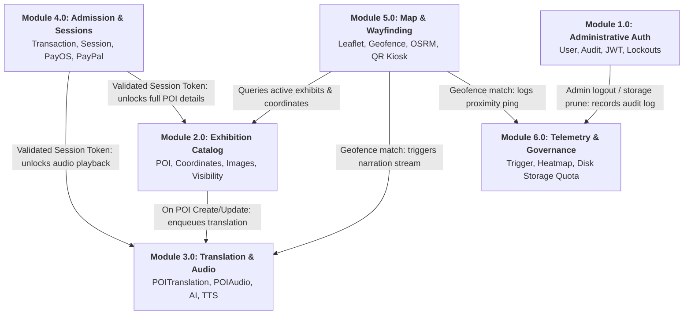

# Maintenance-Oriented System Architecture & Control Mapping (Cu Chi Tunnels Smart Audio Guide)

> **Document Status:** Active Local Maintenance Blueprint & Control Map  
> **Target Scope:** MVP Backend (FastAPI / SQLAlchemy / MySQL 8.0) & Frontend (React 18 / Vite / Leaflet)  
> **Git Policy:** Strictly Local Reference — **Do Not Commit or Push to Remote Repository**  
> **Engineering Paradigm:** Maintenance-Oriented Atomic Feature 3-Layer Vertical Slices (Zero Narrative Summaries)

---

# Master Navigation Hub & Real System File Directory

Click any **"📄 Jump to Section"** link to jump directly to the exact control analysis in this document, or click any **"💻 Open Real System File"** link to jump straight into the live source file in your editor:

| Subsystem Domain | Component / Layer | Document Section (Control Specs) | Live Codebase File (Direct IDE Jump) | Key Function / Responsibility |
|---|---|---|---|---|
| **Core Config** | Env Config | [Section 1.0 Overview](#module-10-administrative-authentication--session-security) | [`.env`](backend/.env) | Environment variable definitions & flags |
| **Core Config** | Pydantic Settings | [Section 1.0 Overview](#module-10-administrative-authentication--session-security) | [`config.py`](backend/app/core/config.py) | Settings singleton (`Settings`) |
| **Core Config** | Database Engine | [Section G.5 (Repo-to-DB)](#g5-repository-to-database-mapping-matrix) | [`database.py`](backend/app/core/database.py) | Connection pool & `SessionLocal` |
| **Core Config** | API Gateway Entry | [Section G.3 (API Matrix)](#g3-api-to-service-mapping-matrix) | [`main.py`](backend/app/main.py) | FastAPI app factory, CORS & routers |
| **Core Config** | Frontend API Client | [Section 1.2 (Feature 1.1)](#12-granular-feature-by-feature-3-layer-manifests) | [`apiClient.js`](frontend/src/api/apiClient.js) | Axios instance & interceptors |
| **Packaging** | App Container | [Section 6.2 (Feature 6.8)](#62-granular-feature-by-feature-3-layer-manifests) | [`Dockerfile.app`](Dockerfile.app) | Multi-stage build (Vite SPA + FastAPI) |
| **Packaging** | DB Container | [Section G.5 (Repo-to-DB)](#g5-repository-to-database-mapping-matrix) | [`Dockerfile.mysql`](Dockerfile.mysql) | Standalone MySQL 8.0 with schema & seeds |
| **Packaging** | Compose Orchestrator | [Section G.5 (Repo-to-DB)](#g5-repository-to-database-mapping-matrix) | [`docker-compose.yml`](docker-compose.yml) | Local & production container orchestration |
| **Gateway** | QR Kiosk View | [Section 5.2 (Feature 5.11)](#52-granular-feature-by-feature-3-layer-manifests) | [`QRCodePage.jsx`](frontend/src/views/QRCodePage.jsx) | Scannable visitor QR gateway & `BASE_URL` |
| **1.0 Auth** | View | [Section 1.3 (UI Points)](#13-ui-control-points) | [`AdminLoginView.jsx`](frontend/src/views/admin/AdminLoginView.jsx) | Admin login portal form |
| **1.0 Auth** | Navigation Bar | [Section 1.3 (UI Points)](#13-ui-control-points) | [`AdminNavbar.jsx`](frontend/src/components/admin/AdminNavbar.jsx) | Top admin chrome & greeting (`Chào, {name}`) |
| **1.0 Auth** | Modal | [Section 1.3 (UI Points)](#13-ui-control-points) | [`AccountLockoutModal.jsx`](frontend/src/components/admin/AccountLockoutModal.jsx) | 15-minute countdown modal |
| **1.0 Auth** | Context | [Section 1.2 (Feature 1.1)](#12-granular-feature-by-feature-3-layer-manifests) | [`AuthContext.jsx`](frontend/src/contexts/AuthContext.jsx) | `user`, `login()`, `logout()`, idle timer |
| **1.0 Auth** | Controller | [Section 1.2 (Feature 1.1)](#12-granular-feature-by-feature-3-layer-manifests) | [`auth_controller.py`](backend/app/controllers/auth_controller.py) | `POST /login`, `GET /me`, `POST /logout` |
| **1.0 Auth** | Service | [Section 1.4 (Business Rules)](#14-business-rule-control-points) | [`auth_service.py`](backend/app/services/auth_service.py) | `authenticate_admin()`, lockout counters |
| **1.0 Auth** | Security | [Section 1.4 (Business Rules)](#14-business-rule-control-points) | [`security.py`](backend/app/core/security.py) | JWT signing & Bcrypt verification |
| **1.0 Auth** | Repository | [Section G.4 (Service-to-Repo)](#g4-service-to-repository-mapping-matrix) | [`user_repository.py`](backend/app/repositories/user_repository.py) | SQL queries on `User` table |
| **1.0 Auth** | Model | [Section G.5 (Repo-to-DB)](#g5-repository-to-database-mapping-matrix) | [`user.py`](backend/app/models/user.py) | SQLAlchemy `User` entity |
| **1.0 Auth** | Audit Model | [Section G.5 (Repo-to-DB)](#g5-repository-to-database-mapping-matrix) | [`audit.py`](backend/app/models/audit.py) | SQLAlchemy `AuditLog` entity |
| **2.0 Catalog** | View | [Section 2.3 (UI Points)](#23-ui-control-points) | [`PoiCatalogPage.jsx`](frontend/src/views/admin/PoiCatalogPage.jsx) | POI list, search, pagination, toggle |
| **2.0 Catalog** | Modal | [Section 2.3 (UI Points)](#23-ui-control-points) | [`POIFormModal.jsx`](frontend/src/components/admin/POIFormModal.jsx) | POI creation & editing dialog |
| **2.0 Catalog** | Controller | [Section 2.2 (Feature 2.4)](#22-granular-feature-by-feature-3-layer-manifests) | [`poi_controller.py`](backend/app/controllers/poi_controller.py) | `GET /pois`, `POST /pois` |
| **2.0 Catalog** | Admin Controller | [Section 2.2 (Feature 2.1)](#22-granular-feature-by-feature-3-layer-manifests) | [`admin_poi_controller.py`](backend/app/controllers/admin_poi_controller.py) | `PATCH /pois/{id}`, `PUT /visibility` |
| **2.0 Catalog** | Service | [Section 2.4 (Business Rules)](#24-business-rule-control-points) | [`poi_service.py`](backend/app/services/poi_service.py) | Coordinate validation, CRUD, translation trigger |
| **2.0 Catalog** | Repository | [Section G.4 (Service-to-Repo)](#g4-service-to-repository-mapping-matrix) | [`poi_repository.py`](backend/app/repositories/poi_repository.py) | SQL queries on `POI` table |
| **2.0 Catalog** | Model | [Section G.5 (Repo-to-DB)](#g5-repository-to-database-mapping-matrix) | [`poi.py`](backend/app/models/poi.py) | SQLAlchemy `POI` entity |
| **3.0 Trans** | View | [Section 3.3 (UI Points)](#33-ui-control-points) | [`TranslationAuditView.jsx`](frontend/src/views/admin/TranslationAuditView.jsx) | Linguistic review, edit & waveform player |
| **3.0 Trans** | Controller | [Section 3.2 (Feature 3.5)](#32-granular-feature-by-feature-3-layer-manifests) | [`translation_controller.py`](backend/app/controllers/translation_controller.py) | `PATCH /{id}`, `POST /publish`, `POST /regenerate` |
| **3.0 Trans** | Pipeline | [Section 3.4 (Business Rules)](#34-business-rule-control-points) | [`translation_pipeline_service.py`](backend/app/services/translation_pipeline_service.py) | Concurrency queue & job orchestrator |
| **3.0 Trans** | Worker | [Section 3.6 (Workflows)](#36-workflow-control-points) | [`translation_worker.py`](backend/app/services/translation_worker.py) | Background translation worker |
| **3.0 Trans** | TTS Service | [Section 3.7 (Integrations)](#37-integration-control-points) | [`tts_service.py`](backend/app/services/tts_service.py) | Microsoft Edge-TTS neural voice dubbing |
| **3.0 Trans** | Model | [Section G.5 (Repo-to-DB)](#g5-repository-to-database-mapping-matrix) | [`translation.py`](backend/app/models/translation.py) | SQLAlchemy `POITranslation` entity |
| **3.0 Trans** | Audio Model | [Section G.5 (Repo-to-DB)](#g5-repository-to-database-mapping-matrix) | [`audio.py`](backend/app/models/audio.py) | SQLAlchemy `POIAudio` entity |
| **4.0 Billing** | Modal | [Section 4.3 (UI Points)](#43-ui-control-points) | [`CheckoutModal.jsx`](frontend/src/components/visitor/CheckoutModal.jsx) | VietQR & card payment modal |
| **4.0 Billing** | Hook | [Section 4.2 (Feature 4.6)](#42-granular-feature-by-feature-3-layer-manifests) | [`usePaymentPolling.js`](frontend/src/hooks/usePaymentPolling.js) | Dynamic status polling & token exchange |
| **4.0 Billing** | Modal | [Section 4.3 (UI Points)](#43-ui-control-points) | [`RestoreSessionModal.jsx`](frontend/src/components/visitor/RestoreSessionModal.jsx) | Cross-device `CCT-...` recovery |
| **4.0 Billing** | Paywall | [Section 4.3 (UI Points)](#43-ui-control-points) | [`ContentPaywallGate.jsx`](frontend/src/components/visitor/ContentPaywallGate.jsx) | Protected content blur & lock UI |
| **4.0 Billing** | Context | [Section 4.2 (Feature 4.11)](#42-granular-feature-by-feature-3-layer-manifests) | [`VisitorSessionContext.jsx`](frontend/src/contexts/VisitorSessionContext.jsx) | `sessionToken`, `remainingSeconds` |
| **4.0 Billing** | Controller | [Section 4.2 (Feature 4.3)](#42-granular-feature-by-feature-3-layer-manifests) | [`payment_controller.py`](backend/app/controllers/payment_controller.py) | `POST /create-checkout`, `POST /session` |
| **4.0 Billing** | Session Controller | [Section 4.2 (Feature 4.10)](#42-granular-feature-by-feature-3-layer-manifests) | [`session_controller.py`](backend/app/controllers/session_controller.py) | `POST /restore` (rate-limited) |
| **4.0 Billing** | Audio Controller | [Section 4.2 (Feature 4.12)](#42-granular-feature-by-feature-3-layer-manifests) | [`audio_controller.py`](backend/app/controllers/audio_controller.py) | `GET /audio/{poi_id}` (byte-range) |
| **4.0 Billing** | Service | [Section 4.4 (Business Rules)](#44-business-rule-control-points) | [`payment_service.py`](backend/app/services/payment_service.py) | PayOS/PayPal integration & webhooks |
| **4.0 Billing** | Session Service | [Section 4.4 (Business Rules)](#44-business-rule-control-points) | [`session_service.py`](backend/app/services/session_service.py) | 24h token provisioning & hashing |
| **4.0 Billing** | Model | [Section G.5 (Repo-to-DB)](#g5-repository-to-database-mapping-matrix) | [`transaction.py`](backend/app/models/transaction.py) | SQLAlchemy `Transaction` entity |
| **4.0 Billing** | Session Model | [Section G.5 (Repo-to-DB)](#g5-repository-to-database-mapping-matrix) | [`session.py`](backend/app/models/session.py) | SQLAlchemy `Session` entity |
| **5.0 Map** | View | [Section 5.3 (UI Points)](#53-ui-control-points) | [`VisitorTourPage.jsx`](frontend/src/views/visitor/VisitorTourPage.jsx) | Main visitor tour & audio player view |
| **5.0 Map** | Map Component | [Section 5.3 (UI Points)](#53-ui-control-points) | [`InteractiveOsmMap.jsx`](frontend/src/components/visitor/InteractiveOsmMap.jsx) | Leaflet map, pins & geofence rings |
| **5.0 Map** | Route Overlay | [Section 5.3 (UI Points)](#53-ui-control-points) | [`RouteOverlay.jsx`](frontend/src/components/visitor/RouteOverlay.jsx) | Pedestrian route line rendering |
| **5.0 Map** | Geolocation Hook | [Section 5.2 (Feature 5.2)](#52-granular-feature-by-feature-3-layer-manifests) | [`useGeolocation.js`](frontend/src/hooks/useGeolocation.js) | Continuous GPS coordinates tracking |
| **5.0 Map** | Geofence Hook | [Section 5.2 (Feature 5.4)](#52-granular-feature-by-feature-3-layer-manifests) | [`useGeofenceTrigger.js`](frontend/src/hooks/useGeofenceTrigger.js) | 30m proximity distance evaluation |
| **5.0 Map** | Cooldown Service | [Section 5.2 (Feature 5.5)](#52-granular-feature-by-feature-3-layer-manifests) | [`cooldownService.js`](frontend/src/services/cooldownService.js) | 60s trigger suppression manager |
| **5.0 Map** | Controller | [Section 5.2 (Feature 5.7)](#52-granular-feature-by-feature-3-layer-manifests) | [`tour_controller.py`](backend/app/controllers/tour_controller.py) | `GET /tours/walking-route` |
| **5.0 Map** | Wayfinding Service | [Section 5.4 (Business Rules)](#54-business-rule-control-points) | [`wayfinding_service.py`](backend/app/services/wayfinding_service.py) | OSRM routing & off-road fallbacks |
| **6.0 Telemetry**| Dashboard | [Section 6.3 (UI Points)](#63-ui-control-points) | [`AnalyticsDashboard.jsx`](frontend/src/views/admin/AnalyticsDashboard.jsx) | Dwell times & visitor volume stats |
| **6.0 Telemetry**| Heatmap | [Section 6.3 (UI Points)](#63-ui-control-points) | [`AnalyticsHeatmap.jsx`](frontend/src/components/admin/AnalyticsHeatmap.jsx) | Leaflet.heat density overlay |
| **6.0 Telemetry**| System Health | [Section 6.3 (UI Points)](#63-ui-control-points) | [`SystemHealthPage.jsx`](frontend/src/views/admin/SystemHealthPage.jsx) | Disk storage monitor & orphan cleaning |
| **6.0 Telemetry**| Controller | [Section 6.2 (Feature 6.2)](#62-granular-feature-by-feature-3-layer-manifests) | [`analytics_controller.py`](backend/app/controllers/analytics_controller.py) | `GET /overview`, `GET /heatmap`, `GET /export` |
| **6.0 Telemetry**| System Controller | [Section 6.2 (Feature 6.5)](#62-granular-feature-by-feature-3-layer-manifests) | [`system_controller.py`](backend/app/controllers/system_controller.py) | `GET /system/storage`, `POST /clean-orphans` |
| **6.0 Telemetry**| Ping Controller | [Section 6.2 (Feature 6.1)](#62-granular-feature-by-feature-3-layer-manifests) | [`telemetry_controller.py`](backend/app/controllers/telemetry_controller.py) | `POST /telemetry/trigger` |
| **6.0 Telemetry**| Service | [Section 6.4 (Business Rules)](#64-business-rule-control-points) | [`telemetry_service.py`](backend/app/services/telemetry_service.py) | Proximity logs & density weights |
| **6.0 Telemetry**| Storage Service | [Section 6.4 (Business Rules)](#64-business-rule-control-points) | [`storage_service.py`](backend/app/services/storage_service.py) | Disk capacity scan & orphan pruner |
| **6.0 Telemetry**| Model | [Section G.5 (Repo-to-DB)](#g5-repository-to-database-mapping-matrix) | [`trigger.py`](backend/app/models/trigger.py) | SQLAlchemy `Trigger` entity |

---

# Module 1.0: Administrative Authentication & Session Security

## 1.1 Module Overview
- **Purpose:** Manages system administration access, credential verification via Bcrypt, cryptographically signed HttpOnly JWT session cookies, 5-attempt brute-force protection, 15-minute temporary lockouts, inactivity timeouts, and administrative audit trail logging.
- **Entry Points:**
  - Frontend: [`AdminLoginView.jsx`](frontend/src/views/admin/AdminLoginView.jsx) (Route `/admin/login`), [`AdminNavbar.jsx`](frontend/src/components/admin/AdminNavbar.jsx) (Chrome on all `/admin/*` routes)
  - Backend Gateway: [`auth_controller.py`](backend/app/controllers/auth_controller.py) (`prefix="/api/v1/auth"`)
- **Dependencies:** `python-jose` (JWT), `passlib[bcrypt]` (Hashing), `SlowAPI` (Rate limiting).
- **Owned Data:**
  - Table [`User`](backend/app/models/user.py): `UserName`, `Email`, `Password_hash`, `FullName`, `Is_Active`, `FalsedAttempts`, `Lockeduntil`
  - Table [`Audit`](backend/app/models/audit.py): `LogID`, `Admin_Username`, `Action`, `Target`, `Client_IP`, `Timestamp`

## 1.2 Granular Feature-by-Feature 3-Layer Manifests

### Feature 1.1: Admin Login Form Submission & Credential Ingestion
- **Layer 1 (Frontend):**
  - View: [`AdminLoginView.jsx`](frontend/src/views/admin/AdminLoginView.jsx)
  - Context: [`AuthContext.jsx`](frontend/src/contexts/AuthContext.jsx) (`login(username, password)`)
  - API Client: [`authApi.js`](frontend/src/api/authApi.js) (`loginAdmin(data)`)
- **Layer 2 (Backend Logic & Gateway):**
  - Gateway: [`auth_controller.py`](backend/app/controllers/auth_controller.py) (`POST /api/v1/auth/login`)
  - Service: [`auth_service.py`](backend/app/services/auth_service.py) (`authenticate_admin(username, password)`)
  - Security Utility: [`security.py`](backend/app/core/security.py) (`verify_password(plain, hashed)`)
- **Layer 3 (Data Access & Persistence):**
  - Repository: [`user_repository.py`](backend/app/repositories/user_repository.py) (`find_by_username(username)`)
  - Schema: [`auth_schema.py`](backend/app/schemas/auth_schema.py) (`AdminLoginRequest`, `AdminSessionResponse`)
  - Model & Table: [`user.py`](backend/app/models/user.py), Table `User`
- **Tests:** [`test_auth_controller.py`](backend/tests/test_auth_controller.py), [`test_auth_service.py`](backend/tests/test_auth_service.py)

### Feature 1.2: HttpOnly JWT Session Cookie Issuance
- **Layer 1 (Frontend):**
  - Client Interceptor: [`apiClient.js`](frontend/src/api/apiClient.js) (`withCredentials: true`)
  - Context: [`AuthContext.jsx`](frontend/src/contexts/AuthContext.jsx) (`user` state hydration)
- **Layer 2 (Backend Logic & Gateway):**
  - Gateway: [`auth_controller.py`](backend/app/controllers/auth_controller.py) (`response.set_cookie(key="admin_session", httponly=True, samesite="lax")`)
  - Security Utility: [`security.py`](backend/app/core/security.py) (`create_access_token(data, expires_delta)`)
- **Layer 3 (Data Access & Persistence):**
  - Configuration: [`config.py`](backend/app/core/config.py) (`JWT_SECRET_KEY`, `ACCESS_TOKEN_EXPIRE_MINUTES=60`)
- **Tests:** [`test_auth_controller.py`](backend/tests/test_auth_controller.py)

### Feature 1.3: Login Gateway Rate Limiting (5 req/min)
- **Layer 1 (Frontend):**
  - View: [`AdminLoginView.jsx`](frontend/src/views/admin/AdminLoginView.jsx) (HTTP 429 error toast)
- **Layer 2 (Backend Logic & Gateway):**
  - Rate Limiter: [`limiter.py`](backend/app/core/limiter.py) (`RATE_LIMIT_LOGIN="5/minute"`, `custom_rate_limit_exceeded_handler`)
  - Gateway: [`auth_controller.py`](backend/app/controllers/auth_controller.py) (`@rate_limit("RATE_LIMIT_LOGIN")`)
- **Layer 3 (Data Access & Persistence):**
  - In-memory client IP tracking key table in SlowAPI
- **Tests:** [`test_auth_controller.py`](backend/tests/test_auth_controller.py)

### Feature 1.4: 5-Attempt Counter & 15-Minute Account Lockout Enforcement
- **Layer 1 (Frontend):**
  - Modal: [`AccountLockoutModal.jsx`](frontend/src/components/admin/AccountLockoutModal.jsx) (dynamic countdown ticker)
  - View: [`AdminLoginView.jsx`](frontend/src/views/admin/AdminLoginView.jsx) (`lockoutSeconds` state trigger)
- **Layer 2 (Backend Logic & Gateway):**
  - Service: [`auth_service.py`](backend/app/services/auth_service.py) (`MAX_FAILED_ATTEMPTS=5`, `LOCKOUT_MINUTES=15`, raises `AccountLockedError`)
- **Layer 3 (Data Access & Persistence):**
  - Repository: [`user_repository.py`](backend/app/repositories/user_repository.py) (`increment_failed_attempts()`, `lock_account()`, `reset_failed_attempts()`)
  - Model & Table: [`user.py`](backend/app/models/user.py), Table `User` (`FalsedAttempts`, `Lockeduntil`)
- **Tests:** [`test_auth_service.py`](backend/tests/test_auth_service.py)

### Feature 1.5: Current Admin Profile Fetch & Full Name Navbar Greeting
- **Layer 1 (Frontend):**
  - Component: [`AdminNavbar.jsx`](frontend/src/components/admin/AdminNavbar.jsx) (Greeting: `adminGreeting: 'Chào, {name}'` prioritizing `full_name`)
  - Locales: [`adminTranslations.js`](frontend/src/locales/adminTranslations.js)
  - API Client: [`authApi.js`](frontend/src/api/authApi.js) (`getProfile()`)
- **Layer 2 (Backend Logic & Gateway):**
  - Gateway: [`auth_controller.py`](backend/app/controllers/auth_controller.py) (`GET /api/v1/auth/me`)
  - Dependency: [`dependencies.py`](backend/app/core/dependencies.py) (`get_current_admin_profile()`)
  - Security Utility: [`security.py`](backend/app/core/security.py) (`decode_token()`)
- **Layer 3 (Data Access & Persistence):**
  - Repository: [`user_repository.py`](backend/app/repositories/user_repository.py) (`find_by_username()`)
  - Schema: [`auth_schema.py`](backend/app/schemas/auth_schema.py) (`AdminProfileResponse`)
  - Model & Table: [`user.py`](backend/app/models/user.py), Table `User` (`FullName`, `UserName`)
- **Tests:** [`AdminNavbar.test.jsx`](frontend/src/components/admin/AdminNavbar.test.jsx), [`test_auth_controller.py`](backend/tests/test_auth_controller.py)

### Feature 1.6: Inactivity Idle Timeout & Frontend Auto-Logout
- **Layer 1 (Frontend):**
  - Context: [`AuthContext.jsx`](frontend/src/contexts/AuthContext.jsx) (listens to mouse/keyboard DOM events, resets 30m countdown)
  - Custom Hook: [`useAuth.js`](frontend/src/hooks/useAuth.js)
- **Layer 2 (Backend Logic & Gateway):**
  - Configuration: [`config.py`](backend/app/core/config.py) (`IDLE_TIMEOUT_MINUTES=30`)
- **Layer 3 (Data Access & Persistence):**
  - Browser DOM state & local storage eviction
- **Tests:** [`AuthContext.test.jsx`](frontend/src/contexts/AuthContext.test.jsx)

### Feature 1.7: Explicit Admin Logout & Security Audit Trail Recording
- **Layer 1 (Frontend):**
  - Component: [`AdminNavbar.jsx`](frontend/src/components/admin/AdminNavbar.jsx) (Logout button)
  - API Client: [`authApi.js`](frontend/src/api/authApi.js) (`logoutAdmin()`)
- **Layer 2 (Backend Logic & Gateway):**
  - Gateway: [`auth_controller.py`](backend/app/controllers/auth_controller.py) (`POST /api/v1/auth/logout`, clears `admin_session` cookie)
  - Service: [`auth_service.py`](backend/app/services/auth_service.py) (`record_logout_audit()`)
- **Layer 3 (Data Access & Persistence):**
  - Repository: [`audit_repository.py`](backend/app/repositories/audit_repository.py) (`log_action("ADMIN_LOGOUT")`)
  - Model & Table: [`audit.py`](backend/app/models/audit.py), Table `Audit`
- **Tests:** [`test_auth_controller.py`](backend/tests/test_auth_controller.py)

## 1.3 UI Control Points
- **Screen: Admin Login Portal**
  - *Route:* `/admin/login`
  - *Component:* [`AdminLoginView.jsx`](frontend/src/views/admin/AdminLoginView.jsx)
  - *Displayed Fields:* Portal Header ("Hệ thống Quản trị Bảo tàng"), Error Banner, Lockout Warning
  - *Editable Fields:* `username` (Text Input), `password` (Password Input)
  - *Hidden Fields:* None
  - *Filter Fields:* None
  - *Action Buttons:* "Đăng nhập" (`handleLoginSubmit()`)
- **Screen: Account Lockout Modal**
  - *Route:* Rendered on `/admin/login` upon 5th failure
  - *Component:* [`AccountLockoutModal.jsx`](frontend/src/components/admin/AccountLockoutModal.jsx)
  - *Displayed Fields:* Lockout Notice, Remaining Countdown Ticker (`MM:SS`)
  - *Editable Fields:* None
  - *Hidden Fields:* `lockoutUntil` timestamp
  - *Filter Fields:* None
  - *Action Buttons:* "Đã hiểu" (Dismiss modal)
- **Screen: Admin Top Navbar Chrome**
  - *Route:* Persistent on all `/admin/*` routes
  - *Component:* [`AdminNavbar.jsx`](frontend/src/components/admin/AdminNavbar.jsx)
  - *Displayed Fields:* Brand Logo, Page Title, Admin Greeting (`Chào, {name}` prioritizing `full_name`), Storage Banner integration
  - *Editable Fields:* None
  - *Hidden Fields:* `user` profile object
  - *Filter Fields:* None
  - *Action Buttons:* "Đăng xuất" (`handleLogout()`)

## 1.4 Business Rule Control Points
- **BR-AUTH-01 (Bcrypt Password Hashing):** All admin passwords hashed with Bcrypt `cost=12` in production and `cost=4` in test suite. Source: [`security.py:25-35`](backend/app/core/security.py). APIs: `POST /api/v1/auth/login`. DB: `User.Password_hash`.
- **BR-AUTH-02 (5-Attempt Failed Lockout):** If `FalsedAttempts >= 5`, account is locked for 15 minutes (`Lockeduntil = now() + 15m`). Source: [`auth_service.py:45-70`](backend/app/services/auth_service.py). APIs: `POST /api/v1/auth/login`. DB: `User.FalsedAttempts`, `User.Lockeduntil`.
- **BR-AUTH-03 (HttpOnly Cookie Isolation):** Session tokens stored exclusively in `admin_session` HttpOnly, SameSite=Lax cookie. Never accessible to browser JavaScript. Source: [`auth_controller.py:55-65`](backend/app/controllers/auth_controller.py). APIs: `POST /api/v1/auth/login`, `POST /api/v1/auth/logout`.
- **BR-AUTH-04 (Greeting Name Resolution):** Navbar greeting displays `user.full_name`. If `full_name` is null or empty, falls back to `user.user_name`. Source: [`AdminNavbar.jsx:28-35`](frontend/src/components/admin/AdminNavbar.jsx), [`adminTranslations.js`](frontend/src/locales/adminTranslations.js).
- **BR-AUTH-05 (Audit Trail Logging):** Every administrative login, logout, and lockout event is recorded with client IP, timestamp, and action code. Source: [`audit_repository.py:15-30`](backend/app/repositories/audit_repository.py). DB: Table `Audit`.

## 1.5 Validation Control Points
- **VAL-AUTH-01 (Login Request Schema):** `username` must be non-empty string $\le 20$ chars; `password` must be non-empty string $\le 128$ chars. Validation Source: [`auth_schema.py:10-25`](backend/app/schemas/auth_schema.py) (`AdminLoginRequest`). Screen: [`AdminLoginView.jsx`](frontend/src/views/admin/AdminLoginView.jsx). API: `POST /api/v1/auth/login`.
- **VAL-AUTH-02 (Active Account Status):** User account must have `Is_Active = TRUE`. Disabled accounts rejected immediately. Validation Source: [`auth_service.py:50`](backend/app/services/auth_service.py).

## 1.6 Workflow Control Points
- **Workflow: Admin Authentication Lifecycle**
  - *States:* `UNAUTHENTICATED` $\rightarrow$ `AUTHENTICATED` $\rightarrow$ `LOCKED` (on 5 failures) $\rightarrow$ `EXPIRED` (after 60m or 30m idle)
  - *Transitions:*
    - `UNAUTHENTICATED` $\rightarrow$ `AUTHENTICATED`: Valid credentials submitted.
    - `UNAUTHENTICATED` $\rightarrow$ `LOCKED`: 5 consecutive failed login attempts.
    - `LOCKED` $\rightarrow$ `UNAUTHENTICATED`: 15 minutes elapsed since `Lockeduntil`.
    - `AUTHENTICATED` $\rightarrow$ `UNAUTHENTICATED`: Explicit logout or idle timeout.
  - *Trigger Files:* [`auth_controller.py`](backend/app/controllers/auth_controller.py), [`auth_service.py`](backend/app/services/auth_service.py), [`AuthContext.jsx`](frontend/src/contexts/AuthContext.jsx).

## 1.7 Integration Control Points
- **External Integration:** None (Domain is self-contained using internal Bcrypt and Jose JWT).

## 1.8 Change Impact Matrix
- **If UI changes (e.g. login form, greeting layout):**
  - Affected: [`AdminLoginView.jsx`](frontend/src/views/admin/AdminLoginView.jsx), [`AdminNavbar.jsx`](frontend/src/components/admin/AdminNavbar.jsx), [`adminTranslations.js`](frontend/src/locales/adminTranslations.js), [`AdminNavbar.test.jsx`](frontend/src/components/admin/AdminNavbar.test.jsx).
- **If validation changes (e.g. password complexity rules):**
  - Affected: [`auth_schema.py`](backend/app/schemas/auth_schema.py), [`AdminLoginView.jsx`](frontend/src/views/admin/AdminLoginView.jsx), [`test_auth_controller.py`](backend/tests/test_auth_controller.py).
- **If business rules change (e.g. lockout threshold from 5 to 3):**
  - Affected: [`auth_service.py`](backend/app/services/auth_service.py) (`MAX_FAILED_ATTEMPTS`), [`AccountLockoutModal.jsx`](frontend/src/components/admin/AccountLockoutModal.jsx), [`test_auth_service.py`](backend/tests/test_auth_service.py).
- **If workflow changes (e.g. multi-factor authentication added):**
  - Affected: [`auth_controller.py`](backend/app/controllers/auth_controller.py), [`auth_service.py`](backend/app/services/auth_service.py), [`AuthContext.jsx`](frontend/src/contexts/AuthContext.jsx), [`AdminLoginView.jsx`](frontend/src/views/admin/AdminLoginView.jsx).
- **If database schema changes (e.g. adding MFA columns):**
  - Affected: [`backend/scripts/mysql_schema.sql`](backend/scripts/mysql_schema.sql), [`user.py`](backend/app/models/user.py), [`user_repository.py`](backend/app/repositories/user_repository.py), [`backend/scripts/seed_data.sql`](backend/scripts/seed_data.sql).

---

# Module 2.0: Exhibition Cataloging & Spatial Perimeter Management

## 2.1 Module Overview
- **Purpose:** Manages the catalog of historical relics and exhibits, GPS geographic perimeter coordinate validation, 5MB cover artwork uploads (local disk or Supabase), exhibit editing with automatic translation invalidation, public visibility toggling, and visitor paywall teaser data delivery.
- **Entry Points:**
  - Frontend: [`PoiCatalogPage.jsx`](frontend/src/views/admin/PoiCatalogPage.jsx) (Route `/admin/pois`), [`POIFormModal.jsx`](frontend/src/components/admin/POIFormModal.jsx)
  - Backend Gateway: [`poi_controller.py`](backend/app/controllers/poi_controller.py) (`prefix="/api/v1/pois"`), [`admin_poi_controller.py`](backend/app/controllers/admin_poi_controller.py) (`prefix="/api/v1/admin/pois"`)
- **Dependencies:** `Pillow` (Image validation), `geopy` (Coordinate math), `supabase` (Cloud storage adapter).
- **Owned Data:**
  - Table [`POI`](backend/app/models/poi.py): `POI_ID`, `Title`, `Description`, `Latitude`, `Longitude`, `Trigger_Radius`, `Cover_Image_URL`, `Is_Active`, `Create_at`, `Update_at`
  - Table [`POITranslation`](backend/app/models/translation.py): Linked by foreign key `POI_ID`

## 2.2 Granular Feature-by-Feature 3-Layer Manifests

### Feature 2.1: Admin POI Paginated Catalog Fetching
- **Layer 1 (Frontend):**
  - View: [`PoiCatalogPage.jsx`](frontend/src/views/admin/PoiCatalogPage.jsx) (Table rows, page controls)
  - API Client: [`poiApi.js`](frontend/src/api/poiApi.js) (`getAdminPois({ page, size, search })`)
- **Layer 2 (Backend Logic & Gateway):**
  - Gateway: [`admin_poi_controller.py`](backend/app/controllers/admin_poi_controller.py) (`GET /api/v1/admin/pois`)
  - Service: [`poi_service.py`](backend/app/services/poi_service.py) (`list_pois_paginated(page, size, search)`)
- **Layer 3 (Data Access & Persistence):**
  - Repository: [`poi_repository.py`](backend/app/repositories/poi_repository.py) (`find_all_paginated(page, size, search)`)
  - Schema: [`poi_schema.py`](backend/app/schemas/poi_schema.py) (`POIListResponse`, `POIListItem`)
  - Model & Table: [`poi.py`](backend/app/models/poi.py), Table `POI`
- **Tests:** [`PoiCatalogPage.test.jsx`](frontend/src/views/admin/PoiCatalogPage.test.jsx), [`test_poi_controller.py`](backend/tests/test_poi_controller.py)

### Feature 2.2: Admin POI Search Filtering (Title & ID Substring)
- **Layer 1 (Frontend):**
  - View: [`PoiCatalogPage.jsx`](frontend/src/views/admin/PoiCatalogPage.jsx) (Search input with 300ms debounce)
  - API Client: [`poiApi.js`](frontend/src/api/poiApi.js) (`getAdminPois({ search: query })`)
- **Layer 2 (Backend Logic & Gateway):**
  - Gateway: [`admin_poi_controller.py`](backend/app/controllers/admin_poi_controller.py) (`query parameter search: str = ""`)
  - Service: [`poi_service.py`](backend/app/services/poi_service.py)
- **Layer 3 (Data Access & Persistence):**
  - Repository: [`poi_repository.py`](backend/app/repositories/poi_repository.py) (`filter(POI.Title.ilike(...) | POI.POI_ID.ilike(...))`)
  - Model & Table: Table `POI`
- **Tests:** [`test_poi_controller.py`](backend/tests/test_poi_controller.py)

### Feature 2.3: Admin POI Form Modal Open & Single POI Detail Fetch
- **Layer 1 (Frontend):**
  - Modal: [`POIFormModal.jsx`](frontend/src/components/admin/POIFormModal.jsx)
  - View: [`PoiCatalogPage.jsx`](frontend/src/views/admin/PoiCatalogPage.jsx) (`handleEditPoi(poiId)`)
  - API Client: [`poiApi.js`](frontend/src/api/poiApi.js) (`getPoiById(poiId)`)
- **Layer 2 (Backend Logic & Gateway):**
  - Gateway: [`admin_poi_controller.py`](backend/app/controllers/admin_poi_controller.py) (`GET /api/v1/admin/pois/{id}`)
  - Service: [`poi_service.py`](backend/app/services/poi_service.py) (`get_poi(poi_id)`)
- **Layer 3 (Data Access & Persistence):**
  - Repository: [`poi_repository.py`](backend/app/repositories/poi_repository.py) (`find_by_id(poi_id)`)
  - Schema: [`poi_schema.py`](backend/app/schemas/poi_schema.py) (`POIResponse`)
  - Model & Table: Table `POI`
- **Tests:** [`test_poi_controller.py`](backend/tests/test_poi_controller.py)

### Feature 2.4: POI Creation Payload Ingestion & Validation
- **Layer 1 (Frontend):**
  - Modal: [`POIFormModal.jsx`](frontend/src/components/admin/POIFormModal.jsx) (Form submit handler)
  - API Client: [`poiApi.js`](frontend/src/api/poiApi.js) (`createPoi(data)`)
- **Layer 2 (Backend Logic & Gateway):**
  - Gateway: [`poi_controller.py`](backend/app/controllers/poi_controller.py) (`POST /api/v1/pois`)
  - Service: [`poi_service.py`](backend/app/services/poi_service.py) (`create_poi(payload)`)
- **Layer 3 (Data Access & Persistence):**
  - Schema: [`poi_schema.py`](backend/app/schemas/poi_schema.py) (`POICreateRequest`)
  - Repository: [`poi_repository.py`](backend/app/repositories/poi_repository.py) (`create(poi_data)`)
  - Model & Table: Table `POI`
- **Tests:** [`test_poi_controller.py`](backend/tests/test_poi_controller.py), [`test_poi_service.py`](backend/tests/test_poi_service.py)

### Feature 2.5: Cu Chi Geographic Perimeter Geofence Coordinate Validation
- **Layer 1 (Frontend):**
  - Modal: [`POIFormModal.jsx`](frontend/src/components/admin/POIFormModal.jsx) (Latitude & Longitude number inputs)
- **Layer 2 (Backend Logic & Gateway):**
  - Service: [`poi_service.py`](backend/app/services/poi_service.py) (`validate_coordinates(lat, lng)`, checks bounding box: $11.13 \le \text{lat} \le 11.16$, $106.45 \le \text{lng} \le 106.48$)
  - Configuration: [`config.py`](backend/app/core/config.py) (`ALLOW_GLOBAL_COORDINATES`, `CU_CHI_BOUNDS`)
- **Layer 3 (Data Access & Persistence):**
  - Model & Table: Table `POI` (`Latitude`, `Longitude`)
- **Tests:** [`test_poi_service.py`](backend/tests/test_poi_service.py)

### Feature 2.6: Exhibition Cover Artwork Upload & Size/Mime-Type Enforcement
- **Layer 1 (Frontend):**
  - Modal: [`POIFormModal.jsx`](frontend/src/components/admin/POIFormModal.jsx) (File dropzone, client preview, size check $\le 5\text{MB}$)
  - API Client: [`poiApi.js`](frontend/src/api/poiApi.js) (`uploadPoiImage(file)`)
- **Layer 2 (Backend Logic & Gateway):**
  - Gateway: [`admin_poi_controller.py`](backend/app/controllers/admin_poi_controller.py) (`POST /api/v1/admin/pois/upload-image`)
  - Integration: [`storage_client.py`](backend/app/integrations/storage_client.py) (`upload_image(file_bytes, filename)`)
  - Configuration: [`config.py`](backend/app/core/config.py) (`MAX_IMAGE_SIZE_BYTES=5242880`, `ALLOWED_IMAGE_TYPES=["image/jpeg", "image/png", "image/webp"]`)
- **Layer 3 (Data Access & Persistence):**
  - Disk storage directory `/static/images` or Supabase Storage bucket `museum-media`
- **Tests:** [`test_poi_controller.py`](backend/tests/test_poi_controller.py)

### Feature 2.7: POI Updating & Text Delta Analysis
- **Layer 1 (Frontend):**
  - Modal: [`POIFormModal.jsx`](frontend/src/components/admin/POIFormModal.jsx) (Save Changes button)
  - API Client: [`poiApi.js`](frontend/src/api/poiApi.js) (`updatePoi(poiId, data)`)
- **Layer 2 (Backend Logic & Gateway):**
  - Gateway: [`admin_poi_controller.py`](backend/app/controllers/admin_poi_controller.py) (`PATCH /api/v1/admin/pois/{id}`)
  - Service: [`poi_service.py`](backend/app/services/poi_service.py) (`update_poi(poi_id, update_data)`)
- **Layer 3 (Data Access & Persistence):**
  - Schema: [`poi_schema.py`](backend/app/schemas/poi_schema.py) (`POIUpdateRequest`)
  - Repository: [`poi_repository.py`](backend/app/repositories/poi_repository.py) (`update(poi_id, fields)`)
  - Model & Table: Table `POI`
- **Tests:** [`test_poi_service.py`](backend/tests/test_poi_service.py)

### Feature 2.8: Automatic Invalidation of Stale Translations on Description Change
- **Layer 1 (Frontend):**
  - View: [`PoiCatalogPage.jsx`](frontend/src/views/admin/PoiCatalogPage.jsx) (Renders "Cần cập nhật" status badge)
- **Layer 2 (Backend Logic & Gateway):**
  - Service: [`poi_service.py`](backend/app/services/poi_service.py) (computes hash delta on `description`, calls `mark_stale_by_poi()`)
- **Layer 3 (Data Access & Persistence):**
  - Repository: [`translation_repository.py`](backend/app/repositories/translation_repository.py) (`mark_stale_by_poi(poi_id)`)
  - Model & Table: [`translation.py`](backend/app/models/translation.py), Table `POITranslation` (`Status="NEEDS_UPDATE"`)
- **Tests:** [`test_poi_service.py`](backend/tests/test_poi_service.py)

### Feature 2.9: POI Public Visibility Toggle Switch
- **Layer 1 (Frontend):**
  - View: [`PoiCatalogPage.jsx`](frontend/src/views/admin/PoiCatalogPage.jsx) (Toggle Switch in table row)
  - API Client: [`poiApi.js`](frontend/src/api/poiApi.js) (`updateVisibility(poiId, isActive)`)
- **Layer 2 (Backend Logic & Gateway):**
  - Gateway: [`admin_poi_controller.py`](backend/app/controllers/admin_poi_controller.py) (`PUT /api/v1/admin/pois/{id}/visibility`)
  - Service: [`poi_service.py`](backend/app/services/poi_service.py) (`set_visibility(poi_id, is_active)`)
- **Layer 3 (Data Access & Persistence):**
  - Schema: [`poi_schema.py`](backend/app/schemas/poi_schema.py) (`POIVisibilityUpdateRequest`)
  - Repository: [`poi_repository.py`](backend/app/repositories/poi_repository.py) (`update_visibility(poi_id, is_active)`)
  - Model & Table: Table `POI` (`Is_Active`)
- **Tests:** [`test_poi_controller.py`](backend/tests/test_poi_controller.py)

### Feature 2.10: Public Visitor Active POI Listing & Paywall Teaser Masking
- **Layer 1 (Frontend):**
  - View: [`VisitorTourPage.jsx`](frontend/src/views/visitor/VisitorTourPage.jsx) (Exhibit list panel)
  - API Client: [`poiApi.js`](frontend/src/api/poiApi.js) (`getVisitorPois(language, token)`)
- **Layer 2 (Backend Logic & Gateway):**
  - Gateway: [`poi_controller.py`](backend/app/controllers/poi_controller.py) (`GET /api/v1/pois`)
  - Service: [`poi_service.py`](backend/app/services/poi_service.py) (`get_visitor_pois()`, checks session validity: if invalid/absent, returns short teaser description & sets `is_locked=True`)
- **Layer 3 (Data Access & Persistence):**
  - Repository: [`poi_repository.py`](backend/app/repositories/poi_repository.py) (`find_active()`)
  - Schema: [`poi_schema.py`](backend/app/schemas/poi_schema.py) (`POIMapItem`)
  - Model & Table: Table `POI`, Table `POITranslation`
- **Tests:** [`test_poi_controller.py`](backend/tests/test_poi_controller.py)

### Feature 2.11: Single POI Detailed View with Audio Link Unlock
- **Layer 1 (Frontend):**
  - View: [`VisitorTourPage.jsx`](frontend/src/views/visitor/VisitorTourPage.jsx) (Bottom sheet POI card)
- **Layer 2 (Backend Logic & Gateway):**
  - Gateway: [`poi_controller.py`](backend/app/controllers/poi_controller.py) (`GET /api/v1/pois/{id}`)
  - Service: [`poi_service.py`](backend/app/services/poi_service.py) (`get_poi_detail(poi_id, session_token)`)
- **Layer 3 (Data Access & Persistence):**
  - Repository: [`poi_repository.py`](backend/app/repositories/poi_repository.py)
  - Model & Table: Table `POI`, Table `POIAudio`
- **Tests:** [`test_poi_controller.py`](backend/tests/test_poi_controller.py)

## 2.3 UI Control Points
- **Screen: POI Catalog Page**
  - *Route:* `/admin/pois`
  - *Component:* [`PoiCatalogPage.jsx`](frontend/src/views/admin/PoiCatalogPage.jsx)
  - *Displayed Fields:* POI Title, ID, Thumbnail Artwork, Coordinates, Radius, Active Switch, Translation Status Pills ("Hoàn tất", "Đang dịch", "Cần cập nhật")
  - *Editable Fields:* Search Query (Text Input), Visibility Toggle (Switch)
  - *Hidden Fields:* Internal `poi_id` strings
  - *Filter Fields:* Search Input (Debounced)
  - *Action Buttons:* "Thêm Địa điểm" (Opens create modal), "Chỉnh sửa" (Opens edit modal)
- **Screen: POI Form Modal (Create / Edit)**
  - *Route:* Rendered dynamically on `/admin/pois`
  - *Component:* [`POIFormModal.jsx`](frontend/src/components/admin/POIFormModal.jsx)
  - *Displayed Fields:* Form Header ("Tạo Địa điểm mới" / "Chỉnh sửa Địa điểm"), Artwork Preview
  - *Editable Fields:* `poi_id` (Text Input, create only), `title` (Text Input), `description` (Textarea), `latitude` (Number), `longitude` (Number), `trigger_radius` (Number, default 30), `cover_image` (File dropzone)
  - *Hidden Fields:* `is_active` initial state
  - *Filter Fields:* None
  - *Action Buttons:* "Hủy" (`onClose()`), "Lưu Địa điểm" (`handleSubmit()`)

## 2.4 Business Rule Control Points
- **BR-CAT-01 (Coordinate Perimeter Bounds):** Coordinates must fall inside Cu Chi historical boundary ($11.13 \le \text{lat} \le 11.16$, $106.45 \le \text{lng} \le 106.48$). If outside and `ALLOW_GLOBAL_COORDINATES=false`, rejected with HTTP 422. Source: [`poi_service.py:75-90`](backend/app/services/poi_service.py).
- **BR-CAT-02 (Artwork Constraints):** Image files must be $\le 5\text{MB}$ and format JPEG, PNG, or WEBP. Source: [`config.py:90-95`](backend/app/core/config.py), [`admin_poi_controller.py:95`](backend/app/controllers/admin_poi_controller.py).
- **BR-CAT-03 (Stale Translation Marking):** Modifying an exhibit's Vietnamese source `description` immediately sets all foreign language translations to `Status="NEEDS_UPDATE"`. Source: [`poi_service.py:145-160`](backend/app/services/poi_service.py).
- **BR-CAT-04 (Visitor Content Paywalling):** Visitors without a verified 24-hour session token receive only teaser descriptions ($\le 120$ chars) and have audio URLs masked (`is_locked=True`). Source: [`poi_service.py:180-205`](backend/app/services/poi_service.py).

## 2.5 Validation Control Points
- **VAL-CAT-01 (POI Create Schema):** `poi_id` matches `^[a-zA-Z0-9_-]{3,30}$`; `title` 3-255 chars; `description` $\ge 10$ chars; `trigger_radius` $5.0 \le r \le 100.0$. Validation Source: [`poi_schema.py:15-40`](backend/app/schemas/poi_schema.py) (`POICreateRequest`). Screen: [`POIFormModal.jsx`](frontend/src/components/admin/POIFormModal.jsx). API: `POST /api/v1/pois`.
- **VAL-CAT-02 (Image Upload Size):** HTTP file payload checked before writing to disk/cloud. Size $> 5\text{MB}$ returns HTTP 413. Source: [`admin_poi_controller.py:100`](backend/app/controllers/admin_poi_controller.py).

## 2.6 Workflow Control Points
- **Workflow: POI Lifecycle & Invalidation State Machine**
  - *States:* `DRAFT` $\rightarrow$ `ACTIVE` $\rightarrow$ `HIDDEN` $\rightarrow$ `STALE_TRANSLATIONS`
  - *Transitions:*
    - Create POI $\rightarrow$ `ACTIVE` (or `HIDDEN` if `is_active=False`) + queues background translation.
    - Toggle Visibility $\rightarrow$ switches `ACTIVE` $\leftrightarrow$ `HIDDEN`.
    - Edit Text $\rightarrow$ retains POI active state but transitions translations to `NEEDS_UPDATE`.
  - *Trigger Files:* [`poi_service.py`](backend/app/services/poi_service.py), [`admin_poi_controller.py`](backend/app/controllers/admin_poi_controller.py).

## 2.7 Integration Control Points
- **External Integration: Cloud Media Object Storage (Supabase Storage)**
  - *Service:* Supabase Storage API (`POST /storage/v1/object/museum-media/*`)
  - *Adapter:* [`storage_client.py`](backend/app/integrations/storage_client.py) (`StorageClient.upload_image()`)
  - *Fallback:* If `SUPABASE_URL` is empty or upload fails, falls back automatically to local disk `/static/images`.

## 2.8 Change Impact Matrix
- **If UI changes (e.g. POI catalog table layout, form inputs):**
  - Affected: [`PoiCatalogPage.jsx`](frontend/src/views/admin/PoiCatalogPage.jsx), [`POIFormModal.jsx`](frontend/src/components/admin/POIFormModal.jsx), [`adminTranslations.js`](frontend/src/locales/adminTranslations.js), [`PoiCatalogPage.test.jsx`](frontend/src/views/admin/PoiCatalogPage.test.jsx).
- **If validation changes (e.g. trigger radius bounds):**
  - Affected: [`poi_schema.py`](backend/app/schemas/poi_schema.py), [`POIFormModal.jsx`](frontend/src/components/admin/POIFormModal.jsx), [`test_poi_service.py`](backend/tests/test_poi_service.py).
- **If business rules change (e.g. Cu Chi coordinate boundaries extended):**
  - Affected: [`config.py`](backend/app/core/config.py) (`CU_CHI_BOUNDS`), [`poi_service.py`](backend/app/services/poi_service.py), [`test_poi_service.py`](backend/tests/test_poi_service.py).
- **If workflow changes (e.g. draft approval step before active):**
  - Affected: [`poi_controller.py`](backend/app/controllers/poi_controller.py), [`poi_service.py`](backend/app/services/poi_service.py), [`PoiCatalogPage.jsx`](frontend/src/views/admin/PoiCatalogPage.jsx).
- **If database schema changes (e.g. adding 3D model URL to POI):**
  - Affected: [`backend/scripts/mysql_schema.sql`](backend/scripts/mysql_schema.sql), [`poi.py`](backend/app/models/poi.py), [`poi_repository.py`](backend/app/repositories/poi_repository.py), [`poi_schema.py`](backend/app/schemas/poi_schema.py).

---

# Module 3.0: Multilingual Translation & Neural Audio Dubbing Pipeline

## 3.1 Module Overview
- **Purpose:** Orchestrates automated AI-powered translation for foreign languages (`en`, `ja`, `ko`, `zh`, `fr`), dual AI cloud failover (Render Deep-Translator $\leftrightarrow$ OpenRouter multi-key rotation), administrative linguistic audit & manual script editing, Microsoft Edge-TTS neural voice dubbing generation, and on-demand audio regeneration.
- **Entry Points:**
  - Frontend: [`TranslationAuditView.jsx`](frontend/src/views/admin/TranslationAuditView.jsx) (Route `/admin/translations`), [`AudioWaveformPlayer.jsx`](frontend/src/components/admin/AudioWaveformPlayer.jsx)
  - Backend Gateway: [`translation_controller.py`](backend/app/controllers/translation_controller.py) (`prefix="/api/v1/admin/translations"`)
  - Background Workers: [`pipeline_queue.py`](backend/app/services/pipeline_queue.py), [`translation_worker.py`](backend/app/services/translation_worker.py)
- **Dependencies:** `edge-tts` (Microsoft Neural Voice dubbing), `httpx` (Asynchronous HTTP clients for Render and OpenRouter).
- **Owned Data:**
  - Table [`POITranslation`](backend/app/models/translation.py): `Translation_ID`, `POI_ID`, `LanguageID`, `Translated_Title`, `Translated_Description`, `Status`, `Translation_hash`, `Create_at`, `Update_at`
  - Table [`POIAudio`](backend/app/models/audio.py): `Audio_ID`, `POI_ID`, `LanguageID`, `File_Path`, `Duration_seconds`, `Create_at`, `Update_at`
  - Table [`LanguageCode`](backend/app/models/language.py): Catalogs active language identifiers (`vi`, `en`, `ja`, `ko`, `zh`, `fr`)
  - Filesystem partition: `/audio_cache/*.mp3` (Static audio assets)

## 3.2 Granular Feature-by-Feature 3-Layer Manifests

### Feature 3.1: Automated Translation Task Enqueueing on POI Mutation
- **Layer 1 (Frontend):**
  - Triggered in background on POI create / update form submission in [`POIFormModal.jsx`](frontend/src/components/admin/POIFormModal.jsx).
- **Layer 2 (Backend Logic & Gateway):**
  - Queue Orchestrator: [`pipeline_queue.py`](backend/app/services/pipeline_queue.py) (`get_pipeline_queue().enqueue_job(job)`)
  - Service: [`translation_pipeline_service.py`](backend/app/services/translation_pipeline_service.py) (`queue_translations_for_poi(poi_id, languages)`)
- **Layer 3 (Data Access & Persistence):**
  - In-memory async job queue (`JobItem(poi_id, languages)`)
  - Table `POITranslation` (Initial status set to `IN_TRANSLATION`)
- **Tests:** [`test_translation_service.py`](backend/tests/test_translation_service.py)

### Feature 3.2: Translation Deduplication via Content SHA-256 Hashing
- **Layer 1 (Frontend):**
  - Transparent background optimization (No direct UI trigger).
- **Layer 2 (Backend Logic & Gateway):**
  - Service: [`translation_pipeline_service.py`](backend/app/services/translation_pipeline_service.py) (`compute_hash(text)`, compares against `Translation_hash`)
- **Layer 3 (Data Access & Persistence):**
  - Repository: [`translation_repository.py`](backend/app/repositories/translation_repository.py) (`find_by_poi_and_language()`)
  - Model & Table: [`translation.py`](backend/app/models/translation.py), Table `POITranslation` (`Translation_hash`)
- **Tests:** [`test_translation_service.py`](backend/tests/test_translation_service.py)

### Feature 3.3: Primary Translation Invocation via Render Deep-Translator Service
- **Layer 1 (Frontend):**
  - Executed autonomously by the background queue worker.
- **Layer 2 (Backend Logic & Gateway):**
  - Worker: [`translation_worker.py`](backend/app/services/translation_worker.py)
  - Integration: [`deep_translator_client.py`](backend/app/integrations/deep_translator_client.py) (`DeepTranslatorClient.translate(text, target_lang)`)
  - Configuration: [`config.py`](backend/app/core/config.py) (`RENDER_TRANSLATION_API_URL`, `RENDER_TRANSLATION_TIMEOUT=70.0`, cold-start wake-up retry)
- **Layer 3 (Data Access & Persistence):**
  - Repository: [`translation_repository.py`](backend/app/repositories/translation_repository.py) (`upsert()`)
  - Model & Table: Table `POITranslation` (`Translated_Title`, `Translated_Description`, `Status="COMPLETED"`)
- **Tests:** [`test_translation_service.py`](backend/tests/test_translation_service.py)

### Feature 3.4: Secondary Translation Failover via OpenRouter Multi-Key Auto-Rotation
- **Layer 1 (Frontend):**
  - Transparent fallback during network or upstream failure.
- **Layer 2 (Backend Logic & Gateway):**
  - Integration: [`openrouter_client.py`](backend/app/integrations/openrouter_client.py) (`OpenRouterClient.translate()`, automatically rotates keys when receiving 402/403/429/401 HTTP codes)
  - Configuration: [`config.py`](backend/app/core/config.py) (`OPENROUTER_API_KEY`, `OPENROUTER_MODEL="openrouter/free"`, `OPENROUTER_BASE_URL`)
- **Layer 3 (Data Access & Persistence):**
  - Model & Table: Table `POITranslation`
- **Tests:** [`test_translation_service.py`](backend/tests/test_translation_service.py)

### Feature 3.5: Translation Audit Table Paginated Listing & Language Filtering
- **Layer 1 (Frontend):**
  - View: [`TranslationAuditView.jsx`](frontend/src/views/admin/TranslationAuditView.jsx) (Translation review data grid, language dropdown selector, status pills)
  - API Client: [`translationApi.js`](frontend/src/api/translationApi.js) (`getTranslations({ page, size, language_id, status })`)
- **Layer 2 (Backend Logic & Gateway):**
  - Gateway: [`translation_controller.py`](backend/app/controllers/translation_controller.py) (`GET /api/v1/admin/translations`)
  - Service: [`translation_pipeline_service.py`](backend/app/services/translation_pipeline_service.py) (`list_translations()`)
- **Layer 3 (Data Access & Persistence):**
  - Repository: [`translation_repository.py`](backend/app/repositories/translation_repository.py) (`find_all_paginated()`)
  - Schema: [`translation_schema.py`](backend/app/schemas/translation_schema.py) (`TranslationListResponse`, `TranslationListItem`)
  - Model & Table: Table `POITranslation`
- **Tests:** [`TranslationAuditView.test.jsx`](frontend/src/views/admin/TranslationAuditView.test.jsx), [`test_translation_controller.py`](backend/tests/test_translation_controller.py)

### Feature 3.6: Manual Script Editing & Re-Hashing in Translation Audit
- **Layer 1 (Frontend):**
  - View: [`TranslationAuditView.jsx`](frontend/src/views/admin/TranslationAuditView.jsx) (Edit Script dialog modal, textarea inputs)
  - API Client: [`translationApi.js`](frontend/src/api/translationApi.js) (`updateTranslation(id, data)`)
- **Layer 2 (Backend Logic & Gateway):**
  - Gateway: [`translation_controller.py`](backend/app/controllers/translation_controller.py) (`PATCH /api/v1/admin/translations/{id}`)
  - Service: [`translation_pipeline_service.py`](backend/app/services/translation_pipeline_service.py) (`update_translation_text()`, recalculates hash, sets `Status="NEEDS_UPDATE"`)
- **Layer 3 (Data Access & Persistence):**
  - Schema: [`translation_schema.py`](backend/app/schemas/translation_schema.py) (`TranslationUpdateRequest`, `TranslationResponse`)
  - Repository: [`translation_repository.py`](backend/app/repositories/translation_repository.py) (`update()`)
  - Model & Table: Table `POITranslation`
- **Tests:** [`test_translation_controller.py`](backend/tests/test_translation_controller.py)

### Feature 3.7: Translation Approval & Publishing Gateway
- **Layer 1 (Frontend):**
  - View: [`TranslationAuditView.jsx`](frontend/src/views/admin/TranslationAuditView.jsx) ("Xuất bản" action button)
  - API Client: [`translationApi.js`](frontend/src/api/translationApi.js) (`publishTranslation(id)`)
- **Layer 2 (Backend Logic & Gateway):**
  - Gateway: [`translation_controller.py`](backend/app/controllers/translation_controller.py) (`POST /api/v1/admin/translations/{id}/publish`)
  - Service: [`translation_pipeline_service.py`](backend/app/services/translation_pipeline_service.py) (`publish_translation()`)
- **Layer 3 (Data Access & Persistence):**
  - Repository: [`translation_repository.py`](backend/app/repositories/translation_repository.py) (`set_status(id, "COMPLETED")`)
  - Model & Table: Table `POITranslation` (`Status`)
- **Tests:** [`test_translation_controller.py`](backend/tests/test_translation_controller.py)

### Feature 3.8: Microsoft Edge-TTS Neural Voice Dubbing Generation
- **Layer 1 (Frontend):**
  - Executed automatically upon translation completion or publishing.
- **Layer 2 (Backend Logic & Gateway):**
  - Service: [`tts_service.py`](backend/app/services/tts_service.py) (`generate_audio_for_translation()`, invokes `edge_tts.Communicate`, neural voice mapping: `vi` $\rightarrow$ `vi-VN-HoaiMyNeural`, `en` $\rightarrow$ `en-US-JennyNeural`, `ja` $\rightarrow$ `ja-JP-NanamiNeural`, `ko` $\rightarrow$ `ko-KR-SunHiNeural`, `zh` $\rightarrow$ `zh-CN-XiaoxiaoNeural`)
- **Layer 3 (Data Access & Persistence):**
  - Repository: [`audio_repository.py`](backend/app/repositories/audio_repository.py) (`upsert(poi_id, lang, file_path, duration)`)
  - Model & Table: [`audio.py`](backend/app/models/audio.py), Table `POIAudio`
  - Filesystem: `/audio_cache/{poi_id}_{lang}.mp3`
- **Tests:** [`test_translation_service.py`](backend/tests/test_translation_service.py)

### Feature 3.9: On-Demand Audio Regeneration Button Trigger
- **Layer 1 (Frontend):**
  - View: [`TranslationAuditView.jsx`](frontend/src/views/admin/TranslationAuditView.jsx) ("Tạo lại Audio" action button with loading spinner)
  - API Client: [`translationApi.js`](frontend/src/api/translationApi.js) (`regenerateAudio(id)`)
- **Layer 2 (Backend Logic & Gateway):**
  - Gateway: [`translation_controller.py`](backend/app/controllers/translation_controller.py) (`POST /api/v1/admin/translations/{id}/regenerate-audio`, throttled 3/min)
  - Service: [`tts_service.py`](backend/app/services/tts_service.py) (`regenerate_audio_for_translation()`)
- **Layer 3 (Data Access & Persistence):**
  - Schema: [`translation_schema.py`](backend/app/schemas/translation_schema.py) (`AudioRegenerationResponse`)
  - Repository: [`audio_repository.py`](backend/app/repositories/audio_repository.py), Table `POIAudio`
- **Tests:** [`test_translation_controller.py`](backend/tests/test_translation_controller.py)

### Feature 3.10: Admin Audio Playback & Waveform Inspector
- **Layer 1 (Frontend):**
  - View: [`TranslationAuditView.jsx`](frontend/src/views/admin/TranslationAuditView.jsx)
  - Component: [`AudioWaveformPlayer.jsx`](frontend/src/components/admin/AudioWaveformPlayer.jsx) (HTML5 Audio player with duration seek, playback rate, volume controls)
- **Layer 2 (Backend Logic & Gateway):**
  - Gateway: Mounted static directory via [`main.py`](backend/app/main.py) (`/static/audio/...`)
- **Layer 3 (Data Access & Persistence):**
  - Static MP3 files on disk partition
- **Tests:** [`TranslationAuditView.test.jsx`](frontend/src/views/admin/TranslationAuditView.test.jsx)

## 3.3 UI Control Points
- **Screen: Translation Audit View**
  - *Route:* `/admin/translations`
  - *Component:* [`TranslationAuditView.jsx`](frontend/src/views/admin/TranslationAuditView.jsx)
  - *Displayed Fields:* POI Title, Target Language, Source Text, Translated Text, Status Badges (`COMPLETED`, `IN_TRANSLATION`, `NEEDS_UPDATE`), Audio Playback Controls
  - *Editable Fields:* Translated Title (Modal input), Translated Description (Modal textarea)
  - *Hidden Fields:* `translation_id`, `translation_hash`
  - *Filter Fields:* Language Dropdown (`vi`, `en`, `ja`, `ko`, `zh`, `fr`), Status Filter (`ALL`, `COMPLETED`, `IN_TRANSLATION`, `NEEDS_UPDATE`), POI Select
  - *Action Buttons:* "Chỉnh sửa" (Opens edit modal), "Xuất bản" (`publishTranslation()`), "Tạo lại Audio" (`regenerateAudio()`)
- **Screen: Audio Waveform Player Component**
  - *Component:* [`AudioWaveformPlayer.jsx`](frontend/src/components/admin/AudioWaveformPlayer.jsx)
  - *Displayed Fields:* Current Time, Total Duration, Audio Waveform Graphic
  - *Editable Fields:* Seek Bar Slider, Playback Speed (1x, 1.25x, 1.5x)
  - *Action Buttons:* Play / Pause Toggle

## 3.4 Business Rule Control Points
- **BR-TRN-01 (Translation Provider Priority):** Translations prioritize Render Deep-Translator API. On timeout ($>70\text{s}$) or HTTP 5xx, falls back automatically to OpenRouter. Source: [`translation_worker.py:40-65`](backend/app/services/translation_worker.py).
- **BR-TRN-02 (OpenRouter Multi-Key Failover):** OpenRouter client parses comma-separated keys from `OPENROUTER_API_KEY`. Automatically advances to the next key on 401, 402, 403, or 429 status codes. Source: [`openrouter_client.py:45-80`](backend/app/integrations/openrouter_client.py).
- **BR-TRN-03 (Neural Voice Model Integrity):** Microsoft Edge-TTS voices strictly adhere to designated neural language models (e.g., `vi-VN-HoaiMyNeural`). Synthesized MP3s must be 48kHz, 96kbps. Source: [`tts_service.py:30-55`](backend/app/services/tts_service.py).
- **BR-TRN-04 (Audio Regeneration Gateway Rate Limit):** Manual voice regeneration is throttled to 3 requests per minute per IP. Source: [`config.py:83`](backend/app/core/config.py), [`translation_controller.py:85`](backend/app/controllers/translation_controller.py).

## 3.5 Validation Control Points
- **VAL-TRN-01 (Translation Update Schema):** `translated_title` 1-255 chars; `translated_description` $\ge 10$ chars. Validation Source: [`translation_schema.py:20-35`](backend/app/schemas/translation_schema.py) (`TranslationUpdateRequest`). Screen: [`TranslationAuditView.jsx`](frontend/src/views/admin/TranslationAuditView.jsx). API: `PATCH /api/v1/admin/translations/{id}`.
- **VAL-TRN-02 (Language Code Validity):** Foreign language must exist in `LanguageCode` table. Unknown codes return HTTP 400. Source: [`translation_pipeline_service.py:90`](backend/app/services/translation_pipeline_service.py).

## 3.6 Workflow Control Points
- **Workflow: Translation & Voice Dubbing Lifecycle**
  - *States:* `DRAFT` $\rightarrow$ `IN_TRANSLATION` $\rightarrow$ `COMPLETED` $\rightarrow$ `NEEDS_UPDATE`
  - *Transitions:*
    - POI Created $\rightarrow$ `IN_TRANSLATION` (worker job queued).
    - Worker Succeeded $\rightarrow$ `COMPLETED` + triggers Edge-TTS audio synthesis.
    - POI Text Edited $\rightarrow$ `NEEDS_UPDATE` (retains previous audio until reviewed).
    - Admin Edits Script $\rightarrow$ recalculates hash, transitions to `COMPLETED` on publishing.
  - *Trigger Files:* [`pipeline_queue.py`](backend/app/services/pipeline_queue.py), [`translation_worker.py`](backend/app/services/translation_worker.py), [`translation_controller.py`](backend/app/controllers/translation_controller.py).

## 3.7 Integration Control Points
- **External Integration: Render Deep-Translator Service**
  - *Service:* `https://translation-temporary.onrender.com/translate`
  - *Client Adapter:* [`deep_translator_client.py`](backend/app/integrations/deep_translator_client.py)
- **External Integration: OpenRouter Unified LLM API**
  - *Service:* `https://openrouter.ai/api/v1/chat/completions`
  - *Client Adapter:* [`openrouter_client.py`](backend/app/integrations/openrouter_client.py)
- **External Integration: Microsoft Edge-TTS Service**
  - *Protocol:* WebSocket binary audio stream via `edge-tts` Python library
  - *Client Adapter:* [`tts_service.py`](backend/app/services/tts_service.py)

## 3.8 Change Impact Matrix
- **If UI changes (e.g. audit view layout, audio player controls):**
  - Affected: [`TranslationAuditView.jsx`](frontend/src/views/admin/TranslationAuditView.jsx), [`AudioWaveformPlayer.jsx`](frontend/src/components/admin/AudioWaveformPlayer.jsx), [`adminTranslations.js`](frontend/src/locales/adminTranslations.js).
- **If validation changes (e.g. script max length limit):**
  - Affected: [`translation_schema.py`](backend/app/schemas/translation_schema.py), [`TranslationAuditView.jsx`](frontend/src/views/admin/TranslationAuditView.jsx).
- **If business rules change (e.g. changing neural voice identifier):**
  - Affected: [`tts_service.py`](backend/app/services/tts_service.py) (`VOICE_MAPPING`), [`test_translation_service.py`](backend/tests/test_translation_service.py).
- **If workflow changes (e.g. adding mandatory linguistic proofreader sign-off):**
  - Affected: [`translation_controller.py`](backend/app/controllers/translation_controller.py), [`translation_pipeline_service.py`](backend/app/services/translation_pipeline_service.py), [`TranslationAuditView.jsx`](frontend/src/views/admin/TranslationAuditView.jsx).
- **If database schema changes (e.g. adding confidence score column):**
  - Affected: [`backend/scripts/mysql_schema.sql`](backend/scripts/mysql_schema.sql), [`translation.py`](backend/app/models/translation.py), [`translation_repository.py`](backend/app/repositories/translation_repository.py), [`translation_schema.py`](backend/app/schemas/translation_schema.py).

---

# Module 4.0: Digital Admission Checkout & Visiting Session Lifecycle

## 4.1 Module Overview
- **Purpose:** Manages visitor admission paywall enforcement, dynamic VietQR domestic payments via PayOS, international card processing via PayPal, offline payment simulation bypass, 24-hour cryptographic session token issuance, cross-device session code (`CCT-XXXX`) recovery with anti-brute-force defense, and authenticated byte-range MP3 audio streaming.
- **Entry Points:**
  - Frontend: [`CheckoutModal.jsx`](frontend/src/components/visitor/CheckoutModal.jsx), [`RestoreSessionModal.jsx`](frontend/src/components/visitor/RestoreSessionModal.jsx), [`ContentPaywallGate.jsx`](frontend/src/components/visitor/ContentPaywallGate.jsx)
  - Backend Gateway: [`payment_controller.py`](backend/app/controllers/payment_controller.py) (`prefix="/api/v1/payments"`), [`session_controller.py`](backend/app/controllers/session_controller.py) (`prefix="/api/v1/sessions"`), [`audio_controller.py`](backend/app/controllers/audio_controller.py) (`prefix="/api/v1/audio"`)
- **Dependencies:** `payos` (VietQR SDK), `paypalrestsdk` (PayPal REST API), `SlowAPI` (Anti-brute-force defense).
- **Owned Data:**
  - Table [`Transaction`](backend/app/models/transaction.py): `Order_ID`, `Amount`, `Currency`, `Payment_Method`, `Status`, `Creator_Token_Hash`, `Transaction_Ref`, `Create_at`, `Update_at`
  - Table [`Session`](backend/app/models/session.py): `Session_ID`, `Order_ID`, `Session_Token`, `SessionCode`, `Expired_at`, `Create_at`

## 4.2 Granular Feature-by-Feature 3-Layer Manifests

### Feature 4.1: Paywall Gate Evaluation & Unauthenticated Blur Display
- **Layer 1 (Frontend):**
  - Component: [`ContentPaywallGate.jsx`](frontend/src/components/visitor/ContentPaywallGate.jsx) (CSS `backdrop-filter: blur(8px)`, Admission fee badge: 50,000 VND)
  - Context: [`VisitorSessionContext.jsx`](frontend/src/contexts/VisitorSessionContext.jsx) (`isSessionActive` evaluation)
- **Layer 2 (Backend Logic & Gateway):**
  - Service: [`poi_service.py`](backend/app/services/poi_service.py) (`is_locked=True` in payload)
- **Layer 3 (Data Access & Persistence):**
  - Browser session storage (`sessionToken` key)
- **Tests:** [`ContentPaywallGate.test.jsx`](frontend/src/components/visitor/ContentPaywallGate.test.jsx)

### Feature 4.2: Admission Checkout Modal & Gateway Selector
- **Layer 1 (Frontend):**
  - Modal: [`CheckoutModal.jsx`](frontend/src/components/visitor/CheckoutModal.jsx) (Gateway choice radios: `VIETQR`, `PAYPAL`)
  - Locales: [`visitorTranslations.js`](frontend/src/locales/visitorTranslations.js)
- **Layer 2 (Backend Logic & Gateway):**
  - Configuration: [`config.py`](backend/app/core/config.py) (`AUDIO_GUIDE_SERVICE_FEE=50000`, `SERVICE_FEE_CURRENCY="VND"`)
- **Layer 3 (Data Access & Persistence):**
  - Schema: [`payment_schema.py`](backend/app/schemas/payment_schema.py) (`CheckoutCreateRequest`)
- **Tests:** [`CheckoutModal.test.jsx`](frontend/src/components/visitor/CheckoutModal.test.jsx)

### Feature 4.3: Domestic VietQR Payment Initialization via PayOS SDK
- **Layer 1 (Frontend):**
  - Modal: [`CheckoutModal.jsx`](frontend/src/components/visitor/CheckoutModal.jsx) (Renders dynamic VietQR image with bank account & transfer content)
  - API Client: [`paymentApi.js`](frontend/src/api/paymentApi.js) (`createCheckout({ method: "VIETQR" })`)
- **Layer 2 (Backend Logic & Gateway):**
  - Gateway: [`payment_controller.py`](backend/app/controllers/payment_controller.py) (`POST /api/v1/payments/create-checkout`)
  - Service: [`payment_service.py`](backend/app/services/payment_service.py) (`create_payos_payment()`)
  - Integration: [`payos_client.py`](backend/app/integrations/payos_client.py) (`create_payment_link()`)
- **Layer 3 (Data Access & Persistence):**
  - Repository: [`transaction_repository.py`](backend/app/repositories/transaction_repository.py) (`create()`)
  - Model & Table: [`transaction.py`](backend/app/models/transaction.py), Table `Transaction` (`Payment_Method="VIETQR"`, `Status="PENDING"`)
  - Schema: [`payment_schema.py`](backend/app/schemas/payment_schema.py) (`CheckoutCreateResponse`, `creator_token`)
- **Tests:** [`test_payment_controller.py`](backend/tests/test_payment_controller.py)

### Feature 4.4: International Card & PayPal Checkout Initialization
- **Layer 1 (Frontend):**
  - Modal: [`CheckoutModal.jsx`](frontend/src/components/visitor/CheckoutModal.jsx) (PayPal checkout redirect button)
  - API Client: [`paymentApi.js`](frontend/src/api/paymentApi.js) (`createCheckout({ method: "PAYPAL" })`)
- **Layer 2 (Backend Logic & Gateway):**
  - Gateway: [`payment_controller.py`](backend/app/controllers/payment_controller.py) (`POST /api/v1/payments/create-checkout`)
  - Service: [`payment_service.py`](backend/app/services/payment_service.py) (`create_paypal_order()`)
  - Integration: [`paypal_client.py`](backend/app/integrations/paypal_client.py) (`create_order()`)
- **Layer 3 (Data Access & Persistence):**
  - Repository: [`transaction_repository.py`](backend/app/repositories/transaction_repository.py)
  - Model & Table: Table `Transaction` (`Payment_Method="PAYPAL"`)
- **Tests:** [`test_payment_controller.py`](backend/tests/test_payment_controller.py)

### Feature 4.5: Offline Local Payment Simulation Bypass
- **Layer 1 (Frontend):**
  - Modal: [`CheckoutModal.jsx`](frontend/src/components/visitor/CheckoutModal.jsx) ("Simulate Payment" button enabled when backend flag is on)
- **Layer 2 (Backend Logic & Gateway):**
  - Gateway: [`payment_controller.py`](backend/app/controllers/payment_controller.py) (`POST /api/v1/payments/create-checkout?simulate=true`)
  - Configuration: [`config.py`](backend/app/core/config.py) (`ENABLE_PAYMENT_SIMULATION=true`)
- **Layer 3 (Data Access & Persistence):**
  - Repository: [`transaction_repository.py`](backend/app/repositories/transaction_repository.py) (`update_status(order_id, "COMPLETED")`)
  - Model & Table: Table `Transaction`
- **Tests:** [`test_payment_controller.py`](backend/tests/test_payment_controller.py)

### Feature 4.6: Real-Time Order Status Polling Hook
- **Layer 1 (Frontend):**
  - Custom Hook: [`usePaymentPolling.js`](frontend/src/hooks/usePaymentPolling.js) (polls status every 2.5s)
  - API Client: [`paymentApi.js`](frontend/src/api/paymentApi.js) (`getOrderStatus(orderId)`)
- **Layer 2 (Backend Logic & Gateway):**
  - Gateway: [`payment_controller.py`](backend/app/controllers/payment_controller.py) (`GET /api/v1/payments/order/{id}/status`, rate-limited `30/minute`)
  - Service: [`payment_service.py`](backend/app/services/payment_service.py) (`get_order_status(order_id)`)
- **Layer 3 (Data Access & Persistence):**
  - Schema: [`payment_schema.py`](backend/app/schemas/payment_schema.py) (`OrderStatusResponse`, contains status string only, zero secrets)
  - Model & Table: Table `Transaction` (`Status`)
- **Tests:** [`test_payment_controller.py`](backend/tests/test_payment_controller.py)

### Feature 4.7: PayOS Webhook Cryptographic Verification Receiver
- **Layer 1 (Frontend):**
  - Transparent asynchronous cloud receiver (No frontend UI).
- **Layer 2 (Backend Logic & Gateway):**
  - Gateway: [`payment_controller.py`](backend/app/controllers/payment_controller.py) (`POST /api/v1/payments/webhook`)
  - Service: [`payment_service.py`](backend/app/services/payment_service.py) (`process_payos_webhook()`, validates HMAC SHA-256 signature against `PAYOS_CHECKSUM_KEY`)
- **Layer 3 (Data Access & Persistence):**
  - Repository: [`transaction_repository.py`](backend/app/repositories/transaction_repository.py) (`set_status(order_id, "COMPLETED")`)
  - Model & Table: Table `Transaction`
- **Tests:** [`test_payment_controller.py`](backend/tests/test_payment_controller.py)

### Feature 4.8: Cryptographic Creator Token & Session Token Exchange
- **Layer 1 (Frontend):**
  - Custom Hook: [`usePaymentPolling.js`](frontend/src/hooks/usePaymentPolling.js) (submits stored `creator_token` once payment reaches `COMPLETED`)
  - API Client: [`paymentApi.js`](frontend/src/api/paymentApi.js) (`exchangeSessionToken(orderId, creatorToken)`)
- **Layer 2 (Backend Logic & Gateway):**
  - Gateway: [`payment_controller.py`](backend/app/controllers/payment_controller.py) (`POST /api/v1/payments/order/{id}/session`)
  - Service: [`payment_service.py`](backend/app/services/payment_service.py) (`verify_creator_token_and_issue_session()`, checks `SHA256(creator_token) == Creator_Token_Hash`)
- **Layer 3 (Data Access & Persistence):**
  - Schema: [`payment_schema.py`](backend/app/schemas/payment_schema.py) (`OrderSessionRequest`, `OrderSessionResponse`)
  - Repository: [`session_repository.py`](backend/app/repositories/session_repository.py) (`create()`)
  - Model & Table: [`session.py`](backend/app/models/session.py), Table `Session`
- **Tests:** [`test_payment_controller.py`](backend/tests/test_payment_controller.py)

### Feature 4.9: 24-Hour Session Code (`CCT-XXXX`) Provisioning & Storage
- **Layer 1 (Frontend):**
  - Modal: [`CheckoutSuccessModal.jsx`](frontend/src/components/visitor/CheckoutSuccessModal.jsx) (Displays prominent `CCT-XXXX` recovery code, 1-click copy)
  - Context: [`VisitorSessionContext.jsx`](frontend/src/contexts/VisitorSessionContext.jsx)
- **Layer 2 (Backend Logic & Gateway):**
  - Service: [`session_service.py`](backend/app/services/session_service.py) (`generate_session_code()`, random 8-character uppercase string, `Expired_at = now() + 24 hours`)
- **Layer 3 (Data Access & Persistence):**
  - Repository: [`session_repository.py`](backend/app/repositories/session_repository.py) (`save_session()`)
  - Model & Table: Table `Session` (`SessionCode`, `Expired_at`)
- **Tests:** [`test_session_controller.py`](backend/tests/test_session_controller.py)

### Feature 4.10: Cross-Device Session Restore with Brute-Force Rate Limiting
- **Layer 1 (Frontend):**
  - Modal: [`RestoreSessionModal.jsx`](frontend/src/components/visitor/RestoreSessionModal.jsx) (Code input form with formatting mask `CCT-`)
  - API Client: [`sessionApi.js`](frontend/src/api/sessionApi.js) (`restoreSession(sessionCode)`)
- **Layer 2 (Backend Logic & Gateway):**
  - Gateway: [`session_controller.py`](backend/app/controllers/session_controller.py) (`POST /api/v1/sessions/restore`, rate-limited `10/minute`)
  - Service: [`session_service.py`](backend/app/services/session_service.py) (`restore_session()`, validates `Expired_at > now()`, checks IP attempt tracking)
- **Layer 3 (Data Access & Persistence):**
  - Schema: [`session_schema.py`](backend/app/schemas/session_schema.py) (`SessionRestoreRequest`, `SessionRestoreResponse`)
  - Repository: [`session_repository.py`](backend/app/repositories/session_repository.py) (`find_by_code()`)
  - Model & Table: Table `Session`
- **Tests:** [`test_session_controller.py`](backend/tests/test_session_controller.py)

### Feature 4.11: 24-Hour Dynamic Countdown Timer & Automatic Local Eviction
- **Layer 1 (Frontend):**
  - Context: [`VisitorSessionContext.jsx`](frontend/src/contexts/VisitorSessionContext.jsx) (Tick interval updates `remainingSeconds`; on $\le 0$, wipes session storage and locks UI)
- **Layer 2 (Backend Logic & Gateway):**
  - Service: [`session_service.py`](backend/app/services/session_service.py) (`is_valid(session_token)`)
- **Layer 3 (Data Access & Persistence):**
  - Browser session storage
- **Tests:** [`VisitorSessionContext.test.jsx`](frontend/src/contexts/VisitorSessionContext.test.jsx)

### Feature 4.12: Authenticated Byte-Range Audio Streaming (`/api/v1/audio/{id}`)
- **Layer 1 (Frontend):**
  - Context: [`AudioPlayerContext.jsx`](frontend/src/contexts/AudioPlayerContext.jsx) (`<audio>` HTML5 element streaming byte chunks)
- **Layer 2 (Backend Logic & Gateway):**
  - Gateway: [`audio_controller.py`](backend/app/controllers/audio_controller.py) (`GET /api/v1/audio/{poi_id}`, rate-limited `20/minute`)
  - Service: [`session_service.py`](backend/app/services/session_service.py) (`validate_token(token)`, parses `Range: bytes=start-end`, returns HTTP 206 Partial Content or 401/403)
- **Layer 3 (Data Access & Persistence):**
  - Repository: [`audio_repository.py`](backend/app/repositories/audio_repository.py) (`find_by_poi_and_language()`)
  - Model & Table: Table `POIAudio`, Table `Session`
  - Filesystem: `/audio_cache/{poi_id}_{lang}.mp3`
- **Tests:** [`test_audio_controller.py`](backend/tests/test_audio_controller.py)

## 4.3 UI Control Points
- **Screen: Content Paywall Gate**
  - *Route:* Embedded on `/visitor` when session inactive
  - *Component:* [`ContentPaywallGate.jsx`](frontend/src/components/visitor/ContentPaywallGate.jsx)
  - *Displayed Fields:* Admission Fee (50,000 VND), Unlocked Features List, Locked Blur Backdrop
  - *Editable Fields:* None
  - *Hidden Fields:* None
  - *Filter Fields:* None
  - *Action Buttons:* "Mở khóa Toàn bộ Bản quyền" (Opens checkout modal), "Tôi đã có mã vé" (Opens restore modal)
- **Screen: Checkout Modal**
  - *Route:* Rendered dynamically on `/visitor`
  - *Component:* [`CheckoutModal.jsx`](frontend/src/components/visitor/CheckoutModal.jsx)
  - *Displayed Fields:* QR Code Container, Banking Information, Payment Status Pill, Countdown Timer
  - *Editable Fields:* Payment Method Selection (Radio buttons: VietQR / PayPal)
  - *Hidden Fields:* `creator_token`, `order_id`
  - *Filter Fields:* None
  - *Action Buttons:* "Hủy giao dịch" (`handleClose()`), "Simulate Payment" (in local dev mode)
- **Screen: Restore Session Modal**
  - *Route:* Rendered dynamically on `/visitor`
  - *Component:* [`RestoreSessionModal.jsx`](frontend/src/components/visitor/RestoreSessionModal.jsx)
  - *Displayed Fields:* Modal Title ("Khôi phục Phiên tham quan"), Error Alert
  - *Editable Fields:* `session_code` (Formatted text input `CCT-XXXX`)
  - *Hidden Fields:* None
  - *Filter Fields:* None
  - *Action Buttons:* "Khôi phục" (`handleRestoreSubmit()`), "Đóng" (`onClose()`)

## 4.4 Business Rule Control Points
- **BR-PAY-01 (Session Validity Window):** Admission passes grant exactly 24 hours of valid listening from payment timestamp (`now() + 24 hours`). Source: [`session_service.py:40`](backend/app/services/session_service.py). DB: `Session.Expired_at`.
- **BR-PAY-02 (Creator Token Verification):** Payment session exchange requires presenting the exact `creator_token` generated during checkout initialization. Prevents third-party session hijacking. Source: [`payment_service.py:95-115`](backend/app/services/payment_service.py). DB: `Transaction.Creator_Token_Hash`.
- **BR-PAY-03 (PayOS Webhook Signature):** Inbound PayOS webhooks must be cryptographically verified using HMAC SHA-256 against `PAYOS_CHECKSUM_KEY`. Unsigned payloads rejected with HTTP 401. Source: [`payment_service.py:140-165`](backend/app/services/payment_service.py).
- **BR-PAY-04 (Brute-Force Recovery Defense):** `/api/v1/sessions/restore` throttled to 10 requests per minute per IP. 5 consecutive invalid session codes locks IP for 15 minutes. Source: [`session_service.py:80-105`](backend/app/services/session_service.py).
- **BR-PAY-05 (Byte-Range Audio Delivery):** Audio streaming requests support HTTP `Range: bytes=start-end` header, returning HTTP 206 Partial Content. Direct unauthorized requests without token return HTTP 403 Forbidden. Source: [`audio_controller.py:45-85`](backend/app/controllers/audio_controller.py).

## 4.5 Validation Control Points
- **VAL-PAY-01 (Checkout Create Schema):** `payment_method` must be `VIETQR` or `PAYPAL`. Amount fixed to `AUDIO_GUIDE_SERVICE_FEE` (50,000 VND). Validation Source: [`payment_schema.py:15-30`](backend/app/schemas/payment_schema.py) (`CheckoutCreateRequest`). Screen: [`CheckoutModal.jsx`](frontend/src/components/visitor/CheckoutModal.jsx). API: `POST /api/v1/payments/create-checkout`.
- **VAL-PAY-02 (Session Restore Schema):** `session_code` validated against regex `^CCT-[A-Z0-9]{4,8}$`. Validation Source: [`session_schema.py:15-25`](backend/app/schemas/session_schema.py) (`SessionRestoreRequest`). Screen: [`RestoreSessionModal.jsx`](frontend/src/components/visitor/RestoreSessionModal.jsx). API: `POST /api/v1/sessions/restore`.

## 4.6 Workflow Control Points
- **Workflow: Admission Checkout & Session Lifecycle**
  - *States:* `CHECKOUT_INITIATED` $\rightarrow$ `PAYMENT_PENDING` $\rightarrow$ `PAYMENT_COMPLETED` $\rightarrow$ `SESSION_ACTIVE` $\rightarrow$ `SESSION_EXPIRED`
  - *Transitions:*
    - Click Unlock $\rightarrow$ `CHECKOUT_INITIATED` (creates Transaction).
    - Scan VietQR $\rightarrow$ `PAYMENT_PENDING` (polling begins).
    - Webhook Verified $\rightarrow$ `PAYMENT_COMPLETED`.
    - Creator Token Exchanged $\rightarrow$ `SESSION_ACTIVE` (creates 24h Session).
    - 24 Hours Elapsed $\rightarrow$ `SESSION_EXPIRED` (evicted from storage).
  - *Trigger Files:* [`payment_controller.py`](backend/app/controllers/payment_controller.py), [`payment_service.py`](backend/app/services/payment_service.py), [`usePaymentPolling.js`](frontend/src/hooks/usePaymentPolling.js).

## 4.7 Integration Control Points
- **External Integration: PayOS Domestic VietQR Gateway**
  - *Service:* PayOS Payment API (`https://api-merchant.payos.vn/v2/payment-requests`)
  - *Adapter:* [`payos_client.py`](backend/app/integrations/payos_client.py)
- **External Integration: PayPal International Card & Account Gateway**
  - *Service:* PayPal REST API Sandbox (`https://api-m.sandbox.paypal.com/v2/checkout/orders`)
  - *Adapter:* [`paypal_client.py`](backend/app/integrations/paypal_client.py)

## 4.8 Change Impact Matrix
- **If UI changes (e.g. checkout modal design, payment options):**
  - Affected: [`CheckoutModal.jsx`](frontend/src/components/visitor/CheckoutModal.jsx), [`RestoreSessionModal.jsx`](frontend/src/components/visitor/RestoreSessionModal.jsx), [`ContentPaywallGate.jsx`](frontend/src/components/visitor/ContentPaywallGate.jsx), [`visitorTranslations.js`](frontend/src/locales/visitorTranslations.js).
- **If validation changes (e.g. session code formatting):**
  - Affected: [`session_schema.py`](backend/app/schemas/session_schema.py), [`RestoreSessionModal.jsx`](frontend/src/components/visitor/RestoreSessionModal.jsx), [`test_session_controller.py`](backend/tests/test_session_controller.py).
- **If business rules change (e.g. ticket price from 50k to 70k, session duration from 24h to 48h):**
  - Affected: [`config.py`](backend/app/core/config.py) (`AUDIO_GUIDE_SERVICE_FEE`), [`session_service.py`](backend/app/services/session_service.py), [`CheckoutModal.jsx`](frontend/src/components/visitor/CheckoutModal.jsx).
- **If workflow changes (e.g. adding SMS receipt verification):**
  - Affected: [`payment_controller.py`](backend/app/controllers/payment_controller.py), [`payment_service.py`](backend/app/services/payment_service.py), [`usePaymentPolling.js`](frontend/src/hooks/usePaymentPolling.js).
- **If database schema changes (e.g. recording buyer email in transaction):**
  - Affected: [`backend/scripts/mysql_schema.sql`](backend/scripts/mysql_schema.sql), [`transaction.py`](backend/app/models/transaction.py), [`transaction_repository.py`](backend/app/repositories/transaction_repository.py), [`payment_schema.py`](backend/app/schemas/payment_schema.py).

---

# Module 5.0: Interactive Map, GPS Geofencing & Walking Wayfinding

## 5.1 Module Overview
- **Purpose:** Delivers real-time tourist orientation across the Cu Chi Ben Duoc relic complex, continuous GPS location tracking via HTML5 Geolocation, 30m geofence evaluation with 60s cooldown to auto-trigger audio guides, pedestrian walking route calculation via OSRM foot routing with direct line and jungle off-road fallback, and a digital pass kiosk view at `/qr` with dynamic universal `BASE_URL` resolution.
- **Entry Points:**
  - Frontend: [`VisitorTourPage.jsx`](frontend/src/views/visitor/VisitorTourPage.jsx) (Route `/visitor`), [`QRCodePage.jsx`](frontend/src/views/QRCodePage.jsx) (Route `/qr`), [`InteractiveOsmMap.jsx`](frontend/src/components/visitor/InteractiveOsmMap.jsx), [`RouteOverlay.jsx`](frontend/src/components/visitor/RouteOverlay.jsx)
  - Backend Gateway: [`tour_controller.py`](backend/app/controllers/tour_controller.py) (`prefix="/api/v1/tours"`), [`system_controller.py`](backend/app/controllers/system_controller.py) (`prefix="/api/v1/system"`)
- **Dependencies:** `leaflet` (Map visualization), `react-leaflet` (React wrapper), `qrcode.react` (SVG QR generation), OSRM Project HTTP foot engine.
- **Owned Data:**
  - POI GPS Coordinates & Trigger Radii (`POI.Latitude`, `POI.Longitude`, `POI.Trigger_Radius`)
  - Pedestrian Walkway Network (OpenStreetMap road graph)
  - Public System Settings: `BASE_URL` / `CLOUDFLARE_TUNNEL_URL`

## 5.2 Granular Feature-by-Feature 3-Layer Manifests

### Feature 5.1: Interactive Leaflet Map Mounting & Tile Rendering
- **Layer 1 (Frontend):**
  - View: [`VisitorTourPage.jsx`](frontend/src/views/visitor/VisitorTourPage.jsx)
  - Component: [`InteractiveOsmMap.jsx`](frontend/src/components/visitor/InteractiveOsmMap.jsx) (`MapContainer`, `TileLayer` pointing to `https://{s}.tile.openstreetmap.org/{z}/{x}/{y}.png`, default center `[11.1432, 106.4631]`, zoom 16)
- **Layer 2 (Backend Logic & Gateway):**
  - Static client-side mounting, zero backend requests.
- **Layer 3 (Data Access & Persistence):**
  - OpenStreetMap public tile cache
- **Tests:** [`InteractiveOsmMap.test.jsx`](frontend/src/components/visitor/InteractiveOsmMap.test.jsx)

### Feature 5.2: Continuous Visitor GPS Geolocation Tracking Hook
- **Layer 1 (Frontend):**
  - Custom Hook: [`useGeolocation.js`](frontend/src/hooks/useGeolocation.js) (`navigator.geolocation.watchPosition`, options: `enableHighAccuracy: true`, `timeout: 10000`, `maximumAge: 5000`)
  - View: [`VisitorTourPage.jsx`](frontend/src/views/visitor/VisitorTourPage.jsx) (Pulsing blue position marker & accuracy circle)
- **Layer 2 (Backend Logic & Gateway):**
  - Hardware browser GPS API, zero backend requests.
- **Layer 3 (Data Access & Persistence):**
  - React hook memory state (`{ lat, lng, accuracy }`, `isLocating`, `error`)
- **Tests:** [`useGeolocation.test.js`](frontend/src/hooks/useGeolocation.test.js)

### Feature 5.3: POI Exhibit Marker Placement & Custom Status Icons
- **Layer 1 (Frontend):**
  - Component: [`InteractiveOsmMap.jsx`](frontend/src/components/visitor/InteractiveOsmMap.jsx) (Iterates `pois` array, renders Leaflet `Marker`, custom SVG icons for locked/unlocked exhibits, click popup)
  - API Client: [`poiApi.js`](frontend/src/api/poiApi.js) (`getVisitorPois()`)
- **Layer 2 (Backend Logic & Gateway):**
  - Gateway: [`poi_controller.py`](backend/app/controllers/poi_controller.py) (`GET /api/v1/pois`)
- **Layer 3 (Data Access & Persistence):**
  - Schema: [`poi_schema.py`](backend/app/schemas/poi_schema.py) (`POIMapItem`), Table `POI` (`Latitude`, `Longitude`)
- **Tests:** [`VisitorTourPage.test.jsx`](frontend/src/views/visitor/VisitorTourPage.test.jsx)

### Feature 5.4: 30-Meter Proximity Geofence Evaluation (Haversine Algorithm)
- **Layer 1 (Frontend):**
  - Custom Hook: [`useGeofenceTrigger.js`](frontend/src/hooks/useGeofenceTrigger.js) (computes spherical haversine distance between user GPS and all POIs every 2000ms: $d = 2R \arcsin(\dots)$; triggers when $d \le \text{radius}$, default 30m)
- **Layer 2 (Backend Logic & Gateway):**
  - Client-side spatial math
- **Layer 3 (Data Access & Persistence):**
  - React hook internal trigger state
- **Tests:** [`useGeofenceTrigger.test.js`](frontend/src/hooks/useGeofenceTrigger.test.js)

### Feature 5.5: 60-Second Trigger Suppression Cooldown Service
- **Layer 1 (Frontend):**
  - Helper Service: [`cooldownService.js`](frontend/src/services/cooldownService.js) (`DEFAULT_COOLDOWN_MS = 60000`, `isSuppressed(poiId) -> bool`, `registerTrigger(poiId)`)
- **Layer 2 (Backend Logic & Gateway):**
  - Client-side suppression timer
- **Layer 3 (Data Access & Persistence):**
  - In-memory JavaScript `Map<poi_id, timestamp>`
- **Tests:** [`cooldownService.test.js`](frontend/src/services/cooldownService.test.js)

### Feature 5.6: Proximity Audio Narration Auto-Trigger Dispatch
- **Layer 1 (Frontend):**
  - Context: [`AudioPlayerContext.jsx`](frontend/src/contexts/AudioPlayerContext.jsx) (`playPoiAudio(poiId)`), auto-loads audio stream into global bottom player when geofence triggers
  - View: [`VisitorTourPage.jsx`](frontend/src/views/visitor/VisitorTourPage.jsx)
- **Layer 2 (Backend Logic & Gateway):**
  - Gateway: [`audio_controller.py`](backend/app/controllers/audio_controller.py) (`GET /api/v1/audio/{poi_id}`)
- **Layer 3 (Data Access & Persistence):**
  - Table `POIAudio`, Table `Session`
- **Tests:** [`AudioPlayerContext.test.jsx`](frontend/src/contexts/AudioPlayerContext.test.jsx)

### Feature 5.7: Pedestrian Route Request Ingestion & Gateway Throttling (10 req/min)
- **Layer 1 (Frontend):**
  - View: [`VisitorTourPage.jsx`](frontend/src/views/visitor/VisitorTourPage.jsx) ("Dẫn đường" action button on exhibit card)
  - API Client: [`tourApi.js`](frontend/src/api/tourApi.js) (`getWalkingRoute(originLat, originLng, destPoiId)`)
- **Layer 2 (Backend Logic & Gateway):**
  - Gateway: [`tour_controller.py`](backend/app/controllers/tour_controller.py) (`GET /api/v1/tours/walking-route`, rate-limited `10/minute`)
  - Service: [`wayfinding_service.py`](backend/app/services/wayfinding_service.py) (`calculate_walking_route()`)
- **Layer 3 (Data Access & Persistence):**
  - Schema: [`tour_schema.py`](backend/app/schemas/tour_schema.py) (`GeoJsonRouteFeature`), Table `POI`
- **Tests:** [`test_tour_controller.py`](backend/tests/test_tour_controller.py)

### Feature 5.8: OSRM Foot Routing Engine Integration with Direct Micro-Distance Bypass
- **Layer 1 (Frontend):**
  - Transparent execution by backend route service.
- **Layer 2 (Backend Logic & Gateway):**
  - Service: [`wayfinding_service.py`](backend/app/services/wayfinding_service.py) (Phase 1: If distance $\le 35\text{m}$, returns direct 2-point line; Phase 2: Queries OSRM foot API `http://router.project-osrm.org/route/v1/foot/{lng1},{lat1};{lng2},{lat2}?overview=full&geometries=geojson` with `timeout=0.8s`)
- **Layer 3 (Data Access & Persistence):**
  - OSRM external HTTP service, RFC 7946 GeoJSON `LineString`
- **Tests:** [`test_wayfinding_service.py`](backend/tests/test_wayfinding_service.py)

### Feature 5.9: Off-Road Jungle Exhibit Coordinate Stitching & Direct-Line Fallback
- **Layer 1 (Frontend):**
  - Transparent route smoothing.
- **Layer 2 (Backend Logic & Gateway):**
  - Service: [`wayfinding_service.py`](backend/app/services/wayfinding_service.py) (Phase 3: Evaluates gap between OSRM route endpoint and POI. If $> 20\text{m}$ [jungle off-road trail], appends direct walking leg to POI coordinate; on OSRM timeout or 5xx, falls back to direct line)
- **Layer 3 (Data Access & Persistence):**
  - RFC 7946 GeoJSON `Feature<LineString>`
- **Tests:** [`test_wayfinding_service.py`](backend/tests/test_wayfinding_service.py)

### Feature 5.10: Leaflet Route Overlay Polyline Rendering
- **Layer 1 (Frontend):**
  - Component: [`RouteOverlay.jsx`](frontend/src/components/visitor/RouteOverlay.jsx) (renders Leaflet `Polyline` with dashed navy styling, start green circle marker, destination red pin marker)
  - View: [`VisitorTourPage.jsx`](frontend/src/views/visitor/VisitorTourPage.jsx) (`routeGeoJson` state)
- **Layer 2 (Backend Logic & Gateway):**
  - Ingests GeoJSON feature from `/api/v1/tours/walking-route`
- **Layer 3 (Data Access & Persistence):**
  - GeoJSON coordinates array
- **Tests:** [`RouteOverlay.test.jsx`](frontend/src/components/visitor/RouteOverlay.test.jsx)

### Feature 5.11: Scannable Entrance QR Kiosk View & Universal BASE_URL Resolver
- **Layer 1 (Frontend):**
  - View: [`QRCodePage.jsx`](frontend/src/views/QRCodePage.jsx) (`/qr`, centered 240px SVG QR, high-res 1024x1024 PNG download via `handleDownloadPng()`, 1-click clipboard link copy, localhost warning badge)
  - API Client: [`systemApi.js`](frontend/src/api/systemApi.js) (`getPublicConfig()`)
- **Layer 2 (Backend Logic & Gateway):**
  - Gateway: [`system_controller.py`](backend/app/controllers/system_controller.py) (`GET /api/v1/system/public-config`)
  - Resolver: `resolve_base_url()` in `system_controller.py` (resolves `BASE_URL`, falls back to `CLOUDFLARE_TUNNEL_URL` or client origin)
- **Layer 3 (Data Access & Persistence):**
  - Schema: [`system_schema.py`](backend/app/schemas/system_schema.py) (`PublicConfigResponse`, `PublicConfigData`), [`.env`](backend/.env) (`BASE_URL`)
- **Tests:** [`QRCodePage.test.jsx`](frontend/src/views/QRCodePage.test.jsx), [`systemApi.test.js`](frontend/src/api/systemApi.test.js), [`test_system_controller.py`](backend/tests/test_system_controller.py)

## 5.3 UI Control Points
- **Screen: Visitor Tour & Interactive Map**
  - *Route:* `/visitor`
  - *Component:* [`VisitorTourPage.jsx`](frontend/src/views/visitor/VisitorTourPage.jsx)
  - *Displayed Fields:* Map Tiles, Visitor GPS Location Circle, POI Map Pins (Locked/Unlocked), Exhibit Detail Sheet (Title, Cover Image, Audio Duration, Teaser / Full Description), Bottom Audio Player
  - *Editable Fields:* Language Selector Dropdown (`vi`, `en`, `ja`, `ko`, `zh`, `fr`)
  - *Hidden Fields:* `userLocation` coordinates, `routeGeoJson` geometry
  - *Filter Fields:* None
  - *Action Buttons:* "Nghe Thuyết minh" (Starts audio playback), "Dẫn đường" (`handleFindRoute()`), "Mở khóa" (Triggers checkout modal)
- **Screen: QR Entrance Kiosk Page**
  - *Route:* `/qr`
  - *Component:* [`QRCodePage.jsx`](frontend/src/views/QRCodePage.jsx)
  - *Displayed Fields:* Header ("Mã QR Tham quan Thông minh"), Scannable SVG QR Code (240px), Resolved Target Link Badge, Localhost Notice
  - *Editable Fields:* None
  - *Hidden Fields:* None
  - *Filter Fields:* None
  - *Action Buttons:* "Sao chép liên kết" (`handleCopyLink()`), "Tải mã QR (PNG 1024x1024)" (`handleDownloadPng()`), "Mở xem thử giao diện du khách" (Opens `/visitor` in new tab)

## 5.4 Business Rule Control Points
- **BR-MAP-01 (Proximity Geofence Evaluation):** Geofence distance evaluated every 2000ms using the spherical Haversine formula ($R = 6371\text{km}$). Triggers automatically when $\text{distance} \le 30\text{m}$. Source: [`useGeofenceTrigger.js:25-50`](frontend/src/hooks/useGeofenceTrigger.js).
- **BR-MAP-02 (Trigger Cooldown Suppression):** Once triggered, a POI enters a 60,000ms (1 min) cooldown timer during which subsequent proximity triggers are ignored. Source: [`cooldownService.js:10-30`](frontend/src/services/cooldownService.js).
- **BR-MAP-03 (Micro-Proximity Routing Bypass):** If visitor is $\le 35\text{m}$ from destination POI, OSRM external HTTP query is bypassed entirely, returning a 2-point direct line to minimize network latency. Source: [`wayfinding_service.py:50-65`](backend/app/services/wayfinding_service.py).
- **BR-MAP-04 (Off-Road Gap Stitching):** If the nearest pedestrian walkway terminates $> 20\text{m}$ from the POI coordinate (jungle bunker exhibit), an off-road direct line segment is appended from the walkway terminus to the POI. Source: [`wayfinding_service.py:110-135`](backend/app/services/wayfinding_service.py).
- **BR-MAP-05 (Universal Dynamic Base URL):** If `BASE_URL` is defined in settings or `.env`, `/qr` generates links prefixed with that origin. If empty, falls back to `CLOUDFLARE_TUNNEL_URL`, or dynamically defaults to `/visitor`. Source: [`system_controller.py:76-104`](backend/app/controllers/system_controller.py).

## 5.5 Validation Control Points
- **VAL-MAP-01 (Walking Route Query Parameters):** `origin_lat` and `origin_lng` must be valid floats within geographic limits. `destination_poi_id` must match existing active POI. Validation Source: [`tour_controller.py:25-45`](backend/app/controllers/tour_controller.py). Screen: [`VisitorTourPage.jsx`](frontend/src/views/visitor/VisitorTourPage.jsx). API: `GET /api/v1/tours/walking-route`.
- **VAL-MAP-02 (GeoJSON Output Schema):** Route payload must strictly conform to RFC 7946 GeoJSON `Feature<LineString>` with numerical `[longitude, latitude]` pairs. Validation Source: [`tour_schema.py:10-30`](backend/app/schemas/tour_schema.py).

## 5.6 Workflow Control Points
- **Workflow: Visitor Spatial Navigation & Audio Trigger Lifecycle**
  - *States:* `TRACKING_GPS` $\rightarrow$ `PROXIMITY_DETECTED` $\rightarrow$ `AUDIO_PLAYING` $\rightarrow$ `COOLDOWN_ACTIVE`
  - *Transitions:*
    - GPS Position Acquired $\rightarrow$ `TRACKING_GPS`.
    - Distance $\le 30\text{m}$ & Not Suppressed $\rightarrow$ `PROXIMITY_DETECTED`.
    - Auto-dispatch Audio $\rightarrow$ `AUDIO_PLAYING` + sets `cooldownService` timestamp.
    - 60s Elapsed $\rightarrow$ `COOLDOWN_ACTIVE` resets back to `TRACKING_GPS`.
  - *Trigger Files:* [`useGeolocation.js`](frontend/src/hooks/useGeolocation.js), [`useGeofenceTrigger.js`](frontend/src/hooks/useGeofenceTrigger.js), [`cooldownService.js`](frontend/src/services/cooldownService.js).

## 5.7 Integration Control Points
- **External Integration: Project-OSRM Foot Routing API**
  - *Endpoint:* `http://router.project-osrm.org/route/v1/foot/{coords}`
  - *Client Layer:* Asynchronous HTTP call in [`wayfinding_service.py`](backend/app/services/wayfinding_service.py) with 0.8s timeout and haversine direct-line fallback.
- **External Integration: OpenStreetMap Public Map Tiles**
  - *Endpoint:* `https://{s}.tile.openstreetmap.org/{z}/{x}/{y}.png`
  - *Client Layer:* Client-side Leaflet `TileLayer` in [`InteractiveOsmMap.jsx`](frontend/src/components/visitor/InteractiveOsmMap.jsx).

## 5.8 Change Impact Matrix
- **If UI changes (e.g. map marker icons, QR page design):**
  - Affected: [`InteractiveOsmMap.jsx`](frontend/src/components/visitor/InteractiveOsmMap.jsx), [`RouteOverlay.jsx`](frontend/src/components/visitor/RouteOverlay.jsx), [`QRCodePage.jsx`](frontend/src/views/QRCodePage.jsx), [`QRCodePage.test.jsx`](frontend/src/views/QRCodePage.test.jsx).
- **If validation changes (e.g. route coordinate constraints):**
  - Affected: [`tour_controller.py`](backend/app/controllers/tour_controller.py), [`tour_schema.py`](backend/app/schemas/tour_schema.py), [`test_tour_controller.py`](backend/tests/test_tour_controller.py).
- **If business rules change (e.g. geofence radius from 30m to 50m, cooldown from 60s to 120s):**
  - Affected: [`useGeofenceTrigger.js`](frontend/src/hooks/useGeofenceTrigger.js), [`cooldownService.js`](frontend/src/services/cooldownService.js), [`cooldownService.test.js`](frontend/src/services/cooldownService.test.js).
- **If workflow changes (e.g. adding visitor route waypoint stops):**
  - Affected: [`wayfinding_service.py`](backend/app/services/wayfinding_service.py), [`tour_controller.py`](backend/app/controllers/tour_controller.py), [`VisitorTourPage.jsx`](frontend/src/views/visitor/VisitorTourPage.jsx).
- **If database schema changes (e.g. adding individual custom trigger radius per POI):**
  - Affected: [`backend/scripts/mysql_schema.sql`](backend/scripts/mysql_schema.sql), [`poi.py`](backend/app/models/poi.py), [`poi_schema.py`](backend/app/schemas/poi_schema.py), [`POIFormModal.jsx`](frontend/src/components/admin/POIFormModal.jsx).

---

# Module 6.0: Operational Telemetry, Spatial Heatmaps & Storage Governance

## 6.1 Module Overview
- **Purpose:** Ingests high-frequency visitor proximity pings, aggregates visit dwell times and language demographics, computes normalized spatial density weights for `Leaflet.heat` overlays, streams historical telemetry as UTF-8 BOM CSV/JSON exports, monitors physical static audio disk quota (1 GB baseline, 85% warning, 95% critical thresholds), and sweeps unreferenced MP3 audio files with audit logging.
- **Entry Points:**
  - Frontend: [`AnalyticsDashboard.jsx`](frontend/src/views/admin/AnalyticsDashboard.jsx) (Route `/admin/analytics`), [`SystemHealthPage.jsx`](frontend/src/views/admin/SystemHealthPage.jsx) (Route `/admin/system/health`), [`StorageHealthBanner.jsx`](frontend/src/components/admin/StorageHealthBanner.jsx)
  - Backend Gateway: [`telemetry_controller.py`](backend/app/controllers/telemetry_controller.py) (`prefix="/api/v1/telemetry"`), [`analytics_controller.py`](backend/app/controllers/analytics_controller.py) (`prefix="/api/v1/admin/analytics"`), [`system_controller.py`](backend/app/controllers/system_controller.py) (`prefix="/api/v1/admin"`), [`main.py`](backend/app/main.py) (`GET /health`)
- **Dependencies:** `leaflet.heat` (Heatmap clustering), `shutil` (Disk usage stats).
- **Owned Data:**
  - Table [`Trigger`](backend/app/models/trigger.py): `TriggerID`, `POI_ID`, `Latitude`, `Longitude`, `Triggered_at`, `Session_ID`
  - Table [`Audit`](backend/app/models/audit.py): Logs `ADMIN_STORAGE_CLEANED` events
  - Filesystem: Physical `/audio_cache` MP3 storage partition

## 6.2 Granular Feature-by-Feature 3-Layer Manifests

### Feature 6.1: Visitor Proximity Ping Telemetry Ingestion (20 req/min)
- **Layer 1 (Frontend):**
  - Custom Hook: [`useGeofenceTrigger.js`](frontend/src/hooks/useGeofenceTrigger.js) (dispatches background ping when proximity fires)
  - API Client: [`telemetryApi.js`](frontend/src/api/telemetryApi.js) (`recordTrigger({ poi_id, lat, lng })`)
- **Layer 2 (Backend Logic & Gateway):**
  - Gateway: [`telemetry_controller.py`](backend/app/controllers/telemetry_controller.py) (`POST /api/v1/telemetry/trigger`, rate-limited `20/minute`)
  - Service: [`telemetry_service.py`](backend/app/services/telemetry_service.py) (`record_trigger(poi_id, lat, lng, session_id)`)
- **Layer 3 (Data Access & Persistence):**
  - Repository: [`telemetry_repository.py`](backend/app/repositories/telemetry_repository.py) (`create()`)
  - Model & Table: [`trigger.py`](backend/app/models/trigger.py), Table `Trigger`
- **Tests:** [`test_telemetry_controller.py`](backend/tests/test_telemetry_controller.py)

### Feature 6.2: Admin Telemetry Overview & Dwell Time Aggregation
- **Layer 1 (Frontend):**
  - View: [`AnalyticsDashboard.jsx`](frontend/src/views/admin/AnalyticsDashboard.jsx) (Metric cards: total triggers, unique sessions, average dwell time per POI, language distribution pie chart)
  - API Client: [`analyticsApi.js`](frontend/src/api/analyticsApi.js) (`getAnalyticsOverview(timeRange)`)
- **Layer 2 (Backend Logic & Gateway):**
  - Gateway: [`analytics_controller.py`](backend/app/controllers/analytics_controller.py) (`GET /api/v1/admin/analytics/overview`)
  - Service: [`telemetry_service.py`](backend/app/services/telemetry_service.py) (`get_analytics_overview(time_range)`)
- **Layer 3 (Data Access & Persistence):**
  - Repository: [`telemetry_repository.py`](backend/app/repositories/telemetry_repository.py) (`aggregate_stats()`)
  - Schema: [`analytics_schema.py`](backend/app/schemas/analytics_schema.py) (`AnalyticsOverviewResponse`)
  - Model & Table: Table `Trigger`
- **Tests:** [`AnalyticsDashboard.test.jsx`](frontend/src/views/admin/AnalyticsDashboard.test.jsx), [`test_analytics_controller.py`](backend/tests/test_analytics_controller.py)

### Feature 6.3: Spatial Coordinate Density Weighting & Leaflet.heat Overlay
- **Layer 1 (Frontend):**
  - Component: [`AnalyticsHeatmap.jsx`](frontend/src/components/admin/AnalyticsHeatmap.jsx) (mounts Leaflet map, initializes `L.heatLayer(points, { radius: 25, blur: 15, maxZoom: 17 })`)
  - API Client: [`analyticsApi.js`](frontend/src/api/analyticsApi.js) (`getHeatmapData(timeRange)`)
- **Layer 2 (Backend Logic & Gateway):**
  - Gateway: [`analytics_controller.py`](backend/app/controllers/analytics_controller.py) (`GET /api/v1/admin/analytics/heatmap`, rate-limited `30/minute`)
  - Service: [`telemetry_service.py`](backend/app/services/telemetry_service.py) (`get_heatmap_points()`, groups coordinates, normalizes intensity weights $0.0 \le w \le 1.0$)
- **Layer 3 (Data Access & Persistence):**
  - Schema: [`analytics_schema.py`](backend/app/schemas/analytics_schema.py) (`AnalyticsHeatmapResponse`, `HeatmapPoint`)
  - Model & Table: Table `Trigger` (`Latitude`, `Longitude`)
- **Tests:** [`test_analytics_controller.py`](backend/tests/test_analytics_controller.py)

### Feature 6.4: Historical Telemetry Data UTF-8 BOM CSV/JSON Export
- **Layer 1 (Frontend):**
  - Component: [`AnalyticsExport.jsx`](frontend/src/components/admin/AnalyticsExport.jsx) (Date pickers: `dateFrom`, `dateTo`, Radio: `CSV` / `JSON`, Download button with progress)
  - API Client: [`analyticsApi.js`](frontend/src/api/analyticsApi.js) (`exportAnalytics(params)`)
- **Layer 2 (Backend Logic & Gateway):**
  - Gateway: [`analytics_controller.py`](backend/app/controllers/analytics_controller.py) (`GET /api/v1/admin/analytics/export`, rate-limited `10/minute`)
  - Service: [`telemetry_service.py`](backend/app/services/telemetry_service.py) (`export_telemetry()`, encodes UTF-8 BOM `\xef\xbb\xbf` so Vietnamese diacritics render properly in Microsoft Excel)
- **Layer 3 (Data Access & Persistence):**
  - Repository: [`telemetry_repository.py`](backend/app/repositories/telemetry_repository.py) (`query_export_records()`), Table `Trigger`, Table `POI`
- **Tests:** [`test_analytics_controller.py`](backend/tests/test_analytics_controller.py)

### Feature 6.5: Static Audio Disk Quota Calculation (1 GB Baseline)
- **Layer 1 (Frontend):**
  - View: [`SystemHealthPage.jsx`](frontend/src/views/admin/SystemHealthPage.jsx) (Storage usage gauge, used vs free MB, file count)
  - API Client: [`systemApi.js`](frontend/src/api/systemApi.js) (`getStorageHealth()`)
- **Layer 2 (Backend Logic & Gateway):**
  - Gateway: [`system_controller.py`](backend/app/controllers/system_controller.py) (`GET /api/v1/admin/system/storage`, rate-limited `30/minute`)
  - Service: [`storage_service.py`](backend/app/services/storage_service.py) (`get_storage_health()`, measures `/audio_cache` directory size via `os.scandir`)
  - Configuration: [`config.py`](backend/app/core/config.py) (`STORAGE_QUOTA_BYTES=1073741824`)
- **Layer 3 (Data Access & Persistence):**
  - Schema: [`system_schema.py`](backend/app/schemas/system_schema.py) (`StorageHealthResponse`, `StorageHealthData`)
  - Physical disk partition
- **Tests:** [`test_system_controller.py`](backend/tests/test_system_controller.py), [`test_storage_service.py`](backend/tests/test_storage_service.py)

### Feature 6.6: 3-Tier Storage Threshold Alerting (Normal, Warning >=85%, Critical >=95%)
- **Layer 1 (Frontend):**
  - Component: [`StorageHealthBanner.jsx`](frontend/src/components/admin/StorageHealthBanner.jsx) (Persistent banner in admin layout: green when $<85\%$, yellow warning alert when $85-94\%$, red critical pulsing alert when $\ge 95\%$)
  - Component: [`AdminNavbar.jsx`](frontend/src/components/admin/AdminNavbar.jsx)
- **Layer 2 (Backend Logic & Gateway):**
  - Service: [`storage_service.py`](backend/app/services/storage_service.py) (`STORAGE_WARNING_THRESHOLD_PERCENT=85.0`, `STORAGE_CRITICAL_THRESHOLD_PERCENT=95.0`, computes `percentage = (used / quota) * 100`)
- **Layer 3 (Data Access & Persistence):**
  - Schema: [`system_schema.py`](backend/app/schemas/system_schema.py) (`StorageHealthData.status: "NORMAL" | "WARNING" | "CRITICAL"`)
- **Tests:** [`AdminNavbar.test.jsx`](frontend/src/components/admin/AdminNavbar.test.jsx), [`test_storage_service.py`](backend/tests/test_storage_service.py)

### Feature 6.7: Unreferenced MP3 Orphan File Sweeping & Pruning Audit
- **Layer 1 (Frontend):**
  - View: [`SystemHealthPage.jsx`](frontend/src/views/admin/SystemHealthPage.jsx) ("Dọn dẹp Tệp mồ côi" button with confirmation modal)
  - API Client: [`systemApi.js`](frontend/src/api/systemApi.js) (`cleanOrphans()`)
- **Layer 2 (Backend Logic & Gateway):**
  - Gateway: [`system_controller.py`](backend/app/controllers/system_controller.py) (`POST /api/v1/admin/system/storage/clean-orphans`, throttled `1/5minute`)
  - Service: [`storage_service.py`](backend/app/services/storage_service.py) (`prune_orphaned_audio_files()`, scans `/audio_cache`, compares each file against `POIAudio.File_Path`, unlinks unreferenced MP3s)
- **Layer 3 (Data Access & Persistence):**
  - Repository: [`audio_repository.py`](backend/app/repositories/audio_repository.py) (`get_all_active_paths()`), [`audit_repository.py`](backend/app/repositories/audit_repository.py) (`log_action("ADMIN_STORAGE_CLEANED")`)
  - Schema: [`system_schema.py`](backend/app/schemas/system_schema.py) (`CleanOrphansResponse`, `CleanOrphansData`)
  - Model & Table: Table `POIAudio`, Table `Audit`
- **Tests:** [`test_system_controller.py`](backend/tests/test_system_controller.py), [`test_storage_service.py`](backend/tests/test_storage_service.py)

### Feature 6.8: Application Liveness Health Probe Endpoint
- **Layer 1 (Frontend):**
  - Docker healthcheck & deployment ping harnesses (`curl -f http://localhost:8000/health`)
- **Layer 2 (Backend Logic & Gateway):**
  - Gateway: [`main.py`](backend/app/main.py) (`@application.get("/health", tags=["System Health"])`)
- **Layer 3 (Data Access & Persistence):**
  - Response: `{"status": "ok", "service": "Smart Multilingual Automated Audio Guide & Interactive Map API"}`
- **Tests:** [`test_main.py`](backend/tests/test_main.py)

## 6.3 UI Control Points
- **Screen: Analytics Dashboard**
  - *Route:* `/admin/analytics`
  - *Component:* [`AnalyticsDashboard.jsx`](frontend/src/views/admin/AnalyticsDashboard.jsx)
  - *Displayed Fields:* Time Range Tabs (`TODAY`, `LAST_7_DAYS`, `LAST_30_DAYS`), Metric Cards (Total Triggers, Unique Visitors, Avg Dwell Time), Dwell Time Bar Chart, Demographics Pie Chart
  - *Editable Fields:* None
  - *Hidden Fields:* None
  - *Filter Fields:* Time Range Selector
  - *Action Buttons:* "Xuất Báo cáo" (Toggles export drawer)
- **Screen: Analytics Spatial Heatmap**
  - *Route:* Rendered on `/admin/analytics`
  - *Component:* [`AnalyticsHeatmap.jsx`](frontend/src/components/admin/AnalyticsHeatmap.jsx)
  - *Displayed Fields:* Leaflet Heatmap Layer, Intensity Gradient Scale
  - *Editable Fields:* None
  - *Hidden Fields:* Raw coordinates array
  - *Action Buttons:* Zoom In / Zoom Out
- **Screen: System Health & Storage Governance**
  - *Route:* `/admin/system/health`
  - *Component:* [`SystemHealthPage.jsx`](frontend/src/views/admin/SystemHealthPage.jsx)
  - *Displayed Fields:* Audio Storage Partition Gauge, Total Capacity (1 GB), Used Bytes, Free Bytes, Status Alert Pill, Orphan File Count
  - *Editable Fields:* None
  - *Hidden Fields:* None
  - *Filter Fields:* None
  - *Action Buttons:* "Quét và Dọn dẹp Tệp mồ côi" (`handleCleanOrphans()`)

## 6.4 Business Rule Control Points
- **BR-TEL-01 (Telemetry Ping Throttling):** Visitor proximity telemetry pings (`/api/v1/telemetry/trigger`) are rate-limited to 20 requests per minute per IP. Source: [`config.py:81`](backend/app/core/config.py), [`telemetry_controller.py:35`](backend/app/controllers/telemetry_controller.py).
- **BR-TEL-02 (Storage Capacity Thresholds):** Warning threshold triggers at 85% ($850\text{MB}$ of $1\text{GB}$). Critical threshold triggers at 95% ($950\text{MB}$). Source: [`storage_service.py:24-25`](backend/app/services/storage_service.py).
- **BR-TEL-03 (Orphan Pruning Throttle):** Disk orphan pruning is restricted to once every 5 minutes (`1/5minute`) to prevent denial-of-service from continuous I/O sweeps. Source: [`config.py:85`](backend/app/core/config.py), [`system_controller.py:56`](backend/app/controllers/system_controller.py).
- **BR-TEL-04 (UTF-8 BOM CSV Encoding):** CSV exports stream bytes prefixed with `\xef\xbb\xbf` to prevent Microsoft Excel from corrupting Vietnamese text. Source: [`telemetry_service.py:115-130`](backend/app/services/telemetry_service.py).

## 6.5 Validation Control Points
- **VAL-TEL-01 (Telemetry Ingestion Schema):** `poi_id` non-empty string; `lat` $\in [-90, 90]$; `lng` $\in [-180, 180]$. Validation Source: [`telemetry_schema.py:10-25`](backend/app/schemas/telemetry_schema.py). Screen: Background trigger in [`useGeofenceTrigger.js`](frontend/src/hooks/useGeofenceTrigger.js). API: `POST /api/v1/telemetry/trigger`.
- **VAL-TEL-02 (Export Date Range Schema):** `date_from` $\le$ `date_to`. Query format must be `csv` or `json`. Validation Source: [`analytics_schema.py:30-45`](backend/app/schemas/analytics_schema.py). Screen: [`AnalyticsExport.jsx`](frontend/src/components/admin/AnalyticsExport.jsx). API: `GET /api/v1/admin/analytics/export`.

## 6.6 Workflow Control Points
- **Workflow: Storage Governance & Cleanup Lifecycle**
  - *States:* `STORAGE_NORMAL` ($<85\%$) $\rightarrow$ `STORAGE_WARNING` ($85-94\%$) $\rightarrow$ `STORAGE_CRITICAL` ($\ge 95\%$) $\rightarrow$ `PRUNING_EXECUTED`
  - *Transitions:*
    - Directory Growth $\rightarrow$ transitions from `NORMAL` to `WARNING` / `CRITICAL`.
    - Admin clicks Clean $\rightarrow$ `PRUNING_EXECUTED` (deletes unreferenced files, logs audit record).
    - Capacity drops $<85\%$ $\rightarrow$ resets to `STORAGE_NORMAL`.
  - *Trigger Files:* [`storage_service.py`](backend/app/services/storage_service.py), [`system_controller.py`](backend/app/controllers/system_controller.py).

## 6.7 Integration Control Points
- **External Integration:** None (Domain executes strictly within local operating system filesystem, SQLite/MySQL DB, and Leaflet.heat).

## 6.8 Change Impact Matrix
- **If UI changes (e.g. analytics charts, health gauge):**
  - Affected: [`AnalyticsDashboard.jsx`](frontend/src/views/admin/AnalyticsDashboard.jsx), [`SystemHealthPage.jsx`](frontend/src/views/admin/SystemHealthPage.jsx), [`StorageHealthBanner.jsx`](frontend/src/components/admin/StorageHealthBanner.jsx).
- **If validation changes (e.g. export date range limit to 90 days):**
  - Affected: [`analytics_schema.py`](backend/app/schemas/analytics_schema.py), [`AnalyticsExport.jsx`](frontend/src/components/admin/AnalyticsExport.jsx).
- **If business rules change (e.g. storage quota increased to 5 GB):**
  - Affected: [`config.py`](backend/app/core/config.py) (`STORAGE_QUOTA_BYTES`), [`storage_service.py`](backend/app/services/storage_service.py), [`test_storage_service.py`](backend/tests/test_storage_service.py).
- **If workflow changes (e.g. automatic cron pruning without manual button click):**
  - Affected: [`storage_service.py`](backend/app/services/storage_service.py), [`main.py`](backend/app/main.py).
- **If database schema changes (e.g. adding visitor device user-agent to trigger table):**
  - Affected: [`backend/scripts/mysql_schema.sql`](backend/scripts/mysql_schema.sql), [`trigger.py`](backend/app/models/trigger.py), [`telemetry_repository.py`](backend/app/repositories/telemetry_repository.py), [`telemetry_schema.py`](backend/app/schemas/telemetry_schema.py).

---

# Global System Map & Traceability Architecture

## G.1 Module Dependency Diagram (Mermaid)

---

## G.2 Complete 59-Feature Atomic 3-Layer Traceability Matrix

| Feature ID | Feature Name | Layer 1: Frontend UI & State | Layer 2: Backend Logic & Gateway | Layer 3: Data Access & Persistence | Test File |
|---|---|---|---|---|---|
| **1.1** | Admin Login Form Submission | `AdminLoginView.jsx`, `authApi.js` | `auth_controller.py` (`POST /login`), `auth_service.py` | `user_repository.py`, `User`, `AdminLoginRequest` | `test_auth_controller.py` |
| **1.2** | HttpOnly JWT Cookie Issuance | `apiClient.js`, `AuthContext.jsx` | `auth_controller.py` (`set_cookie`), `security.py` | `config.py` (`JWT_SECRET_KEY`) | `test_auth_controller.py` |
| **1.3** | Login Rate Limiting (5/min) | `AdminLoginView.jsx` (toast) | `limiter.py` (`5/minute`), `auth_controller.py` | In-memory SlowAPI IP cache | `test_auth_controller.py` |
| **1.4** | 5-Attempt Failed Lockout Modal | `AccountLockoutModal.jsx` | `auth_service.py` (`MAX_FAILED_ATTEMPTS=5`) | `user_repository.py`, `User.Lockeduntil` | `test_auth_service.py` |
| **1.5** | Full Name Navbar Greeting | `AdminNavbar.jsx`, `adminTranslations.js` | `auth_controller.py` (`GET /me`), `dependencies.py` | `user_repository.py`, `User.FullName` | `AdminNavbar.test.jsx` |
| **1.6** | Inactivity Idle Auto-Logout | `AuthContext.jsx`, `useAuth.js` | `config.py` (`IDLE_TIMEOUT_MINUTES=30`) | Local browser DOM timers | `AuthContext.test.jsx` |
| **1.7** | Explicit Logout & Audit Log | `AdminNavbar.jsx` (logout button) | `auth_controller.py` (`POST /logout`) | `audit_repository.py`, Table `Audit` | `test_auth_controller.py` |
| **2.1** | Paginated Catalog Fetching | `PoiCatalogPage.jsx`, `poiApi.js` | `admin_poi_controller.py` (`GET /pois`) | `poi_repository.py`, Table `POI` | `PoiCatalogPage.test.jsx` |
| **2.2** | POI Search Filtering | `PoiCatalogPage.jsx` (search bar) | `admin_poi_controller.py` (`search`) | `poi_repository.py` (`ilike`) | `test_poi_controller.py` |
| **2.3** | POI Detail Fetch in Modal | `POIFormModal.jsx`, `poiApi.js` | `admin_poi_controller.py` (`GET /{id}`) | `poi_repository.py`, `POIResponse` | `test_poi_controller.py` |
| **2.4** | POI Creation Ingestion | `POIFormModal.jsx`, `poiApi.js` | `poi_controller.py` (`POST /pois`) | `poi_repository.py`, `POICreateRequest` | `test_poi_service.py` |
| **2.5** | Cu Chi Coordinate Bounds Check | `POIFormModal.jsx` (lat/lng) | `poi_service.py` (`validate_coordinates`) | `config.py` (`CU_CHI_BOUNDS`), Table `POI` | `test_poi_service.py` |
| **2.6** | Artwork Upload ($\le 5\text{MB}$) | `POIFormModal.jsx` (dropzone) | `admin_poi_controller.py` (`POST /upload-image`) | `storage_client.py`, `/static/images` | `test_poi_controller.py` |
| **2.7** | POI Update & Text Delta | `POIFormModal.jsx`, `poiApi.js` | `admin_poi_controller.py` (`PATCH /{id}`) | `poi_repository.py`, `POIUpdateRequest` | `test_poi_service.py` |
| **2.8** | Stale Translation Invalidation | `PoiCatalogPage.jsx` (badge) | `poi_service.py` (`mark_stale_by_poi`) | `translation_repository.py`, `Status="NEEDS_UPDATE"` | `test_poi_service.py` |
| **2.9** | Visibility Toggle Switch | `PoiCatalogPage.jsx` (switch) | `admin_poi_controller.py` (`PUT /visibility`) | `poi_repository.py`, `POI.Is_Active` | `test_poi_controller.py` |
| **2.10**| Visitor POIs & Paywall Teaser | `VisitorTourPage.jsx`, `poiApi.js` | `poi_controller.py` (`GET /pois`) | `poi_repository.py`, `POIMapItem.is_locked` | `test_poi_controller.py` |
| **2.11**| Single POI Detail & Unlock | `VisitorTourPage.jsx` (card) | `poi_controller.py` (`GET /pois/{id}`) | `poi_repository.py`, Table `POIAudio` | `test_poi_controller.py` |
| **3.1** | Background Translation Enqueue | `POIFormModal.jsx` (submit) | `pipeline_queue.py`, `translation_pipeline_service.py` | In-memory Queue, Table `POITranslation` | `test_translation_service.py` |
| **3.2** | SHA-256 Deduplication Hashing | Background worker optimization | `translation_pipeline_service.py` (`compute_hash`) | `translation_repository.py`, `Translation_hash` | `test_translation_service.py` |
| **3.3** | Primary Translation (Render) | Background queue worker | `translation_worker.py`, `deep_translator_client.py` | `translation_repository.py`, Table `POITranslation` | `test_translation_service.py` |
| **3.4** | Secondary Failover (OpenRouter)| Background queue worker | `openrouter_client.py` (auto key rotation) | `config.py` (`OPENROUTER_API_KEY`) | `test_translation_service.py` |
| **3.5** | Translation Audit Listing | `TranslationAuditView.jsx` | `translation_controller.py` (`GET /translations`) | `translation_repository.py`, `TranslationListResponse` | `TranslationAuditView.test.jsx` |
| **3.6** | Manual Script Editing & Re-hash | `TranslationAuditView.jsx` (modal) | `translation_controller.py` (`PATCH /{id}`) | `translation_repository.py`, `TranslationUpdateRequest`| `test_translation_controller.py` |
| **3.7** | Translation Approval Gateway | `TranslationAuditView.jsx` (publish) | `translation_controller.py` (`POST /{id}/publish`) | `translation_repository.py`, `Status="COMPLETED"` | `test_translation_controller.py` |
| **3.8** | Edge-TTS Voice Dubbing | Background pipeline task | `tts_service.py` (`edge_tts.Communicate`) | `audio_repository.py`, Table `POIAudio` | `test_translation_service.py` |
| **3.9** | On-Demand Audio Regeneration | `TranslationAuditView.jsx` (button)| `translation_controller.py` (`POST /regenerate-audio`) | `audio_repository.py`, `AudioRegenerationResponse` | `test_translation_controller.py` |
| **3.10**| Waveform Inspector & Player | `AudioWaveformPlayer.jsx` | `main.py` (`app.mount("/static", ...)`) | Physical MP3 files on disk partition | `TranslationAuditView.test.jsx` |
| **4.1** | Paywall Gate Blur Display | `ContentPaywallGate.jsx` | `poi_service.py` (`is_locked=True`) | Browser session storage | `ContentPaywallGate.test.jsx` |
| **4.2** | Checkout Modal & Gateways | `CheckoutModal.jsx` (radios) | `config.py` (`AUDIO_GUIDE_SERVICE_FEE=50000`) | `payment_schema.py` (`CheckoutCreateRequest`) | `CheckoutModal.test.jsx` |
| **4.3** | Domestic VietQR via PayOS | `CheckoutModal.jsx`, `paymentApi.js`| `payment_controller.py` (`POST /create-checkout`) | `transaction_repository.py`, `payos_client.py` | `test_payment_controller.py` |
| **4.4** | International PayPal Order | `CheckoutModal.jsx`, `paymentApi.js`| `payment_controller.py` (`POST /create-checkout`) | `transaction_repository.py`, `paypal_client.py` | `test_payment_controller.py` |
| **4.5** | Offline Payment Simulation | `CheckoutModal.jsx` (button) | `payment_controller.py` (`?simulate=true`) | `transaction_repository.py` (`status="COMPLETED"`) | `test_payment_controller.py` |
| **4.6** | Real-Time Payment Polling | `usePaymentPolling.js` | `payment_controller.py` (`GET /order/{id}/status`) | `payment_schema.py` (`OrderStatusResponse`) | `test_payment_controller.py` |
| **4.7** | PayOS Webhook Verification | Asynchronous cloud receiver | `payment_controller.py` (`POST /webhook`), HMAC check | `transaction_repository.py`, Table `Transaction` | `test_payment_controller.py` |
| **4.8** | Session Token Exchange | `usePaymentPolling.js` | `payment_controller.py` (`POST /order/{id}/session`) | `payment_service.py`, Table `Session` | `test_payment_controller.py` |
| **4.9** | 24h Session Code (`CCT-XXXX`) | `CheckoutSuccessModal.jsx` | `session_service.py` (`generate_session_code`) | `session_repository.py`, `Session.SessionCode` | `test_session_controller.py` |
| **4.10**| Session Restore via Code | `RestoreSessionModal.jsx` | `session_controller.py` (`POST /sessions/restore`) | `session_repository.py`, Table `Session` | `test_session_controller.py` |
| **4.11**| Dynamic Countdown & Eviction | `VisitorSessionContext.jsx` | `session_service.py` (`is_valid`) | Local browser storage eviction | `VisitorSessionContext.test.jsx`|
| **4.12**| Byte-Range Audio Streaming | `AudioPlayerContext.jsx` | `audio_controller.py` (`GET /audio/{id}`) | `audio_repository.py`, Table `POIAudio` | `test_audio_controller.py` |
| **5.1** | Leaflet Map Rendering | `InteractiveOsmMap.jsx` | Static client-side mounting | OpenStreetMap public tile CDN | `InteractiveOsmMap.test.jsx` |
| **5.2** | GPS Tracking Watch Hook | `useGeolocation.js` | Browser hardware GPS API | React hook state (`lat, lng, accuracy`) | `useGeolocation.test.js` |
| **5.3** | POI Marker Pin Placement | `InteractiveOsmMap.jsx` | `poi_controller.py` (`GET /pois`) | `poi_schema.py` (`POIMapItem`), Table `POI` | `VisitorTourPage.test.jsx` |
| **5.4** | 30m Geofence Haversine | `useGeofenceTrigger.js` | Client-side spherical formula | Hook internal trigger state | `useGeofenceTrigger.test.js` |
| **5.5** | 60s Trigger Cooldown | `cooldownService.js` | Client-side suppression map | In-memory `Map<poi_id, timestamp>` | `cooldownService.test.js` |
| **5.6** | Proximity Audio Narration | `AudioPlayerContext.jsx` | `audio_controller.py` (`GET /audio/{id}`) | Table `POIAudio`, Table `Session` | `AudioPlayerContext.test.jsx` |
| **5.7** | Walking Route Throttling | `VisitorTourPage.jsx`, `tourApi.js` | `tour_controller.py` (`GET /tours/walking-route`) | `limiter.py` (`10/minute`), `tour_schema.py` | `test_tour_controller.py` |
| **5.8** | OSRM Foot Routing Engine | Background route calculation | `wayfinding_service.py` (`calculate_walking_route`) | OSRM HTTP API, GeoJSON `LineString` | `test_wayfinding_service.py` |
| **5.9** | Off-Road Jungle Stitching | Background route calculation | `wayfinding_service.py` (20m gap append) | RFC 7946 GeoJSON `Feature<LineString>` | `test_wayfinding_service.py` |
| **5.10**| Route Polyline Overlay | `RouteOverlay.jsx` | Receives GeoJSON feature | Leaflet `Polyline` coordinate pairs | `RouteOverlay.test.jsx` |
| **5.11**| Scannable QR Kiosk (`/qr`) | `QRCodePage.jsx`, `systemApi.js` | `system_controller.py` (`GET /public-config`) | `system_schema.py`, `config.py` (`BASE_URL`) | `QRCodePage.test.jsx` |
| **6.1** | Telemetry Ping Ingestion | `useGeofenceTrigger.js` | `telemetry_controller.py` (`POST /telemetry/trigger`) | `telemetry_repository.py`, Table `Trigger` | `test_telemetry_controller.py` |
| **6.2** | Admin Telemetry Overview | `AnalyticsDashboard.jsx` | `analytics_controller.py` (`GET /overview`) | `telemetry_repository.py`, Table `Trigger` | `AnalyticsDashboard.test.jsx` |
| **6.3** | Spatial Heatmap Overlay | `AnalyticsHeatmap.jsx` | `analytics_controller.py` (`GET /heatmap`) | `telemetry_service.py`, `HeatmapPoint` | `test_analytics_controller.py` |
| **6.4** | Telemetry UTF-8 CSV Export | `AnalyticsExport.jsx` | `analytics_controller.py` (`GET /export`) | `telemetry_service.py` (UTF-8 BOM `\xef\xbb\xbf`) | `test_analytics_controller.py` |
| **6.5** | Static Disk Quota Measure | `SystemHealthPage.jsx` | `system_controller.py` (`GET /system/storage`) | `storage_service.py`, `STORAGE_QUOTA_BYTES` | `test_storage_service.py` |
| **6.6** | 3-Tier Storage Alerts | `StorageHealthBanner.jsx` | `storage_service.py` (85% warning, 95% critical) | `system_schema.py` (`StorageHealthData`) | `AdminNavbar.test.jsx` |
| **6.7** | MP3 Orphan Pruner & Audit | `SystemHealthPage.jsx` | `system_controller.py` (`POST /clean-orphans`) | `audio_repository.py`, `audit_repository.py` | `test_system_controller.py` |
| **6.8** | Liveness Probe Endpoint | Monitoring harnesses | `main.py` (`GET /health`) | `{"status": "ok", "service": "..."}` | `test_main.py` |

---

## G.3 API-to-Service Mapping Matrix

| Domain | Verb | Endpoint Path | Auth Gate | Rate Limit | Service Invoked | Key Repository Method | Response Schema |
|---|---|---|---|---|---|---|---|
| **1.0 Auth** | `POST` | `/api/v1/auth/login` | Public | `5/minute` | `AuthService.authenticate_admin` | `user_repo.find_by_username` | `AdminSessionResponse` |
| **1.0 Auth** | `GET` | `/api/v1/auth/me` | Admin Cookie | `120/minute` | `dependencies.get_current_admin_profile` | `user_repo.find_by_username` | `AdminProfileResponse` |
| **1.0 Auth** | `POST` | `/api/v1/auth/logout` | Admin Cookie | `120/minute` | `AuthService.record_logout_audit` | `audit_repo.log_action` | `{"success": True}` |
| **2.0 Catalog**| `GET` | `/api/v1/pois` | Public | `60/minute` | `PoiService.get_visitor_pois` | `poi_repo.find_active` | `list[POIMapItem]` |
| **2.0 Catalog**| `GET` | `/api/v1/pois/{id}` | Public | `60/minute` | `PoiService.get_poi_detail` | `poi_repo.find_by_id` | `POIMapItem` |
| **2.0 Catalog**| `POST` | `/api/v1/pois` | Admin Cookie | `10/minute` | `PoiService.create_poi` | `poi_repo.create` | `POIResponse` |
| **2.0 Catalog**| `GET` | `/api/v1/admin/pois` | Admin Cookie | `60/minute` | `PoiService.list_pois_paginated` | `poi_repo.find_all_paginated` | `POIListResponse` |
| **2.0 Catalog**| `GET` | `/api/v1/admin/pois/{id}` | Admin Cookie | `60/minute` | `PoiService.get_poi` | `poi_repo.find_by_id` | `POIResponse` |
| **2.0 Catalog**| `PATCH` | `/api/v1/admin/pois/{id}` | Admin Cookie | `10/minute` | `PoiService.update_poi` | `poi_repo.update` | `POIResponse` |
| **2.0 Catalog**| `PUT` | `/api/v1/admin/pois/{id}/visibility`| Admin Cookie | `10/minute` | `PoiService.set_visibility` | `poi_repo.update_visibility` | `POIResponse` |
| **2.0 Catalog**| `POST` | `/api/v1/admin/pois/upload-image` | Admin Cookie | `10/minute` | `StorageClient.upload_image` | Filesystem / Supabase | `{"image_url": str}` |
| **3.0 Trans** | `GET` | `/api/v1/admin/translations` | Admin Cookie | `60/minute` | `TranslationService.list_translations` | `trans_repo.find_all_paginated` | `TranslationListResponse` |
| **3.0 Trans** | `PATCH` | `/api/v1/admin/translations/{id}` | Admin Cookie | `10/minute` | `TranslationService.update_translation` | `trans_repo.update` | `TranslationResponse` |
| **3.0 Trans** | `POST` | `/api/v1/admin/translations/{id}/publish` | Admin Cookie | `10/minute` | `TranslationService.publish_translation` | `trans_repo.set_status` | `TranslationResponse` |
| **3.0 Trans** | `POST` | `/api/v1/admin/translations/{id}/regenerate-audio` | Admin Cookie | `3/minute` | `TtsService.regenerate_audio` | `audio_repo.upsert` | `AudioRegenerationResponse` |
| **4.0 Billing**| `POST` | `/api/v1/payments/create-checkout` | Public | `5/minute` | `PaymentService.create_payment` | `trans_repo.create` | `CheckoutCreateResponse` |
| **4.0 Billing**| `GET` | `/api/v1/payments/order/{id}/status` | Public | `30/minute` | `PaymentService.get_order_status` | `trans_repo.find_by_id` | `OrderStatusResponse` |
| **4.0 Billing**| `POST` | `/api/v1/payments/order/{id}/session` | Public | `10/minute` | `PaymentService.exchange_session_token`| `session_repo.create` | `OrderSessionResponse` |
| **4.0 Billing**| `POST` | `/api/v1/payments/webhook` | Webhook Secret | Unlimited | `PaymentService.process_payos_webhook` | `trans_repo.update_status` | `{"success": True}` |
| **4.0 Billing**| `POST` | `/api/v1/sessions/restore` | Public | `10/minute` | `SessionService.restore_session` | `session_repo.find_by_code` | `SessionRestoreResponse` |
| **4.0 Billing**| `GET` | `/api/v1/audio/{poi_id}` | Session Token | `20/minute` | `SessionService.validate_token` | `audio_repo.find_by_poi` | Audio Stream (`audio/mpeg`) |
| **5.0 Map** | `GET` | `/api/v1/tours/walking-route` | Public | `10/minute` | `WayfindingService.calculate_route` | `poi_repo.find_by_id` | `GeoJsonRouteFeature` |
| **5.0 Map** | `GET` | `/api/v1/system/public-config` | Public | `60/minute` | `system_controller.resolve_base_url` | None (`.env` / settings) | `PublicConfigResponse` |
| **6.0 Telem** | `POST` | `/api/v1/telemetry/trigger` | Public | `20/minute` | `TelemetryService.record_trigger` | `telem_repo.create` | `{"success": True}` |
| **6.0 Telem** | `GET` | `/api/v1/admin/analytics/overview` | Admin Cookie | `60/minute` | `TelemetryService.get_overview` | `telem_repo.aggregate_stats` | `AnalyticsOverviewResponse` |
| **6.0 Telem** | `GET` | `/api/v1/admin/analytics/heatmap` | Admin Cookie | `30/minute` | `TelemetryService.get_heatmap_points` | `telem_repo.get_points` | `AnalyticsHeatmapResponse` |
| **6.0 Telem** | `GET` | `/api/v1/admin/analytics/export` | Admin Cookie | `10/minute` | `TelemetryService.export_telemetry` | `telem_repo.query_export` | File Stream (CSV / JSON) |
| **6.0 Storage**| `GET` | `/api/v1/admin/system/storage` | Admin Cookie | `30/minute` | `StorageService.get_storage_health` | Filesystem scan | `StorageHealthResponse` |
| **6.0 Storage**| `POST` | `/api/v1/admin/system/storage/clean-orphans` | Admin Cookie | `1/5minute` | `StorageService.prune_orphaned_audio_files`| `audio_repo`, `audit_repo` | `CleanOrphansResponse` |
| **6.0 System** | `GET` | `/health` | Public | `120/minute`| Application Server Liveness | None | `{"status": "ok"}` |

---

## G.4 Service-to-Repository Mapping Matrix

| Domain Service File | Primary Repositories Injected | External Clients Injected | Mutations Performed |
|---|---|---|---|
| [`auth_service.py`](backend/app/services/auth_service.py) | `UserRepository`, `AuditRepository` | None | Updates `FalsedAttempts`, `Lockeduntil`, logs audit |
| [`poi_service.py`](backend/app/services/poi_service.py) | `POIRepository`, `TranslationRepository` | `StorageClient` | Inserts `POI`, updates text, marks translations stale |
| [`translation_pipeline_service.py`](backend/app/services/translation_pipeline_service.py) | `TranslationRepository`, `AudioRepository` | None | Inserts `POITranslation`, updates hash and status |
| [`translation_worker.py`](backend/app/services/translation_worker.py) | `TranslationRepository`, `AudioRepository` | `DeepTranslatorClient`, `OpenRouterClient` | Updates `POITranslation`, enqueues TTS |
| [`tts_service.py`](backend/app/services/tts_service.py) | `AudioRepository` | `edge_tts` SDK | Writes MP3 files, upserts `POIAudio` rows |
| [`payment_service.py`](backend/app/services/payment_service.py) | `TransactionRepository`, `SessionRepository` | `PayOSClient`, `PayPalClient` | Inserts `Transaction`, updates status, creates `Session` |
| [`session_service.py`](backend/app/services/session_service.py) | `SessionRepository` | None | Validates token expiration, hashes creator tokens |
| [`wayfinding_service.py`](backend/app/services/wayfinding_service.py) | `POIRepository` | OSRM Foot HTTP Engine | Read-only coordinate routing queries |
| [`telemetry_service.py`](backend/app/services/telemetry_service.py) | `TelemetryRepository`, `POIRepository` | None | Inserts `Trigger`, aggregates coordinates & times |
| [`storage_service.py`](backend/app/services/storage_service.py) | `AudioRepository`, `AuditRepository` | None | Sweeps filesystem, logs `ADMIN_STORAGE_CLEANED` |

---

## G.5 Repository-to-Database Mapping Matrix

| Repository Class | Model Entity | MySQL 8.0 Primary Table | Foreign Key References | Cascade Rules |
|---|---|---|---|---|
| [`UserRepository`](backend/app/repositories/user_repository.py) | [`User`](backend/app/models/user.py) | `User` | None (Primary authentication entity) | Restrict |
| [`POIRepository`](backend/app/repositories/poi_repository.py) | [`POI`](backend/app/models/poi.py) | `POI` | Parent of `POITranslation`, `POIAudio`, `Trigger` | `ON DELETE CASCADE` |
| [`TranslationRepository`](backend/app/repositories/translation_repository.py)| [`POITranslation`](backend/app/models/translation.py) | `POITranslation` | `POI_ID` $\rightarrow$ `POI(POI_ID)`, `LanguageID` $\rightarrow$ `LanguageCode` | `ON DELETE CASCADE` |
| [`AudioRepository`](backend/app/repositories/audio_repository.py) | [`POIAudio`](backend/app/models/audio.py) | `POIAudio` | `POI_ID` $\rightarrow$ `POI(POI_ID)`, `LanguageID` $\rightarrow$ `LanguageCode` | `ON DELETE CASCADE` |
| [`TransactionRepository`](backend/app/repositories/transaction_repository.py)| [`Transaction`](backend/app/models/transaction.py)| `Transaction` | Parent of `Session` (`Order_ID`) | Restrict |
| [`SessionRepository`](backend/app/repositories/session_repository.py) | [`Session`](backend/app/models/session.py) | `Session` | `Order_ID` $\rightarrow$ `Transaction(Order_ID)` | `ON DELETE CASCADE` |
| [`TelemetryRepository`](backend/app/repositories/telemetry_repository.py) | [`Trigger`](backend/app/models/trigger.py) | `Trigger` | `POI_ID` $\rightarrow$ `POI(POI_ID)`, `Session_ID` $\rightarrow$ `Session` | `ON DELETE SET NULL` |
| [`AuditRepository`](backend/app/repositories/audit_repository.py) | [`Audit`](backend/app/models/audit.py) | `Audit` | `Admin_Username` $\rightarrow$ `User(UserName)` | `ON DELETE SET NULL` |

---
*End of Maintenance-Oriented System Architecture & Control Mapping.*
