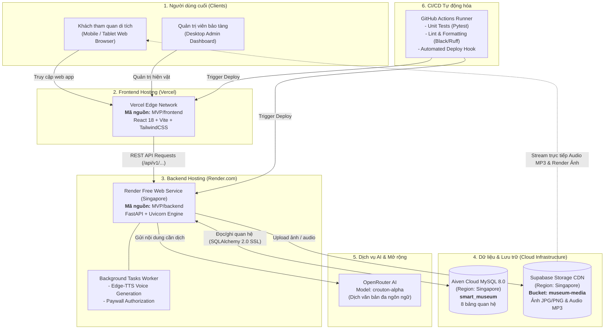

# BẢN ĐỒ KIẾN TRÚC TRIỂN KHAI CLOUD (DEPLOYMENT ARCHITECTURE MAPPING)
**Dự án:** Hệ thống thuyết minh đa ngôn ngữ tự động - Di tích Lịch sử Địa đạo Củ Chi  
**Mục tiêu:** Vận hành 100% miễn phí (Zero-Cost), độ trễ thấp tại Việt Nam (Singapore Region), lưu trữ dữ liệu vĩnh viễn và tích hợp tự động hóa CI/CD.

---

## 1. SƠ ĐỒ KIẾN TRÚC TỔNG THỂ (SYSTEM ARCHITECTURE)



---

## 2. BẢNG CHI TIẾT TỪNG THÀNH PHẦN

| Thành phần trong `MVP` | Thư mục mã nguồn | Nền tảng Deploy | Loại dịch vụ (Service Type) | Vùng máy chủ (Region) | Gói cước | Nhiệm vụ chính trong hệ thống |
| :--- | :--- | :--- | :--- | :--- | :--- | :--- |
| **Frontend Web App** | `MVP/frontend/` | **Vercel** | Web SPA (Edge Static & Routing) | Toàn cầu (Edge Network) | **Hobby (Free)** | Phục vụ giao diện khách tham quan (Bản đồ số Leaflet, phát audio thuyết minh) và Admin Dashboard. |
| **Backend API Engine** | `MVP/backend/` | **Render.com** | Web Service (Python 3.10 Runtime) | **Singapore (`ap-southeast-1`)** | **Free Web Service** | Đầu não trung tâm: Xử lý nghiệp vụ, xác thực JWT, tính toán toạ độ GPS, điều phối TTS và thanh toán. |
| **Cơ sở dữ liệu (Database)** | N/A *(Schema quản lý qua SQLAlchemy)* | **Aiven Cloud** | Managed MySQL Database 8.0 | **Singapore (`ap-southeast-1`)** | **Free Tier** | Lưu trữ 8 bảng quan hệ: `POI`, `POITranslation`, `POIAudio`, `VisitorSession`, `Transaction`, `User`, `LanguageCode`, `AuditLog`. |
| **Kho file tĩnh (Media Storage)** | `app/integrations/storage_client.py` | **Supabase** | Cloud Object Storage (S3-compatible) | **Singapore (`ap-southeast-1`)** | **Free Tier (1GB Storage)** | Lưu trữ vĩnh viễn file MP3 thuyết minh và file ảnh hiện vật. Phục vụ trực tiếp cho người dùng qua CDN. |
| **Máy dịch thuật AI (Translation)** | `app/integrations/deep_translator_client.py` | **OpenRouter** | Cloud AI LLM API | Cloud | **Free / Pay-per-use** | Dịch tự động tiêu đề và mô tả di tích sang tiếng Anh, Nhật, Hàn, Trung bằng mô hình `crouton-alpha`. |
| **Quy trình CI/CD** | `.github/workflows/ci.yml` | **GitHub Actions** | Automated Workflow Runner | Ubuntu Runner | **Free (2,000 phút/tháng)** | Tự động chạy test, quét bảo mật AST 3 tầng, kiểm tra format code và kích hoạt deploy khi có commit mới. |

---

## 3. LUỒNG DỮ LIỆU THỰC TẾ (DATA FLOWS)

### Luồng 1: Khách tham quan quét mã QR hoặc nghe thuyết minh
1. Trình duyệt của khách mở `https://<ten-mien-vercel>.vercel.app` (tải trang gần như tức thì từ Vercel CDN).
2. Khi khách đến gần điểm di tích hoặc bấm nghe thuyết minh:
   * Frontend gửi request tới Backend trên Render: `GET /api/v1/audio/{poi_id}?token=...`.
   * Render kiểm tra phiên tham quan 24 giờ hợp lệ (Paywall Security).
   * Render trả về mã chuyển hướng **HTTP 307 Temporary Redirect** trỏ thẳng đến Supabase CDN URL (`https://vnzojzglicrwmannlrwz.supabase.co/storage/v1/object/public/museum-media/audio/...`).
   * Trình duyệt phát trực tiếp âm thanh từ Supabase CDN, giải phóng băng thông cho server Render.

### Luồng 2: Quản trị viên tải ảnh hiện vật mới
1. Admin đăng nhập vào trang quản trị trên Vercel.
2. Admin chọn file ảnh JPG/PNG và bấm Tải lên:
   * Frontend gửi file qua `POST /api/v1/admin/poi/upload-image` tới Render.
   * Render sử dụng [`StorageClient`](file:///c:/Users/ASUS/OneDrive/Desktop/Software-Technology/MVP/backend/app/integrations/storage_client.py) gửi trực tiếp binary lên bucket `museum-media` của Supabase.
   * Supabase trả về CDN URL công khai.
   * Render lưu CDN URL này vào cột `image_url` của bảng `POI` trên Aiven MySQL.

### Luồng 3: Tạo mới điểm di tích & Tự động dịch thuật
1. Admin tạo POI mới với nội dung tiếng Việt.
2. Render lưu POI vào Aiven MySQL, đồng thời gửi Background Task:
   * Gọi OpenRouter API dịch nội dung sang 4 ngôn ngữ (en, ja, ko, zh).
   * Kích hoạt Edge-TTS tạo ra các file âm thanh MP3 tương ứng.
   * [`StorageClient`](file:///c:/Users/ASUS/OneDrive/Desktop/Software-Technology/MVP/backend/app/integrations/storage_client.py) upload các file MP3 này lên Supabase Storage.
   * Cập nhật trạng thái `READY` và lưu link audio vào Aiven MySQL.

---

## 4. BẢNG BIẾN MÔI TRƯỜNG CẦN CẤU HÌNH THEO TỪNG NƠI

### A. Cấu hình trên Render.com (Backend Web Service)
```env
# 1. Kết nối cơ sở dữ liệu Aiven Cloud MySQL
DATABASE_URL=mysql+pymysql://avnadmin:<AIVEN_PASSWORD>@mysql-218752f0-self-hosting.f.aivencloud.com:21340/smart_museum?charset=utf8mb4

# 2. Bảo mật Token & Phiên làm việc
JWT_SECRET_KEY=cb9a3a29c918ec28129e68d3c5cb1112b1163b7c10100f6445ca6c829e2c6fbf
ENVIRONMENT=production

# 3. Supabase Cloud Storage (Lưu trữ ảnh và file audio)
SUPABASE_URL=https://vnzojzglicrwmannlrwz.supabase.co
SUPABASE_KEY=<SUPABASE_SECRET_KEY>
SUPABASE_BUCKET_NAME=museum-media

# 4. OpenRouter AI Translation
OPENROUTER_API_KEY=<OPENROUTER_API_KEY>
OPENROUTER_MODEL=stealth/crouton-alpha
OPENROUTER_BASE_URL=https://openrouter.ai/api/v1
TRANSLATION_PROVIDERS_ORDER=openrouter,offline,google_cloud,gemini,deep_translator

# 5. Thanh toán trực tuyến
PAYOS_CHECKSUM_KEY=dev_payos_checksum_key_cuchi_demo
```

### B. Cấu hình trên Vercel (Frontend Project)
```env
# Trỏ toàn bộ lời gọi API về backend trên Render
VITE_API_BASE_URL=https://smart-museum-backend.onrender.com
```

---

## 5. TỔNG KẾT TRẢ LỜI NHANH
* **Frontend đang ở đâu?** $\rightarrow$ **Vercel** (`MVP/frontend`).
* **Backend đang ở đâu?** $\rightarrow$ **Render.com** (`MVP/backend`).
* **Database đang ở đâu?** $\rightarrow$ **Aiven Cloud** (MySQL).
* **Ảnh và file MP3 đang ở đâu?** $\rightarrow$ **Supabase Storage** (Bucket `museum-media`).
