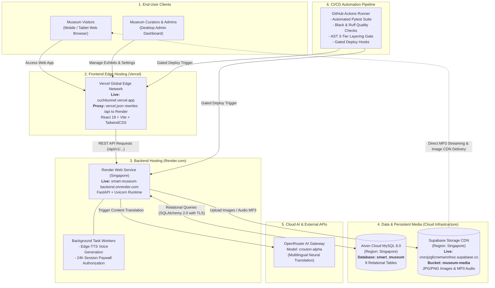

# CLOUD DEPLOYMENT ARCHITECTURE & INFRASTRUCTURE MAPPING
**Project:** Smart Multilingual Automated Audio Guide - Cu Chi Tunnels Historical Relic  
**Objective:** 100% Zero-Cost Hosting, Low-Latency Delivery in Vietnam (Singapore Region), Persistent Media Storage, and Automated Gated CI/CD.

---

## 1. HIGH-LEVEL SYSTEM ARCHITECTURE



---

## 2. INFRASTRUCTURE & SUBSYSTEM BREAKDOWN

| Subsystem / Directory | Source Code Path | Cloud Provider | Service Type | Host Region | Pricing Tier | Core Operational Responsibility |
| :--- | :--- | :--- | :--- | :--- | :--- | :--- |
| **Frontend Web App** | `MVP/frontend/` | **Vercel** | Web SPA + Reverse Proxy | Global Edge Network | **Hobby (Free)** | **Live:** `https://cuchitunnel.vercel.app`. Delivers visitor app, Leaflet map, audio player, and Admin Portal with edge rewrites to Render. |
| **Backend API Engine** | `MVP/backend/` | **Render.com** | Web Service (Python 3.10) | **Singapore (`ap-southeast-1`)** | **Free Web Service** | **Live:** `https://smart-museum-backend.onrender.com`. Central API: JWT auth, GPS checks, Edge-TTS, and payments. |
| **Relational Database** | Managed via SQLAlchemy ORM | **Aiven Cloud** | Managed MySQL Database 8.0 | **Singapore (`ap-southeast-1`)** | **Free Tier** | Stores 8 structured relational tables: `POI`, `POITranslation`, `POIAudio`, `VisitorSession`, `Transaction`, `User`, `LanguageCode`, and `AuditLog`. |
| **Media Object Storage** | `app/integrations/storage_client.py` | **Supabase** | Cloud Object Storage (S3-compatible) | **Singapore (`ap-southeast-1`)** | **Free Tier (1GB Storage)** | Permanently stores synthesized Edge-TTS MP3 audio narrations and exhibit cover images. Serves files directly via public CDN URLs. |
| **AI Translation Gateway** | `app/integrations/deep_translator_client.py` | **OpenRouter** | Cloud AI LLM API | Global Cloud | **Free / Pay-per-use** | Translates Vietnamese exhibit narratives into English, Japanese, Korean, and Chinese using the `crouton-alpha` neural model. |
| **CI / CD Pipeline** | `.github/workflows/ci.yml` | **GitHub Actions** | Automated Workflow Runner | Ubuntu Runner | **Free (2,000 min/mo)** | Enforces code formatting (Black), linting (Ruff), AST 3-tier architectural layering, test execution (Pytest), and deployment triggers. |

---

## 3. REAL-WORLD DATA & RUNTIME FLOWS

### Flow 1: Visitor Streams Exhibit Audio Narration
1. Visitor loads the web application from `https://<project-id>.vercel.app` (served near-instantaneously from Vercel's global CDN).
2. Upon approaching a Point of Interest (POI) or pressing the Play button:
   * Frontend sends an authorized request to Render: `GET /api/v1/audio/{poi_id}?token=...`.
   * Render verifies the active 24-hour visitor session pass (Paywall enforcement).
   * Render issues an **HTTP 307 Temporary Redirect** pointing directly to the Supabase CDN URL (`https://vnzojzglicrwmannlrwz.supabase.co/storage/v1/object/public/museum-media/audio/...`).
   * The client's HTML5 audio player directly streams the MP3 from Supabase CDN with byte-range support, offloading heavy media streaming from the backend container.

### Flow 2: Administrator Uploads Exhibit Cover Image
1. Museum administrator logs in to the Admin Dashboard on Vercel.
2. Admin uploads a JPEG/PNG/WebP image file:
   * Frontend posts binary file to Render: `POST /api/v1/admin/poi/upload-image`.
   * Render validates file size (< 5MB) and MIME type.
   * [`StorageClient`](file:///c:/Users/ASUS/OneDrive/Desktop/Software-Technology/MVP/backend/app/integrations/storage_client.py) streams the image binary to Supabase Storage bucket `museum-media/images/`.
   * Supabase returns the persistent CDN URL.
   * Render persists the CDN URL in the `image_url` field of the `POI` table in Aiven MySQL.

### Flow 3: Creating an Exhibit with Automated Translation & Voice Synthesis
1. Admin creates a new POI with primary Vietnamese narrative content.
2. Render commits the POI record to Aiven MySQL and schedules an asynchronous `BackgroundTask`:
   * Calls OpenRouter API to translate title and description into target languages (`en`, `ja`, `ko`, `zh`).
   * Invokes Edge-TTS neural engine to synthesize MP3 voice narrations with voice personas.
   * [`StorageClient`](file:///c:/Users/ASUS/OneDrive/Desktop/Software-Technology/MVP/backend/app/integrations/storage_client.py) uploads generated MP3 files to Supabase Storage (`audio/audio_{hash}.mp3`).
   * Updates translation records to `READY` status and writes CDN URLs to Aiven MySQL.

---
## 4. ENVIRONMENT VARIABLES MAPPING BY HOST

### A. Render.com Web Service (`MVP/backend`)
```env
# 1. Aiven Cloud MySQL Relational Database (SSL Enabled)
DATABASE_URL=mysql+pymysql://avnadmin:<AIVEN_PASSWORD>@mysql-218752f0-self-hosting.f.aivencloud.com:21340/smart_museum?charset=utf8mb4

# 2. Security & Session Lifecycle
JWT_SECRET_KEY=<64_HEX_CHARACTERS_JWT_SECRET>
ENVIRONMENT=production

# 3. Supabase Cloud Storage (Persistent Media CDN)
SUPABASE_URL=https://vnzojzglicrwmannlrwz.supabase.co
SUPABASE_KEY=<SUPABASE_SECRET_KEY>
SUPABASE_BUCKET_NAME=museum-media

# 4. OpenRouter AI Translation (Model: Crouton Alpha)
OPENROUTER_API_KEY=<OPENROUTER_API_KEY>
OPENROUTER_MODEL=stealth/crouton-alpha
OPENROUTER_BASE_URL=https://openrouter.ai/api/v1
TRANSLATION_PROVIDERS_ORDER=openrouter,offline,google_cloud,gemini,deep_translator

# 5. Payment Gateway Configuration
PAYOS_CHECKSUM_KEY=<PAYOS_CHECKSUM_KEY>
CORS_ORIGINS=https://cuchitunnel.vercel.app,http://localhost:5173
```

### B. Vercel Hosting (`MVP/frontend`)
```env
# Base URL pointing to the deployed Render backend API
VITE_API_BASE_URL=https://smart-museum-backend.onrender.com
```
---

## 5. QUICK ARCHITECTURE REFERENCE
* **Frontend Live URL:** [https://cuchitunnel.vercel.app](https://cuchitunnel.vercel.app) *(Vercel Edge SPA)*
* **Backend Live URL:** [https://smart-museum-backend.onrender.com](https://smart-museum-backend.onrender.com) *(Render Web Service)*
* **Backend API Docs:** [https://smart-museum-backend.onrender.com/docs](https://smart-museum-backend.onrender.com/docs) *(Swagger UI)*
* **Database Host:** Aiven Cloud MySQL 8.0 (Singapore `ap-southeast-1`, TLS Encrypted)
* **Media Storage CDN:** Supabase Storage (Bucket `museum-media`, Singapore `ap-southeast-1`)
* **AI Neural Translation:** OpenRouter API (`stealth/crouton-alpha`)