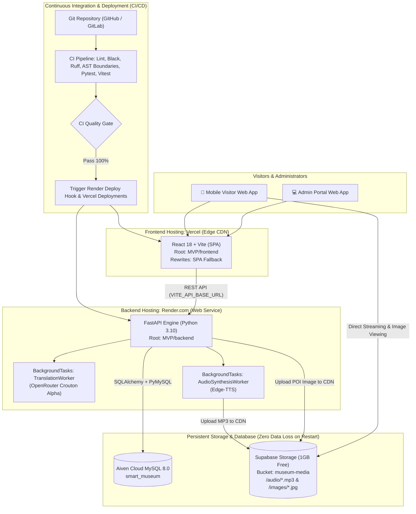

# HYBRID CLOUD & CI/CD DEPLOYMENT EXECUTION PLAN
### Project: Smart Multilingual Audio Guide & Interactive Map — Cu Chi Tunnels Historical Relic Site
*Architecture: Frontend (Vercel) + Backend (Render) + Persistent Storage (Supabase) + Database (Aiven MySQL) + CI/CD (GitHub Actions / GitLab CI)*

---

## 1. ARCHITECTURE OVERVIEW

The system follows a **100% Free Tier Hybrid Cloud Architecture**, enforcing strict Separation of Concerns (SoC) to eliminate the ephemeral filesystem limitation of free-tier cloud PaaS platforms without introducing monthly hosting costs:



---

## 2. SERVICE & RESOURCE ALLOCATION MATRIX (FREE TIER COMPLIANCE)

| Subsystem | Platform | Service Tier | Financial Cost | Operational Constraints |
| :--- | :--- | :--- | :--- | :--- |
| **Frontend Web** | **Vercel** | Hobby Free | **$0** (Lifetime) | Vite React compilation, SPA routing fallback. |
| **Backend API** | **Render.com** | Free Web Service | **$0** (Lifetime) | 512MB RAM, FastAPI ASGI, sleeps after 15m idle. |
| **Database** | **Aiven Cloud** | Free Tier | **$0** (Pre-configured) | MySQL 8.0, SSL `TLS_AES_256_GCM_SHA384`, DB `smart_museum`. |
| **File Storage** | **Supabase** | Free Tier | **$0** (1GB Storage) | Persistent storage for narration MP3s and exhibit images. |
| **AI Translation** | **OpenRouter** | Pay-as-you-go | Nominal (~$0.001/req) | AI Model `stealth/crouton-alpha`. |
| **CI/CD Pipeline** | **GitHub / GitLab** | Free Tier | **$0** | Automated linting, test suites, and gated deployment hooks. |

---

## 3. ACTIONABLE TASK BREAKDOWN

### 📊 Deployment Progress Status (Updated November 2026)
| Deployment Phase | Target Platform | Status | Live Endpoint / Artifact |
| :--- | :--- | :---: | :--- |
| **Phase 1: Cloud Object Storage Setup** | **Supabase** | ✅ **COMPLETED** | `https://vnzojzglicrwmannlrwz.supabase.co` (`museum-media`) |
| **Phase 2: Storage Adapter in Codebase** | **FastAPI Backend** | ✅ **COMPLETED** | `MVP/backend/app/integrations/storage_client.py` (Dual-mode CDN) |
| **Phase 3: Deploy Backend Web Service** | **Render.com** | ✅ **COMPLETED** | `https://smart-museum-backend.onrender.com` |
| **Phase 4: Deploy Frontend Edge SPA** | **Vercel** | ✅ **COMPLETED** | `https://cuchitunnel.vercel.app` (Edge Reverse Proxy) |
| **Phase 5: Automated CI/CD Deploy Hooks** | **GitHub Actions** | ⏳ **PENDING** | Render Deploy Hook trigger upon passing CI gate |
| **Phase 6: E2E Acceptance & Integrity Testing** | **Live Production** | ⏳ **PENDING** | Mobile testing, media streaming, restart persistence |

---

### PHASE 1: Initialize Cloud Object Storage (Supabase Storage)
> **Objective:** Establish persistent cloud media storage for synthesized MP3 audio narrations and exhibit images, eliminating local disk dependency on Render.

- [x] **TASK-01.1:** Sign up / Log in to [Supabase](https://supabase.com) using GitHub account credentials (no credit card required).
- [x] **TASK-01.2:** Create a new project (Name: `cuchi-tunnels-media`, Region: **Singapore (`ap-southeast-1`)** for minimal latency to Vietnam).
- [x] **TASK-01.3:** Navigate to **Storage** $\rightarrow$ Create a new bucket named `museum-media`.
  - Enable **Public bucket** access (enables visitors to stream MP3 audio and render images directly via public CDN URLs).
- [x] **TASK-01.4:** Retrieve API credentials from **Project Settings** $\rightarrow$ **API**:
  - `SUPABASE_URL` (e.g. `https://vnzojzglicrwmannlrwz.supabase.co`).
  - `SUPABASE_SERVICE_ROLE_KEY` / `SUPABASE_ANON_KEY` (write access token for file uploads).

---

### PHASE 2: Implement Storage Adapter in Backend Codebase
> **Objective:** Enable dual-mode media storage supporting both Cloud CDN uploads in production and local filesystem storage during offline development.

- [x] **TASK-02.1: Update Backend Environment Configuration**
  - Files: `MVP/backend/app/core/config.py` and `MVP/backend/.env.example`.
  - Add configuration settings:
    ```python
    SUPABASE_URL: str = ""
    SUPABASE_KEY: str = ""
    SUPABASE_BUCKET_NAME: str = "museum-media"
    ```
- [x] **TASK-02.2: Construct Lightweight Storage Client Integration**
  - File: `MVP/backend/app/integrations/storage_client.py`.
  - Leverage native async `httpx` client (zero heavy SDK dependencies, preserving lean architecture):
    - `upload_file(relative_path: str, content: bytes, content_type: str) -> str`
    - Return public CDN URL: `https://<id>.supabase.co/storage/v1/object/public/museum-media/<relative_path>`.
    - Automatically fall back to local disk (`/static/...`) if `SUPABASE_URL` is unconfigured.
- [x] **TASK-02.3: Integrate Storage Client with AudioSynthesisWorker**
  - File: `MVP/backend/app/services/audio_synthesis_worker.py`.
  - Upon Edge-TTS MP3 generation, upload binary buffer to Supabase Storage and persist the CDN URL in `POIAudio.audio_url`.
- [x] **TASK-02.4: Integrate Storage Client with POIService (Cover Image Uploads)**
  - File: `MVP/backend/app/services/poi_service.py`.
  - Stream uploaded cover images to Supabase Storage CDN rather than storing exclusively on local disk.
- [x] **TASK-02.5: Author Unit Tests for Storage Client**
  - File: `MVP/backend/tests/unit/integrations/test_storage_client.py`.
  - Verify 100% test coverage for successful cloud uploads, error fallback, and local fallback paths.

---

### PHASE 3: Deploy Backend to Render.com (Web Service)
> **Objective:** Host the FastAPI backend engine and background task workers on a 24/7 cloud runtime.

- [x] **TASK-03.1:** Log in to [Render.com](https://dashboard.render.com) using GitHub/GitLab.
- [x] **TASK-03.2:** Click **New +** $\rightarrow$ **Web Service** $\rightarrow$ Connect repository `Software-Technology`.
- [x] **TASK-03.3:** Configure Web Service deployment parameters:
  - **Name:** `smart-museum-backend`
  - **Region:** `Singapore (Southeast Asia)`
  - **Branch:** `main` (or designated release branch)
  - **Root Directory:** `MVP/backend`
  - **Runtime:** `Python 3`
  - **Build Command:** `pip install -r requirements.txt`
  - **Start Command:** `uvicorn app.main:app --host 0.0.0.0 --port $PORT`
  - **Plan Type:** `Free`
- [x] **TASK-03.4:** Configure Render Environment Variables:
  - `DATABASE_URL`: `mysql+pymysql://avnadmin:<AIVEN_PASSWORD>@mysql-218752f0-self-hosting.f.aivencloud.com:21340/smart_museum?charset=utf8mb4`
  - `JWT_SECRET_KEY`: `<64_HEX_CHARACTERS_JWT_SECRET>`
  - `OPENROUTER_API_KEY`: `<YOUR_OPENROUTER_API_KEY>`
  - `OPENROUTER_MODEL`: `stealth/crouton-alpha`
  - `OPENROUTER_BASE_URL`: `https://openrouter.ai/api/v1`
  - `TRANSLATION_PROVIDERS_ORDER`: `openrouter,offline,google_cloud,gemini,deep_translator`
  - `SUPABASE_URL`: Supabase project URL from Phase 1
  - `SUPABASE_KEY`: Supabase API key from Phase 1
  - `SUPABASE_BUCKET_NAME`: `museum-media`
  - `CORS_ORIGINS`: `http://localhost:5173` *(to be updated with Vercel domain in Phase 4)*
- [x] **TASK-03.5:** Initiate deployment and monitor build logs.
- [x] **TASK-03.6:** Record **Backend Public URL** (e.g. `https://smart-museum-backend.onrender.com`) and **Deploy Hook URL** (located in Settings $\rightarrow$ Deploy Hook).

---

### PHASE 4: Deploy Frontend to Vercel (Edge SPA)
> **Objective:** Deliver the visitor web app and admin portal across Vercel global edge CDN, optimized for low-latency mobile device access.

- [x] **TASK-04.1:** Log in to [Vercel.com](https://vercel.com) $\rightarrow$ Click **Add New Project** $\rightarrow$ Import repository `Software-Technology`.
- [x] **TASK-04.2:** Configure Project Settings:
  - **Framework Preset:** `Vite`
  - **Root Directory:** Edit $\rightarrow$ select `MVP/frontend`
  - **Build Command:** `npm run build`
  - **Output Directory:** `dist`
- [x] **TASK-04.3:** Set Environment Variables on Vercel:
  - `VITE_API_BASE_URL` = Render backend URL (e.g. `https://smart-museum-backend.onrender.com`).
- [x] **TASK-04.4:** Deploy and acquire Vercel Production Domain (e.g. `https://smart-museum-frontend.vercel.app`).
- [x] **TASK-04.5: Update Backend CORS Origins**
  - Navigate to Render $\rightarrow$ `smart-museum-backend` $\rightarrow$ **Environment**.
  - Update `CORS_ORIGINS` = `cuchitunnel.vercel.app`.

---

### PHASE 5: Establish Automated CI/CD Pipelines (GitHub Actions & GitLab CI)
> **Objective:** Guarantee automated deployment only occurs when all code quality checks, architecture gates, and test suites pass 100%.

- [ ] **TASK-05.1: Configure Repository Secrets**
  - Repository $\rightarrow$ **Settings** $\rightarrow$ **Secrets and variables** $\rightarrow$ **Actions**.
  - Add Secret: `RENDER_DEPLOY_HOOK_URL` = Render Deploy Hook URL from Task 03.6.
- [ ] **TASK-05.2: Append Gated Deployment Job to GitHub Actions**
  - File: `.github/workflows/ci.yml`.
  - Add deployment job triggered upon successful completion of `ci-gate` on the `main` branch:
    ```yaml
      deploy-production:
        name: Trigger Production Deploy (Render)
        needs: [ci-gate]
        if: github.ref == 'refs/heads/main' && github.event_name == 'push'
        runs-on: ubuntu-latest
        steps:
          - name: Execute Render Deploy Webhook
            run: curl -s -X POST "${{ secrets.RENDER_DEPLOY_HOOK_URL }}"
    ```
- [ ] **TASK-05.3: Provide Equivalent GitLab CI Configuration Template**
  - File: `.gitlab-ci.yml` (root directory).
  - Define stages: `quality_check` $\rightarrow$ `backend_test` $\rightarrow$ `frontend_test` $\rightarrow$ `auto_deploy`.
- [ ] **TASK-05.4: Validate Automated Pipeline Execution**
  - Submit feature branch pull request.
  - Verify automated CI testing $\rightarrow$ Merge to `main` $\rightarrow$ Confirm automated deployment to Vercel and Render.

---

### PHASE 6: End-to-End Verification & Integrity Testing
> **Objective:** Validate real-world functionality on mobile networks and confirm media data immutability.

- [ ] **TASK-06.1:** Access the production Vercel application on a mobile device over cellular 4G/5G; confirm map loading and geolocation permissions.
- [ ] **TASK-06.2: Validate POI Creation & Media Upload Pipeline**
  - Create a new historical POI from the Admin Portal and upload a cover photo.
  - Confirm the image renders with a public Supabase Storage CDN URL.
- [ ] **TASK-06.3: Validate AI Translation & Neural Audio Generation**
  - Confirm `TranslationWorker` translates the exhibit into 5 foreign languages via `stealth/crouton-alpha`.
  - Confirm `AudioSynthesisWorker` synthesizes Edge-TTS audio and saves CDN URLs in `POIAudio`.
- [ ] **TASK-06.4: Validate Audio Playback on Visitor Web App**
  - Switch language to English, Japanese, and Korean; trigger narration playback.
  - Confirm audio streams reliably from Supabase Storage CDN.
- [ ] **TASK-06.5: Verify Data Persistence Across Service Restarts**
  - Trigger manual service restart or redeploy on Render.
  - Reload visitor tour view and replay audio: **Confirm 100% of audio and image assets remain available with zero data loss**.

---

## 4. DEFINITION OF DONE (DOD)

1. ✅ Frontend deployed on Vercel Edge CDN with sub-$1.5\text{s}$ mobile load time over cellular connections.
2. ✅ Backend deployed on Render Web Service, securely connected to Aiven Cloud MySQL 8.0 over TLS.
3. ✅ Narration audio files and exhibit photos persistently hosted on Supabase Storage CDN; zero data loss on restart.
4. ✅ OpenRouter AI translation (`Crouton Alpha`) and Edge-TTS audio synthesis workers execute without timeouts.
5. ✅ CI/CD pipeline enforces automated quality gates and executes zero-touch deployments upon verified git pushes.
